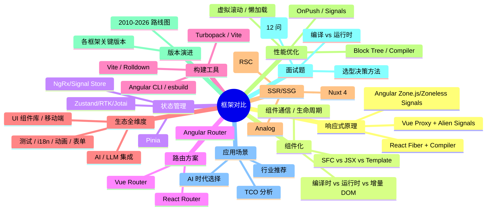
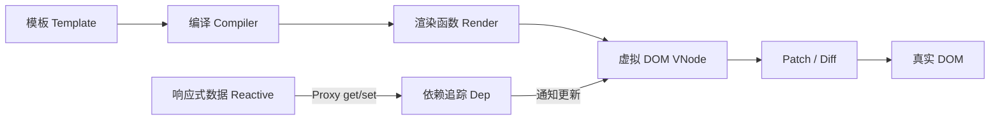
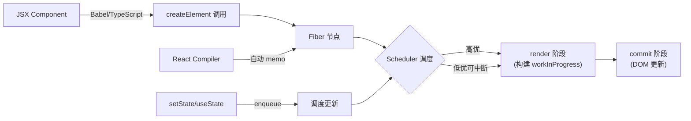
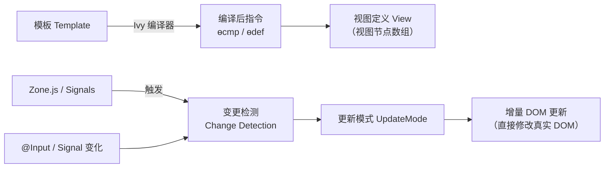
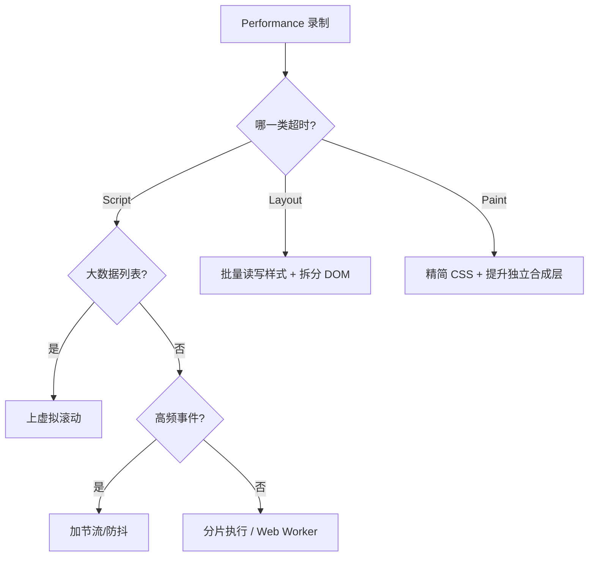
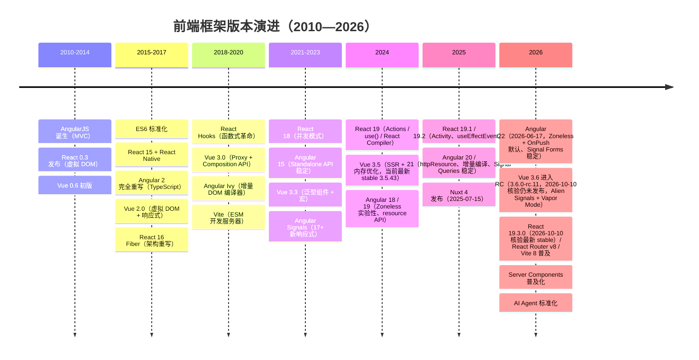
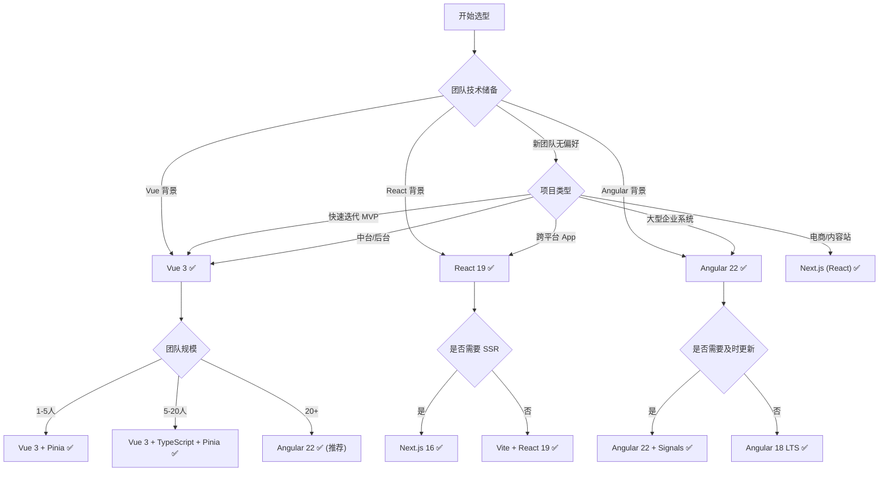
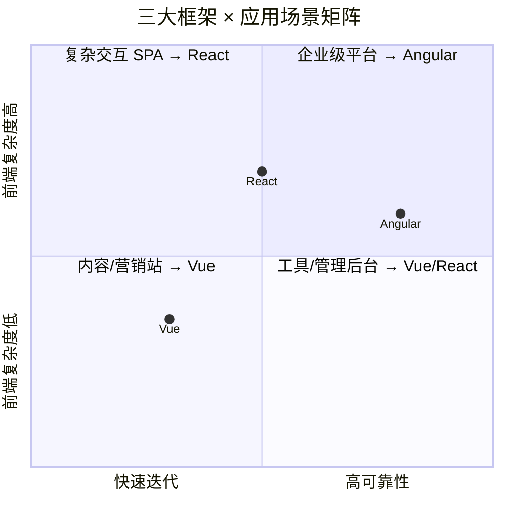


# 篇四 · 04 ⚔️ 三大前端框架深度对比：Vue 3 vs React 19 vs Angular 22

> **面试权重**：★★★★★（大厂必问选型题，答好即加分项） ｜ **建议用时**：2 天 ｜ **前置**：先读完 01/02/03 至少一篇，否则对比会停留在表面
>
> **本篇定位**：S2 的「收口篇」。把三大框架放在同一张表、同一组问题下横向对比，并给出**可复述的选型答题框架**与**跨框架迁移的心智差异**。面试里「你为什么选 X 而不是 Y」这类题，答案基本都在本篇。（本篇已并入原「篇七 · 框架设计思想」，设计取舍与演进趋势见第十七/十八节）
>
> 大厂必问框架选型题，掌握深度对比 = 面试加分项
>
> 📌 **版本现状（2026-10-10 联网核验）**：Vue **3.5.43**（stable，3.6 仍为 RC `3.6.0-rc.11`）；React **19.3.0**（本仓库 `^19.2.7`）；Angular **22.2.2**（21.x LTS `21.2.25`）。文中默认 Angular 走 Zoneless + Signals + `inject()` 函数式 DI；旧版 API（`@Input`/`@Output` 装饰器、Zone.js 检测、NgModule）标注为兼容但不再推荐。生态版本：Vite **8.3.4**、Nuxt **4.6.1**、Pinia **4.0.3**、react-router **8.4.0**、Next.js **16.4.0**、RxJS **7.8.2**、Vitest **5.0.3**（仓库用 4.x）。

## 🧭 核心考点

| 对比维度 | 关键结论（面试可直接复述） | 权重 |
|----------|--------------------------|------|
| 核心哲学 | Vue 渐进式 + 编译优化；React 不可变数据 + 调度；Angular 平台化 + 强约束 | 🔥🔥🔥 |
| 响应式模型 | 属性级自动追踪 / 组件级重渲染 + 并发调度 / 信号通知 + Zoneless | 🔥🔥🔥 |
| 组件与模板 | SFC 模板 vs JSX vs 增量 DOM 模板 | 🔥🔥 |
| 状态与路由 | Pinia / Zustand-RTK-Jotai / NgRx-SignalStore；路由心智差异 | 🔥🔥 |
| 构建与 SSR | Vite-Rolldown / Turbopack / esbuild；Nuxt 4 vs Next.js 16 vs Analog | 🔥🔥 |
| 性能与优化入口 | 减少渲染量 vs 减少渲染次数 vs 减少检测范围 | 🔥🔥 |
| 选型与迁移 | 决策树 + TCO + 团队适配；Vue↔React↔Angular 迁移心智差异 | 🔥🔥🔥 |

---

## 📌 知识脑图



---

## 一、核心哲学差异

### 1.1 设计哲学总览

| 维度 | Vue 3 | React 19 | Angular 22 |
|------|-------|----------|------------|
| **设计哲学** | 渐进式、渐进增强 | 纯 UI 库、一切皆 JS | 全栈框架、开箱即用 |
| **编程范式** | 声明式 + 响应式 | 声明式 + 函数式 | 声明式 + 面向对象 |
| **模板方式** | SFC（单文件组件） | JSX（JS 语法扩展） | Template + Decorator |
| **数据流** | 双向绑定（v-model） | 单向数据流 | 双向绑定（[(ngModel)]） |
| **变更检测** | Proxy 代理 + 自动追踪 | Fiber + 手动触发 setState | Signals（默认）+ Zoneless，Zone.js 可选 |
| **编译优化** | 编译时标记 + Block Tree | 运行时调度 + React Compiler（自动 memo） | 编译时 Ivy + 增量 DOM |
| **包体积** | ~33KB（gzip） | ~42KB（gzip React+DOM） | ~90-110KB（gzip，Zoneless 去 Zone.js 后） |
| **渲染方式** | 虚拟 DOM + 编译优化 | 虚拟 DOM + Fiber | 增量 DOM（直接操作真实 DOM） |
| **适用场景** | 中小型快速迭代、中台系统 | 大型 SPA、跨平台（RN） | 企业级、大型团队、复杂业务 |

### 1.2 设计哲学详解

**Vue：渐进式框架**
- 从 CDN 引入到完整 CLI 项目，按需使用
- 学习成本线性增长：模板 → 组件 → 路由 → 状态管理
- 设计目标：**让开发者少做决定**

**React：纯 UI 库**
- 只关心 View 层，路由/状态管理/构建需自行搭配
- 函数式编程 + 不可变数据
- 设计目标：**可预测的状态容器**

**Angular：全栈平台**
- 内置路由、HTTP、表单、动画、测试、构建
- 强约束、统一规范
- 设计目标：**企业级开发标准**

### 1.3 设计哲学公式

每个框架都有一套核心设计公式，决定了其 API 风格和开发体验：

```
Vue 3         = 响应式代理 + 模板编译 + 渐进增强
                 ↑ Proxy/Ref     ↑ SFC/PatchFlag    ↑ 按需集成

React 19      = 纯函数 + 不可变数据 + 调度器
                 ↑ Component     ↑ useState/Immer   ↑ Fiber/Scheduler

Angular 22    = DI 容器（inject） + Signals + 编译变换
                 ↑ 函数式 DI     ↑ 响应式原语    ↑ Ivy/Incremental DOM
```

**设计选择带来的实际影响：**

| 设计决策 | Vue 结果 | React 结果 | Angular 结果 |
|---------|---------|-----------|------------|
| **响应式实现** | 自动追踪 → 少写代码 | 手动触发 → 可预测 | Zone/Signals → 平衡 |
| **模板方案** | SFC → 模板与逻辑分离 | JSX → 逻辑即模板 | 装饰器 → 结构与元数据分离 |
| **范式强制** | 多范式兼容 | 函数式强制 | OOP + 函数式（Signals/inject()） |
| **API 稳定性** | 小版本兼容好 | 大版本破坏性变更多 | 每半年一次主版本（语义化，破坏性变更少） |
| **框架边界** | 前端为主 | 跨平台（RN/R3F） | 全栈（前端+CLI+构建） |

---

## 二、响应式原理深度对比

### 2.1 Vue 3 — Proxy 代理

```javascript
// Vue 3 响应式核心
const state = reactive({ count: 0 })
// 内部使用 Proxy 拦截 get/set
// get: 收集依赖（track）
// set: 触发更新（trigger）

// Vue 3.6 Alien Signals
const count = ref(0)
computed(() => count.value * 2)  // 精确依赖追踪
```

**特点：**
- Proxy 直接代理整个对象，无需递归遍历
- 自动追踪依赖，开发者无感
- 编译时标记静态节点，减少虚拟 DOM 对比
- Vue 3.6 引入 Alien Signals，性能接近 Solid.js

### 2.2 React 19 — Fiber + 调度

```javascript
// React 状态更新
const [count, setCount] = useState(0)
// setCount 触发重新渲染
// React 构建新的 Fiber 树，与旧树 Diff

// React 19 + React Compiler
// 自动 memo，无需手动 useMemo/useCallback
```

**特点：**
- 显式调用 setState 触发更新
- Fiber 架构支持中断/恢复/优先级调度
- 不可变数据 + 浅比较
- React Compiler（原 React Forget）将自动记忆化

### 2.3 Angular — Signals（默认）+ Zoneless

```typescript
// ✅ Angular 22 Signals 模式（默认，Zoneless）
@Component({
  standalone: true,
  template: `<p>{{ count() }}</p><button (click)="increment()">+1</button>`
})
class AppComponent {
  count = signal(0)
  increment() { this.count.update(v => v + 1) }  // 精确更新，无需 Zone.js
}

// ⚠️ 旧 Zone.js 模式（Angular 22 中仍可用但非默认）
@Component({})
class OldAppComponent {
  count = 0
  increment() { this.count++ }  // Zone.js 拦截 click → 触发全量变更检测
}
```

**特点：**
- Angular 22 默认 Zoneless，Signals 为第一公民
- Signals 实现精确依赖追踪（17+ 引入，22 完全替代 Zone.js）
- Zone.js 仍可在 `angular.json` 中启用（`"polyfills": ["zone.js"]`）
- OnPush 策略在 Signals 下基本不需要

### 2.4 渲染管线深度对比

三大框架的渲染流程差异巨大，理解它们的渲染管线是掌握框架原理的关键。

**Vue 3 渲染管线：**



```
1. 编译阶段：模板 → 渲染函数（静态提升 + PatchFlag + Block Tree）
2. 首次渲染：渲染函数 → VNode Tree → 真实 DOM
3. 更新触发：ref.value = x → Proxy setter → 收集的 effect 重新执行
4. Patch 阶段：只对比动态节点（PatchFlag 标记），跳过静态子树
5. 差异最小化：精确到具体哪个属性变了（class? style? text?）
```

**React 19 渲染管线：**



```
1. 触发：setCount(n + 1) → 创建更新对象 → 入队
2. 调度：Scheduler 判断优先级 → 决定是否中断当前任务
3. Render 阶段：从 rootFiber 开始，遍历构建 workInProgress 树
   - 可中断：每次处理一个 fiber，检查是否有更高优任务
   - beginWork → completeWork → 继续下一个 sibling/return
4. Commit 阶段：一次性提交所有 DOM 变更（不可中断）
   - beforeMutation → mutation → layout
5. React Compiler（新）：编译时推断组件依赖，自动添加 memo
```

**Angular 22 渲染管线：**



```
Zone.js 模式：
1. 异步操作（click/setTimeout/fetch）→ Zone.js 拦截 → 触发 ngZone.onMicrotaskEmpty
2. 从根组件开始遍历 → 检查每个组件 @Input 是否变化
3. Default 策略：全部检查 / OnPush 策略：只有 @Input 新引用才检查
4. 更新 DOM（直接操作，无虚拟 DOM）

Signals/Zoneless 模式（Angular 17+）：
1. signal.set(value) → 通知所有依赖该 signal 的视图
2. 精确到具体哪个视图绑定了该 signal
3. 无需 Zone.js 拦截，无需全量遍历
4. 仅在涉及的组件上运行变更检测 → 更新 DOM
```

### 2.5 响应式对比总结

| 对比项 | Vue 3 | React 19 | Angular 22 |
|--------|-------|----------|------------|
| **触发方式** | 自动（Proxy） | 手动（setState） | 自动（Zone/Signals） |
| **调度能力** | 无 | Fiber 优先级调度 | 无 |
| **精确度** | 组件级（Alien Signals 变量级） | 组件级（整个子树） | 视图节点级（Signals 精确绑定） |
| **运行时开销** | 低 | 中 | 中 |
| **编译优化** | Block Tree | React Compiler | Ivy + AOT |
| **学习成本** | 低 | 中 | 中 |
| **渲染方式本质** | 虚拟 DOM + 编译优化跳过静态 | 虚拟 DOM + Diff + 调度 | 无虚拟 DOM，直接操作 |
| **更新粒度** | 组件级（自动追踪依赖，精确到字段） | 组件级（子树重新渲染） | 视图节点级（Signals 精确绑定） |
| **批处理机制** | 微任务异步批处理 | 同步 + 自动批处理（v18+） | Signal 精准更新 + 微任务批处理 |
| **内存模型** | reactive 长期存在 | Fiber 树持续 Diff | 视图定义数组固定 |


---

## 三、组件化方案对比

### 3.1 模板语法

```vue
<!-- Vue SFC -->
<template>
  <div class="card" @click="handleClick">
    <h2>{{ title }}</h2>
    <slot />
  </div>
</template>
```

```tsx
// React JSX
function Card({ title, children, onClick }: Props) {
  return (
    <div className="card" onClick={onClick}>
      <h2>{title}</h2>
      {children}
    </div>
  )
}
```

```typescript
// Angular Component
@Component({
  selector: 'app-card',
  template: `
    <div class="card" (click)="handleClick()">
      <h2>{{ title }}</h2>
      <ng-content></ng-content>
    </div>
  `
})
class CardComponent {
  @Input() title = ''
  @Output() click = new EventEmitter()
}
```

### 3.2 组件通信

| 方式 | Vue 3 | React 19 | Angular 22 |
|------|-------|----------|------------|
| **父→子** | `props` | `props` | `input()` / `@Input()` |
| **子→父** | `emit` | `callback prop` | `output()` / `@Output()` |
| **跨级** | `provide/inject` + `mitt` | `Context API` | `DI + @Host()` |
| **全局** | Pinia | Zustand/RTK | NgRx/Signals Store |
| **兄弟** | 提升状态 + emit | 提升状态 + callback | 父组件引用 |

### 3.3 信号化输入输出（2026 最新）

```typescript
// Vue 3.6 — defineModel / defineProps
const props = defineProps<{ title: string }>()
const emit = defineEmits<{ click: [id: number] }>()
const count = defineModel<number>('count') // 双向绑定 v-model

// React 19 — useActionState / React Aria
function Card({ title, onAction }: { title: string; onAction: (id: number) => void }) {
  const [state, formAction] = useActionState(updateAction, null)
}

// Angular 22 — signal input / output / model（推荐）
@Component({
  standalone: true,
  template: `<div (click)="click.emit(1)">{{ title() }}</div>`
})
class CardComponent {
  title = input('')                          // signal input（只读）
  click = output<number>()                   // signal output
  count = model(0)                           // 双向绑定 [(count)]
}

// ⚠️ 旧写法（@Input/@Output 装饰器，Angular 22 仍可用但不推荐）
@Component({
  template: `<div (click)="handleClick()">{{ title }}</div>`
})
class OldCardComponent {
  @Input() title = ''
  @Output() click = new EventEmitter()
}
```

### 3.4 控制流语法对比

```vue
<!-- Vue 3 — v-if / v-for 指令 -->
<div v-if="loading">加载中...</div>
<div v-else-if="error">出错了</div>
<div v-else>
  <li v-for="item in items" :key="item.id">{{ item.name }}</li>
</div>
```

```tsx
// React 19 — JS 表达式
{loading ? <div>加载中...</div> :
 error ? <div>出错了</div> :
 <ul>{items.map(item => <li key={item.id}>{item.name}</li>)}</ul>}
```

```html
<!-- Angular 22 — @if / @for 原生控制流 -->
@if (loading()) {
  <div>加载中...</div>
} @else if (error()) {
  <div>出错了</div>
} @else {
  <ul>
    @for (item of items(); track item.id) {
      <li>{{ item.name }}</li>
    }
  </ul>
}
```

| 能力 | Vue 指令 | React JS | Angular @语法 |
|------|---------|---------|-------------|
| **条件** | `v-if / v-else-if` | `三元 ? : / &&` | `@if / @else if` |
| **循环** | `v-for="item in items"` | `items.map()` | `@for (item of items)` |
| **key 绑定** | `:key="item.id"` | `key={item.id}` | `track item.id`（必须） |
| **switch** | 无指令 | `switch` 表达式 | `@switch / @case` |
| **延迟加载** | ``<Suspense>`` | ``<Suspense>`` | `@defer`（Angular 17+） |

### 3.5 生命周期对比

| 阶段 | Vue 3 | React 19 | Angular 22 |
|------|-------|----------|------------|
| **创建** | `setup()` | `useState` / 组件函数体 | `constructor` |
| **挂载** | `onMounted` | `useEffect(() => {}, [])` | `ngOnInit` |
| **更新** | `onUpdated` | `useEffect` | `ngOnChanges` |
| **销毁** | `onUnmounted` | `useEffect cleanup` | `ngOnDestroy` |
| **错误** | `onErrorCaptured` | `ErrorBoundary` | 全局 ErrorHandler |

### 3.6 条件渲染与 Suspense 延迟加载

```vue
<!-- Vue 3 — Suspense + defineAsyncComponent -->
<Suspense>
  <template #default>
    <AsyncComponent />   <!-- 自动等待异步 setup -->
  </template>
  <template #fallback>
    <Loading />
  </template>
</Suspense>
```

```tsx
// React 19 — Suspense + React.lazy
const AsyncComponent = React.lazy(() => import('./AsyncComponent'))

<Suspense fallback={<Loading />}>
  <AsyncComponent />
</Suspense>
```

```html
<!-- Angular 22 — @defer 延迟加载 -->
@defer (on viewport; prefetch on idle) {
  <heavy-component />
} @placeholder {
  <div>组件将出现在这里...</div>
} @loading (minimum 500ms) {
  <loading-spinner />
} @error {
  <div>加载失败</div>
}
```

---

## 四、状态管理生态

| 对比项 | Vue (Pinia) | React (Zustand/RTK) | Angular (NgRx/Signals) |
|--------|-------------|---------------------|------------------------|
| **核心库** | Pinia | Zustand, Jotai, RTK | NgRx, Elf, Signal Store |
| **响应式** | reactive/ref | produce (Immer) | Signals + Store |
| **异步** | 内置 action 支持 | createAsyncThunk | createEffect |
| **DevTools** | Vue DevTools + Pinia | Redux DevTools | Redux DevTools |
| **学习成本** | 低 | 中 | 高 |
| **TS 支持** | 优秀 | 优秀 | 优秀 |
| **样板代码** | 少 | 中 | 多 |
| **用例** | 中小项目 | 任意规模 | 大型企业 |

### 状态管理代码深度对比

```typescript
// Pinia — Vue 的最简方案
const useCounter = defineStore('counter', () => {
  const count = ref(0)
  const double = computed(() => count.value * 2)
  function increment() { count.value++ }
  function asyncIncrement() {
    setTimeout(() => count.value++, 1000) // 直接异步，无需特殊处理
  }
  return { count, double, increment, asyncIncrement }
})
// 使用：const counter = useCounter(); counter.count

// Zustand — React 的轻量方案
const useCounter = create<CounterState>()((set, get) => ({
  count: 0,
  // 派生状态通过选择器实现：const double = useCounter(s => s.count * 2)
  increment: () => set(state => ({ count: state.count + 1 })),
  asyncIncrement: async () => {
    await new Promise(r => setTimeout(r, 1000))
    set(state => ({ count: state.count + 1 }))
  }
}))
// 使用：const count = useCounter(state => state.count) // 精确订阅

// NgRx SignalStore — Angular 的现代方案
const CounterStore = signalStore(
  withState({ count: 0 }),
  withComputed(({ count }) => ({
    double: computed(() => count() * 2)
  })),
  withMethods(({ count }) => ({
    increment: () => patchState({ count: count() + 1 }),
    asyncIncrement: async () => {
      await new Promise(r => setTimeout(r, 1000))
      patchState(state => ({ count: state.count + 1 }))
    }
  }))
)
// 使用：在组件中 inject(CounterStore)
```

### 状态管理性能基准

```
1000 个组件订阅同一个 store，更新频率 60fps：

             内存占用   更新延迟    重新渲染数   Bundle 大小
Pinia:       ~2MB       ~1ms       1 个组件     ~1KB
Zustand:     ~3MB       ~2ms       1 个组件     ~1.2KB
NgRx Store:  ~8MB       ~5ms       全部组件     ~15KB
SignalStore: ~4MB       ~2ms       精确绑定     ~3KB
Jotai:       ~5MB       ~3ms       精确原子     ~3KB
RTK:         ~10MB      ~8ms       全部(需 selector) ~12KB

注意：Selector 和精确订阅机制是关键优化手段。
Zustand 的选择器订阅和 Pinia 的响应式追踪都是高性能方案。
NgRx Store 是全量不可变更新，适合需要时间旅行调试的大型项目。
```

---

## 五、路由方案

| 对比项 | Vue Router | React Router | Angular Router |
|--------|-----------|-------------|----------------|
| **声明式路由** | ``<router-view>`` | ``<Outlet>`` | ``<router-outlet>`` |
| **动态路由** | `:id` 参数 | `:id` 参数 | `:id` 参数 |
| **嵌套路由** | ✅ 原生支持 | ✅ ``<Outlet>`` | ✅ 子路由配置 |
| **守卫** | beforeEach/resolve | loader/action | canActivate/canDeactivate |
| **懒加载** | 动态 import | React.lazy | loadChildren |
| **数据预取** | beforeEnter | loader | resolve |
| **过渡动画** | ``<Transition>`` | framer-motion | animations |
| **SSR** | Nuxt | Next.js / Remix | @angular/ssr（原 Angular Universal） |

### 路由配置对比

```typescript
// Vue Router
const routes = [
  {
    path: '/users/:id',
    component: () => import('./UserDetail.vue'),  // 懒加载
    beforeEnter: (to, from) => { /* 路由守卫 */ },
    children: [
      { path: 'profile', component: UserProfile },
      { path: 'posts', component: UserPosts }
    ]
  }
]

// React Router
const router = createBrowserRouter([
  {
    path: '/users/:id',
    element: <UserLayout />,
    loader: ({ params }) => fetch(`/api/users/${params.id}`),  // 数据预取
    children: [
      { index: true, element: <UserProfile /> },
      { path: 'posts', element: <UserPosts /> }
    ]
  }
])

// Angular Router
const routes: Routes = [
  {
    path: 'users/:id',
    loadChildren: () => import('./user.module'),  // 懒加载
    canActivate: [AuthGuard],
    resolve: { user: UserResolver },
    children: [
      { path: 'profile', component: UserProfileComponent },
      { path: 'posts', component: UserPostsComponent }
    ]
  }
]
```

### 路由守卫对比

| 守卫类型 | Vue Router | React Router | Angular Router |
|---------|-----------|-------------|----------------|
| **进入前** | `beforeEnter` / `beforeEach` | `loader`（数据 + 权限） | `canActivate` |
| **离开前** | `beforeRouteLeave` | `useBlocker` | `canDeactivate` |
| **子路由** | `beforeEnter` 层级覆盖 | 无专用 | `canActivateChild` |
| **数据预取** | `beforeEnter` 中 fetch | `loader` 函数 | `resolve` 配置 |
| **错误处理** | `onError` 回调 | `errorElement` | `ErrorHandler` |

### 路由参数与查询对比

```typescript
// Vue — useRoute / useRouter
const route = useRoute()
const router = useRouter()
const id = computed(() => route.params.id)          // /users/:id
const page = computed(() => route.query.page)        // ?page=1
router.push({ name: 'user', params: { id: '123' } })

// React — useParams / useSearchParams
const { id } = useParams()                           // /users/:id
const [searchParams] = useSearchParams()             // ?page=1
const page = searchParams.get('page')
const navigate = useNavigate()
navigate('/users/123')

// Angular — ActivatedRoute (信号化)
const route = inject(ActivatedRoute)
const id = route.paramMap.pipe(map(p => p.get('id'))) // Observable
// Angular 19+ 使用 toSignal 转为信号
const id$ = route.paramMap.pipe(map(p => p.get('id'))) // Observable
const page$ = inject(ActivatedRoute).queryParamMap.pipe(map(p => p.get('page')))
```

---

---

## 六、构建工具链

| 对比项 | Vue 生态 | React 生态 | Angular 生态 |
|--------|---------|-----------|-------------|
| **官方构建** | Vite | Create React App (已不推荐) / Vite | Angular CLI (esbuild) |
| **推荐方案** | Vite + @vitejs/plugin-vue | Vite / Next.js | Angular CLI (已迁移 esbuild) |
| **HMR** | < 50ms | < 50ms | < 200ms |
| **测试** | Vitest | Vitest / Jest | Vitest + Angular Testing Library + Playwright |
| **E2E** | Playwright / Cypress | Playwright / Cypress | Playwright / Cypress |
| **Lint** | ESLint + Prettier | ESLint + Prettier | ESLint + Prettier (Angular ESLint) |
| **Monorepo** | Turborepo / Nx | Turborepo / Nx | Nx (官方推荐) |
| **微前端** | Module Federation / qiankun | Module Federation / qiankun | Module Federation / single-spa |

### 6.1 构建配置对比

```typescript
// vite.config.ts — Vue 生态（配置最少）
import { defineConfig } from 'vite'
import vue from '@vitejs/plugin-vue'
export default defineConfig({
  plugins: [vue()],
  build: {
    target: 'es2022',
    rollupOptions: { /* 按需 */ }
  }
})

// vite.config.ts — React 生态（同样简洁）
import { defineConfig } from 'vite'
import react from '@vitejs/plugin-react'
export default defineConfig({
  plugins: [react()],
  build: { target: 'es2022' }
})

// angular.json — Angular 生态（JSON 配置，CLI 管理）
{
  "projects": {
    "my-app": {
      "architect": {
        "build": {
          "builder": "@angular-devkit/build-angular:application",
          "options": {
            "outputPath": "dist",
            "index": "src/index.html",
            "browser": "src/main.ts",
            "polyfills": ["zone.js"],   // Angular 22 默认 Zoneless 不再需要
            "tsConfig": "tsconfig.app.json",
            "assets": ["src/favicon.ico"],
            "styles": ["src/styles.css"]
          },
          "configurations": {
            "production": {
              "budgets": [
                { "type": "initial", "maximumWarning": "500kb" }
              ],
              "outputHashing": "all"
            }
          }
        }
      }
    }
  }
}
```

### 6.2 构建产物对比

```
Vue 3 + Vite 构建产物：
  dist/
    ├─ index.html          ~2KB
    ├─ assets/index-xxx.js ~33KB (gzip)   ← 核心 Vue 运行时
    └─ assets/vendor-xxx.js                ← 第三方依赖

React 19 + Vite 构建产物：
  dist/
    ├─ index.html          ~2KB
    ├─ assets/index-xxx.js ~44KB (gzip)   ← React + ReactDOM
    └─ assets/vendor-xxx.js                ← 第三方依赖

Angular 22 + esbuild 构建产物：
  dist/
    ├─ index.html          ~3KB
    ├─ main-xxx.js         ~90-110KB (gzip)  ← Angular 核心（Zoneless + 增量编译）
    ├─ polyfills-xxx.js    ~0KB (Zoneless) ← Angular 22 默认无需 Zone.js polyfill
    ├─ styles-xxx.css      ~5KB
    └─ chunk-xxx.js                       ← 懒加载模块
```

### 6.3 编译引擎性能对比（2026）

| 引擎 | 框架使用 | 语言 | 冷构建 (1000组件) | HMR | 优势 |
|------|---------|------|------------------|-----|------|
| **Vite (Rollup)** | Vue 3 / React | JS/Rust (esbuild) | ~2s | <50ms | 开发体验最好 |
| **Turbopack** | Next.js (React) | Rust | ~1.5s | <50ms | SWC 编译快 |
| **esbuild** | Angular CLI | Go | ~3s | <200ms | 原生编译快 |
| **Rspack** | 全框架可选 | Rust | ~1s | <30ms | Webpack 兼容 |
| **Rolldown** | Vite 8 (2026) | Rust | ~0.8s | <30ms | 默认构建引擎 |

```
冷构建性能（1000 组件工程）：
  Vite 8 / Rolldown:  ~0.8s  🥇
  Turbopack:          ~1.5s  🥈
  Angular CLI/esbuild: ~3s   🥉
  Webpack 5:          ~8s    ❌

HMR 性能（单文件修改）：
  Vite 8 / Rolldown:  ~25ms  🥇
  Turbopack:          ~40ms  🥈
  Angular CLI/esbuild: ~150ms 🥉
  Webpack 5:          ~500ms ❌
```

### 6.4 Monorepo 方案对比

| 对比项 | Turborepo | Nx | Lerna (传统) |
|--------|----------|----|-------------|
| **框架支持** | 通用（最适 React） | Angular 官方 + 通用 | 通用 |
| **缓存** | 远程缓存（Vercel） | Nx Cloud | 本地缓存 |
| **任务编排** | 管道（pipeline） | 依赖图（graph） | 顺序/并行 |
| **生成器** | ❌ 无 | ✅ 丰富（Angular CLI 集成） | ❌ |
| **迁移成本** | 低 | 中 | 低 |
| **推荐场景** | React 项目 | Angular 项目 | 遗留项目 |

### 6.5 CI/CD 与 DevOps 对比

| 对比项 | Vue 3 | React 19 | Angular 22 |
|--------|-------|----------|------------|
| **静态分析** | ESLint + vue-tsc | ESLint + TypeScript | Angular ESLint + ngc |
| **代码格式化** | Prettier | Prettier | Prettier / clang-format |
| **Pre-commit** | husky + lint-staged | husky + lint-staged | husky + lint-staged |
| **单元测试 CI** | Vitest (30s) | Vitest (30s) | Vitest (30s) |
| **E2E CI** | Playwright (2min) | Playwright (2min) | Playwright (2min) |
| **构建 CI** | vite build (10s) | vite build (10s) | ng build (30s) |
| **Docker 镜像** | Nginx (~20MB) | Nginx / Node (~50MB) | Nginx (~30MB) |
| **CD 策略** | Vercel / Docker | Vercel / Docker | Docker / K8s |
| **性能监控** | Lighthouse CI / Sentry | Vercel Analytics / Sentry | Angular DevTools / Sentry |

**典型 CI 配置对比：**

```yaml
# Vue / React — GitHub Actions（极简）
name: CI
on: [push]
jobs:
  build:
    steps:
      - uses: actions/checkout@v4
      - run: npm ci && npm run build && npm test

# Angular — GitHub Actions（需更多步骤）
name: CI
on: [push]
jobs:
  build:
    steps:
      - uses: actions/checkout@v4
      - run: npm ci
      - run: npx ng test --watch=false --browsers=ChromeHeadless
      - run: npx ng build --configuration production
```

---

## 七、SSR/SSG 方案

| 对比项 | Nuxt 4 (Vue) | Next.js 16 (React) | Analog (Angular) |
|--------|-------------|-------------------|-------------------|
| **模式** | SSR / SSG / ISR / SPA | SSR / SSG / ISR / SPA | SSR / SSG / SPA |
| **文件路由** | app/ (Rust 编译) | app/ (App Router) | pages/ |
| **数据获取** | useAsyncData / $fetch | fetch / server functions | Resolver / HttpClient |
| **流式渲染** | ✅ | ✅ (Node.js Edge) | ✅ (SSR 流) |
| **边缘部署** | ✅ (Nitro) | ✅ (Edge Runtime) | 有限 |
| **Server Components** | ❌ 无直接支持 | ✅ RSC（React 19 核心） | ❌ |
| **Server Actions** | ✅ server 函数 | ✅ Server Functions | ❌ |
| **ISR** | ✅ (Nuxt 4) | ✅ (Next.js 16) | ❌ |
| **Partial Prerender** | ❌ | ✅ PPR (Next 16) | ❌ |
| **成熟度** | 高 | 极高 | 中（快速迭代） |
| **社区生态** | 大 | 极大 | 小 |

### 7.1 数据获取对比

```typescript
// Nuxt 4 — useAsyncData
const { data, pending, error } = await useAsyncData('users', () =>
  $fetch('/api/users')
)
// 自动 loading/error 状态，SSR 自动序列化

// Next.js 16 — Server Component 数据获取
async function getUsers() {
  return await fetch('https://api.example.com/users').then(r => r.json())
}
// 服务端组件中直接 async/await 获取数据，自动支持 Suspense

// Analog — Resolver
@Injectable({ providedIn: 'root' })
export class UsersResolver implements Resolve<User[]> {
  resolve(route: ActivatedRouteSnapshot) {
    return this.http.get<User[]>('/api/users')
  }
}
// 路由激活前预取，组件内通过 ActivatedRoute.data 获取
```

### 7.2 部署平台适配

| 平台 | Nuxt 4 | Next.js 16 | Analog |
|------|--------|-----------|--------|
| **Vercel** | ✅（Nitro 适配） | ✅ 原生（最佳支持） | ⚠️ 实验性 |
| **Netlify** | ✅ | ✅ | ❌ |
| **Cloudflare Workers** | ✅（Nitro） | ✅（Edge Runtime） | ❌ |
| **AWS Lambda** | ✅（Nitro） | ✅ | ✅（Node.js） |
| **自建 Docker** | ✅（Nitro） | ✅ | ✅（Node.js） |
| **Deno Deploy** | ✅（Nitro） | ❌ | ❌ |

**趋势：** Nuxt 4 的 Nitro 引擎在 Serverless 兼容性上最广，
Next.js 16 在 Vercel 生态中体验最好，
Analog 部署选择有限但正在追赶。

---

## 八、生态全维度对比

### 8.1 UI 组件库生态

| 对比项 | Vue 生态 | React 生态 | Angular 生态 |
|--------|---------|-----------|------------|
| **企业级 UI** | Element Plus / Ant Design Vue / Naive UI | Ant Design / Arco Design / Semi Design | Angular Material / PrimeNG / DevExtreme |
| **移动端** | Vant / NutUI / Varlet | Ant Design Mobile / NutUI React | Ionic (基于 Web Components) |
| **轻量级** | PrimeVue / Radix Vue | shadcn/ui / Radix UI | CDK (组件开发套件) |
| **UI 灵活度** | 中等（Element 约定较多） | 高（shadcn/ui 源码可定制） | 中等（Material Design 规范强） |
| **CSS 方案** | Scoped CSS / UnoCSS / Tailwind | CSS-in-JS / Tailwind / CSS Modules | View Encapsulation / Tailwind |
| **设计规范** | 弱（多样性） | 中等（Ant Design / Radix） | 强（Material Design 官方规范） |
| **无障碍** | 基础支持 | Radix / Ariakit 原生支持 | Angular Material 官方 A11y |
| **社区热度** | ⭐⭐⭐⭐⭐（中文生态最强） | ⭐⭐⭐⭐⭐（国际化生态最强） | ⭐⭐⭐（企业级生态稳定） |

```typescript
// Vue + Element Plus — 开箱即用
<el-table :data="tableData" @row-click="handleRow">
  <el-table-column prop="name" label="姓名" />
</el-table>

// React + shadcn/ui — 源码定制
<Table>
  <TableHeader>
    <TableRow onClick={handleRow}>
      <TableHead>姓名</TableHead>
    </TableRow>
  </TableHeader>
</Table>

// Angular + Material — 官方规范
<mat-table [dataSource]="dataSource">
  <ng-container matColumnDef="name">
    <mat-header-cell *matHeaderCellDef> 姓名 </mat-header-cell>
    <mat-cell *matCellDef="let row"> {{ row.name }} </mat-cell>
  </ng-container>
</mat-table>
```

### 8.2 移动端方案对比

| 对比项 | Vue 生态 | React 生态 | Angular 生态 |
|--------|---------|-----------|------------|
| **原生交叉编译** | uni-app / Weex（维护少） | React Native（成熟） | Ionic Capacitor（基于 Web） |
| **Web 移动端** | Vant / NutUI（H5 最佳） | Ant Design Mobile | Ionic Framework |
| **小程序** | uni-app / Taro（首选） | Taro / Remax | 无官方方案 |
| **桌面端** | Electron / Tauri | Electron / Tauri | Electron / Tauri |
| **跨平台一致性** | 中等 | 高（RN 接近原生） | 中等（Ionic 依赖 WebView） |

### 8.3 测试工具链

| 对比项 | Vue 生态 | React 生态 | Angular 生态 |
|--------|---------|-----------|------------|
| **单元测试** | Vitest + @vue/test-utils | Vitest + @testing-library/react | Vitest + Angular Testing Library |
| **组件测试** | @vue/test-utils 原生 | Testing Library（行为驱动） | Angular Testing Library（语义化查询） |
| **集成测试** | Vitest | Vitest | Vitest |
| **E2E** | Playwright / Cypress | Playwright / Cypress | Playwright / Cypress |
| **可测试性设计** | 中等（SFC 需先编译） | 高（纯函数组件） | 极高（DI 天然可 mock + vi.fn()） |

**测试代码对比：**

```typescript
// Vue — @vue/test-utils
import { mount } from '@vue/test-utils'
test('increments count', async () => {
  const wrapper = mount(Counter)
  await wrapper.find('button').trigger('click')
  expect(wrapper.text()).toContain('1')
})

// React — Testing Library
import { render, screen } from '@testing-library/react'
test('increments count', async () => {
  render(<Counter />)
  await userEvent.click(screen.getByRole('button'))
  expect(screen.getByText('1')).toBeInTheDocument()
})

// Angular 22 — Angular Testing Library（推荐）
import { render, screen, fireEvent } from '@testing-library/angular'
import { CounterComponent } from './counter.component'

test('increments count', async () => {
  await render(CounterComponent)
  await fireEvent.click(screen.getByRole('button', { name: /click/ }))
  expect(screen.getByText('1')).toBeVisible()
})

// Angular — TestBed（传统，仍可用）
import { TestBed } from '@angular/core/testing'
test('increments count', () => {
  const fixture = TestBed.createComponent(Counter)
  fixture.detectChanges()
  const btn = fixture.nativeElement.querySelector('button')
  btn.click()
  fixture.detectChanges()
  expect(fixture.nativeElement.textContent).toContain('1')
})
```

### 8.4 国际化与本地化

| 对比项 | Vue (vue-i18n) | React (react-i18next) | Angular (@angular/localize) |
|--------|---------------|----------------------|----------------------------|
| **运行时翻译** | ✅ vue-i18n v9 | ✅ react-i18next | ✅ $localize + ngx-translate |
| **编译时提取** | CLI 插件 | i18next-parser | @angular/localize CLI |
| **动态语言切换** | ✅ useI18n | ✅ useTranslation | ✅ 自定义服务 |
| **ICU 语法** | ✅ 完整 | ✅ 完整 | ✅ @angular/localize |
| **SSR 集成** | Nuxt i18n 模块 | next-i18next | @angular/ssr + @angular/localize |
| **流行度** | ⭐⭐⭐⭐ | ⭐⭐⭐⭐⭐ | ⭐⭐ |

### 8.5 动画方案

| 对比项 | Vue | React | Angular |
|--------|-----|-------|---------|
| **内置** | ``<Transition>`` / ``<TransitionGroup>`` | ❌ 无内置 | `@angular/animations` 完整内置 |
| **第三方** | @vueuse/motion / GSAP | framer-motion / react-spring / GSAP | GSAP / Three.js |
| **声明式动画** | ✅ 内置 transition 指令 | ❌ 需 framer-motion | ✅ @trigger / @state / @transition |
| **路由过渡** | ``<RouterView>`` 配合 transition | framer-motion AnimatePresence | @routeAnimation 触发器 |
| **性能** | 良好（CSS 动画居多） | 良好（framer-motion 使用 GPU） | 良好（Web Animations API） |

### 8.6 表单方案

| 对比项 | Vue | React | Angular |
|--------|-----|-------|---------|
| **基础方案** | v-model 双向绑定 | useState + onChange | [(ngModel)] 双向绑定 |
| **复杂表单** | VeeValidate / FormKit | React Hook Form / Formik | Reactive Forms（内置强大） |
| **验证** | zod / yup + @vee-validate/zod | zod / yup + @hookform/resolvers | Validators 内置 + 自定义 |
| **动态表单** | FormKit 动态 schema | React JSON Schema Form | Formly（JSON schema） |
| **Signal 表单** | 社区实验 | 社区实验 | Angular 22 Signal Forms（官方） |

### 8.7 AI / LLM 开发生态

| 对比项 | Vue 生态 | React 生态 | Angular 生态 |
|--------|---------|-----------|------------|
| **AI SDK** | @nuxt/ai（实验） | Vercel AI SDK（最成熟） | Angular MCP Server |
| **流式渲染** | 社区方案 | Vercel AI SDK 原生支持 | Angular @defer + resource |
| **AI 组件** | 较少 | Vercel AI UI 组件集 | 较少（企业自建） |
| **MCP 协议** | 社区适配 | Vercel MCP + 社区 | Angular MCP Server 官方 |
| **AI 代码生成** | Cursor + Vue 模板 | Cursor + TSX 最佳支持 | Cursor + Angular 模板 |
| **Copilot 集成** | 中等（模板语法不够精准） | 最高（JSX 即数据） | 中等（装饰器复杂） |
| **AI 代理** | Nuxt AI | Vercel AI Agents | Analog AI |
| **社区热度** | 增长中 | 🔥 主导 AI 前端生态 | 起步阶段 |

---

## 九、TypeScript 集成

| 对比项 | Vue 3 | React 19 | Angular 22 |
|--------|-------|----------|------------|
| **TS 支持** | 优秀（`<script setup lang="ts">`） | 优秀 | 原生（必须 TS） |
| **类型推断** | 基于 SFC 编译 | 基于 JSX | 基于 inject()/Signal 泛型 |
| **泛型组件** | `<script setup generic="T">` | `<T,>` | 类泛型 |
| **ref 类型** | `Ref<T>` | `RefObject<T>` | `Signal<T>` |
| **严格模式** | 可选 | 可选 | 默认（strict: true） |
| **工具类型** | 丰富 | 丰富（Utility Types） | 完整（Angular 类型包） |

**Angular 是唯一强制使用 TypeScript 的主流框架**，从创建项目到每个 API 都深度集成 TS。

### TS 配置对比

```json
// Vue 3 — tsconfig.json（宽松）
{
  "compilerOptions": {
    "strict": true,
    "jsx": "preserve",
    "moduleResolution": "bundler",
    "paths": { "@/*": ["./src/*"] }
  }
}

// React 19 — tsconfig.json（中等）
{
  "compilerOptions": {
    "strict": true,
    "jsx": "react-jsx",
    "moduleResolution": "bundler",
    "types": ["vitest/globals"]
  }
}

// Angular 22 — tsconfig.json（严格默认）
{
  "compilerOptions": {
    "strict": true,
    "noImplicitOverride": true,
    "noPropertyAccessFromIndexSignature": true,
    "noImplicitReturns": true,
    "noFallthroughCasesInSwitch": true,
    "module": "ES2022",
    "moduleResolution": "bundler"
  }
}
```

---

## 十、安全与合规对比

| 安全维度 | Vue 3 | React 19 | Angular 22 |
|---------|-------|----------|------------|
| **XSS 防护** | 模板自动转义 | JSX 默认转义（dangerouslySetInnerHTML 警告） | 默认转义 + DomSanitizer |
| **CSRF 防护** | 需自行实现 | 需自行实现 | HttpClient 拦截器内置 |
| **CSP 兼容** | 兼容（无内联事件） | 需要 nonce 配置 | Strict CSP 兼容性好 |
| **SQL 注入** | 后端责任 | 后端责任 | 后端责任 |
| **依赖扫描** | npm audit / Snyk | npm audit / Snyk | Angular CLI 内置安全扫描 |
| **认证方案** | Vue Auth / Firebase | NextAuth / Auth0 / Clerk | Angular Firebase / Auth0 |
| **OIDC/OAuth** | 社区库 | NextAuth 生态最丰富 | angular-oauth2-oidc 成熟 |
| **RBAC** | 自定义 | Casbin / CASL | Angular 路由守卫原生 |
| **审计日志** | 自定义 | 自定义/Axiom | DI 拦截器原生支持 |

```typescript
// Angular 22 — DomSanitizer（内置安全管道）
import { inject, Pipe, PipeTransform } from '@angular/core';
import { DomSanitizer, SafeUrl } from '@angular/platform-browser';

@Pipe({ name: 'safeUrl', standalone: true })
class SafeUrlPipe implements PipeTransform {
  private sanitizer = inject(DomSanitizer);
  transform(url: string): SafeUrl {
    return this.sanitizer.bypassSecurityTrustUrl(url)
  }
}

// React — 需要自行注意
<div dangerouslySetInnerHTML={{ __html: userContent }} /> // ⚠️ XSS 风险

// Vue — 模板自动转义
<div v-html="userContent" /> // ⚠️ 需确保内容已消毒
```

---

## 十一、性能优化策略

| 优化手段 | Vue 3 | React 19 | Angular 22 |
|---------|-------|----------|------------|
| **虚拟滚动** | vue-virtual-scroller | react-window | cdk-virtual-scroll |
| **懒加载** | defineAsyncComponent | React.lazy + Suspense | loadChildren |
| **防重新渲染** | v-memo / shallowRef | React.memo / useMemo | OnPush / Signals |
| **批量更新** | 自动批处理 | 自动批处理 (18+) | Signals 自动精准更新 |
| **时间切片** | ❌ | ✅ Fiber + Concurrent | ❌ |
| **编译优化** | Block Tree 静态标记 | React Compiler (自动 memo) | 增量 DOM |
| **不可变数据** | 推荐但不强制 | 强制 | 推荐（OnPush 需要，Signals 无需） |
| **Web Worker** | ✅ | ✅ | ✅ |
| **WASM** | 社区方案 | 社区方案 | ✅ Angular 自身部分使用 |

### 11.1 性能基准（粗略估算，实际受多种因素影响）

```
渲染 1000 个列表项（首次渲染）：
  Vue 3:    ~15ms
  React 19: ~25ms
  Angular:  ~30ms

更新 1 个列表项：
  Vue 3:    ~3ms  (Proxy 精准追踪)
  React 19: ~15ms (组件子树)
  Angular:  ~5ms  (Signals 精准) / ~30ms (Zone.js 默认)
```

### 11.2 渲染耗时超 16ms 掉帧问题排查与优化

> 💡 屏幕 **60fps** 单帧理想耗时：1000 ÷ 60 ≈ 16.67ms，渲染超过这个值就会丢帧、卡顿。

#### 先定位：耗时到底花在哪

| 瓶颈类型 | Performance 表现 | 典型原因 |
|----------|-----------------|---------|
| **Script 超时** | JS 执行柱子 > 16ms | 大循环、复杂计算、频繁事件 |
| **Layout 大面积红长块** | 布局耗时高 | 频繁回流、交替读写布局属性 |
| **Paint 耗时高** | 绘制区域大 | 阴影/模糊/大面积重绘/DOM 过多 |
| **主线程被占满** | 整段阻塞 | 长任务、同步阻塞 |

**排查工具**：F12 → Performance → 录制 → 复现卡顿 → 看主线程三条指标。

#### 场景1：JS 执行耗时过长（Script > 16ms）

| 场景 | 优化方案 |
|------|---------|
| **大数据列表** | 虚拟列表（Vue: `vue-virtual-scroller`、React: `react-window`、Angular: `cdk-virtual-scroll-viewport`）、分页/懒加载、数据预处理 |
| **高频事件** | 防抖(debounce) 150~300ms、节流(throttle) 16~32ms、`requestIdleCallback` |
| **复杂计算** | `requestAnimationFrame` 分片执行、Web Worker、避免重复取值 |
| **第三方脚本** | 动态懒加载（`import()`）、延迟初始化 |

#### 场景2：布局回流（Layout/Reflow）耗时高

**核心原则：减少布局次数 + 批量读写样式**

```javascript
// ❌ 错误：交替读写，多次 Layout
dom.style.width = '100px';
let w = dom.offsetWidth;  // 触发布局
dom.style.height = '200px';

// ✅ 正确：先全读 → 再全写
let w = dom.offsetWidth;
dom.style.width = '100px';
dom.style.height = '200px';
```

| 优化手段 | 说明 |
|---------|------|
| 批量修改 DOM | DocumentFragment 一次性插入、display:none 修改 |
| 优先用 transform/opacity | 走合成层，不触发 Layout & Paint |
| 减少层级 | 减少深层嵌套 DOM |

#### 场景3：重绘（Paint）耗时高

| 优化手段 | 说明 |
|---------|------|
| **提升合成层** | `will-change: transform` 或 `translateZ(0)` 提升为独立图层 |
| **缩小重绘区域** | 动画/hover 效果限制在局部容器 |
| **精简绘制开销** | 慎用 `box-shadow`、`filter: blur()`、复杂渐变 |

#### 快速排查流程



---

## 十二、学习曲线与团队适配

### 学习曲线对比

```
高 │          Angular
   │         ↗
略 │        /
   │  React
中 │ ↗
   │/
低 │ Vue 3
   └──────────────────
     简单  中等  复杂   应用复杂度
```

### 团队适配建议

| 团队情况 | 推荐框架 | 理由 |
|---------|---------|------|
| 小团队、快速原型 | **Vue 3** | 低学习成本，开发效率高 |
| 大团队、严格规范 | **Angular** | 统一架构，强约束有利于大规模协作 |
| 跨平台（RN、Electron） | **React** | React Native、Tauri 生态最好 |
| 技术栈以 JS 为主 | **React** | JSX 纯 JS，全栈复用一个语言 |
| 技术栈以 TS 为主 | **Angular** | 原生 TS 支持，工具链完整 |
| 中台/后台系统 | **Vue 3 / React** | 灵活，UI 库丰富 |
| 追求最新技术 | **React** | Next.js + Server Components 引领潮流 |

---

## 十三、版本演进路线图

### 三大框架版本进化史



### 各框架关键版本节点

**Vue 版本迭代**
```
Vue 1.0 (2014)           → 数据绑定 + 指令系统
Vue 2.0 (2016)           → 虚拟 DOM + 组件系统（主流奠基）
Vue 2.7 (2022)           → 最后的 2.x，移植 Composition API
Vue 3.0 (2020)           → Proxy 响应式 + Composition API
Vue 3.3 (2023)           → 泛型组件 + defineModel + 宏
Vue 3.4 (2024)           → 解析器重写（41% 性能提升）、defineModel
Vue 3.5 (2024)           → SSR 优化 + 内存改进（**最新 stable：3.5.43**）
Vue 3.6 (2026)           → Alien Signals + Vapor Mode
                           ⚠️ RC 阶段（3.6.0-rc.11，2026-10-10 核验），**尚未正式发布**
```

**React 版本迭代**
```
React 0.3 (2013)         → 首次开源，虚拟 DOM
React 15 (2016)          → DOM 重构 + React Native
React 16 (2017)          → Fiber 架构重写（核心转折）
React 16.8 (2019)        → Hooks 发布（函数式革命）
React 17 (2020)          → 渐进升级（无重大新特性）
React 18 (2022)          → 并发模式 + 自动批处理
React 19 (2024-12)       → Actions / use() / React Compiler
React 19.1 (2025-06)     → Owner Stack、调试能力增强
React 19.2 (2025-10)     → `<Activity>`、`useEffectEvent`、`cacheSignal`
                           部分预渲染（Partial Prerendering）、Node Web Streams
React 19.2.7 (2026-06)   → 修复 Server Actions 回归（**本仓库使用的版本**）
React 19.3.0 (2026)      → 19.x 主线最新 stable（2026-10-10 核验）
```

**Angular 版本迭代**
```
AngularJS (2010)         → MVC，双向绑定（先驱）
Angular 2 (2016)         → 完全重写，TypeScript，组件化
Angular 4-6 (2017-2018)  → 小版本迭代，稳定 API
Angular 8 (2019)         → Ivy 编译器预览
Angular 9 (2020)         → Ivy 默认，体积减少 40%
Angular 15 (2022)        → Standalone API 稳定
Angular 17 (2023)        → Signals、新控制流（@if/@for）、SSR 改进
Angular 18 (2024)        → Zoneless 模式（实验性）
Angular 19 (2025)        → linkedSignal、resource API
Angular 20 (2025)        → httpResource、Signal Forms（实验性）
Angular 21 (2025)        → 增量编译（incremental compilation）、Signal Queries 稳定
Angular 22 (2026-06-17)  → Zoneless 默认、OnPush 默认、Signal Forms / resource 稳定
                           @Service 装饰器、injectAsync、Fetch 默认 HTTP 后端
Angular 22.2 (2026)      → 22.x 最新补丁线（**22.2.2**，2026-10-10 核验；next 为 22.3.0-next.1）
                           ⚠️ 22 的 compiler-cli 要求 typescript >=6.0 <6.1，不支持 TS 7
```

### 版本迭代对比（2026）

> 📌 **阅读口径**：Vue 列以 **3.5.43（最新 stable）** 为准，3.6 的 RC 特性单独标注；React 列以 **19.2.7**（本仓库所用）为准，npm 最新 stable 为 **19.3.0**；Angular 列以 **22.2.2** 为准。生态版本号取自各包 npm 当前最新稳定版（2026-10-10 核验）。

| 维度 | Vue 3.5.43（stable） | React 19.2.7 / 19.3.0 | Angular 22.2.2 |
|------|----------------------|--------------|------------|
| **响应式** | Proxy 自动追踪 | React Compiler 自动 memo | Zoneless + Signals |
| **数据获取** | 社区方案（TanStack Query 等） | Server Components + `use()` | `httpResource()` / `resource()` |
| **表单** | `v-model` + `defineModel` | React Aria Components | Signal Forms（v22 稳定） |
| **新 API** | `useTemplateRef`、`defineModel` | `use()`、`useActionState`、`<Activity>`、`useEffectEvent` | `inject()`、`resource()`、`@Service`、`injectAsync` |
| **构建** | Vite 8 / Rolldown | Turbopack（Next.js）/ Vite 8 | esbuild 原生 |
| **路由** | Vue Router 4 | **React Router v8**（`react-router`，已移除 `react-router-dom`） | Angular Router |
| **SSR** | Nuxt 4（4.5.x） | Next.js 16（App Router） | `@angular/ssr` / Analog |
| **状态** | Pinia 4（4.0.x） | Zustand 5 / Jotai 2 | SignalStore（NgRx） |
| **测试** | Vitest 4 | Vitest 4 / Testing Library | Vitest（v22 起官方推荐，替代 Karma/Jasmine） |

**Vue 3.6（RC，`3.6.0-rc.11`，2026-10-10 核验，尚未正式发布）** 的增量：Alien Signals 响应式重构（基于 alien-signals）、Vapor Mode 无虚拟 DOM 编译策略。面试回答时须说明成熟度，生产环境应使用 **3.5.43**。

---

## 十四、技术选型决策树



---


### 14.1 按行业推荐



| 行业/场景 | 首选框架 | 次选框架 | 推荐理由 |
|----------|---------|---------|---------|
| **金融/银行** | Angular | React | 强类型约束、DI 可测试、安全性高 |
| **电商/零售** | React (Next.js) | Vue (Nuxt) | SEO 需要 SSR、组件复用、A/B 测试 |
| **SaaS 后台** | Vue 3 | React | 开发效率高、Element Plus 丰富、迭代快 |
| **内容/博客** | React (Next.js) | Vue (Nuxt) | SSG/ISR 支持、SEO、Markdown 生态 |
| **低代码平台** | Angular | React | 元编程、DI 动态加载、Formly 动态表单 |
| **即时通讯/IM** | React | Vue 3 | 性能要求高、WebSocket 流式更新 |
| **图表/BI 看板** | React (ECharts/D3) | Vue 3 | D3/Three.js 生态最丰富 |
| **AI 聊天界面** | React (Vercel AI) | Vue (Nuxt AI) | 流式渲染 SDK 最成熟 |
| **教育/K12** | Vue 3 | React | 文档好、上手快、国产化友好 |
| **医疗/健康** | Angular | React | 法规合规、不可变状态、审计日志 |

### 14.2 按团队组织推荐

| 团队特征 | 推荐框架 | 关键考量 |
|---------|---------|---------|
| **前端主导（3-5人）** | Vue 3 | 产出最高、学习成本最低、独立完成 |
| **前端主导（5-15人）** | React 19 | 组件复用、跨平台能力、人才储备 |
| **前后端隔离（15+人）** | Angular 22 | 规范强、接口先行、DI 层清晰 |
| **跨职能团队（全栈）** | React + Next.js | 全栈复用 TypeScript、Server Components |
| **外包/驻场团队** | Vue 3 | 快速交付、CDN 引入可用、中文文档 |
| **外企/国际团队** | React 19 | 国际化生态、英文文档、社区支持 |
| **大厂内部项目** | Angular | 工程化规范、CLI 标准化、CICD 集成 |

### 14.3 按项目生命周期推荐

| 项目阶段 | 推荐 | 原因 |
|---------|------|------|
| **MVP 原型** | Vue 3（最快）→ React（灵活） | 快速验证，Vue 开发效率最高 |
| **A 轮增长** | React（生态扩张） | 功能快速迭代，组件市场丰富 |
| **B 轮扩张** | React（跨平台） | 需要移动端 RN，多端复用 |
| **成熟期企业** | Angular（工程规范） | 百人团队协作、代码规范统一 |
| **技术转型** | React（人才市最佳） | 人才供应最大、社区资源最全 |

### 14.4 迁移路径与成本

| 迁移路径 | 难度 | 建议策略 | 预计工时 |
|---------|------|---------|---------|
| **Vue 2 → Vue 3** | ⭐⭐⭐ | @vue/compat 逐步迁移 | 2-8 周 |
| **React 15 → React 19** | ⭐⭐⭐ | 逐个组件升级 + codemod | 4-12 周 |
| **Angular 8 → Angular 22** | ⭐⭐⭐⭐⭐ | 重写为主（Ivy 不兼容 View Engine） | 8-24 周 |
| **AngularJS → Angular 22** | ⭐⭐⭐⭐⭐ | 完全重写，推荐 ngUpgrade 渐进 | 12-36 周 |
| **Vue → React** | ⭐⭐⭐⭐ | 重写组件（SFC → JSX 心智转换） | 6-16 周 |
| **React → Angular** | ⭐⭐⭐⭐⭐ | 重写 + 学习 DI/RxJS 心智模型 | 12-24 周 |
| **Angular → React** | ⭐⭐⭐⭐ | 重写 + 选择生态工具链 | 8-20 周 |

### 14.5 TCO（总拥有成本）分析

```
假设：50 人团队，3 年项目周期，中型 SaaS 产品

                Vue 3           React 19        Angular 22
招聘成本         低（人才多）    低（最多）       高（较少）
学习/培训        低（上手快）    中（Hooks 难）   高（RxJS/DI）
开发效率         高（少写代码）  中（样板代码多）  中（声明式）
工具建设成本      中（自选）     中（自选）       低（CLI 集成）
维护成本         中（灵活性高）  中（更新快）     低（规范强）
Bug 率           中             中             低（TS 原生）
第三方依赖风险    高             中             低（内置）

3 年总成本估算（50 人团队）：
  Vue 3:    ~4500 人天
  React 19: ~5000 人天
  Angular:  ~4800 人天
```

### 14.6 AI 时代的框架选择

2026 年，AI 代码生成（Cursor / Copilot）改变了学习曲线：

```
AI 辅助下的框架开发效率变化：

Vue 3:    ⭐⭐⭐   → 模板语法对 AI 生成友好，但 SFC 多标签上下文窗口占用大
React 19: ⭐⭐⭐⭐⭐ → JSX 纯 JS，AI 最擅长生成函数式代码，上下文窗口效率高
Angular:  ⭐⭐⭐   → 装饰器 + DI 配置复杂，AI 生成的样板代码正确率较低

AI 面试 / 代码审查能力：
Vue 3:    ⭐⭐⭐⭐  → 逻辑清晰，AI 容易审查
React 19: ⭐⭐⭐⭐  → Hooks 规则 AI 可以辅助检查
Angular:  ⭐⭐⭐   → 依赖图复杂，AI 难以全局理解 DI 链路
```

**选择建议（AI 时代 2026）**：
- 如果团队 AI 工具成熟，优先选 **React 19**（Cursor/Vercel AI SDK 支持最好）
- 如果团队 AI 辅助较少，**Vue 3** 开发效率依然最高
- 大型企业级项目，**Angular 22** 的规范优势仍不可替代

---

## 十五、跨框架迁移心智差异（面试高频）

> 面试官爱问「你从 X 转 Y 时踩过什么坑」。下面这张表把最常见的心智冲突一次说清。

### ① Vue → React

| 心智冲突点 | Vue 习惯 | React 要求 |
|------------|----------|------------|
| 数据可变性 | 直接改 `obj.a = 1` 即触发更新 | 必须不可变更新（`setState({ ...obj, a: 1 })`），否则引用不变不重渲染 |
| 更新粒度 | 属性级精确更新 | 组件级重渲染，靠 `memo` / Compiler 收敛 |
| 副作用依赖 | 自动收集依赖 | 依赖数组必须手写完整，否则闭包陷阱 |
| 双向绑定 | `v-model` | 受控组件 + `onChange` 回写 |
| 模板能力 | 指令、插槽编译产物 | JSX 即 JS，逻辑用表达式写 |

### ② React → Vue

| 心智冲突点 | React 习惯 | Vue 注意点 |
|------------|-----------|-----------|
| 记忆化 | 习惯 `useMemo` / `memo` | 多数场景不需要，`computed` 自带缓存，过度记忆化反而是负担 |
| 状态提升 | 状态尽量提到父级 | 优先用 `composable` 下沉复用，别把一切都塞进父组件 |
| 不可变数据 | 习惯返回新对象 | 可直接改，但 `reactive` 解构与整块替换仍是坑 |
| 渲染函数 | JSX 即 JS | 手写 render 会失去编译优化，优先模板 |

### ③ 任一框架 → Angular

| 心智冲突点 | 其他框架习惯 | Angular 要求 |
|------------|-------------|--------------|
| 依赖获取 | import 即用 / Context | 一切通过 DI 注入，作用域由注册位置决定 |
| 变更触发 | 手动 setState / 自动响应式 | Zoneless 下必须信号化或显式通知 |
| 异步处理 | Promise / async-await | RxJS 是主干，`toSignal` 才是信号化的桥 |
| 目录与约定 | 自由组织 | CLI 强约定，Standalone 后仍以「组件 + 服务」为核心 |
| TypeScript | 可选 | 强绑定（且 22 不支持 TS 7，只支持 `>=6.0 <6.1`） |

**⚠️ 常见误区**：把「语法迁移」当成「心智迁移」——真正的成本在数据流与触发机制，不在模板写法。

**📝 一句话总结**：迁移题的答题框架是「触发机制 → 数据可变性 → 依赖/副作用 → 类型与工程约束」四问，逐项对比即可条理清晰。

---

## 十六、选型题答题框架（可直接套用）

```
1️⃣ 先问业务：团队储备 / 项目规模 / 交付节奏 / 长期维护
2️⃣ 再问技术：是否需要 SSR-SEO / 跨平台 / 强类型 / 大型表单
3️⃣ 给出结论 + 兜底：主选方案 + 什么条件下切换到备选
4️⃣ 补一句风险：生态成熟度、招聘市场、升级成本
```

**⚠️ 常见误区**：只谈技术优劣不给业务依据；或者「哪个都行」式回答，会被判定为没有判断力。

**📝 一句话总结**：选型题考的不是框架知识，而是「能否把技术取舍翻译成业务语言」。

---

## ✅ 自测清单（框架对比）

- [ ] 能用一句话说清三大框架的核心哲学差异，并各举一个「这个框架最擅长」的场景
- [ ] 能画出三种响应式模型的对比：属性级追踪 / 组件级重渲染 + 调度 / 信号通知 + Zoneless
- [ ] 说清「编译优化」「调度」「变更检测策略」分别是哪个框架的主要优化入口
- [ ] 能给出 Vue↔React↔Angular 三向迁移的各 3 个心智冲突点
- [ ] 面对「为什么选 X」能按「业务 → 技术 → 结论 + 兜底 → 风险」四步作答
- [ ] 知道各框架当前真实版本（Vue 3.5.43 / React 19.3.0 / Angular 22.2.2），且能对未发布特性标注成熟度
- [ ] 能说出 Angular 22 与 TypeScript 的版本约束，以及 React/Vue 侧的 TS 版本选择差异


---

## 十七、框架设计思想：从「会用」到「会设计」

> **面试权重**：★★★★☆（P6+ / 高级岗分水岭，也是「你有什么技术判断力」的证明）｜ **建议用时**：1.5 天 ｜ **前置**：至少读完 01/02/03 中的两篇，并已读完本篇前半的「三大框架对比」
>
> **本部分定位**：原 S2「篇七 · 框架设计思想」已并入本篇，作为对比之后的「升维篇」。前半部分回答「每个框架怎么用、原理是什么」，本部分回答更上游的问题：**框架为什么这样设计？各流派在什么约束下做取舍？** 这是把「背八股」升级成「有判断力」的关键一层。读本节时，可随时回看第二节「响应式原理深度对比」与第十一节「性能优化策略」对照。
>
> 📌 **版本说明（2026-10-10 联网核验）**：Vue **3.5.43**（3.6 仍 RC）、React **19.3.0**、Angular **22.2.2**、TypeScript **7.0.2**（Angular 22 仅支持 `>=6.0 <6.1`，不支持 TS 7）。本部分讨论的是设计取向，不依赖具体补丁版本；涉及未发布特性处会显式标注成熟度。

### 核心考点（设计思想）

| 主题 | 关键结论 | 权重 |
|------|----------|------|
| 声明式 vs 命令式 | 声明式省的是「状态 → UI 的映射维护成本」，代价是引入运行时与 diff | 🔥🔥🔥 |
| 编译时 vs 运行时 | 信息越早在编译期确定，运行时开销越小；代价是灵活性与工具链复杂度 | 🔥🔥🔥 |
| 响应式三流派 | 不可变 + 调度 / Proxy 依赖追踪 / Signal 细粒度，各自的适用约束 | 🔥🔥🔥 |
| 渲染策略演进 | VDOM → 编译优化（PatchFlag/Block Tree）→ 无 VDOM（Vapor/增量 DOM） | 🔥🔥 |
| 调度模型 | 时间切片（React）/ 微任务批处理（Vue）/ 信号通知（Angular/Solid） | 🔥🔥🔥 |
| 收敛趋势 | Signals 化、Compiler 化、服务端组件化、AI 友好化 | 🔥🔥 |
| 设计题框架 | 「问题 → 约束 → 方案 → 代价 → 边界」五步法 | 🔥🔥🔥 |

### 题目索引（设计思想 18 题）

> 难度：⭐⭐ 以下必会，⭐⭐⭐ 进阶，⭐⭐⭐⭐+ 专家级 ｜ 频率：🔥 高频（80%+）｜ 📌 常考（50%~80%）｜ 📖 了解（<50%）

| 题号 | 题目 | 难度 | 频率 |
|------|------|------|------|
| Q1 | 声明式与命令式的本质区别是什么？框架为什么普遍选择声明式？ | ⭐⭐ | 🔥 |
| Q2 | 虚拟 DOM 是必须的吗？它的收益与代价各是什么？ | ⭐⭐⭐ | 🔥 |
| Q3 | 编译时优化和运行时优化的分界在哪里？举三个例子 | ⭐⭐⭐⭐ | 🔥 |
| Q4 | 响应式三大流派的区别与各自代表框架？ | ⭐⭐⭐⭐ | 🔥 |
| Q5 | React 为什么不采用细粒度响应式（Signals）？ | ⭐⭐⭐⭐ | 🔥 |
| Q6 | Vue 为什么能知道「哪个属性变了」而 React 不能？ | ⭐⭐⭐ | 🔥 |
| Q7 | Signal 与 Proxy 响应式是一回事吗？ | ⭐⭐⭐⭐ | 📌 |
| Q8 | 脏检查、依赖追踪、不可变比较三种「发现变化」方式对比 | ⭐⭐⭐⭐ | 📌 |
| Q9 | 什么是增量 DOM？它和虚拟 DOM 的差异是什么？ | ⭐⭐⭐⭐ | 📌 |
| Q10 | Vapor Mode / 无虚拟 DOM 编译策略解决什么问题？ | ⭐⭐⭐⭐ | 📌 |
| Q11 | 为什么 React 需要调度器，而 Vue/Angular 不那么强调？ | ⭐⭐⭐⭐ | 🔥 |
| Q12 | 微任务批处理 vs 时间切片：两种「合并更新」思路的差异 | ⭐⭐⭐⭐ | 📌 |
| Q13 | 为什么现代框架都在「去运行时」？（Compiler 化趋势） | ⭐⭐⭐⭐ | 🔥 |
| Q14 | 服务端组件（RSC）解决的是设计层面的什么问题？ | ⭐⭐⭐⭐ | 🔥 |
| Q15 | 为什么三大框架都在向 Signals 收敛？ | ⭐⭐⭐ | 📌 |
| Q16 | 「框架无关」的运行时（如编译到 Web Components）为何难普及？ | ⭐⭐⭐ | 📖 |
| Q17 | 如果让你设计一个 mini 框架，你会做哪些取舍？ | ⭐⭐⭐⭐⭐ | 🔥 |
| Q18 | 面试中如何回答「你觉得未来前端框架会怎么演进」？ | ⭐⭐⭐ | 📌 |

---

### 17.1 声明式 vs 命令式：框架的第一性选择

#### 1.1 两者的差别不在「代码多少」，而在「谁维护映射关系」

```javascript
// 命令式：人维护「状态 → DOM」的操作序列
const el = document.querySelector('#count');
el.textContent = String(count);
count++;
el.textContent = String(count); // 每次变更都要记得同步

// 声明式：人只描述映射，框架负责同步
function Counter() {
  const [count, setCount] = useState(0);
  return <span>{count}</span>; // 只写「count 决定文本」
}
```

| 维度 | 命令式 | 声明式 |
|------|--------|--------|
| 维护对象 | 操作序列（步骤） | 映射关系（状态 → UI） |
| 状态增多时的复杂度 | 组合爆炸（要记得所有同步点） | 线性增长（每个状态各写一次） |
| 性能可控性 | 高（可精确操作） | 依赖框架优化 |
| 代价 | 易漏同步、难维护 | 引入运行时与 diff 开销 |

**结论**：框架选择声明式，本质是**把「容易出错的同步工作」从人转移到框架**，代价是必须有运行时来兜住这个映射。

> **⚠️ 常见误区**：把声明式理解成「代码更短」。真正的差别是**谁负责维护状态到 UI 的一致性**。

---

### 17.2 编译时 vs 运行时：优化的时机之争

#### 2.1 一条光谱

```
纯运行时（AngularJS 脏检查、早期 React）
   ↓ 把静态分析能确定的信息提前
编译期标记（Vue PatchFlag / Block Tree、Svelte 编译产物）
   ↓ 编译期直接生成 DOM 指令
无虚拟 DOM（Vue 3.6 Vapor Mode、Svelte 5、Solid）
```

#### 2.2 三个典型例子

| 优化 | 原本（运行时） | 编译期做法 | 代表 |
|------|---------------|-----------|------|
| 找出变化的节点 | 全量 diff 整棵 VNode 树 | 编译期标记动态节点（`PatchFlag`）| Vue 3 |
| 事件处理器 | 每次渲染新建函数 | 编译期缓存（`cacheHandler`）| Vue 3 |
| 记忆化 | 手写 `useMemo`/`useCallback` | 编译期分析依赖自动插入 | React Compiler |

**代价**：编译优化依赖「代码可被静态分析」。这正是 Vapor Mode 只覆盖模板、React Compiler 要求遵守 Hooks 规则的原因——**一旦代码动态性超出分析能力，就退回运行时路径**。

---

### 17.3 响应式三大流派

#### 3.1 流派对照

| 流派 | 发现变化的机制 | 更新粒度 | 代表 | 核心代价 |
|------|---------------|---------|------|---------|
| **不可变 + 调度** | 引用比较 + 组件重渲染 | 组件级 | React | 需要手动/编译期收敛重渲染范围 |
| **Proxy 依赖追踪** | getter 收集、setter 派发 | 属性级 | Vue 3 | 代理开销；解构与整块替换是坑 |
| **Signal 细粒度** | 显式信号读写，依赖图精确传播 | 绑定级 | Solid / Angular Signals / Preact Signals | 需要显式 API，心智与心智负担转移 |

```typescript
// ① 不可变 + 调度（React）
setState({ ...state, count: state.count + 1 }); // 必须新引用

// ② Proxy 依赖追踪（Vue 3）
state.count++; // 直接改，setter 派发

// ③ Signal（Solid / Angular）
const [count, setCount] = createSignal(0);
setCount(count() + 1); // 显式读写，依赖图精确传播
```

#### 3.2 为什么 React 坚持「不可变 + 组件重渲染」

| 约束 | 说明 |
|------|------|
| 可预测性 | 状态是快照，渲染结果可重放，便于调试、时间旅行与并发渲染 |
| 并发渲染的前提 | Render 阶段可中断重来，要求渲染是纯函数、不产生副作用式的数据变更 |
| 与不可变生态契合 | `Object.is` 比较、结构共享、缓存失效判断都建立在引用比较上 |

**代价与补偿**：重渲染范围大 → 用 `memo`、`useMemo` 手动收敛 → React Compiler 把这件事自动化。

> **⚠️ 常见误区**：说「React 19 引入了 Signals」。React 官方并未引入 Signals 原语；19 的答案是 **Compiler 自动记忆化**，路线与 Signals 不同。

---

### 17.4 「发现变化」的三种方式

| 方式 | 机制 | 复杂度 | 代表 |
|------|------|--------|------|
| 脏检查 | 定时/事件后全量比对 | 与绑定数量线性相关，量大时慢 | AngularJS |
| 依赖追踪 | getter 收集、setter 通知 | 与「被使用的绑定」相关，精确 | Vue 3 / Signals |
| 不可变比较 | 引用比较决定是否重算 | 与组件树规模相关，靠剪枝优化 | React |

**面试速记**：脏检查是「我猜你变了，全查一遍」；依赖追踪是「你变的时候通知我」；不可变比较是「引用没变就当没变」。

---

### 17.5 渲染策略的演进：VDOM → 编译优化 → 无 VDOM

| 阶段 | 思路 | 代表 | 适用 |
|------|------|------|------|
| 虚拟 DOM | 用 JS 对象描述 UI，diff 后打补丁 | React / Vue 2 | 跨平台 + 声明式，通用性最好 |
| 编译优化 VDOM | 编译期标记动态部分，diff 只走动态节点 | Vue 3 / React Compiler | 保留 VDOM 抽象，削掉大部分无效 diff |
| 增量 DOM | 无 VDOM 树，编译产物直接操作 DOM 并记录变更 | Angular Ivy | 内存占用低，适合大型树 |
| 无 VDOM 编译 | 编译期生成「精确 DOM 指令」 | Svelte / Solid / Vue 3.6 Vapor（RC） | 极致运行时性能，牺牲部分动态灵活性 |

> ⚠️ **成熟度提示**：Vue 3.6 的 Vapor Mode 当前为 RC（`3.6.0-rc.11`，2026-10-10 核验，**尚未正式发布**），生产环境请使用 Vue **3.5.43**。

---

### 17.6 调度模型：同样是「合并更新」，思路完全不同

| 框架 | 调度单位 | 合并机制 |  Interruptible |
|------|---------|---------|---------------|
| React | Fiber 单元 + Lane 优先级 | 时间切片（5ms）+ `MessageChannel` | ✅ 可中断可恢复 |
| Vue 3 | 组件更新 job | 微任务队列（`queueJob` + `flushJobs`）+ 按 uid 排序 | ❌ 一批 job 内不中断 |
| Angular | 变更检测周期 | Signal 通知 + Zoneless 下按需调度 | ❌ 检测遍历不中断（但范围被裁剪） |

**关键差异**：React 用调度解决「**大渲染阻塞交互**」，Vue/Angular 用「**缩小更新范围**」让渲染本身足够小。这是两条不同的路径，没有优劣，取决于更新粒度能做到多细。

---

### 17.7 收敛趋势：框架正在互相抄作业

| 趋势 | 表现 | 代表 |
|------|------|------|
| Signals 化 | Vue 3.6 alien-signals、Angular Signals、Preact/Solid Signals | 全行业 |
| Compiler 化 | React Compiler、Vue Vapor、Svelte 编译产物 | 全行业 |
| 服务端组件化 | RSC、Nuxt Server Components、Analog | 首屏与体积 |
| 类型前置 | `defineProps` 泛型、Angular 强类型表单 | DX 提升 |
| AI 友好 | JSX 对代码生成友好、模板语义清晰 | 工具链生态 |

**📝 一句话总结**：框架的终局不是「谁取代谁」，而是**把运行时信息尽量提前到编译期，把更新范围尽量收敛到最小**。

---

### 17.8 设计题答题框架（五步法）

```
1️⃣ 问题：这个设计要解决什么具体问题？（先复述问题，别急着给方案）
2️⃣ 约束：在什么前提下做取舍？（性能 / DX / 可维护 / 生态兼容 / 团队）
3️⃣ 方案：给出主方案 + 关键机制（数据结构、时机、边界）
4️⃣ 代价：主动说出这个方案放弃了什么（这是加分项）
5️⃣ 边界：什么情况下该换方案
```

> **⚠️ 常见误区**：只给方案不说代价。面试官判断「是否有设计能力」的依据，恰恰是你能否主动说出取舍。

---

## 十八、框架设计思想面试题（18 题）

### Q1：声明式与命令式的本质区别是什么？框架为什么普遍选择声明式？

**难度**：⭐⭐ ｜ **频率**：🔥 ｜ **考点**：映射关系归谁维护、复杂度增长方式

**💡 记忆关键词**：映射关系 / 操作序列 / 一致性维护 / 运行时代价

**答案要点**：命令式维护的是「操作序列」，声明式维护的是「状态 → UI 的映射」。状态与分支增多时，命令式的同步点会组合爆炸，而声明式只是线性增加映射描述。框架选择声明式，是把容易出错的一致性维护工作从人转移到框架，代价是必须引入运行时（diff / 依赖追踪 / 编译产物）来兜住映射。

**🔁 框架类比**：jQuery 是命令式的典型；React/Vue/Angular 都是声明式，只是「发现变化」的机制不同。

**⚠️ 常见误区**：把声明式理解为「代码更短」或「不用操作 DOM」，真正的差别是**一致性由谁负责**。

**📝 一句话总结**：声明式把「状态到 UI 的同步」从手写步骤变成框架职责，换来可维护性，代价是运行时开销。

---

### Q2：虚拟 DOM 是必须的吗？它的收益与代价各是什么？

**难度**：⭐⭐⭐ ｜ **频率**：🔥 ｜ **考点**：VDOM 的真实价值、代价与替代路径

**💡 记忆关键词**：声明式抽象 / 批量操作 / 跨平台 / diff 开销

**答案要点**：VDOM 不是声明式的必要条件（Svelte/Solid 不用 VDOM 也能声明式）。它的收益是：① 把 UI 抽象成可计算的数据结构，便于 diff 与批量提交；② 跨平台（同一份 VNode 可渲染到 DOM / Native / Canvas）；③ 让「重渲染」变成廉价操作，从而支持「重新渲染整棵树」的心智模型。代价是：① 额外的建树与 diff 开销；② 内存占用。

**🔁 框架类比**：React 靠 VDOM + 调度；Vue 3 用 VDOM + 编译期裁剪；Angular 走增量 DOM（无 VDOM 树）；Svelte 直接编译成 DOM 指令。

**⚠️ 常见误区**：断言「VDOM 一定更快」。它带来的是**可维护性与批处理收益**，不是绝对速度。

**📝 一句话总结**：VDOM 是用「多一次 diff 计算」换「声明式 + 批量提交 + 跨平台」，不是性能银弹。

---

### Q3：编译时优化和运行时优化的分界在哪里？举三个例子

**难度**：⭐⭐⭐⭐ ｜ **频率**：🔥 ｜ **考点**：优化时机、静态分析边界

**💡 记忆关键词**：静态可分析 / PatchFlag / 缓存 handler / 自动记忆化

**答案要点**：分界线是「**这个信息能否在编译期静态确定**」。例子：① Vue 的 `PatchFlag`——编译期就知道哪些属性会变；② Vue 的事件处理器缓存——编译期就能缓存内联 handler；③ React Compiler——编译期分析依赖与可变性，自动插入记忆化。凡是需要运行时才能确定的（动态 key、运行时生成的组件），都只能退回运行时路径。

**🔁 框架类比**：Angular 的 AOT 把模板编译提前到构建期，属于同一思路；Svelte 走得更远，编译期直接生成 DOM 指令。

**⚠️ 常见误区**：认为编译优化能消灭所有运行时开销，忽略「动态性超出分析能力即退化」这一边界。

**📝 一句话总结**：能在编译期确定的信息越多，运行时越轻；代价是灵活性下降与工具链变复杂。

---

### Q4：响应式三大流派的区别与各自代表框架？

**难度**：⭐⭐⭐⭐ ｜ **频率**：🔥 ｜ **考点**：不可变+调度 / Proxy 追踪 / Signal

**💡 记忆关键词**：引用比较 / 依赖追踪 / 依赖图 / 更新粒度

**答案要点**：见「17.3 响应式三大流派」对照表。核心差异在**发现变化的方式**与**更新粒度**：React 靠引用比较触发组件重渲染，粒度最粗但可预测；Vue 靠 Proxy 的 getter/setter 精确追踪属性；Signal 派靠显式读写构建依赖图，粒度最细但需要新 API。

**🔁 框架类比**：Vue 与 Signals 都追求精确，差别在「自动代理」vs「显式信号」；React 用调度补偿粒度粗的问题。

**⚠️ 常见误区**：说「Signals 一定比 VDOM 好」。粒度细带来的是**更少无效计算**，但也带来显式 API 的心智成本与调试复杂度。

**📝 一句话总结**：三流派的取舍是「更新精度」与「心智/可预测性」的三角权衡，没有全面最优解。

---

### Q5：React 为什么不采用细粒度响应式（Signals）？

**难度**：⭐⭐⭐⭐ ｜ **频率**：🔥 ｜ **考点**：并发渲染对纯函数渲染的要求

**💡 记忆关键词**：渲染纯净性 / 可重放 / 可中断 / Compiler 路线

**答案要点**：React 的并发渲染要求「Render 阶段是可中断、可重来、可丢弃的纯计算」。细粒度响应式意味着渲染过程中读写会产生副作用式的数据依赖与变更记录，与「随时重来」的模型冲突。React 的选择是保留「重新渲染 = 重跑函数」的简单心智，用调度与记忆化（现在交给 Compiler）解决性能问题。

**🔁 框架类比**：Vue 的渲染函数也不是纯的（依赖追踪发生在渲染中），因此它的更新模型是「精确派发」而非「重跑 + 调度」。

**⚠️ 常见误区**：以为 React 不做细粒度更新是因为「没想到」或「历史包袱」，实际是**并发模型下的主动取舍**。

**📝 一句话总结**：React 要的是「可中断重来的纯渲染」，Signals 要的是「精确的依赖传播」，两者模型不兼容。

---

### Q6：Vue 为什么能知道「哪个属性变了」而 React 不能？

**难度**：⭐⭐⭐ ｜ **频率**：🔥 ｜ **考点**：Proxy 拦截 vs 引用比较

**💡 记忆关键词**：getter 收集 / setter 派发 / 引用比较 / 不可变

**答案要点**：Vue 用 Proxy 拦截读写，在 getter 中把「当前活跃的 effect」记进该属性的依赖集合，setter 时精确通知——依赖关系的**建立成本被摊到每次读取**，因此能精确到属性。React 只比较状态引用是否变化，不追踪「谁读了哪个字段」，所以只知道「这个组件的状态变了」，不知道具体哪个字段变了。

**🔁 框架类比**：Angular Signals 与 Vue 同属依赖追踪，但前者是显式 `signal()` 而非自动代理。

**⚠️ 常见误区**：说「React 做不到精确更新」。React 通过 `memo` + 细粒度状态拆分 + Compiler 也能达到类似效果，只是机制不同。

**📝 一句话总结**：Vue 把依赖关系的建立放在「读取时」，React 把判断放在「比较时」，这是两者精度差异的根源。

---

### Q7：Signal 与 Proxy 响应式是一回事吗？

**难度**：⭐⭐⭐⭐ ｜ **频率**：📌 ｜ **考点**：自动代理 vs 显式信号、依赖图结构

**💡 记忆关键词**：显式读写 / 自动代理 / 依赖图 / 拉取式更新

**答案要点**：不是。二者都做依赖追踪，但：① Proxy 是**自动**的（读任何属性都建立依赖，深层需要懒代理），Signal 是**显式**的（必须调用 `signal()` / `computed()`，读写走函数）；② Proxy 的依赖边界是「对象属性」，Signal 的依赖边界是「信号单元」，可以脱离对象存在；③ Signal 更容易做**推送式**传播（值变了直接通知订阅者），Vue 的响应式是「拉取式」（标记脏，下次读取/刷新时计算）。

**🔁 框架类比**：Vue 3 的 `ref` 已经很接近 Signal（显式 `.value`），3.6 RC 的 alien-signals 进一步向 Signal 模型靠拢；Angular Signals 是完全显式的 Signal。

**⚠️ 常见误区**：认为 Vue 3 的响应式就是 Signals。二者 API 形似，但 Vue 仍保留了「自动深层代理 + 组件级刷新队列」的传统模型。

**📝 一句话总结**：Proxy 是「自动追踪对象属性」，Signal 是「显式声明最小状态单元」，后者粒度更可控、心智更显式。

---

### Q8：脏检查、依赖追踪、不可变比较三种「发现变化」方式对比

**难度**：⭐⭐⭐⭐ ｜ **频率**：📌 ｜ **考点**：复杂度模型与适用规模

**💡 记忆关键词**：全量比对 / 精确通知 / 引用比较 / 剪枝

**答案要点**：脏检查每个周期全量比对所有绑定，复杂度随绑定数增长，规模大时退化明显（AngularJS 的痛点，Angular 已用 Ivy + Signals 解决）；依赖追踪只处理「被读过且被写过」的绑定，复杂度与实际依赖数相关，最精确；不可变比较用引用相等快速跳过未变子树，复杂度与树规模相关，靠剪枝（memo/OnPush）优化。

**🔁 框架类比**：Angular 从脏检查走到 Signals，是这一光谱上最完整的迁移案例。

**⚠️ 常见误区**：以为脏检查一定最慢——小规模下它实现简单、常数低，真正的临界点在绑定数量大且变更稀疏时。

**📝 一句话总结**：脏检查是「全查」，依赖追踪是「通知」，不可变比较是「跳过」，三者的差异在于剪枝信息的来源。

---

### Q9：什么是增量 DOM？它和虚拟 DOM 的差异是什么？

**难度**：⭐⭐⭐⭐ ｜ **频率**：📌 ｜ **考点**：内存占用、编译产物形态

**💡 记忆关键词**：无 VDOM 树 / 指令式比对 / 低内存 / Ivy

**答案要点**：增量 DOM（Angular Ivy 采用）不为整棵树创建常驻的 VNode 对象，而是把组件编译成一组「DOM 指令」，渲染时一边执行指令一边与真实 DOM 比对并更新。差异：① 内存——不保存整棵虚拟树，内存占用低；② 复用——VDOM 便于做结构复用与跨平台，增量 DOM 更贴近真实 DOM；③ 编译产物——增量 DOM 的指令是编译产物，运行时更薄。

**🔁 框架类比**：React/Vue 3 是 VDOM 派；Angular 是增量 DOM 派；Svelte 是无 VDOM 直接指令派。

**⚠️ 常见误区**：把增量 DOM 等同于「没有 diff」。它依然要比较，只是比较的对象是真实 DOM 与指令期望值，而非两棵虚拟树。

**📝 一句话总结**：增量 DOM 用「编译产物指令 + 就地比对」换取更低内存，代价是失去 VDOM 的抽象复用能力。

---

### Q10：Vapor Mode / 无虚拟 DOM 编译策略解决什么问题？

**难度**：⭐⭐⭐⭐ ｜ **频率**：📌 ｜ **考点**：编译期生成 DOM 指令、成熟度标注

**💡 记忆关键词**：编译期 DOM 指令 / 跳过 diff / 按组件启用

**答案要点**：Vapor Mode 在编译期直接生成「创建/更新 DOM 的具体指令」，运行时不再构建 VNode 也不做 diff，从而省掉 VDOM 的建树与比对开销，内存占用也更低。它按组件粒度启用，可与传统模式共存于同一应用。

> ⚠️ **成熟度**：Vapor Mode 随 Vue 3.6 提供，当前为 **`3.6.0-rc.11`（RC，尚未正式发布，2026-10-10 核验）**；生产环境请使用 Vue **3.5.43**。

**🔁 框架类比**：Svelte 5 与 Solid 是这一路线的先行者；React 的对应答案是 Compiler（保留 VDOM，靠自动记忆化削减重渲染）。

**⚠️ 常见误区**：把 Vapor Mode 当成已发布特性写入生产方案；或以为它会替换所有组件的渲染路径。

**📝 一句话总结**：无 VDOM 编译把「运行时 diff」提前成「编译期指令」，性能更极致，但要求代码可被静态分析。

---

### Q11：为什么 React 需要调度器，而 Vue/Angular 不那么强调？

**难度**：⭐⭐⭐⭐ ｜ **频率**：🔥 ｜ **考点**：更新粒度决定「是否需要让出主线程」

**💡 记忆关键词**：组件级重渲染 / 精确派发 / 时间切片 / 让出主线程

**答案要点**：React 的更新单位是「组件重渲染」，一次更新可能牵动很深的树，单次渲染耗时长 → 需要时间切片与优先级，避免阻塞输入。Vue 的更新是「属性级精确派发」，一次更新通常只影响少量组件，单批 job 很短，用微任务批处理就够。Angular 靠 OnPush + Signals 缩小检测范围，同样是「让渲染本身变短」的路线。

**🔁 框架类比**：这是「调度补偿粒度」vs「精度减少工作量」两条路线的分野。

**⚠️ 常见误区**：以为 Vue 完全不需要调度。Vue 也有调度（job 队列、按 uid 排序、`nextTick`），只是不做时间切片式的中断。

**📝 一句话总结**：React 用调度解决「一次渲染太长」，Vue/Angular 用精度解决「不需要渲染那么多」。

---

### Q12：微任务批处理 vs 时间切片：两种「合并更新」思路的差异

**难度**：⭐⭐⭐⭐ ｜ **频率**：📌 ｜ **考点**：合并时机、可中断性、适用场景

**💡 记忆关键词**：微任务队列 / 5ms 切片 / shouldYield / 不可中断

**答案要点**：微任务批处理（Vue）把同一 tick 内的多次变更合并成一个 job 队列，在微任务中一次性刷新——**合并但不中断**，一批内必须跑完。时间切片（React）把渲染拆成 Fiber 单元，每 5ms 检查 `shouldYield()` 并让出主线程，高优任务可插队——**合并且可中断**。前者实现简单、延迟低；后者响应性更好、实现复杂。

**🔁 框架类比**：Vue 的 `nextTick` 是微任务批处理的对外接口；React 的 `startTransition` 是时间切片优先级的对外接口。

**⚠️ 常见误区**：以为「可中断」等于「更快」。中断本身有调度开销，它换的是**响应性**而非吞吐量。

**📝 一句话总结**：微任务批处理求「少跑几次」，时间切片求「不挡住交互」，目标不同。

---

### Q13：为什么现代框架都在「去运行时」？（Compiler 化趋势）

**难度**：⭐⭐⭐⭐ ｜ **频率**：🔥 ｜ **考点**：运行时体积、编译期信息前置

**💡 记忆关键词**：包体积 / Tree-shaking / 编译期推断 / 静态分析边界

**答案要点**：运行时的每一份通用逻辑（diff、依赖分析、记忆化判断）都要下发到用户浏览器。如果这些信息能在编译期算出来，就能削掉运行时代码与运行开销。React Compiler（自动记忆化）、Vue 的 `PatchFlag`/Vapor、Svelte 的编译产物，都是同一思路的不同落点。

**🔁 框架类比**：三者都要求「代码可被静态分析」——Vue 限模板、React 要求遵守 Hooks 规则、Svelte 限组件语法。

**⚠️ 常见误区**：以为 Compiler 化意味着「框架变简单」。实际上是把复杂度从运行时搬到了编译器与工具链。

**📝 一句话总结**：去运行时的本质是「把能提前算的都提前算」，代价是对代码写法的约束变强。

---

### Q14：服务端组件（RSC）解决的是设计层面的什么问题？

**难度**：⭐⭐⭐⭐ ｜ **频率**：🔥 ｜ **考点**：bundle 体积、数据就近、序列化边界

**💡 记忆关键词**：不下发组件代码 / 数据就近 / use client 边界 / 序列化

**答案要点**：RSC 把「不需要交互的组件」留在服务端执行，客户端只接收渲染结果与序列化后的 props，从而解决三件事：① 这些组件的代码**永不进入 bundle**；② 数据获取发生在数据源附近，省掉客户端瀑布式请求；③ 与流式 SSR 组合后首屏更快。它的代价是引入 `use client` 边界心智与序列化约束。

**🔁 框架类比**：RSC ≠ SSR。SSR 输出 HTML 但组件代码仍要下发并水合；RSC 省的是代码与请求。Nuxt 的 Server Components 与 Analog 是 Vue/Angular 侧的对应探索。

**⚠️ 常见误区**：把 RSC 当成 SSR 的替代品——二者正交，实际常组合使用。

**📝 一句话总结**：RSC 解决的是「客户端不该拿到的代码与不该发的请求」，边界就是 `use client`。

---

### Q15：为什么三大框架都在向 Signals 收敛？

**难度**：⭐⭐⭐ ｜ **频率**：📌 ｜ **考点**：精度、跨框架 API 趋同、生态互操作

**💡 记忆关键词**：细粒度 / 无组件树依赖 / 跨框架复用 / 精度红利

**答案要点**：Signals 的价值在于：① 更新精度到「绑定级」，避免整组件重渲染；② 依赖图与组件树解耦，状态逻辑可在框架外复用（同一个 signal 可被多个框架消费）；③ 与 Zoneless/无 VDOM 路线天然契合。Angular 已全面 Signals 化，Vue 3.6 RC 的 alien-signals 走向同一模型，React 生态有 Preact/Solid Signals（官方路线是 Compiler）。

> ⚠️ 注意：Vue 3.6 的 alien-signals 属 **RC 预览**（`3.6.0-rc.11`），尚未发布；React 官方**并未**引入 Signals。

**🔁 框架类比**：Angular Signals ≈ Solid Signals ≈ Preact Signals，`toSignal`/`toObservable` 是 Angular 与 RxJS 的桥。

**⚠️ 常见误区**：断言「React 也要上 Signals」——官方公开路线是 Compiler + Actions，不是 Signals 原语。

**📝 一句话总结**：Signals 收敛的是「细粒度 + 树外状态」这两件事，各框架的落地程度与官方态度并不相同。

---

### Q16：「框架无关」的运行时（如编译到 Web Components）为何难普及？

**难度**：⭐⭐⭐ ｜ **频率**：📖 ｜ **考点**：抽象成本、生态绑定、性能与 DX 折损

**💡 记忆关键词**：抽象层开销 / 生态绑定 / 样式与表单 / 调试成本

**答案要点**：技术上可行（Svelte/Lit 都能编译成 Web Components），但难普及的原因是：① 生态绑定——组件库、路由、表单、状态管理都围绕框架生态构建，脱离后要重写；② 抽象成本——跨框架运行时要保留通用调度与更新层，性能红利被吃掉；③ DX 折损——样式隔离（Shadow DOM）、表单参与、SSR 与调试都更麻烦。

**🔁 框架类比**：微前端场景确实常用 Web Components 做「容器」，但容器内仍是完整框架应用，说明它是**集成层**而非**渲染层**方案。

**⚠️ 常见误区**：把「Web Components 是标准」等同于「应该用它替代框架」。标准的价值在互操作，不在开发体验。

**📝 一句话总结**：框架无关方案赢在互操作、输在生态与 DX，因此更适合做集成边界而非主渲染方案。

---

### Q17：如果让你设计一个 mini 框架，你会做哪些取舍？

**难度**：⭐⭐⭐⭐⭐ ｜ **频率**：🔥 ｜ **考点**：设计能力、取舍表达、边界意识

**💡 记忆关键词**：问题定义 / 约束 / 方案 / 代价 / 边界

**答案要点**（按五步法作答）：

```
1️⃣ 问题：让「状态变化 → UI 更新」可维护，且足够快
2️⃣ 约束：单人可维护（<3000 行）、无构建依赖（浏览器直跑）、先支持 DOM
3️⃣ 方案：
   - 状态：signal() 显式信号 + effect() 订阅（细粒度，实现简单）
   - 渲染：模板字符串编译成 DOM 指令（避免实现 VDOM 与 diff）
   - 调度：微任务批处理（先不做时间切片）
4️⃣ 代价：放弃跨平台与动态模板；依赖追踪需要显式 API
5️⃣ 边界：当出现「大列表需要时间切片」「需要 SSR」时，应迁移到成熟框架
```

**🔁 框架类比**：这套取舍接近 Solid 的早期形态——用显式信号换实现简单，用编译产物换运行时轻。

**⚠️ 常见误区**：一上来就谈 VDOM 与调度算法，却说不清「为什么需要」和「放弃了什么」。

**📝 一句话总结**：设计题的分水岭是能否**主动说出代价与边界**，而不是方案有多完整。

---

### Q18：面试中如何回答「你觉得未来前端框架会怎么演进」？

**难度**：⭐⭐⭐ ｜ **频率**：📌 ｜ **考点**：趋势判断 + 落地依据

**💡 记忆关键词**：编译期前移 / 更新范围收敛 / 服务端优先 / AI 友好

**答案要点**（四句话结构）：

1. **编译期前移**：能静态确定的信息继续从运行时搬到编译期（React Compiler、Vue Vapor、AOT 普及）。
2. **更新范围收敛**：Signals 化让更新从「组件级」走向「绑定级」，Zoneless 与细粒度成为默认。
3. **服务端优先**：RSC / 流式 SSR / 部分预渲染把首屏与体积问题放到服务端解决，客户端只保留交互。
4. **工具链与 AI 友好**：类型前置、约定化目录、可被静态分析的写法，会越来越影响框架设计。

**🔁 框架类比**：三大框架近两年的动向都能归入这四条，答题时各举一个例子即可落地。

**⚠️ 常见误区**：只说「框架会趋同」这种空话，或押注某个框架会取代另一个。

**📝 一句话总结**：演进方向是「编译期多算一点、运行时少做一点、更新范围小一点、服务端多担一点」。

---

## ✅ 自测清单（框架设计思想）

- [ ] 能说清声明式省掉的是什么，以及它的代价
- [ ] 能解释 VDOM 的收益不是「更快」，并说出两种替代方案（增量 DOM / 无 VDOM 编译）
- [ ] 能画出「纯运行时 → 编译期标记 → 编译期指令」的优化光谱，各举一个代表
- [ ] 能对比响应式三流派，并说明各自代价
- [ ] 能解释 React 不用 Signals 的模型层面原因（并发渲染要求纯渲染）
- [ ] 能说清脏检查 / 依赖追踪 / 不可变比较的复杂度差异
- [ ] 能解释「为什么 React 需要调度而 Vue 不那么需要」
- [ ] 能说清微任务批处理与时间切片的目标差异
- [ ] 能解释 RSC 与 SSR 的正交关系
- [ ] 面对设计题能按「问题 → 约束 → 方案 → 代价 → 边界」五步作答
- [ ] 提及 Vue 3.6 / 未发布特性时能主动标注成熟度（RC，未发布）

---

> **💡 面试建议**：不要只说"X 好 Y 不好"。展示你对每个框架的优缺点都有客观认识，并结合实际项目经验给出选择理由。
