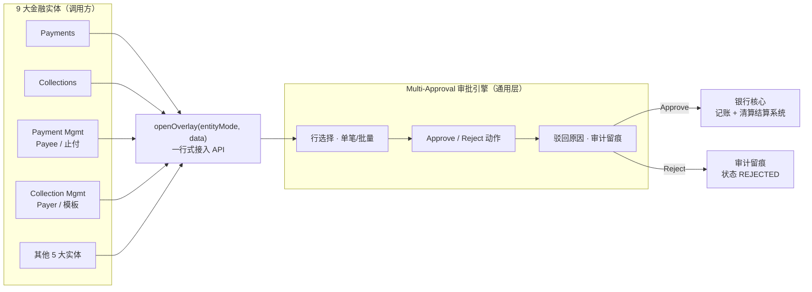
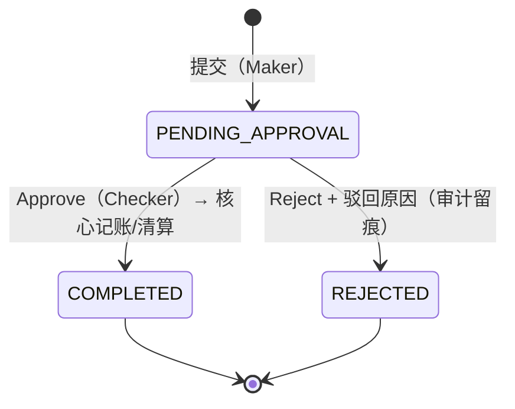

# xxx前端研发 · 试用期述职报告

> **汇报人**xxx**岗位**：前端开发工程师
> **项目**：xxx项目 `xx-ui`（微前端 MFE：多个独立子应用拼成一套网银）
> **周期**：入职两个月
> **汇报框架**：三层价值体系 —— L1 业务交付 → L2 架构资产 → L3 工程效能
>
> **阅读指引**：
>
> - **领导 / 其他部门评委**：读「执行摘要 → 第〇章 → 第五章」即可，约 2 分钟；
> - **技术评委**：全文 + 附录 B/C/D；
> - 全文所有英文术语首次出现均附中文，技术名词可查 **附录 D 术语表**。

---

## 执行摘要（Executive Summary）

> **一句话定位**：入职两个月，在完成业务模块交付的同时，主导设计了支撑全项目审批交互的通用架构资产，并以三项工程化治理为团队建立长效质量防线。
>
> **核心指标看板**
>
> |   交付模块   | 审批引擎复用率 |       新业务接入周期        |     覆盖业务     |         质量门禁          |
> | :----------: | :------------: | :-------------------------: | :--------------: | :-----------------------: |
> | **3 大模块** |    **80%**     | **1 周 → ≤0.5 天（≈90%↓）** | **9 类核心业务** | **提交时 1~2 秒自动校验** |
>
> ⚠️ [待补充: 上线页面数、PR/CR 数、线上缺陷数、组件指南收录数]
>
> **给非技术评委的三句话（白话版）**
>
> 1. 银行每一笔交易都必须"经办 + 复核"两道审批把关。过去每上线一个业务，都要**重新做一套审批弹窗**；我把它收敛成**一套公共审批引擎**，新业务接入从 1 周缩短到半天，**每接入一条业务线节省约 4.5 个人日**。
> 2. 代码格式、风格问题改由**机器在提交代码的那一刻自动检查拦截**，不再靠评审人员逐行挑错——把人的精力还给业务逻辑本身。
> 3. 我负责的页面已按前端框架的**最新推荐写法**重写，未来框架大版本升级**不需要伤筋动骨地返工**，规避了一次潜在的集中改造成本。

---

## 〇、成果全景：三层价值体系

| 层级            | 定位                   | 具体产出                                                     | 受益方                   | 量化结果                                                |
| --------------- | ---------------------- | ------------------------------------------------------------ | ------------------------ | ------------------------------------------------------- |
| **L1 业务交付** | 直接支撑一线交易与合规 | Payers 付款人管理、Approval Collection、Collection Management | 企业客户前台 / 审批员    | ⚠️ [待补充: 页面数、需求交付数]                          |
| **L2 架构资产** | 一次建设、多处复用     | Multi-Approval 通用批量审批中枢、双项目组件沉淀指南          | 全项目 9 大业务线 + 新人 | 复用率 **80%**，接入周期 **≈90%↓**                      |
| **L3 工程效能** | 左移质量、降低技术债   | Signals 迁移、Git 提交格式门禁、组件规范                     | 全体研发                 | 格式类冲突归零、Zoneless 就绪 ⚠️ [待补充: CR 意见数对比] |

> 汇报重点排序：**L2 架构资产 > L3 工程效能 > L1 业务交付**——L1 证明"能干活"，L2/L3 证明"能让团队更高效地干活"。

---

## 一、业务理解简述

`xx UI` 是xx企业网银中交易并发最高的资金枢纽，围绕三个支柱构建功能矩阵：

| 支柱                       | 场景                                            | 统一账本                          | 配套能力                                                     |
| -------------------------- | ----------------------------------------------- | --------------------------------- | ------------------------------------------------------------ |
| **出 Payments（付款）**    | 本币/跨境汇款、账户调拨、批量发薪、缴水电费账单 | Outgoing Listing（出账总账本）    | Payee 收款人管理、Quick Pay 快捷模板、Standing Instructions 周期性预约付款、Stop / Recall 止付追回 |
| **入 Collections（收款）** | 单笔 / 批量发起资金托收                         | Collections Listing（收款总账本） | Payer 付款人档案、Quick Collect 快捷收款模板                 |
| **管 Approvals（审批）**   | 双人经办复核                                    | 两组待审列表                      | 集中审批 + 就地审批、单笔/批量一键审批                       |

**审批分流规则**（谁的单子进哪个队列）：交易类 → **Transaction Approvals（交易审批队列）**，含付款、收款；管理维护类 → **Management Approvals（管理审批队列）**，含收款人 / 付款人 / 模板 / 止付的变更审查。

**合规闭环**（审批之后发生什么）：审批通过 → 银行核心系统记账、清算结算，状态变为 `COMPLETED`（已完成）；审批驳回 → 记录驳回原因、全程可追溯备查，状态变为 `REJECTED`（已驳回）（状态机见 3.1）。

> 演示讲稿见 **附录 A**。

---

## 二、工作概述

基于上述业务全景，入职两个月我承担三个层次的工作：

1. **业务交付（L1，"把需求做出来"）**：独立交付 **Payers 付款人管理**全链路（列表 / 详情 / 编辑），以及 **Approval Collection、Collection Management** 两大收款类审批页面；
2. **架构建设（L2，"把重复的事做成公共资产"）**：主导设计 **Multi-Approval Overlay 通用批量审批中枢**（可理解为"全项目统一的审批窗口"），以一套引擎服务 **9 类核心金融业务**的审批，重复代码减少至原来的 20%（复用率 **80%**），新业务接入周期由 **1 周压缩至半天以内**；
3. **工程治理（L3，"把质量从靠自觉变成靠机制"）**：落地页面刷新机制现代化改造（Zone.js → Angular Signals）、**代码提交时自动格式检查门禁**、**Core/Payments 双项目公共组件清单指南**，从个人模块到团队规范全面把质量关口前移。

---

## 三、核心交付成果

### 3.1 Multi-Approval Overlay 通用批量审批中枢（架构级交付）

**① 背景与问题**

金融业务强制 Maker-Checker 复核（经办 + 复核双人把关），意味着付款、收款、收款人/付款人维护、快捷模板、止付追回……**每一个流程都需要一套审批弹窗**。传统做法是各业务独立实现弹窗（Modal），导致三大结构性问题：

- **重复**：同一套"选中记录 → 通过/驳回 → 填驳回原因 → 留档"逻辑被实现 N 遍；
- **割裂**：各弹窗长相和操作不一致，审批员在不同页面间来回切换要重新适应；
- **高维护**：修一个共性问题要改 N 处，改一处就要全面回归测试，成本随业务数量线性上升。

> **白话版**：审批是合规要求，必须有；但"审批弹窗"本身是重复劳动——我把它做成了**一个公共组件，全项目共用**。

**② 我的任务与关键决策**

主导从"每业务一个弹窗"到"**一套公共审批引擎**"的架构收敛，关键决策：

1. **抽象共性**：提炼 9 大金融实体审批流程的最大公约数——单笔/多行批量、Approve/Reject 双动作、驳回原因必填、审计留痕、统一状态机；
2. **极简 API**：对业务方暴露一行式 `openOverlay(entityMode, data)`，调用方零感知内部复杂度；
3. **剥离业务硬编码**：实体差异全部数据驱动配置，引擎本体不含任何业务逻辑，保证可扩展性；
4. **状态机统一**：全局唯一审批终态流转，满足合规审计。

**③ 架构示意**

**看不懂图？记住这一句话**：9 类业务需要审批时，都走**同一个"审批窗口"**；点"通过" → 银行核心系统记账清算，交易完成；点"驳回" → 必填原因、全程留档备查。业务方接入只需写一行代码。

**④ 结果（量化）**

| 指标           | 结果                                                         |
| -------------- | ------------------------------------------------------------ |
| 代码复用率     | **80%**，冗余弹窗代码全部清除                                |
| 新业务接入周期 | **1 周 → ≤0.5 天（≈90% 提效）**                              |
| 支撑实体       | **9 大核心金融实体**统一一套引擎                             |
| 合规能力       | Approve 直连核心清算（COMPLETED），Reject 全量留痕（REJECTED） |
| 接入成本       | 调用方一行 API，零样板代码                                   |

### 3.2 Payers 付款人管理 + 收款类双审批页（L1 业务交付）

- **Payers 模块**（主力负责）：交付付款人列表（Payer List）、详情、编辑修改全链路；付款人档案与快捷收款模板可被单笔 / 批量收款场景直接复用，**维护一次、处处可用**。
- **Approval Collection / Collection Management**：两大收款类审批页全面接入 Multi-Approval 中枢，支持**集中审批 + 页面内就地审批**，单笔及勾选多行**一键批量通过/驳回**。
- **业务价值**：企业前台少录重、少出错；审批员高峰期不用逐条点击，批量处理效率显著提升。
- ⚠️ [待补充: 页面数、接口联调数、一次性通过率]

### 3.3 交付清单

| 交付物                                     | 层级 | 类型        | 规模/价值                                     |
| ------------------------------------------ | ---- | ----------- | --------------------------------------------- |
| Multi-Approval Overlay 审批中枢            | L2   | 架构级组件  | 9 大实体、复用率 80%                          |
| 组件沉淀指南（Confluence）                 | L2   | 规范文档    | Core + Payments 双项目 ⚠️ [待补充: 收录组件数] |
| Payers 付款人管理                          | L1   | 业务模块    | List / 详情 / 编辑全链路                      |
| Approval Collection、Collection Management | L1   | 审批页面 ×2 | 已接入通用中枢                                |
| Zone.js → Signals 迁移（负责模块）         | L3   | 技术演进    | Zoneless 升级样板                             |
| Prettier + Husky + lint-staged 门禁        | L3   | 工程化      | 提交即拦截格式问题                            |
| Git 格式规范 / 组件规范文档                | L3   | 团队规范    | ⚠️ [待补充: 文档数、组内采用率]                |

---

## 四、工程化与技术亮点（每一项都给出"对业务的意义"）

> 技术评委看 **Problem → Root Cause → Solution → Result** 四段式；非技术评委直接看每节末尾的 💡 说人话 / 业务价值（口径见第五章）。

### 4.1 Zone.js → Angular Signals 渐进迁移

| 维度           | 内容                                                         |
| -------------- | ------------------------------------------------------------ |
| **Problem**    | 存量页面深度依赖 Zone.js 脏检查与手动触发变更检测；Angular 22+ 全面转向 Zoneless，此类写法面临极高重构风险——技术债随版本升级而复利增长。 |
| **Root Cause** | 早期开发习惯：命令式 DOM/状态变更 + 脏检查兜底，响应式建模缺失。 |
| **Solution**   | 在本人负责模块全面采用 Angular 20 Signals 体系（`computed` / `effect` / `input`），状态派生声明式完成，从源头消除冗余变更检测；输出迁移样例供全项目复制。 |
| **Result**     | 本人模块 **100% Signals 化、Zoneless 就绪**，为升级 Angular 22 提供可复制样板。⚠️ [待补充: 迁移组件数、变更检测开销下降幅度] |

> 💡 **说人话**：页面"数据一变就自动刷新"的机制，从"系统到处轮询、全盘检查"换成"谁变了刷新谁"，更省资源、更不容易出错。
> **业务价值**：前端框架大版本升级是全行业通行的集中改造工程；我负责的模块已提前就绪，届时**这部分不用伤筋动骨返工**，人力可直接投向新需求。⚠️ [待补充: 预估可避免的返工人日]

### 4.2 Git 提交格式门禁（Prettier + Husky + lint-staged）

| 维度           | 内容                                                         |
| -------------- | ------------------------------------------------------------ |
| **Problem**    | 成员单双引号、缩进配置不一致，PR 出现大范围格式跳动 → 合并冲突频发、Code Review 信噪比严重下降。 |
| **Root Cause** | ① `.prettierrc` 缺少显式引号规则（配置缺位）；② 项目目录嵌套导致 Husky 未正确定位根目录 `.git` 钩子（钩子失效）。 |
| **Solution**   | ① `.prettierrc` 显式固化双引号 + 空格缩进，联动 VSCode 保存自动格式化；② 修复根目录 Husky `pre-commit`，联动 `lint-staged`（实现细节见附录 B）；③ 提交动作即质量门禁，本地强制拦截。 |
| **Result**     | 格式问题**从"Review 阶段人工抓"左移到"commit 阶段机器拦"**；仅校验暂存区文件，门禁开销 **1~2 秒**（全量校验需数十秒）。⚠️ [待补充: 格式类 CR 意见数 / 合并冲突次数前后对比] |

> 💡 **说人话**：以前格式不对靠评审人员**人眼挑出来**，现在保存/提交代码时**机器 1~2 秒自动检查并纠正**。
> **业务价值**：代码评审的时间还给真正的业务逻辑与风险把关，格式类返工与合并冲突大幅下降，需求合入主线更顺畅。

### 4.3 组件沉淀与规范制定（治理"重复造轮子"）

| 维度           | 内容                                                         |
| -------------- | ------------------------------------------------------------ |
| **Problem**    | Core 与 Payments 积累大量组件，但无统一清单与指引：组内同学不知道"现存什么可用"，新页面频繁重复造轮子——手搭骨架、表单输入、操作栏，耗时且风格不一。 |
| **Root Cause** | 组件"只写不治"：缺少沉淀机制、检索入口与准入标准。           |
| **Solution**   | 深度审查两项目组件源码，**剥离写死业务逻辑的部分**，提炼真正跨业务通用的标准件，形成 Confluence 指南（清单 + 用法 + 适用边界）。 |
| **Result**     | ① 统一各 MFE 页面布局规范；② 减少低效重复代码；③ 作为新人入职指南，缩短上手周期。⚠️ [待补充: 收录组件数、指南访问量、新人上手时长变化] |

> 💡 **说人话**：把散落在两个项目里的"零件"整理成一份**公共零件清单**——有什么、怎么用、哪里能用，一查便知。
> **业务价值**：新页面开发**更快、风格更统一**，新人不必从零摸索；从源头减少"各造各的"带来的返工与视觉不一致。

---

## 五、量化收益与度量口径

> 专业度来自口径统一：每项指标明确**度量方式**，避免"感觉变快了"式表述。

| #    | 指标                     | 优化前              | 优化后                                   | 提升             | 度量口径                      |
| ---- | ------------------------ | ------------------- | ---------------------------------------- | ---------------- | ----------------------------- |
| 1    | 批量审批接入开发周期     | 1 周 / 业务线       | ≤0.5 天                                  | **≈90%**         | 从接需求到联调通过的人日      |
| 2    | 审批弹窗代码复用率       | 各业务独立实现      | **80%**                                  | 冗余清零         | 公共引擎代码 / 审批相关总代码 |
| 3    | 批量审批支撑实体         | 散落 N 个 Modal     | **9 大金融实体**                         | 架构收敛         | 已接入引擎的实体数            |
| 4    | 提交格式校验耗时         | 全量 ≈数十秒        | 仅暂存区 **1~2s**                        | 提交零感知       | pre-commit 钩子端到端耗时     |
| 5    | 格式问题暴露阶段         | Review 阶段人工发现 | commit 阶段机器拦截                      | **左移一个阶段** | 问题发现环节                  |
| 6    | 本人模块 Zoneless 就绪度 | 依赖 Zone.js        | Signals 体系                             | **100% 就绪**    | 是否存在 Zone 依赖 API        |
| 7    | 交付规模 / 质量          | —                   | ⚠️ [待补充: 页面数、PR/CR 数、线上缺陷数] | —                | —                             |

**这组数字对管理层意味着什么（白话解读）**

- **省钱**：每接入一条审批类业务线节省约 **4.5 个人日**；年度收益 ≈ 全年审批类需求数 × 4.5 人日 ⚠️ [待补充: 年度需求估算，得出总人日]。
- **合规**：所有审批动作**状态唯一、原因留痕、全程可追溯**，直接满足内外部审计对"经办复核"的检查要求。
- **稳**：质量从"人盯"变成"机器把关 + 公共组件统一复用"，缺陷更少、上线节奏更可预期。
- **可持续**：技术债提前出清，后续框架升级、需求承接**不依赖某个成员的个人经验**。

---

## 六、不足与改进

| #    | 不足                                                         | 根因                                              | 已采取的改进动作                                             | 初步效果                        |
| ---- | ------------------------------------------------------------ | ------------------------------------------------- | ------------------------------------------------------------ | ------------------------------- |
| 1    | 初期对银行合规业务（清算时序、审批链路）理解不深，需求评审提问质量不高 | 缺少金融业务上下文，首次接触 Maker-Checker 全链路 | 梳理 Maker-Checker 全链路流程图 + 建立需求澄清 checklist，评审前预习业务流 | ⚠️ [待补充: 返工率/返工次数变化] |
| 2    | ⚠️ [待补充: 第二条不足，如跨团队沟通节奏、自测充分性、优先级判断] | ⚠️ [待补充: 根因]                                  | ⚠️ [待补充: 改进动作]                                         | ⚠️ [待补充: 效果]                |
| 3    | ⚠️ [待补充: 第三条不足]                                       | ⚠️ [待补充: 根因]                                  | ⚠️ [待补充: 改进动作]                                         | ⚠️ [待补充: 效果]                |

> 写作原则：**每条不足必须闭环到「根因 + 动作 + 可验证效果」**，不接受"经验不足"式空话。

---

## 七、下阶段工作计划

**业务目标（L1）**

- 深耕 Payments / Collections 审批链路，承接 ⚠️ [待补充: 下一批需求/模块]；
- 推动剩余审批场景 **100% 接入** Multi-Approval 通用中枢，彻底消灭独立 Modal。

**技术目标（L2/L3，可衡量）**

| 目标                                             | 指标                            | 期限           |
| ------------------------------------------------ | ------------------------------- | -------------- |
| 存量页面 Signals 改造覆盖率达 ⚠️ [待补充: 目标 %] | grep Zone 依赖 API 归零         | ⚠️ [待补充: Q?] |
| 组件指南覆盖率提升至 ⚠️ [待补充: 目标 %]          | "重复造轮子"类 CR 意见降为 0    | ⚠️ [待补充: Q?] |
| 补齐测试基线                                     | ⚠️ [待补充: 单测/E2E 覆盖率目标] | ⚠️ [待补充: Q?] |

**个人成长**

- 深入银行资金清算与风控合规知识，提升需求评审阶段的问题预判能力；
- ⚠️ [待补充: 其他方向，如架构设计方法论、跨团队协作]。

---

## 结语

两个月里，我从"完成分配的任务"成长为能主导通用审批引擎这类**架构级交付**的前端研发：交付的不只是页面，更是**让团队少写重复代码、让质量靠机制而非自觉来保障**的长效资产。希望转正后继续在 `ideal-payments-ui` 深耕，以可复用的架构与可量化的工程质量为团队持续创造价值。

---

## 附录 A：系统演示讲稿

### A1. Outgoing 与 Payments 业务（45 秒）

> "首先看 Outgoing Listing，这是所有出账的总账本，包含了日期、收付款人、金额及处理状态。在 Send Payments 菜单下，我们可以看到 Pay local or overseas、Bulk pay 等各个具体的业务场景入口。而在 Payee Management 中维护好的收款人以及快捷模板，可以在这些付款场景中直接调取和复用。"

### A2. Collections 与 Payer 业务（重点凸显交付成果，45 秒）

> "切换到 Collections Listing，这是收款业务的总账本，支持发起 Single Collect 和 Bulk Collect。点击进入 Payers 付款人管理——这是我主力负责的模块，涵盖了 Payer List、详情以及编辑修改。维护好的付款人和快捷收款模板，能无缝复用到各种收款流程中。"

### A3. Approvals 与 Multi-Approval 批量审批（高潮演示，60 秒）

> "最后看风控核心 Approvals 审批模块。提单人提交后，交易不会直接扣款，而是进入这里的待审池。大家可以看到四个清晰的 Tab：交易类的 Payments、Collections，以及维护类的 Payment Management（含 Payee/止付）和 Collection Management（含我负责的 Payer 审批）。"

---

## 附录 B：Husky、lint-staged 与单双引号配置深度剖析

### B1. 为什么 `.husky/pre-commit` 要写 `cd ideal-payments-ui && npx lint-staged`？

- **痛点根因**：标准 Monorepo / 嵌套结构——Git 仓库根目录是 `/ideal-payments-ui`（含 `.git` 与 `.husky`），Angular 源码工程在子目录 `/ideal-payments-ui/ideal-payments-ui`（`package.json` 与 `node_modules` 在此）。
- **原理**：Git hook 默认在 Git 根目录触发。不写 `cd`，Husky 执行 `npx lint-staged` 时会在根目录找 `package.json`，直接报错。
- **解法**：在 `.husky/pre-commit` 中显式 `cd ideal-payments-ui` 再执行 `npx lint-staged`，解决多层目录寻径问题。

### B2. lint-staged 是什么？

- 若每次 commit 都对全项目上万个文件跑 ESLint + Prettier，一次提交要卡几十秒。
- `lint-staged` **只对暂存区（Staged）文件做局部校验与修复**：改动 2 个文件就只格式化这 2 个，1~2 秒完成，不影响工作区其他未暂存代码。

### B3. 需要在根目录加 `package.json` 吗？

- **不需要**。`cd` 进实际 npm 项目目录再执行是侵入性最小的方案，避免在根目录额外维护一套冗余配置。

---

## 附录 C：答辩高频追问与回答要点

1. **"Multi-Approval 最难的技术点是什么？"**
   → 9 大实体审批差异的抽象边界：哪些进引擎共性（选行/动作/留痕/状态机），哪些留作数据驱动配置；关键是保证引擎本体零业务硬编码，否则复用率上不去。

2. **"复用率为什么是 80% 不是 100%？"**
   → 剩余 20% 是各实体特有的字段校验与业务规则，属于合理差异，强行抽象会造成过度设计；80% 是公共引擎覆盖的交互与流程骨架。

3. **"试用期犯过最大的错误？"** ⚠️ [待补充: 结合真实经历，按"错误 → 影响 → 补救 → 机制化预防"作答]

4. **"转正后 3 个月的规划？"**
   → 业务上承接审批链路纵深需求；技术上推进 Signals 覆盖率与组件指南覆盖率两项指标（见第七章）。

5. **"为什么认为自己能胜任转正？"**
   → 三层证据：L1 独立交付业务模块；L2 主导架构级组件被 9 大实体采用；L3 建立的门禁与规范持续为团队产生复利。

---

## 附录 D：术语表（非技术评委速查：正文遇到生词翻这里）

| 术语                      | 含义（白话）                                                 |
| ------------------------- | ------------------------------------------------------------ |
| **Maker-Checker**         | 双人经办复核：一人提交（Maker）、另一人审批（Checker），金融监管强制要求，防单人操控资金 |
| **MFE / 微前端**          | 整套网银由多个独立开发的子应用拼装而成，各自迭代、组合上线   |
| **Overlay / 弹窗组件**    | 覆盖在页面上方的操作窗口，此处指全项目共用的审批弹窗         |
| **Standing Instructions** | 周期性预约付款：设定好时间与金额，到点自动扣划（如每月付租） |
| **Stop / Recall**         | 止付 / 追回：资金正式清算发出前紧急拦截，用于风险处置        |
| **Zone.js / 脏检查**      | 前端框架传统的"发现数据变化"机制：靠全局轮询式检查，页面多了会浪费资源 |
| **Zoneless**              | 新一代运行模式：不再全局轮询，由数据变化主动通知刷新，更快更省资源（Angular 22 主推） |
| **Signals**               | 新式"数据通知"机制：数据一变，只有用到它的界面自动更新，精准且可预测 |
| **lint-staged**           | 只对本次改动的文件做检查（而非全项目），秒级完成             |
| **Husky / pre-commit**    | 在"提交代码"那一刻自动执行检查的钩子，不合格就拦下，问题出不了本地 |
| **PR / Code Review**      | 代码合并请求与同行评审：代码进主干前由其他工程师审查把关     |

