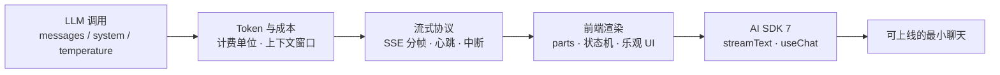

# ① 第一关 · 流式对话

> **一句话目标**：让模型的回答一个字一个字地蹦出来，并且你清楚这一蹦花了多少钱、能不能中途掐断。
>
> **产出物**：一个可上线的流式聊天——支持中断、错误恢复、**实时显示 token 成本**。

← [返回总纲](../index.md) · → [下一关：知识增强 RAG](../02-第二关-知识增强RAG/index.md)

---

## 为什么这一关排第一

AI 应用和传统 Web 应用最大的体感差异是**延迟不可预测**。传统接口 200ms 必返回，LLM 首字可能要 1-3 秒，完整回答要 30 秒以上。

所以 AI 应用的第一性性能指标不是吞吐，而是：

| 指标 | 含义 | 体感 |
|---|---|---|
| **TTFT**（Time To First Token） | 首字延迟 | 决定"卡不卡" |
| **TPOT**（Time Per Output Token） | 单字生成间隔 | 决定"读得顺不顺" |
| **总耗时** | 完整回答耗时 | 决定"值不值得等" |

前端在这件事上有**不可替代的价值**：流式渲染、等待态设计、中断与重试、成本可视化——这些后端给不了你。

## 能力地图

## 章节与里程碑

| # | 章节 | 你会获得的能力 |
|:-:|------|----------------|
| 01 | [30 分钟从 0 到 1](./01-30分钟从0到1.md) | 跑通服务端 `streamText` + 前端 `useChat` 的完整链路 |
| 04 | [AI SDK 7 核心 API](./04-AI-SDK-7核心API.md) | `useChat` 的 `transport` / `status` / `parts` 新范式与 v4→v7 迁移 |
| 附 | [AI 聊天室完整实现](./附-AI聊天室完整实现.md) | 一个带会话管理、历史持久化的完整聊天室实现手册 |

> 🚧 **规划中（暂未成文）**：`02-LLM调用与Token成本`（请求参数与计费模型）、`03-流式协议与前端渲染`（SSE 分帧边界、背压、中断重连）。
> 在此之前，流式协议的工程细节直接读本仓库实现：`apps/ai-demo/src/services/aiStream.ts`（SSE 客户端）与 `backend/internal/sse/`（服务端）。

## 与本仓库代码的映射

| 教程内容 | 真实实现 | 看点 |
|---|---|---|
| SSE 流式接收 | `apps/ai-demo/src/services/aiStream.ts` | 如何处理 TCP 分帧边界，一个逻辑帧可能被拆成多个 chunk |
| 服务端流式生成 | `backend/internal/chat/`、`backend/internal/sse/` | 流式响应与日志流的两种实现 |
| 前端聊天 UI | `apps/ai-demo/src/components/AIChat.tsx` | Ant Design X 的 Bubble.List / Sender 组织方式 |
| 会话持久化 | `apps/ai-demo/src/stores/chatStore.ts` | Zustand 管理对话历史 |

> 本仓库 `apps/ai-demo` 走的是「自建 SSE 客户端 + Go 后端」路线；教程主线（AI SDK 7）的代码放在 `apps/ai-course/`。
> 两条实现是刻意保留的对照——**协议层是共通的，差异只在 SDK 封装**。

## 自检清单

出关前，请逐条打勾：

- [ ] 能从零搭出一条流式链路，并说出每一段用的是什么协议
- [ ] 能用 curl 手动消费 SSE 流，解释一个 `data:` 帧里有什么
- [ ] 能在客户端中断生成，且中断后服务端不再继续烧钱
- [ ] 能在 UI 上同时展示：流式文本 / 加载态 / 错误态 / token 用量
- [ ] 能解释为什么 `temperature` 在客服场景要调低、在创意场景要调高
- [ ] 能说出 AI SDK v4 与 v7 在 `useChat` 上的至少 3 处差异

## 常见坑

| 坑 | 现象 | 正确处理 |
|---|---|---|
| 把 SSE 当成「一行一个 JSON」 | 长回答偶发解析失败 | 按 `\n\n` 分帧缓冲，跨 TCP 边界拼接后再解析 |
| 只在前端做超时 | 用户走了但服务端还在烧钱 | 监听请求关闭信号，中止模型侧生成 |
| 直接渲染 `message.content` | AI SDK 7 下工具调用/推理内容丢失 | 遍历 `message.parts`，按 `text`/`tool-call`/`reasoning` 分别渲染 |
| 不计成本地用旗舰模型 | 上线后账单爆炸 | 按任务分档路由（见第四关 cost & 网关章节） |

## 面试高频

> - 为什么 AI 聊天必须用流式？轮询和 WebSocket 不行吗？
> - 首字延迟由哪些环节构成？怎么优化？
> - 用户中途关闭页面，服务端怎么感知？（→ 第四关「可观测性与 trace」会给出答案）
>
> 完整题库见 [09-面试篇 · 框架与工程](../09-面试篇/05-框架与工程篇.md)。
