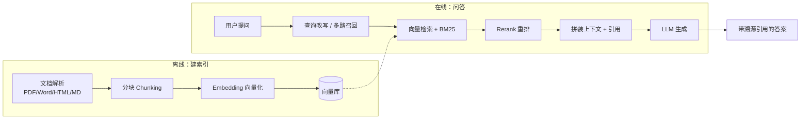

# ② 第二关 · 知识增强 RAG

> **一句话目标**：让模型能回答它训练时没见过的内容，并且答错时你知道错在哪一环。
>
> **产出物**：支持 PDF/Word 的企业知识问答系统——有参考答案溯源、有检索评测基线。

← [上一关：流式对话](../01-第一关-流式对话/index.md) · [返回总纲](../index.md) · → [下一关：Agent 与工具](../03-第三关-Agent与工具/index.md)

---

## 为什么需要这一关

LLM 有三宗罪：**知识过期**（不知道 2026 的事）、**领域无知**（不知道你公司的报销流程）、**会编答案**（hallucination）。

RAG（Retrieval-Augmented Generation）是工程上最经济的解法：不改模型，改喂给模型的内容。
它本质是**一次检索系统与生成模型的工程集成**——而"集成"正是前端最擅长的事。

## 章节与里程碑

| # | 章节 | 你会获得的能力 |
|:-:|------|----------------|
| 01 | [RAG 全链路](./01-RAG全链路.md) | 从文档到答案的完整链路与每一步的取舍 |
| 02 | [分块与 Embedding 策略](./02-分块与Embedding策略.md) | 分块四策略、Embedding 选型的硬约束、元数据过滤 |
| 03 | [混合检索与 Rerank](./03-混合检索与Rerank.md) | 向量 + BM25 的 RRF 融合、什么时候才需要 Rerank |
| 04 | [RAG 评测闭环](./04-RAG评测闭环.md) | 四指标定位法、评测集从哪来、接进 CI |
| 附 | [RAG 全栈技术实战](./附-RAG全栈技术实战.md) | 全栈视角的深度实现手册（原文保留） |

> 教程侧的可跑代码在 `apps/ai-course/src/stages/02-rag/`（分块 → 检索 → 拼上下文 → 溯源），
> 服务端参考实现见 `backend/internal/knowledge/`。

## 决策速查

| 决策点 | 常见选项 | 取舍依据 |
|---|---|---|
| 分块策略 | 固定长度 / 语义切分 / 按标题层级 | 语义切分效果好但成本高；中文场景先试「按标题 + 块间重叠 15%」 |
| Embedding | 商业 API / 本地 bge /  multilingual | 看语种覆盖与召回成本；换模型必须重建索引 |
| 检索方式 | 纯向量 / BM25 / 混合 | 混合 + RRF 融合是当下的稳妥解；专有名词多的场景 BM25 权重调高 |
| 是否 Rerank | 不用 / 交叉编码器重排 | 精度要求高或 Top-K 较大时再引入，注意它增加在线延迟 |
| 向量库 | pgvector / Chroma / Milvus / Qdrant | < 100 万向量：`pgvector` 最省运维；再往上考虑专用向量库 |

> ⚠️ 上表是**决策维度**而非版本结论，具体版本与型号见 [版本基线真源](../index.md#版本基线唯一真源)。

## 与本仓库代码的映射

| 教程内容 | 真实实现 | 看点 |
|---|---|---|
| 文档接入与切分 | `backend/internal/knowledge/` | loader → chunk → embed → search 的完整分层 |
| 问答链路 | `backend/internal/airouter/` | 检索结果如何与工具调用、HITL 串成一条 Agentic 循环 |
| 前端知识库管理 | `apps/ai-demo/src/components/KnowledgeBase.tsx` | 知识库 CRUD + 文档添加的交互设计 |
| 引用溯源 UI | `apps/ai-demo/src/components/AIChat.tsx` | 把检索来源渲染成可点击引用 |

## 自检清单

- [ ] 能说清一次 RAG 问答的 8 个环节，并指出准确率瓶颈通常出在哪 2 环
- [ ] 能解释「为什么 top-k 越大不一定越好」
- [ ] 知道什么时候该混合检索、什么时候纯向量就够
- [ ] 能手写一个最小评测脚本，用召回率/命中率衡量检索好坏
- [ ] 能处理「文档里没有答案」的情形（拒答 vs 硬编）
- [ ] 能在前端展示引用来源，并处理引用块被截断的情况

## 面试高频

> - RAG 为什么能减少幻觉？它彻底消除幻觉了吗？
> - 分块大小怎么定？过大过小分别有什么问题？
> - 用户问"总结一下这份文档"，检索失效怎么办？（→ Agentic RAG / 全文兜底）
> - 怎么评测一个 RAG 系统？（→ 第四关「评测体系」给出 CI 化答案）
>
> 完整题库见 [09-面试篇 · RAG 与知识库](../09-面试篇/02-RAG与知识库篇.md)。
