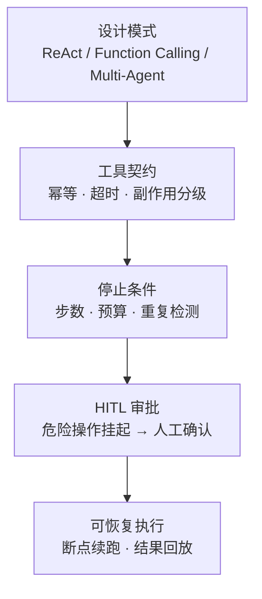

# ③ 第三关 · Agent 与工具

> **一句话目标**：让模型不止会"说"，还会"做"——并且**知道什么时候该停下来、什么时候该问人**。
>
> **产出物**：一个带工具调用、有停止条件、危险操作需人工审批的自主 Agent。

← [上一关：RAG](../02-第二关-知识增强RAG/index.md) · [返回总纲](../index.md) · → [下一关：企业级工程化](../04-第四关-企业级工程化/index.md)

---

## 从 Chatbot 到 Agent 的分界线

| | Chatbot | Agent |
|---|---|---|
| 输出 | 文本 | **决策 + 行动** |
| 循环 | 一问一答 | 推理 → 调工具 → 喂回结果 → 再推理 |
| 边界 | Prompt 约束 | **停止条件 + 权限边界** |
| 风险 | 答错 | 答错 + **做错** |

核心公式：`Agent = LLM（大脑）+ Tools（手脚）+ Memory（记忆）+ Planning（规划）`

而工程上真正难的是后三件事：**让它停**（stopWhen / 步数上限 / 预算上限）、**让它问**（HITL 审批）、**让它可追踪**（trace）。

## 能力地图

## 章节与里程碑

| # | 章节 | 你会获得的能力 |
|:-:|------|----------------|
| 01 | [Agent 设计模式](./01-Agent设计模式.md) | ReAct / Function Calling / Multi-Agent 的取舍与实现 |
| 02 | [工具设计契约](./02-工具设计契约.md) | 副作用分级 L0/L1/L2、幂等键、超时、统一执行入口与审计 |
| 03 | [停止条件与死循环防护](./03-停止条件与死循环防护.md) | 步数/重复检测/超时/预算四道闸，以及"停下来之后怎么办" |
| 04 | [HITL 人工审批](./04-HITL人工审批.md) | 审批工单（TTL 10min）、中断重发、过期与重放边界 |
| 附 | [AI 编程智能体实战](./附-AI编程智能体实战.md) | 一个真实 Code Agent 的完整实现手册（原文保留） |

> 教程侧可跑代码在 `apps/ai-course/src/stages/03-agent/`（工具分级、审批工单、审计流），
> 工业实现对照 `backend/internal/tool/` 的权限分级与 `backend/internal/airouter/` 的审批编排。

## 工具设计的三条铁律

| 铁律 | 说明 | 违反后果 |
|---|---|---|
| **幂等** | 同样的输入重复调用，结果一致（写操作要有幂等键） | 重试 = 重复扣款 / 重复发邮件 |
| **有界** | 必须声明超时，超时必须返回结构化超时结果 | 一个慢工具拖死整个 Agent 循环 |
| **分级** | 按副作用给工具分级（只读 / 可撤销写 / 不可逆写），只对高等级请求审批 | 要么什么都拦（难用），要么什么都不拦（不敢上线） |

> 本仓库 `backend/internal/tool/` 已实现 `L0 只读 / L1 可撤销 / L2 不可逆` 三级 + 参数净化沙箱 + 调用审计，是这三条铁律的落地参考。

## 与本仓库代码的映射

| 教程内容 | 真实实现 | 看点 |
|---|---|---|
| ReAct / Function Calling | `backend/internal/agent/` | 两种范式的引擎实现与切换 |
| 工具注册与权限分级 | `backend/internal/tool/` | 沙箱净化、幂等键、超时、审计日志 |
| 对话记忆 | `backend/internal/memory/` | 多轮会话记忆的裁剪与压缩 |
| Agentic 编排循环 | `backend/internal/airouter/` | RAG → 工具 → 重试 → HITL 的循环 + SSE 事件推给前端 |
| 智能体管理 UI | `apps/ai-demo/src/components/Agents.tsx` | 三种 Agent 类型的可视化管理 |

## E:\code\ai 延伸精读（Agent 实现）

把 ③ 的通用 Agent 理论对照真实工程实现：

- `E:\code\ai\pi\pi-agent-core`：工具调用 + 状态机的极简实现（落到 01 / 02 章）
- `E:\code\ai\how-pi-agent-works`：Agent Loop / 消息 / 流式事件 / 工具调用 / 会话树的 4 个渐进 TS Demo（落到 01 / 03 章）
- `E:\code\ai\hello-agents`：手搓 ReAct / Plan-and-Solve / Reflection + 多 Agent 案例（落到 01 / 04 章）

> 完整编码 Agent 专论见 [⑩ 编码 Agent 专题](../10-编码Agent专题/index.md)。

## 自检清单

- [ ] 能手写一个 ReAct 循环，并说出它在哪些任务上不如 Plan-and-Execute
- [ ] 能设计一组工具，给每个工具标注副作用等级与幂等策略
- [ ] 能回答"Agent 跑不收敛怎么办"——至少给出 3 种收敛手段
- [ ] 能实现危险操作的人工审批，并且审批期间不影响其他会话
- [ ] 能让一次失败的执行在修复后**从断点继续**，而不是从头再来
- [ ] 能在 UI 上把工具调用轨迹渲染成人能看懂的"执行日志"

## 面试高频

> - Function Calling 和 ReAct 的区别？什么场景用哪个？
> - 工具调用失败怎么处理？（区分"工具报错 / 参数不对 / 选错工具"）
> - 怎么防止 Agent 死循环烧钱？
> - 为什么人工审批不能只在 Prompt 里说"重要操作要先问我"？
>
> 完整题库见 [09-面试篇 · Agent 设计](../09-面试篇/03-Agent设计篇.md) 与 [工具与协议](../09-面试篇/04-工具与协议篇.md)。
