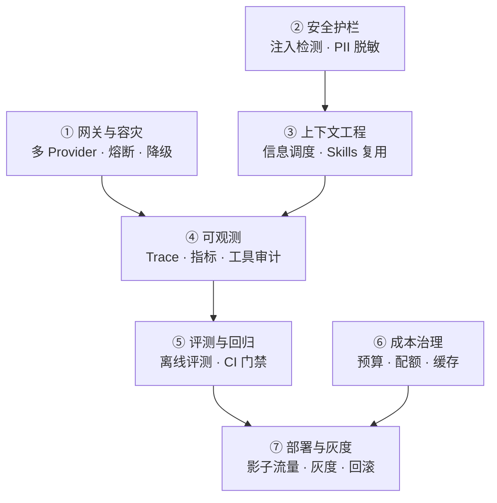

# ④ 第四关 · 企业级工程化 ★

> **一句话目标**：从"能跑的 Demo"走到"敢上线的系统"。
>
> **产出物**：一个有多 Provider 容灾、有安全护栏、有人类审批、能被观测、能被引证、"烧钱有上限"的生产级 AI 应用。

← [上一关：Agent 与工具](../03-第三关-Agent与工具/index.md) · [返回总纲](../index.md) · → [下一关：协议与多 Agent](../05-第五关-协议与多Agent/index.md)

---

## 为什么这是全教程的分水岭

前三关回答"能不能跑"，这一关回答"敢不敢上线"。

一个 AI 应用上线后真正会出的事：
模型厂商限流了怎么办？用户在 Prompt 里注入攻击怎么办？Agent 调了一个不可逆的写操作怎么办？
这次改动让回答质量变好了还是变差了怎么证明？月底账单飙了谁负责？

这些问题没有一个是模型能替你解决的——它们全是**工程问题**，而且和传统后端的"高可用 + 可观测 + 灰度"是一套思路。

> 面试里有 80% 的追问集中在这里。能不能答到"这就跟限流熔断一样，只不过我把熔断输入从 QPS 换成了…"，是初中高级的分水岭。

## 七道门槛

| # | 章节 | 解决什么问题 |
|:-:|------|--------------|
| 01 | 🚧 `01-多Provider网关与熔断降级` | 一家厂商挂了 / 限流了，服务还能用；按场景自动路由到不同档位模型 |
| 02 | 🚧 `02-安全护栏` | Prompt 注入、越权工具调用、PII 泄露 |
| 03 | [上下文工程与 Skills](./03-上下文工程与Skills.md) | 什么信息在什么时刻进入模型视野；把 Prompt 沉淀成可复用技能 |
| 04 | 🚧 `04-可观测性Trace与审计` | 一次请求内部发生了什么、花了多少、调了哪些工具 |
| 05 | 🚧 `05-评测体系与CI回归门禁` | 改动 prompt / 换模型后怎么证明没变差 |
| 06 | 🚧 `06-成本预算与配额治理` | Token 预算、用户级配额、提示缓存命中率 |
| 07 | 🚧 `07-部署灰度与容灾` | 影子流量、灰度放量、一键回滚 |
| 附 | [生产化与工程化手册](./附-生产化与工程化手册.md) | 原文保留的深水区手册 |

> 🚧 标记的章节正在成文。**在此之前，本仓库的 Go 实现就是最好的教材**——下表每一条都能直接读源码。

## 与本仓库代码的映射（本关最强的地方）

| 工程能力 | 真实实现 | 可运行入口 |
|---|---|---|
| Provider 注册表 / 离线降级 / 熔断 / 定价估算 | `backend/internal/llm/` | `GET /api/ai/models` |
| Prompt 注入检测 / PII 脱敏 / 输入分隔符隔离 | `backend/internal/guard/` | 随 `/api/ai/chat` 生效 |
| 工具沙箱 / 权限分级 L0/L1/L2 / 幂等 / 超时 / 审计 | `backend/internal/tool/` | `GET /api/ai/tools`、`POST /api/ai/tools/call` |
| HITL 人工审批工单 | `backend/internal/airouter/` | `GET /api/ai/approvals`、`POST /api/ai/approvals/:id/resolve` |
| Trace / 运行计数 / 工具审计 / 离线评测 / Prompt 版本 | `backend/internal/obs/` | `/api/ai/obs/*`、`/api/ai/eval/*`、`/api/ai/prompts/*` |
| 前端 LLMOps 面板 | `apps/ai-demo/src/components/Observability.tsx` | AI Demo → Observability 选项卡 |

启动后端：`cd backend && go run ./cmd/server/`，再 `cd apps/ai-demo && bun run dev`（`/api` 已代理到 `:8080`）。

## 自检清单

- [ ] 能在 Provider 全部不可用时给出一个**有降级感的回答**，而不是白屏报错
- [ ] 能说出至少 3 类 Prompt 注入攻击和对应的防御层
- [ ] 能给工具划分副作用等级，并让 L2 操作强制走审批
- [ ] 能用一次 trace 说清：这次请求调了几次模型、几次工具、各花了多少毫秒与多少钱
- [ ] 能搭一个最小评测集，在 CI 里跑"改 prompt → 分数下降则失败"
- [ ] 能给出三层成本控制手段（模型分层 / 缓存 / 配额）
- [ ] 能设计灰度：影子流量 → 1% → 10% → 全量，并能一键回滚到上一个 Prompt 版本

## 面试高频

> - 模型厂商限流/宕机，你的系统怎么降级？
> - 怎么防止用户通过 Prompt 拿到别人的数据？
> - 换了一个更强的模型，你怎么证明效果变好了？（引出评测闭环）
> - 一次请求成本怎么算？怎么给不同用户设配额？
> - 提示缓存（Prompt Caching）什么时候划算？
>
> 完整题库见 [09-面试篇 · 框架与工程](../09-面试篇/05-框架与工程篇.md)。
