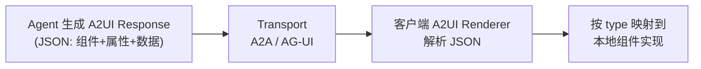

# 生成式 UI 与前端 AI 组件生态

> **为什么单独成章**：这是前端在 Agent 时代最稳固的护城河。后端能编排 Agent，
> 但"Agent 的输出如何在浏览器里被看见、被中断、被审批、被无障碍访问"只能由前端负责。
> 本章把"生成式 UI"从概念落到**可落地的协议与组件库**——重点讲清 `A2UI`（开放标准）与 `@ant-design/x`（本仓库在用）两大体系，二者都来自 `这批 GitHub 开源仓库`。

---

## 一句话理解

| 路线 | 产物 | 时机 | 代表 |
|---|---|---|---|
| **AI 生成代码**（Code Gen） | 源码文件 | 开发期，一次性 | v0.dev、Bolt.new、Claude Artifacts |
| **生成式 UI**（Generative UI） | 结构化**组件描述** | 运行期，每次对话 | `Output.object` + 组件注册表、A2UI、MCP Apps |

**核心区别**：代码生成交给人类 review 后入库；生成式 UI 是**运行时**由 Agent 输出组件树，前端即时渲染，
因此需要 schema 约束、白名单组件、流式渲染与安全边界。

---

## 一、生成式 UI 的三种协议形态

| 形态 | 机制 | 优点 | 代价 | 适用 |
|---|---|---|---|---|
| **结构化对象 + 组件注册表** | 模型输出受 schema 约束的对象，前端映射到白名单组件 | 安全可控、可主题化、易测试 | 表现力受组件集限制 | 企业内部工具、中后台 |
| **A2UI / 组件树描述** | Agent 输出带类型与 props 的组件树，前端递归渲染 | 表现力强、可流式增量渲染 | 需要严格白名单与校验 | 面向 C 端的 AI 原生产品 |
| **MCP Apps** | MCP Server 提供 `ui://` 资源，宿主在**受限 iframe** 渲染，`postMessage` + JSON-RPC 通信 | 跨宿主复用、天然隔离（不接触宿主 DOM/Cookie/Storage） | 需要宿主支持；iframe 交互有延迟 | MCP 生态内的图表/表单/审批 |

> MCP Apps 属于 MCP `2026-07-28` 的**正式扩展**，需要客户端与服务器显式协商后才能使用；
> 详见 [05-前沿技术与生态](../05-第五关-协议与多Agent/附-前沿技术与生态.md)。

---

## 二、A2UI 协议深入（来自 `https://github.com/google/A2UI`）

> `https://github.com/google/A2UI` 是 Google 发起的**开放标准 + 渲染器集合**（当前生产版 v0.9.1，v1.0 为 RC，Apache 2.0）。
> 它的定位一句话：**让 Agent 用声明式 JSON 描述 UI 的"意图"，客户端用自有组件库渲染**——
> "safe like data, expressive like code"（像数据一样安全，像代码一样有表现力）。

### 2.1 四条核心哲学（决定了它为什么安全）

1. **安全优先（Security first）**：UI 是**声明式数据格式，不是可执行代码**。客户端维护一份「可信组件目录（catalog）」，
   例如只批准 `Card` / `Button` / `TextField`，Agent **只能请求渲染目录里的组件**——从根本上杜绝"模型输出任意 HTML/JS"。
2. **对 LLM 友好且可增量更新**：UI 被表示为**扁平的组件列表 + ID 引用**，LLM 很容易**逐步生成**，前端可渐进渲染，体感更顺。
3. **框架无关、可移植**：UI 结构与实现解耦。同一份 A2UI JSON 可被 React / Lit / Flutter / Angular / SwiftUI 各自渲染。
4. **开放注册 + 信任阶梯（Trust Ladder）**：开发者通过注册「Smart Wrapper」把任意现有组件（甚至安全 iframe 容器）接到 A2UI 的数据绑定与事件系统；
   **沙箱策略与信任等级由开发者在自己组件逻辑里强制执行**，而不是依赖核心系统——安全落在你手里。

### 2.2 工作机制（生成与执行解耦）



### 2.3 一份最小 A2UI JSON（扁平列表 + ID 引用）

```json
{
  "components": [
    { "id": "root", "type": "card", "props": { "title": "航班结果" }, "children": ["title", "book"] },
    { "id": "title", "type": "text", "props": { "content": "上海→北京 最低 ¥520" } },
    { "id": "book", "type": "button", "props": { "label": "预订", "action": "book_flight", "args": { "id": "CA123" } } }
  ]
}
```

> 注意：组件是**扁平数组**，父子关系靠 `children` 里的 ID 引用表达——这种结构对 LLM 最友好（不用嵌套深树），也最易于增量 patch（只改某个 id 的属性）。

### 2.4 最小 React 渲染器（受 catalog 约束）

```tsx
// catalog：只允许白名单组件，Agent 请求的类型不在其中一律降级为 text
const catalog = {
  card: Card, text: Text, button: Button,
} as const;

function A2UIRenderer({ response }: { response: A2UIResponse }) {
  const byId = new Map(response.components.map((c) => [c.id, c]));
  const renderNode = (id: string): ReactNode => {
    const node = byId.get(id);
    if (!node) return null;
    const Comp = (catalog as any)[node.type] ?? Text; // 未知类型降级
    return (
      <Comp {...node.props}>
        {node.children?.map((childId) => renderNode(childId))}
      </Comp>
    );
  };
  return <>{response.components.filter((c) => !c.props?.parent).map((c) => renderNode(c.id))}</>;
}
```

> 本仓库 `apps/ai-demo/src/components/A2UI.tsx` 用的就是 `@a2ui/react`，它正是 A2UI 规范的 React 落地；
> `https://github.com/google/A2UI` 是它的规范源头，README 里的「Restaurant Finder Demo」是端到端范例。

---

## 三、Ant Design X 组件库详解（来自 `https://github.com/ant-design/x`）

> `https://github.com/ant-design/x` 是蚂蚁的 `ant-design/x` 单体仓库（`x-mono`），企业级 LLM UI 组件。
> 它和 A2UI 的关系是：**`x-card` 本身就是基于 A2UI 协议的动态卡片渲染**——模型产出结构化 JSON，`x-card` 按 A2UI 思路受控渲染。

### 3.1 关键包与能力

| 包 / 组件 | 能力 | 教程对应 |
|---|---|---|
| `Bubble.List` | 消息列表 + 角色预设 + typing/淡入动画 + 流式标记 | 02 章实战 |
| `Sender` | 输入框 + loading 态 + 取消 + Enter/Shift+Enter | 02 章实战 |
| `Conversations` | 会话历史侧栏：创建/切换/重命名/删除 + 右键菜单 | 02 章实战 |
| `x-markdown` | **流式 Markdown 渲染**：公式、代码高亮、mermaid 图表 | 流式富文本 |
| `x-card` | **基于 A2UI 协议的动态卡片**：结构化 JSON → 交互 UI | 生成式 UI 运行时 |
| `x-skill` | 智能技能库：把常用流程封装成可触发技能 | ④ 上下文工程 / Skills |

### 3.2 选型经验（落到本仓库）

- 已有 antd 中后台 → `@ant-design/x`（本仓库 `apps/ai-demo/src/components/Chat.tsx` 即该路线）
- 用 shadcn/Tailwind 的新项目 → AI Elements
- 要在既有系统里嵌 Copilot → CopilotKit
- 需要跨后端/多 Agent 统一事件模型 → AG-UI
- 要让 Agent **产出界面**而不是文本 → A2UI（`x-card` 已内置）或 MCP Apps

---

## 四、AI SDK 7 的最小实现

### 1. 服务端：schema 强约束输出

```typescript
// app/api/ui/route.ts
import { openai } from '@ai-sdk/openai';
import { generateText, Output } from 'ai';
import { z } from 'zod';

// ✅ 白名单式 schema：模型只能在这几种卡片里选
const UISchema = z.discriminatedUnion('type', [
  z.object({ type: z.literal('metric'), label: z.string(), value: z.string(), delta: z.string().optional() }),
  z.object({ type: z.literal('table'), columns: z.array(z.string()), rows: z.array(z.array(z.string())) }),
  z.object({ type: z.literal('text'), content: z.string() }),
]);

export async function POST(req: Request) {
  const { prompt } = await req.json();

  const result = await generateText({
    model: openai('gpt-5-mini'), // 按 ../../index.md 基线表选当期型号
    prompt,
    output: Output.object({ schema: UISchema }), // generateObject 已废弃
  });

  return Response.json(result.output);
}
```

### 2. 客户端：流式对象 + 组件注册表

```tsx
'use client';
import { experimental_useObject as useObject } from '@ai-sdk/react';
import { UISchema } from './schema';

const registry = {
  metric: MetricCard,
  table: DataTable,
  text: TextBlock,
} as const;

export function GenerativePanel({ prompt }: { prompt: string }) {
  const { object, submit, isLoading, error, stop } = useObject({
    api: '/api/ui',
    schema: UISchema,
  });

  // ✅ 渲染前做一次校验：未知类型一律降级为文本
  const Comp = object && object.type in registry ? registry[object.type] : TextBlock;

  return (
    <div>
      {isLoading && <Skeleton active />}
      {error && <Alert type="error" message="生成失败，请重试" />}
      {object && <Comp {...object} />}
      <Button onClick={stop}>停止</Button>
    </div>
  );
}
```

> 关键点：**schema 既是输出约束，也是安全边界**。宁可表现力受限，也不要让模型输出任意 HTML。
> 若想表现力更强又不失安全，升级到 **A2UI**（第二节）：用扁平组件列表 + catalog 白名单替代单一 discriminatedUnion。

---

## 五、前端必须做对的六件事

| 事项 | 要求 | 为什么 |
|---|---|---|
| **流式渲染** | 首字尽快出现；按语义粒度分块（中文用词粒度，避免逐字抖动） | TTFT 是体感第一指标；`smoothStream` 可平滑分块 |
| **状态机** | `status: ready / submitted / streaming / error` 驱动 UI，不要自己猜 | 中断、重试、错误提示才有确定行为 |
| **可中断** | 提供 stop，并正确处理"部分结果" | 用户不会为长任务无限等待 |
| **工具调用可视化** | 展示 `tool-call` / `tool-result` part，长任务显示进度 | 黑盒执行会摧毁信任感 |
| **审批 UI（HITL）** | 高风险动作（写库、付款、发消息）必须显式确认，附参数预览 | 对应 MCP 的 MRTR `input_required` 与 `Tasks` |
| **安全渲染** | 不 `dangerouslySetInnerHTML` 模型输出；Markdown 渲染要开 sanitize；A2UI/x-card 走 catalog 白名单 | 模型输出是不可信输入，等价于用户输入 |

**无障碍**：流式区域用 `aria-live="polite"` 而不是 `assertive`；骨架屏与停止按钮要有可读标签；
键盘可达性不能因为流式更新而丢失焦点。

---

## 六、面试问答

**Q：生成式 UI 和 AI 生成代码有什么区别？**

> 生成代码是**开发期**产物，要人工 review 后入库；生成式 UI 是**运行期**由 Agent 输出结构化组件描述、
> 前端即时渲染。因此后者必须解决 schema 约束、白名单组件、流式渲染、中断与审批、以及安全边界。

**Q：模型返回任意 HTML/JS，前端直接渲染会怎样？**

> 等于把不可信输入当代码执行：XSS、数据外带、UI 欺骗（伪造确认按钮）都可能发生。
> 正确做法是 schema 约束 + 组件白名单（A2UI 的 catalog / `x-card`）+ 渲染前校验；确需富文本时先 sanitize，
> 需要第三方界面时用 iframe 隔离（MCP Apps 就是这条路线）。

**Q：A2UI 凭什么比"直接流式 HTML"更安全？**

> 因为它**不是代码而是数据**：UI 是扁平组件列表 + ID 引用的声明式 JSON，客户端持有一份可信组件 catalog，
> Agent 只能请求渲染 catalog 内的组件（Card/Button/TextField…），无法注入 `<script>` 或任意 DOM。
> 这正是「safe like data, expressive like code」的含义。

**Q：AI 聊天界面和普通列表渲染有什么本质区别？**

> 三点：① 数据是**增量流式**的，组件要能接受"不完整的中间态"；② 存在**状态机**（提交/流式/错误），
> UI 要驱动中断与重试；③ 内容里混有**异构 part**（文本、推理、工具调用、来源、文件），
> 而不是纯文本字符串（AI SDK 7 的 `message.parts`）。

---

## 延伸阅读

- 本仓库实现：`apps/ai-demo/src/components/Chat.tsx`（`@ant-design/x` + Zustand）
- 本仓库实现：`apps/ai-demo/src/components/A2UI.tsx`（`@a2ui/react`，A2UI 的 React 落地）
- `https://github.com/google/A2UI`：A2UI 开放标准与渲染器（v0.9.1，v1.0 RC），「Restaurant Finder」端到端 Demo
- `https://github.com/ant-design/x`：Ant Design X 单体仓库（`x-markdown` / `x-card`[A2UI] / `x-skill`）
- [10-A2UI 与生成式 UI专题](../10-编码Agent专题/index.md) — 编码 Agent 侧的 UI 生成
- [09-AI SDK 数据连接与聊天](../01-第一关-流式对话/04-AI-SDK-7核心API.md) — `UIMessageStream`、`parts`、`experimental_useObject`
- [06-前沿技术与生态](../05-第五关-协议与多Agent/附-前沿技术与生态.md) — MCP Apps、AG-UI
