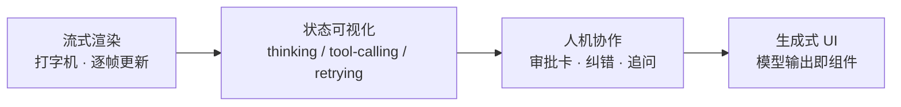

# ⑥ 第六关 · 前端 AI 交互层

> **一句话目标**：同样的模型能力，用更好的交互把它放大——这是前端在 AI 时代不可替代的价值。
>
> **产出物**：一个具备生成式 UI、AI 原生交互范式，并能根据场景选择「云端 vs 端侧」的应用。

← [上一关：协议与多 Agent](../05-第五关-协议与多Agent/index.md) · [返回总纲](../index.md)

---

## 为什么这一关属于前端

前三关的价值主要在"能不能做对"，这一关的价值在"用户觉得好不好用"。同一个 Agent，交互层做差了就是"一个会打字的命令行"，做好了才是产品。

前端在这里的独特战场：

| 战场 | 传统做法失效的地方 | AI 原生做法 |
|---|---|---|
| **不确定性输出** | UI 结构由代码写死 | 输出是 Markdown / 组件 DSL，UI 要**运行时**决定 |
| **长耗时等待** | loading 转圈即可 | TTFT 与生成过程的**过程感**设计 |
| **工具执行** | 前端不关心后端干了啥 | 工具轨迹要可视化，危险操作要**审批卡片** |
| **成本可见性** | 无此概念 | 实时 token / 费用展示，影响用户行为 |
| **离线与隐私** | 一律走服务端 | 小模型跑在浏览器（端侧推理） |

## AI 原生 UI 的四个范式

1. **流式渲染**：不是把整段文本塞进 `
`，而是按 parts 增量更新 + 中断/重生成。
2. **状态可视化**：让"它在想"、"它在查资料"、"它调用了什么工具"变得可见——**信任来自可解释**。
3. **人机协作**：把不可逆操作变成可确认的卡片，把模型的低置信变成"要不要我这样做？"
4. **生成式 UI**：模型输出结构化 UI 描述（AG-UI / A2UI / toolCall→组件），前端负责渲染与"沙箱化"。

## 章节与里程碑

| # | 章节 | 你会获得的能力 |
|:-:|------|----------------|
| 01 | [生成式 UI 与组件生态](./01-生成式UI与组件生态.md) | 主流 AI UI 方案地图：AI Elements / assistant-ui / CopilotKit / AG-UI / Ant Design X |
| 02 | [Ant Design X 实战](./02-Ant-Design-X实战.md) | 用 `Bubble.List`/`Sender`/`Conversations` 组装企业级聊天界面 |
| 03 | [端侧推理](./03-端侧推理.md) | Transformers.js + WebGPU/WebNN + OPFS 把小模型跑进浏览器 |
| 附 | [Agent 全栈开发实战](./附-Agent全栈开发实战.md) | 全栈视角的 Agent 应用实现手册（原文保留） |

## 组件选型速查

| 场景 | 首选 | 理由 |
|---|---|---|
| 企业后台 / 中后台系统里的 AI 功能 | `@ant-design/x` | 与 antd 设计体系统一，Bubble/Sender/Conversations 齐全 |
| 独立的 AI 聊天产品、要极致交互 | `assistant-ui` / `CopilotKit` | 针对对话场景深度优化，开箱功能全 |
| 需要 Agent 前端运行时（前后端状态同步） | `AG-UI` | 定义 Agent↔UI 的事件协议，适合自研 Agent |
| 让模型直接产出 UI | `A2UI` / MCP Apps | 模型输出声明式 UI 描述，前端受控渲染 |

> 版本清单见 [版本基线真源](../index.md#版本基线唯一真源)；本仓库同时使用了 `@ant-design/x` 与 `@a2ui/react`，可直接对照源码学习。

## 与本仓库代码的映射

| 能力 | 真实实现 | 看点 |
|---|---|---|
| 企业级聊天界面 | `apps/ai-demo/src/components/AIChat.tsx` | RAG 引用、工具轨迹、HITL 确认、Token/成本、离线降级提示 |
| 对话历史侧栏 | `apps/ai-demo/src/components/AIChat.tsx`（`Conversations`） | 创建/切换/重命名/删除 + 右键菜单 |
| 声明式 UI 生成 | `apps/ai-demo/src/components/A2UI.tsx` | `@a2ui/react` 渲染模型产出的 UI |
| 主题与 i18n 适配 | `apps/ai-demo/src/App.tsx`、`packages/shared-theme/` | 暗色主题与 `XProvider` 配置 |
| 端侧推理的工程基础 | `apps/frontend/src/workers/` | Web Worker 承担重计算，避免阻塞渲染线程 |

## 自检清单

- [ ] 能把一条消息按 `parts` 拆分渲染（文本 / 工具调用 / 推理 / 来源），而不是只渲染 `content`
- [ ] 能设计"它在思考"的等待态，而不是一个光秃秃的 Spinner
- [ ] 能实现工具调用的**审批 UI**，并在用户拒绝时给出优雅的后续
- [ ] 能在界面上展示本轮成本与累计成本
- [ ] 能说清端侧推理适合哪些场景（隐私 / 离线 / 低成本），以及它的模型体积与算力代价
- [ ] 能在生成式 UI 场景中做**渲染沙箱**（白名单组件 + 受控数据），避免模型输出带来 XSS

## 面试高频

> - AI 应用的交互设计和传统表单式 UI 有什么本质不同？
> - 模型返回的 Markdown/组件 DSL，怎么防止 XSS？
> - 什么时候该把模型放到浏览器端跑？（引出端侧推理与隐私合规）
> - Agent 执行到一半卡住了，前端应该怎么告诉用户？
>
> 结合 [09-面试篇 · 前沿趋势](../09-面试篇/06-前沿趋势篇.md) 一起准备。
