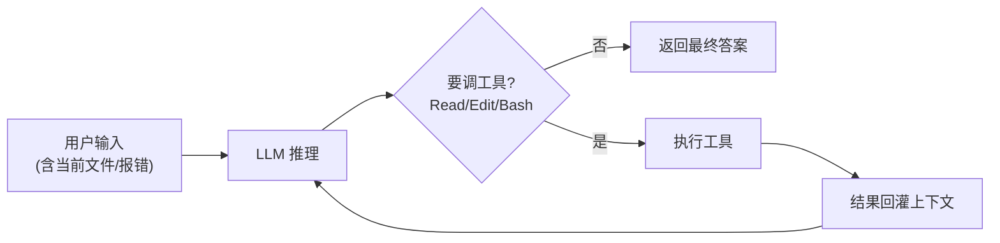

# 01 · Agent Loop 与对话循环

> **一句话**：编码 Agent 不是「一问一答」，而是「推理 → 调工具 → 结果回灌 → 再推理」的循环；这一章拆开这个循环，并说清它在编码场景的特殊性。
>
> **前置**：第三关「Agent 设计模式」
> **产出**：能徒手画出一个编码 Agent 的完整 Loop，并说出停止条件怎么防死循环
> **参考**：`E:\code\ai\claude-code-book`（对话循环章节）、`E:\code\ai\how-pi-agent-works`（Agent Loop + 流式事件）

---

## 1. 原理（够用即可）

普通 Chatbot：`用户 → 模型 → 文本`，一次就结束。
编码 Agent：`用户 → 模型 → 决定调工具 → 执行工具(读文件/跑命令) → 工具结果回灌上下文 → 模型再推理 …` 直到模型认为任务完成或触发停止条件。



**关键差异**：编码 Agent 的「工具结果」是**文件内容 / 命令输出 / 搜索命中**，体积大、价值不均——这直接引出第三章的「上下文压缩」。

**消息归一**：循环里的上下文由三类 message 组成——`user`（含用户指令与附加文件）、`assistant`（含推理与 tool-call）、`tool`（工具结果）。模型看到的是这三条消息的线性历史。

## 2. 企业实现要点

| 关注点 | 普通 Chat | 编码 Agent |
|---|---|---|
| 流式 | 文本 token 流 | token + 工具调用事件 + 工具结果事件 + 状态事件（thinking/tool-calling/retrying） |
| 停止条件 | 模型自然结束 | `maxSteps` / token 预算 / 用户中断 / **工具无进展检测**（连续 N 步未改变文件或命令无输出） |
| 中断恢复 | 无 | 可 `cancel` 当前执行；可 `resume` 从断点继续（见 `how-pi-agent-works` 的会话树） |

> 死循环防护不是「限制步数」这么简单：真实工程里更要检测「工具反复返回相同结果」这类**隐性不收敛**，这一步和 ③ 的「重复检测」一脉相承。

## 3. 代码实现

最小可跑的编码 Agent Loop（AI SDK 7 思路，映射到 `apps/ai-course/src/stages/03-agent/`）：

```ts
import { streamText, type ModelMessage } from 'ai';

async function codingLoop(userInput: string, messages: ModelMessage[]) {
  messages.push({ role: 'user', content: userInput });
  // maxSteps 让 SDK 在模型请求 tool-call 时自动续跑，直到模型不再调工具
  const result = streamText({
    model: myModel,
    messages,
    tools: { readFile, editFile, runBash }, // 见 02 章
    stopWhen: stepCountIs(25), // 停止条件：步数上限
  });
  for await (const part of result.fullStream) {
    // part.type: 'text' | 'tool-call' | 'tool-result' | 'finish'
    renderEvent(part); // 前端把每个 part 渲染成「思考/工具/结果」卡片
  }
}
```

对照 `E:\code\ai\how-pi-agent-works` 的 4 个渐进 TS Demo：它从「纯函数 Loop」逐步加到「流式事件 + 工具调用 + 会话树」，是本章最贴手的实现参考。

## 4. 验证与观测

- 在 `apps/ai-demo` 的聊天界面发一句「读取 package.json 并告诉我用了哪些依赖」，观察事件流是否依次出现 `tool-call(readFile)` → `tool-result` → `text`。
- 故意让它「改一个不存在的文件」，确认工具返回结构化错误后 Loop 能继续而不是崩溃。
- 看 `backend/internal/airouter/` 的 SSE 事件：它把「RAG→工具→重试→HITL」的每一步推给前端，正是企业级 Loop 的可观测形态。

## 5. 面试追问

- **编码 Agent 的 Loop 和普通 Chatbot 有什么区别？** 骨架：多一轮「工具执行 + 结果回灌」；难点在工具结果体积大、需压缩、需权限与可观测。
- **为什么 tool-result 必须回灌而不是只展示？** 因为下一步推理依赖上一步的真实输出（文件内容 / 命令结果），不回灌模型就「瞎编」。
- **怎么防死循环烧钱？** 步数上限 + 预算上限 + 重复检测（相同工具结果连续出现）；追问：重复检测和步数上限哪个更准？
- **中断后怎么恢复？** 会话树 / 断点续跑（见 03 章与 `how-pi-agent-works`）。

## 6. 延伸阅读

- `E:\code\ai\claude-code-book`：对话循环与 `Tool<>` 协议章节（架构剖析）
- `E:\code\ai\how-pi-agent-works`：Agent Loop / 消息 / 流式事件（教学实现）
- `E:\code\ai\pi\pi-agent-core`：工具调用 + 状态机的极简实现
- 回到本仓库：[第三关 · Agent 设计模式](../03-第三关-Agent与工具/01-Agent设计模式.md)
