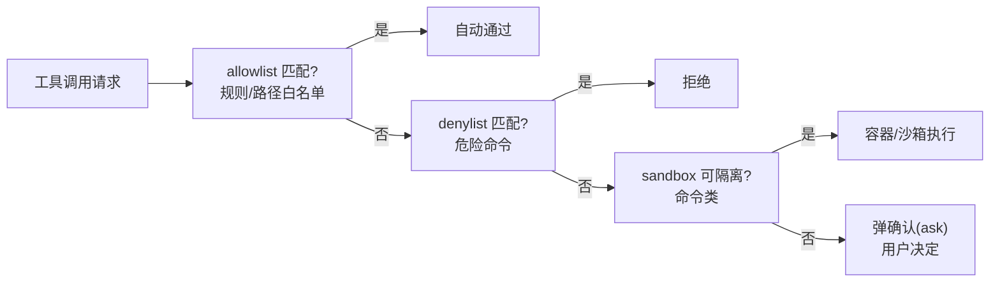

# 02 · 工具系统与权限管线

> **一句话**：编码 Agent 的工具是「读文件 / 写文件 / 跑命令 / 全局搜索」，副作用直接落磁盘和 shell；这一章讲三类核心工具的契约，以及「allow / ask / deny / sandbox」四档权限管线。
>
> **前置**：第三关「工具设计契约」
> **产出**：能画出权限管线，并说清每个工具该落在哪一档
> **参考**：`https://github.com/claude-code-best/claude-code`（工具系统 + 四阶段权限管线）、`https://github.com/earendil-works/pi`（工具调用 + 状态机）

---

## 1. 原理（够用即可）

编码 Agent 的工具远比「查天气」危险，按副作用分为三类：

| 类别 | 工具 | 副作用 |
|---|---|---|
| 只读 | `Read` / `Grep` / `Glob` | 无，可默认放行 |
| 写文件 | `Edit` / `Write` | 改磁盘，需范围受限（限定工作区） |
| 执行命令 | `Bash` | 最高危，可能删库 / 联网 / 装包 |

权限管线决定「这次工具调用是直接过、弹确认、还是拒绝」：



## 2. 企业实现要点

| 档位 | 触发场景 | 例子 | 与 ③ 的 L0/L1/L2 对应 |
|---|---|---|---|
| **allow** | 低风险、可预测 | 读 `src/**`、搜索 | L0 只读 |
| **ask** | 不可逆 / 高风险写 | 删除文件、`git push --force`、覆盖 | L2 不可逆（走 HITL） |
| **deny** | 明确禁止 | `rm -rf /`、访问 `~/.ssh` | L2 直接拦截 |
| **sandbox** | 需执行但不可信 | 跑测试、装依赖、未知脚本 | L1 可撤销（容器回滚） |

> 与第三关「幂等 / 有界 / 分级」三铁律互为表里：这里把「分级」具体化成了四档，并强调**命令执行默认走沙箱**——这是编码 Agent 区别于普通 Agent 的安全基线。

**沙箱为什么必要**：即使 `deny` 了 `rm -rf`，一个伪装成「构建」的命令仍可能悄悄删文件。沙箱（容器 / gVisor / 受限用户）把破坏限制在可丢弃的环境里。

## 3. 代码实现

权限判定（伪代码，落到 `apps/backend/internal/tool/` 的权限分级之上）：

```ts
type Decision = 'allow' | 'ask' | 'deny' | 'sandbox';

function decide(tool: string, args: unknown): Decision {
  if (matchAllowlist(tool, args)) return 'allow';      // 只读 + 工作区内
  if (matchDenylist(tool, args)) return 'deny';        // rm -rf / 敏感路径
  if (tool === 'Bash') return 'sandbox';               // 命令默认沙箱
  if (isIrreversibleWrite(tool, args)) return 'ask';   // 删/覆盖/git 危险操作
  return 'ask';
}
```

工业实现对照：`apps/backend/internal/tool/` 已实现 L0/L1/L2 分级 + 参数净化沙箱 + 调用审计；`https://github.com/claude-code-best/claude-code` 给了一套完整四阶段管线（含规则文件 `~/.claude/settings`）。

## 4. 验证与观测

- 在编码 Agent 里执行 `rm -rf node_modules`：确认命中 `deny` 或 `sandbox`，宿主的 `node_modules` 仍在。
- 执行一次「编辑工作区外的文件」：确认被 `ask` 拦截，需用户确认。
- 看 `apps/backend/internal/tool/` 的审计日志：每个调用应有「参数 + 结果 + 耗时 + 决策档位」。

## 5. 面试追问

- **怎么防止编码 Agent 执行危险命令？** 三层：denylist 拒高危 → sandbox 隔离执行 → ask 档让人确认不可逆操作；追问：sandbox 能防住所有危险吗？
- **四档和 ③ 的 L0/L1/L2 怎么对应？** allow→L0，sandbox→L1（可撤销），ask/deny→L2（不可逆/拦截）。
- **为什么命令比文件写入更危险？** 命令可组合（`curl | sh`）、可联网、可越权；文件写通常限定路径。
- **审计为什么必须？** 出问题要能回放是哪一步、哪个工具、什么参数导致的。

## 6. 延伸阅读

- `https://github.com/claude-code-best/claude-code`：工具系统与四阶段权限管线（含规则文件设计）
- `https://github.com/earendil-works/pi`：工具调用 + 状态机的极简实现
- 回本仓库：[第三关 · 工具设计契约](../03-第三关-Agent与工具/02-工具设计契约.md)、[第四关 · 安全护栏](../04-第四关-企业级工程化/02-安全护栏.md)
