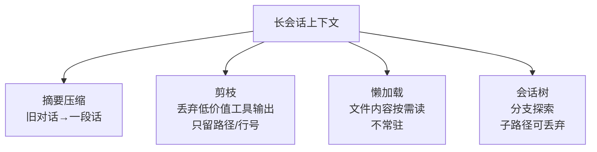

# 03 · 上下文压缩与长会话

> **一句话**：上下文窗口不是无限大，长会话 + 大文件会爆窗，且 KV Cache 成本随长度二次增长；这一章讲摘要、剪枝、懒加载与「会话树」四种对策。
>
> **前置**：02 章（工具结果体积大）、第四关「上下文工程」
> **产出**：能说出至少两种压缩策略及其代价，并解释会话树为什么能防「主上下文污染」
> **参考**：`https://github.com/KMaybe01/claude-code-book`（上下文压缩章节）、`https://github.com/cellinlab/how-pi-agent-works`（上下文压缩 + 会话树）

---

## 1. 原理（够用即可）

编码 Agent 的上下文由「对话 + 文件内容 + 命令输出 + 搜索命中」组成，增长极快：

- 读一个 2000 行文件 = 几千 token；连读十个就逼近窗口。
- 即使窗口有 1M token，**KV Cache 命中率随历史变长下降**，成本与延迟都涨。

所以必须主动管理上下文，而不是「全塞进去」：



## 2. 企业实现要点

| 策略 | 做法 | 收益 | 代价 |
|---|---|---|---|
| **摘要压缩** | 把 N 轮前的对话/工具结果 summary 成一段 | 显著缩短历史 | 可能丢细节，需保留关键事实索引 |
| **剪枝** | 工具结果只留「文件路径 + 行号 + 是否成功」，删掉原始内容 | 上下文最轻 | 再需要内容得重新读（懒加载兜底） |
| **懒加载** | 文件内容只在用到时 `Read`，用完可逐出 | 避免大文件常驻 | 多一次 IO，需缓存 |
| **会话树** | 把每次「尝试」建成分支节点，失败分支可丢弃，主路径只保留结论 | 隔离探索、防污染 | 实现复杂（见 `how-pi-agent-works`） |

> 压缩时机也很关键：**不要每轮都压**（浪费 token），也不要等到爆窗才压（已晚）。常见做法：上下文超阈值（如 70% 窗口）时触发一次摘要。

## 3. 代码实现

摘要触发（伪代码，落到 `backend/internal/memory/` 的裁剪与压缩之上）：

```ts
const WINDOW = 200_000; // 模型窗口
const TRIGGER = 0.7 * WINDOW;

function maybeCompress(messages: ModelMessage[]): ModelMessage[] {
  const used = estimateTokens(messages);
  if (used < TRIGGER) return messages;
  const { keepRecent, toSummarize } = split(messages, keepLast = 10);
  const summary = await summarize(toSummarize); // 调小模型做摘要
  return [{ role: 'system', content: summary }, ...keepRecent];
}
```

工业实现对照：`backend/internal/memory/` 提供多轮会话记忆的裁剪与压缩；`https://github.com/KMaybe01/claude-code-book` 把「自动压缩 + 用户可手动 `/compact`」做成产品特性。

## 4. 验证与观测

- 让 Agent 连续读 10 个大文件后问「前面第三个文件叫什么」：确认它靠摘要/索引仍能答出，而不是真忘了。
- 观察 token 用量曲线：启用剪枝后应明显低于「全量回灌」。
- 看 `how-pi-agent-works` 的会话树 Demo：一条分支探索失败后，主上下文未受其污染。

## 5. 面试追问

- **长会话怎么不爆窗？** 四策：摘要 / 剪枝 / 懒加载 / 会话树；追问：你选哪个做主策略？
- **压缩和剪枝的区别？** 压缩保留语义（summary），剪枝直接丢弃原始内容只留索引；代价分别是「可能失真」vs「需重新读取」。
- **为什么 KV Cache 成本随长度涨？** 历史越长，前缀匹配越难完全命中，重算越多；窗口不是越大越便宜。
- **会话树解决什么剪枝解决不了的？** 剪枝是「丢历史」，会话树是「保留多条探索分支并可选择性合并」，适合试错型编码任务。

## 6. 延伸阅读

- `https://github.com/KMaybe01/claude-code-book`：上下文压缩章节
- `https://github.com/cellinlab/how-pi-agent-works`：上下文压缩 + 会话树（4 个渐进 Demo）
- 回本仓库：[第四关 · 上下文工程与 Skills](../04-第四关-企业级工程化/03-上下文工程与Skills.md)、[第三关 · 对话记忆](../03-第三关-Agent与工具/index.md)
