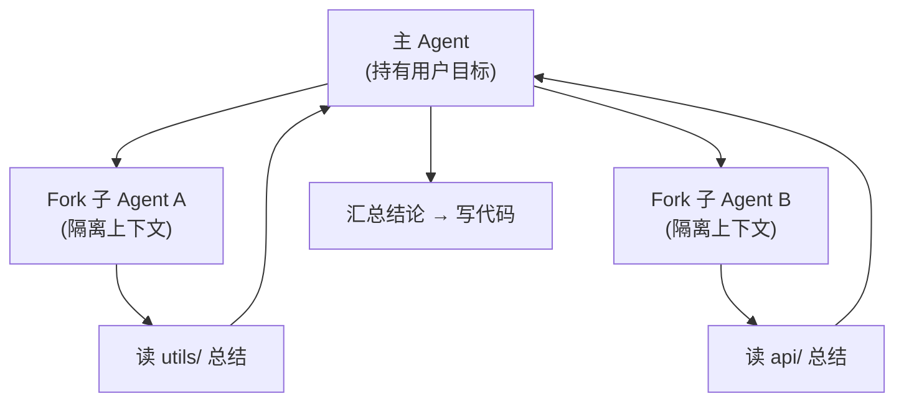

# 04 · 子 Agent 与多 Agent 编排

> **一句话**：当一次任务要探索很多文件、或要并行查多个模块时，主循环直接硬扛会把上下文撑爆；这一章讲 Fork 子 Agent 做隔离探索，以及它和第五关 A2A 的区别。
>
> **前置**：02 章（工具/权限）、03 章（上下文）、第五关「A2A 多 Agent」
> **产出**：能说清「子 Agent」和「主循环多调几次工具」的本质区别，并给出适用场景
> **参考**：`E:\code\ai\claude-code-book`（Fork 子 Agent 章节）、`E:\code\ai\hello-agents`（多 Agent 案例）

---

## 1. 原理（够用即可）

主 Agent 遇到「先去把整个 `utils/` 读一遍、总结用法」这类任务，如果自己读，所有文件内容都会进**主上下文**，挤掉真正要写的代码所需的空间。

解法是 Fork 一个子 Agent：



子 Agent 拥有**独立上下文**，探索完只把「结论」回传给主 Agent，原始文件内容不污染主上下文。

## 2. 企业实现要点

| 模式 | 适用 | 与「主循环多调工具」的区别 |
|---|---|---|
| **主从（Orchestrator-Worker）** | 一个任务可拆成独立子任务并行 | 子任务在隔离上下文跑，主上下文只收结论 |
| **Fork 探索** | 试错型（猜哪条路通） | 失败分支可整体丢弃，不污染主路径 |
| **顺序委派** | 依赖前一步结果的子任务 | 仍是隔离，但串行 |

**和 A2A 的区别**（第五关）：
- 子 Agent 是**同进程内**的逻辑隔离，共享同一套工具与权限，通信走内存。
- A2A 是**跨进程 / 跨组织**的 Agent 通信（HTTP + Agent Card），用于「调用别人的 Agent」。
- 选型：自己仓库内的探索用子 Agent；调用外部能力用 A2A。

> `E:\code\ai\claude-code-book` 的「Fork 子 Agent」章节详细讲了它如何用独立上下文隔离探索；`hello-agents` 的「赛博小镇 / 旅行助手」是多 Agent 协作的教学案例。

## 3. 代码实现

派发子 Agent（伪代码，落到 `backend/internal/agent/` 的 Multi-Agent 之上）：

```ts
async function orchestrate(task: string) {
  const subtasks = await decompose(task); // 拆子任务
  const results = await Promise.all(
    subtasks.map((t) => spawnSubAgent({ task: t, isolatedContext: true })),
  );
  return synthesize(results); // 主 Agent 只汇总结论
}
```

工业实现对照：`backend/internal/agent/` 已实现 ReAct / Function Calling / Multi-Agent 三种引擎；`E:\code\ai\pi\pi-coding-agent` 给了一个 CLI 形态的编码子 Agent 样例。

## 4. 验证与观测

- 让主 Agent「先调研再改代码」，观察子 Agent 的上下文长度与主 Agent 解耦（主 Agent 上下文不随子 Agent 读的文件增长）。
- 故意让一个子 Agent 走错路：确认它失败后主路径仍可继续（分支可丢弃）。

## 5. 面试追问

- **子 Agent 和「主循环里多调几次工具」有什么区别？** 骨架：隔离上下文 vs 共享上下文；子 Agent 解决「探索污染主上下文」问题。
- **什么时候该用子 Agent？** 任务可独立拆分 / 需并行探索 / 试错分支多；追问：什么场景反而不要用？
- **子 Agent 和 A2A 怎么选？** 同仓库内隔离→子 Agent；跨进程跨组织调用→A2A。
- **子 Agent 的结论怎么保证可信？** 让子 Agent 只回传「结论 + 证据索引」，主 Agent 可二次核验。

## 6. 延伸阅读

- `E:\code\ai\claude-code-book`：Fork 子 Agent 章节
- `E:\code\ai\hello-agents`：多 Agent 案例（旅行助手 / 赛博小镇）
- 回本仓库：[第五关 · A2A 多 Agent 协作](../05-第五关-协议与多Agent/03-A2A多Agent协作.md)、[第三关 · Agent 设计模式](../03-第三关-Agent与工具/01-Agent设计模式.md)
