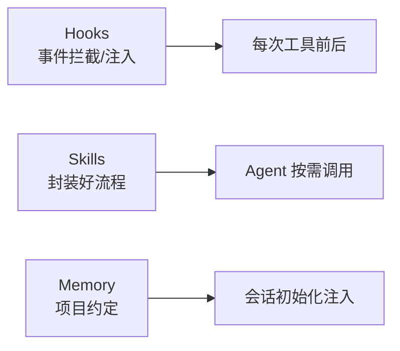

# 05 · Hooks、Skills 与 Memory

> **一句话**：编码 Agent 的能力不该只靠 Prompt 堆出来——生命周期钩子（Hooks）、可复用技能（Skills）、项目记忆（Memory）把它从「一次性对话」升级成「可工程化维护的资产」。
>
> **前置**：第四关「上下文工程与 Skills」
> **产出**：能区分三者职责边界，并各举一个工程用例
> **参考**：`https://github.com/luongnv89/claude-howto`（slash commands / memory / skills / hooks / plugins）、`https://github.com/github/awesome-copilot`（生态对照）

---

## 1. 原理（够用即可）

三者解决的不是同一件事，常常被混为一谈：

| 概念 | 是什么 | 触发时机 | 例子 |
|---|---|---|---|
| **Hooks** | 生命周期钩子，在事件前后注入逻辑 | `PreToolUse` / `PostToolUse` / `Stop` 等 | 禁止某命令、工具后自动格式化、调用后写审计 |
| **Skills** | 可复用能力单元（流程封装） | 被 Agent 主动调用 | 「加一个 CRUD 接口」「写单测」的固定套路 |
| **Memory** | 跨会话持久化的项目约定 | 会话开始即加载 | `CLAUDE.md` 里的「本仓库用 bun、禁 npm」 |



## 2. 企业实现要点

**Hooks 能解决 Skills 解决不了的**：Skills 是「主动调用的能力」，Hooks 是「被动强制的约束」。例如「禁止 `git push --force`」只能用 Hook（PreToolUse 拦截），没法靠 Skill 指望模型「记得别推」。

**Skills 与第四关 Agent Skills 的关系**：第四关把 Skill 定义为「可复用能力单元挂到运行时」；编码 Agent 里它进一步落地为 slash command / 插件——`awesome-copilot` 的 skills 与 Claude Code 的 skills 是同一概念的两套生态，可横向对照。

**Memory 的层级**：用户级（`~/.claude/CLAUDE.md`）+ 项目级（仓库根 `CLAUDE.md`）+ 会话级（本次对话摘要）。优先级通常 项目 > 用户 > 会话。

> 实操模板见 `https://github.com/luongnv89/claude-howto`：它把 slash commands、memory、skills、subagents、MCP、hooks、plugins 都做成了「复制即用」的模板；`awesome-copilot` 则是 GitHub Copilot 一侧的同构生态（agents / instructions / skills / hooks / plugins）。

## 3. 代码实现

PreToolUse 钩子（伪代码，对应 `apps/backend/internal/airouter` 的工具审批编排）：

```ts
// 在工具执行前强制拦截危险操作
hooks.on('PreToolUse', ({ tool, args }) => {
  if (tool === 'Bash' && /git\s+push\s+--force/.test(args.cmd)) {
    return { block: true, reason: '禁止强推，请走 PR' };
  }
  if (tool === 'Edit' && !withinWorkspace(args.path)) {
    return { block: true, reason: '超出工作区' };
  }
});
```

## 4. 验证与观测

- 配置一个 `PostToolUse` 钩子：每次 `Edit` 后自动跑 `oxlint --fix` + `oxfmt`。确认改完文件立即被格式化。
- 写一条 Memory「本仓库禁止 npm」：新会话里让 Agent 装依赖，确认它自动用 `bun`。
- 调一个 Skill「加 CRUD 接口」：确认它按固定套路产出 controller/service/route 而不偏离。

## 5. 面试追问

- **Hooks / Skills / Memory 的职责边界？** Hooks=强制约束与拦截；Skills=主动调用的能力包；Memory=跨会话的项目约定。
- **为什么「禁止强推」必须用 Hook 而不是 Prompt？** Prompt 是软约束，模型可能忘；Hook 在运行时硬拦截，不可绕过。
- **Skills 和第四关的 Agent Skills 是同一个东西吗？** 同一概念（可复用能力单元），编码 Agent 把它落地为 slash command / 插件形态。
- **Memory 该放多少？** 只放「跨会话不变的约定」，别把临时任务塞进 Memory，否则污染每次会话。

## 6. 延伸阅读

- `https://github.com/luongnv89/claude-howto`：slash commands / memory / skills / hooks / plugins（复制即用模板）
- `https://github.com/github/awesome-copilot`：Copilot 一侧的 agents / instructions / skills / hooks / plugins 生态
- 回本仓库：[第四关 · 上下文工程与 Skills](../04-第四关-企业级工程化/03-上下文工程与Skills.md)
