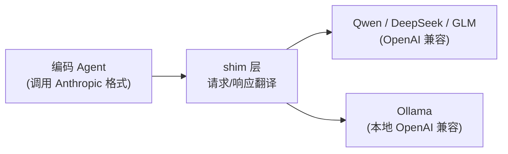

# 06 · 国产模型适配与供应商切换

> **一句话**：编码 Agent 默认绑死某一家厂商，国内落地要换成 Qwen / DeepSeek / GLM / Ollama——这一章讲 OpenAI 兼容 shim 怎么写，以及多厂商路由怎么接。
>
> **前置**：第四关「多 Provider 网关与熔断降级」
> **产出**：能说清把编码 Agent 从 Claude 换成国产模型要改哪几层
> **参考**：`E:\code\ai\openclaude-cn`（OpenAI shim + 实时切换）、`E:\code\ai\cc-switch`（多厂商 GUI）

---

## 1. 原理（够用即可）

多数编码 Agent（如 Claude Code）调用的是**厂商私有 API**（Anthropic Messages API）。要换模型，核心是一层 **shim（垫片）**：把私有 API 的请求/响应，翻译成目标厂商支持的格式（通常是 OpenAI Chat Completions 兼容协议，因为 Qwen/DeepSeek/GLM/Ollama 都兼容它）。



## 2. 企业实现要点

| 要改的层 | 说明 | 坑 |
|---|---|---|
| **请求翻译** | `system` + `messages` + `tools` 映射到 OpenAI 格式 | 不同模型 tool-call 字段命名不一致 |
| **响应翻译** | 把 `choices[].message.tool_calls` 翻回 Agent 期望的结构 | streaming 的 delta 拼接方式不同 |
| **模型能力差异** | 有的模型无 reasoning、有的无并行 tool-call | system prompt 要按模型调整 |
| **实时切换** | `/provider` `/model` 命令动态换供应商与型号 | 切换后要清上下文缓存，避免格式错配 |

> `E:\code\ai\openclaude-cn` 用约 724 行 OpenAI shim 替换 Anthropic SDK，并支持 `/provider` `/model` 实时切换；`E:\code\ai\cc-switch` 更进一步，用 Tauri 桌面 GUI 统一管理 Claude Code / Codex / Gemini 并一键切供应商、管 MCP/Skills/Prompts。

**和本仓库的关系**：第四关 `backend/internal/llm/` 的 Provider 注册表 + 熔断降级，正是「多厂商路由」的服务端版本——前端编码 Agent 的 shim 思路与它同源，只是位置在客户端/CLI。

## 3. 代码实现

shim 的核心（伪代码，思路来自 `openclaude-cn`）：

```ts
// 把 Anthropic 风格请求翻成 OpenAI 兼容请求
function toOpenAI(req: AnthropicRequest): OpenAIRequest {
  return {
    model: mapModel(req.model),        // claude-xxx → qwen-max / deepseek-chat
    messages: [
      { role: 'system', content: req.system },
      ...req.messages,
    ],
    tools: req.tools?.map(translateToolSchema),
    stream: true,
  };
}
```

## 4. 验证与观测

- 在 `openclaude-cn` 里执行 `/provider qwen` 再发一句编码指令，确认走的是 Qwen 且工具调用仍正常。
- 用 `cc-switch` 在 Claude / Codex / Gemini 间一键切换，确认 MCP/Skills 配置随之生效。
- 回本仓库：看 `backend/internal/llm/` 的 Provider 注册表与熔断逻辑，理解服务端多厂商路由。

## 5. 面试追问

- **把编码 Agent 从 Claude 换成 Qwen，要改哪几层？** 请求翻译 / 响应翻译 / 模型能力适配 / 实时切换与缓存清理；追问：tool-call 格式差异怎么处理？
- **为什么选 OpenAI 兼容协议做 shim？** 因为 Qwen/DeepSeek/GLM/Ollama 都兼容它，一层 shim 通吃。
- **切换供应商为什么要清上下文缓存？** 不同模型的 system/tool 格式不同，残留旧格式会错配。
- **本地 Ollama 适合什么场景？** 离线 / 隐私 / 零成本的原型验证，但能力弱于云端旗舰。

## 6. 延伸阅读

- `E:\code\ai\openclaude-cn`：OpenAI shim + `/provider` `/model` 实时切换（约 724 行）
- `E:\code\ai\cc-switch`：多厂商 GUI 统一管理（Claude Code / Codex / Gemini）
- 回本仓库：[第四关 · 多 Provider 网关与熔断降级](../04-第四关-企业级工程化/01-多Provider网关与熔断降级.md)
