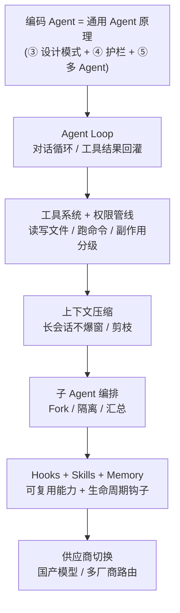

# ⑩ 编码 Agent 专题 · Agentic Coding

> **一句话目标**：把前六关的 Agent 原理，压到**最难、也最贴近前端工程师**的一种 Agent 形态——会读代码、写代码、跑命令、改整仓库的「编码 Agent」。
>
> **产出物**：能读懂 Claude Code 类 harness 的架构，并动手改造它的工具系统 / 权限管线 / 上下文策略 / 子 Agent 编排；能用国产模型驱动它。

← [上一关：前端 AI 交互层](../06-第六关-前端AI交互层/index.md) · [返回总纲](../index.md)

---

## 为什么单独开一个专题

普通对话 Agent 的工具是「查天气 / 发邮件」；**编码 Agent 的工具是「读文件 / 写文件 / 执行命令 / 全局搜索」**——副作用直接落到磁盘和 shell，一次失误可能 `rm -rf` 或半个小时白干。它把第三关的「工具契约 / 停止条件 / HITL」、第四关的「护栏 / 观测 / 成本」、第五关的「多 Agent 协议」全都逼到极限。

所以这一专题**不重复** ③ 的通用理论，而是把它**应用**到编码场景，并补齐编码 Agent 独有的硬骨头：

## 能力地图与里程碑

| # | 章节 | 你会获得的能力 |
|:-:|------|----------------|
| 01 | [Agent Loop 与对话循环](./01-Agent-Loop与对话循环.md) | 拆解「用户输入 → 模型 → 工具 → 结果回灌」的循环；理解流式事件、消息归一、停止条件在编码场景的特殊性 |
| 02 | [工具系统与权限管线](./02-工具系统与权限管线.md) | 文件读写 / 命令执行 / 搜索三类核心工具的契约；四阶段权限管线（allow / ask / deny / sandbox） |
| 03 | [上下文压缩与长会话](./03-上下文压缩与长会话.md) | 上下文窗口不是无限大；摘要、剪枝、压缩策略与「会话树」 |
| 04 | [子 Agent 与多 Agent 编排](./04-子Agent与多Agent编排.md) | Fork 子 Agent 做隔离探索；主从汇总；与 ⑤ 的 A2A 对照 |
| 05 | [Hooks、Skills 与 Memory](./05-钩子Hooks与Skills与Memory.md) | 生命周期钩子、可复用技能库、项目记忆——把「Prompt」升级为「工程资产」 |
| 06 | [国产模型适配与供应商切换](./06-国产模型适配与供应商切换.md) | 用 Qwen/DeepSeek/GLM/Ollama 驱动编码 Agent；OpenAI shim 与实时切换 |
| 附 | [从零构建智能体（hello-agents 精读）](./附-hello-agents精读.md) | 手搓 ReAct/Plan-and-Solve/Reflection + MCP·A2A·ANP（原文保留，深度查阅） |

> 教程侧可跑代码在 `apps/ai-course/src/stages/03-agent/`（工具分级、审批工单、审计流），工业实现对照 `backend/internal/agent`、`internal/tool`、`internal/memory`。

## 与本仓库 / 参考代码库的映射

| 教程内容 | 本仓库实现 | `这批 GitHub 开源仓库` 对照（精读） |
|---|---|---|
| Agent Loop | `backend/internal/airouter/`（RAG→工具→重试→HITL 循环） | `claude-code-book`（对话循环章节）、`how-pi-agent-works`（Agent Loop + 流式事件） |
| 工具系统 + 权限 | `backend/internal/tool/`（L0/L1/L2 + 沙箱 + 审计） | `claude-code`（工具系统 + 四阶段权限管线）、`pi/pi-agent-core`（工具调用 + 状态机） |
| 上下文压缩 | `backend/internal/memory/`（裁剪与压缩） | `claude-code-book`（上下文压缩章节）、`how-pi-agent-works`（上下文压缩 + 会话树） |
| 子 Agent | `backend/internal/agent/`（Multi-Agent） | `claude-code-book`（Fork 子 Agent）、`hello-agents`（多 Agent 案例） |
| Hooks / Skills / Memory | `backend/internal/airouter`（Prompt 版本） | `claude-howto`（slash commands / memory / skills / hooks / plugins）、`awesome-copilot`（生态对照） |
| 供应商切换 | `backend/internal/llm/`（Provider 注册表 + 熔断） | `openclaude-cn`（OpenAI shim + `/provider` 切换）、`cc-switch`（多厂商 GUI） |

## 工具系统的三条铁律（编码场景版）

| 铁律 | 说明 | 违反后果 |
|---|---|---|
| **最小权限** | 命令执行默认走沙箱 / 容器；文件写入限定工作区 | 一条 `rm -rf` 删库 |
| **先问后写** | 不可逆写（删、覆盖、git 操作）进「ask」档，需用户确认 | 改错文件半小时白干 |
| **可审计** | 每个工具调用留痕（参数 + 结果 + 耗时），可回放 | 出问题无法定位是哪一步 |

> 与 ③ 的「幂等 / 有界 / 分级」三铁律互为表里：编码场景把「分级」具体成了「allow / ask / deny / sandbox」四档。

## 自检清单

- [ ] 能手绘一个编码 Agent 的 Loop：从用户一句话到它改完一个文件，中间经过哪些步骤
- [ ] 能说清「allow / ask / deny / sandbox」四档分别在什么场景触发，并画出权限管线
- [ ] 能解释为什么长会话必须做上下文压缩，给出至少两种压缩策略及其代价
- [ ] 能说明 Fork 子 Agent 解决什么问题（隔离探索 / 并行 / 防污染主上下文）
- [ ] 能区分 Hooks、Skills、Memory 三者的职责边界，并各举一个工程用例
- [ ] 能用 `openclaude-cn` 的思路说明：把 Claude Code 换成国产模型，shim 层要改哪几处

## 面试高频

> - 编码 Agent 和通用 Agent 的本质区别？难在哪？
> - 怎么防止编码 Agent 执行危险命令？（权限管线 + 沙箱 + HITL）
> - 上下文窗口有限，长会话怎么不「失忆」？
> - 子 Agent 和直接在主循环里多调几次工具有什么区别？
> - 你用过 / 改过编码 Agent 吗？它的哪个环节你觉得可以优化？
>
> 完整题库见 [09-面试篇 · Agent 设计](../09-面试篇/03-Agent设计篇.md) 与 [工具与协议](../09-面试篇/04-工具与协议篇.md)。
