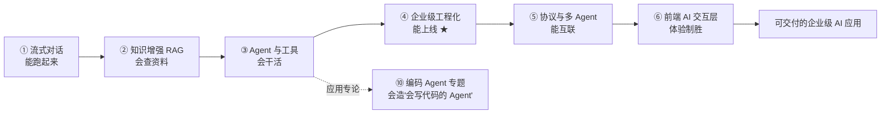

# AI Agent 全栈开发 · 前端转型指南

> **定位**：面向有 React / TypeScript 基础的前端开发者，用**六个关卡 + 一个编码 Agent 专题**从零到一交付生产级 AI Agent 应用，并能读懂 / 改造业界主流编码 Agent（Claude Code 类）的实现。
>
> **前置要求**：熟悉 TypeScript + React Hooks，了解 HTTP / API 基本概念。**不需要机器学习背景**。
>
> **怎么用这份教程**：先看「三条路径」选一条 → 进关卡 → 每章按 `原理 → 企业实现 → 代码 → 验证 → 面试追问` 五段式推进 → 出关卡前用「自检清单」验收。想深挖实现，翻 [参考代码库](#参考代码库)。

---

## 版本基线（唯一真源）

> 全库所有版本声明以此表为准。各章节**只引用、不自创**版本号；如与下表冲突，以本表为准并回帖修正。

**基线核对日期**：2026-10-10

| 维度 | 基线值 | 核验来源 |
|------|--------|---------|
| **AI SDK** | `ai@^7.0.36`（本仓库实际依赖；`engines: node >= 22`，peerDeps `zod ^3.25.76 \|\| ^4.1.8`） | 本仓库 `node_modules/ai/package.json` = `7.0.36` |
| **React 适配器** | `@ai-sdk/react@^4.0.39` | 本仓库 [apps/ai-demo/package.json](https://github.com/KMaybe01/interview-demo/blob/main/apps/ai-demo/package.json) |
| **React** | `19.x` | 本仓库 [apps/ai-demo/package.json](https://github.com/KMaybe01/interview-demo/blob/main/apps/ai-demo/package.json) |
| **MCP 规范** | `2026-07-28`（上一稳定版 `2025-11-25`） | [modelcontextprotocol.io/specification/2026-07-28](https://modelcontextprotocol.io/specification/2026-07-28) |
| **A2A 规范** | `v1.0`（2026-03 发布，首个生产就绪版） | a2aproject / Linux Foundation Agentic AI Foundation |
| **前沿模型** | 旗舰：OpenAI GPT-5 系、Claude Opus/Sonnet 4.5–5.5、Gemini 3.5；性价比：DeepSeek V4、Qwen3、GLM-4.5 | 2026-10 Vercel AI Gateway `/v1/models` 实列 |
| **端侧小模型** | Qwen2.5 / Qwen3 0.5B–1.5B（Transformers.js / onnx-community） | 浏览器推理生态 |
| **前端 AI UI** | AI Elements、assistant-ui、CopilotKit、AG-UI、`@ant-design/x`、`@a2ui/react` | 公开仓库 / 发布信息 |
| **生成式 UI 协议** | A2UI v0.9.1（稳定）/ v1.0 RC；传输兼容 A2A / AG-UI | [https://github.com/google/A2UI](https://github.com/google/A2UI) |
| **编码 Agent 参考实现** | `claude-code`（社区逆向复刻 `claude-code-best`）、`pi`（极简 harness）、`hello-agents`（教学框架） | [https://github.com/claude-code-best/claude-code](https://github.com/claude-code-best/claude-code) / [https://github.com/earendil-works/pi](https://github.com/earendil-works/pi) |
| **包管理器** | `bun`（本仓库禁止 npm/yarn/pnpm） | 根 [AGENTS.md](https://github.com/KMaybe01/interview-demo/blob/main/AGENTS.md) |

> 💡 **型号说明**：模型迭代极快，上表「旗舰/性价比」是**档位划分**而非永久结论。
> 写代码前请核对你所用 Gateway / 厂商当期的**实际模型 ID**（如 `openai/gpt-5`、
> `anthropic/claude-opus-4.5`、`google/gemini-3.5-flash`），不要照抄本文示例里的具体型号。

### 关于模型代际

`GPT-4o` / `Claude 3.5 Sonnet` / `Gemini 1.5 Pro` / `Llama 3.1` / `Qwen 2.5` 属 **2024 代际**，
仅可出现在「技术演进史」语境；**选型与示例一律使用上表的 2026 基线**。

### 关于「OpenAI 营销代号 / 未实列型号」

历史版本曾把 OpenAI 的下一代旗舰写作「GPT-5/Sol/Luna」，该命名**未成为官方实列的模型 ID**。
以 Vercel AI Gateway `/v1/models` 实列的 `openai/gpt-5`、`openai/gpt-5-mini`、`openai/gpt-5-codex` 为准；
写代码前请核对当期实际型号，不要把未经验证的营销代号写进示例。

---

## 教程的两条主线 + 一个参考代码库

本仓库里 AI 能力**已经真实落地**，教程按「技术栈主线 / 参考实现主线 / 延伸参考库」三轨组织：

| | 主线（你要手写的代码） | 副线（企业级后端参考实现） | 延伸参考库（业界实现精读） |
|---|---|---|---|
| **技术栈** | AI SDK 7 + TypeScript 全栈（React + BFF） | Go + Gin（`apps/backend/internal/*`） | 这些 GitHub 开源仓库（见下方映射表） |
| **为什么** | 前端转型最短路径，心智模型与 React 一致 | 网关熔断、工具沙箱、护栏、HITL、评测这些**服务端重活**看生产级怎么写 | 读懂 Claude Code / AI SDK / 编码 Agent 的**真实工程实现**，把理论对照源码 |
| **入口** | [第一关](./01-第一关-流式对话/index.md) → [apps/ai-course/](https://github.com/KMaybe01/interview-demo/tree/main/apps/ai-course) | [07-Go后端参考实现](./07-Go后端参考实现/index.md) | [参考代码库](#参考代码库) |
| **通读要求** | 必读 | 按需查阅，不必通读 | 专题精读，配合对应关卡 |

> 每关的 `index.md` 里都有「与本仓库代码的映射」表，可直接对着真实代码读；`这批 GitHub 开源仓库` 的对应关系见下方[参考代码库](#参考代码库)。

---

## 六个关卡 + 编码 Agent 专题



| 关卡 | 主题 | 产出物 | 参考周期 |
|:---:|------|--------|:------:|
| [①](./01-第一关-流式对话/index.md) | 流式对话 | 生产级流式聊天（可中断 / 可重连 / 有成本显示）→ [apps/ai-course/src/stages/01-chat/](https://github.com/KMaybe01/interview-demo/tree/main/apps/ai-course/src/stages/01-chat) | 1-2 周 |
| [②](./02-第二关-知识增强RAG/index.md) | 知识增强 RAG | 支持 PDF/Word 的企业知识问答 + 评测闭环 | 2-3 周 |
| [③](./03-第三关-Agent与工具/index.md) | Agent 与工具 | 带审批、能停下来的自主 Agent | 3-4 周 |
| [④](./04-第四关-企业级工程化/index.md) | **企业级工程化** | 有网关容灾、护栏、观测、评测、配额的生产系统 | 持续 |
| [⑤](./05-第五关-协议与多Agent/index.md) | 协议与多 Agent | 可对外提供 MCP 工具 + A2A 协作 | 持续 |
| [⑥](./06-第六关-前端AI交互层/index.md) | 前端 AI 交互层 | 生成式 UI / 端侧推理 / AI 原生体验 | 2 周 |
| [⑩](./10-编码Agent专题/index.md) | **编码 Agent 专题** | 读懂并改造 Claude Code 类 harness：Loop / 工具 / 权限 / 上下文压缩 / 子 Agent / Hooks / Skills | 持续 |

> **④ 是本教程的分水岭**。前三关解决「能不能跑」，第四关解决「敢不敢上线」——面试里 80% 的追问也集中在这里。
> **⑩ 是进阶分水岭**：把前六关的原理压到「让 Agent 读写代码、跑命令、自动化整仓库」这一最 demanding 的场景，是前端转型「AI 工具链工程师」的硬通货。

---

## 三条学习路径

| 路径 | 适合谁 | 怎么走 |
|------|--------|--------|
| **⚡ 快速上手（2 周）** | 想尽快跑通一个 AI 应用 | [01-30分钟从0到1](./01-第一关-流式对话/01-30分钟从0到1.md) → 第一关 → 第三关 01/04 → 第四关 01/02/06 |
| **🧗 系统进阶（8 周）** | 想主导 AI 产品架构 | ① → ⑥ 顺序通关，每关做完「自检清单」再进下一关；有余力用 ⑩ 把原理落到编码 Agent |
| **🎯 面试突击（1 周）** | 已在做 AI 项目、要准备面试 | [09-面试篇](./09-面试篇/00-面试技巧与回答模板.md) 六篇 → 反查薄弱章节 → 用第四关补齐「生产感」→ 用 ⑩ 准备「你用过/改过编码 Agent 吗」这类追问 |

---

## 目录结构

```
S5-AI/
├── index.md                          ← 你在这里（版本基线真源）
├── 00-导学/                          「我该学什么 / 怎么选」
│   ├── 01-前端转型AI能力地图.md       能力地图、术语速查、AI SDK 迁移要点、编码 Agent 分支
│   ├── 02-AI应用市场与生态.md         平台 / 工具 / 编码助手 / Copilot / Claude Code 全景
│   └── 03-技术选型速查.md             核心决策点的精简对比
├── 01-第一关-流式对话/                LLM 调用 · 流式协议 · AI SDK 7（延伸：https://github.com/vercel/ai 源码导读）
├── 02-第二关-知识增强RAG/             分块 · 检索 · 重排 · 评测（延伸：hello-agents RAG）
├── 03-第三关-Agent与工具/             设计模式 · 工具契约 · 停止条件 · HITL（延伸：pi / how-pi-agent-works）
├── 04-第四关-企业级工程化/ ★           网关 · 护栏 · 上下文工程 · 观测 · 评测 · 成本 · 部署
├── 05-第五关-协议与多Agent/            MCP 2026-07-28 · A2A v1.0（延伸：hello-agents ANP/A2A/MCP）
├── 06-第六关-前端AI交互层/             生成式 UI · Ant Design X · 端侧推理（延伸：A2UI + x）
├── 07-Go后端参考实现/                 副线：Go + Gin 走一遍 LLM 后端
├── 08-资料库/                         大部头原文归档，按需查阅（不要求通读）
├── 09-面试篇/                         六专题 + 技巧 + 项目表述模板
├── 10-编码Agent专题/  ★NEW            Agentic Coding：Loop / 工具 / 权限 / 上下文压缩 / 子Agent / Hooks / Skills / 国产适配
└── 99-写作约定.md                      章节模板与作者须知
```

> 每个关卡目录下 `NN-*` 是**教程正文**，`附-*` 是**保留原文的实现手册**（内容全量保留，用于深度查阅）。

---

## 参考代码库

> 以下是一批 GitHub 开源仓库的映射（非本地路径），按需取用、不要求通读。定位为**「实现精读」参考库**：教程正文讲原理，这里看真实工程怎么写。
> 下面的映射表是「主题 → 仓库 → 该看什么」，避免你在几十万文件里迷路。

| 仓库（GitHub 地址） | 是什么 | 对应关卡 / 专题 | 重点看 |
|---|---|---|---|
| [https://github.com/vercel/ai](https://github.com/vercel/ai) | Vercel **AI SDK v7** monorepo（`ai` + `@ai-sdk/react` + `@ai-sdk/rsc` 等） | ① ② ③ ⑥ | `packages/ai`（streamText / 工具 / 结构化）、`packages/react`（useChat）、`architecture/`（流式循环、loop control） |
| [https://github.com/google/A2UI](https://github.com/google/A2UI) | Google **生成式 UI 开放标准**（声明式 JSON 描述 UI，客户端受控渲染） | ⑥ 生成式 UI | README、catalog（可信组件目录）、与 A2A/AG-UI 的传输兼容 |
| [https://github.com/ant-design/x](https://github.com/ant-design/x) | 蚂蚁 **Ant Design X**（企业级 LLM UI 组件） | ⑥ 前端交互层 | `x-markdown`（流式 Markdown）、`x-card`（基于 A2UI 协议的动态卡片）、`x-skill` |
| [https://github.com/datawhalechina/hello-agents](https://github.com/datawhalechina/hello-agents) | Datawhale《从零构建智能体》系统教程 + 自研框架 | ② RAG / ③ Agent / ⑤ 协议 | ReAct/Plan-and-Solve/Reflection 手搓、RAG、MCP·A2A·ANP、多 Agent 案例 |
| [https://github.com/earendil-works/pi](https://github.com/earendil-works/pi) | 极简可扩展 Agent harness（`pi-ai` / `pi-agent-core` / `pi-coding-agent`） | ③ Agent / ⑩ 编码 Agent | 工具调用 + 状态机、coding-agent CLI、容器化沙箱 |
| [https://github.com/cellinlab/how-pi-agent-works](https://github.com/cellinlab/how-pi-agent-works) | 中文工程视角拆解 Pi Agent + 教学版实现 | ③ Agent / ⑩ 编码 Agent | Agent Loop / 消息 / 流式事件 / 工具调用 / 会话树 / 上下文压缩；4 个渐进 TS Demo |
| [https://github.com/claude-code-best/claude-code](https://github.com/claude-code-best/claude-code) | 社区逆向复刻的 Claude Code（`claude-code-best`，**非官方**） | ⑩ 编码 Agent / ④ | 对话循环、工具系统、权限管线、钩子、子 Agent、ACP |
| [https://github.com/KMaybe01/claude-code-book](https://github.com/KMaybe01/claude-code-book) | 《解码 Agent Harness》架构剖析书（15 章 + 139 图） | ⑩ 编码 Agent | 对话循环 / `Tool<>` 协议 / 四阶段权限管线 / 上下文压缩 / Fork 子 Agent / MCP / 钩子 / Plan 模式 |
| [https://github.com/bcefghj/claude-code-complete-guide](https://github.com/bcefghj/claude-code-complete-guide) | 《图解 Claude Code 完全指南》漫画式源码解析（120 节） | ⑩ 编码 Agent | 12 篇覆盖基础 / 架构 / 工具 / 权限 / UI / 多 Agent / 性能 |
| [https://github.com/luongnv89/claude-howto](https://github.com/luongnv89/claude-howto) | "Master Claude Code in a Weekend" 实操教程 | ⑩ 编码 Agent | slash commands、memory、skills、subagents、MCP、hooks、plugins 的复制即用模板 |
| [https://github.com/JiaranI/start-claude-code](https://github.com/JiaranI/start-claude-code) | 源码一键运行器（还原 `src/` 1902 文件，Bun+Ink） | ⑩ 编码 Agent（实践） | TUI / 非交互 / 第三方代理接入、构建垫片原理 |
| [https://github.com/Autumn1337/openclaude-cn](https://github.com/Autumn1337/openclaude-cn) | 用国产大模型（Qwen/DeepSeek/GLM/MiMo/Ollama）驱动 Claude Code 的 fork | ⑩ 编码 Agent（国产适配） | 724 行 OpenAI shim 替换 Anthropic SDK；`/provider` `/model` 实时切换 |
| [https://github.com/farion1231/cc-switch](https://github.com/farion1231/cc-switch) | Tauri 桌面 GUI，统一管理 Claude Code/Codex/Gemini 并一键切供应商 | ⑩ 编码 Agent / 00-生态 | 多 Agent 工具统一配置、MCP/Skills/Prompts 管理 |
| [https://github.com/ultraworkers/claw-code-parity](https://github.com/ultraworkers/claw-code-parity) | Python 重写 / 对拍项目（原 TS 源码） | ⑩ 编码 Agent（参考） | `query_engine.py` / `tools.py`、parity-audit 对拍、OmX 编排 |
| [https://github.com/KMaybe01/open-code](https://github.com/KMaybe01/open-code) | Claude Code 自由构建版（剥离遥测/护栏、解锁实验 flag） | ⑩ 编码 Agent（参考） | 五大模型供应商、guardrails 移除对照 |
| [https://github.com/github/awesome-copilot](https://github.com/github/awesome-copilot) | GitHub Copilot 生态清单（agents / instructions / skills / hooks / plugins） | 00-导学 生态 / ⑩ 横向对比 | 可安装自定义层、Learning Hub、`llms.txt`、Cookbook |

> ⚠️ **版权与合规提醒**：`claude-code` / `start-claude-code` / `free-code-main` 等涉及第三方（含逆向/泄露）源码，**仅限个人学习研究其架构思路**；不要将其代码直接复制进本仓库或用于商业分发。引用时标注「社区复刻 / 逆向研究」并区分于 Anthropic 官方实现。

### 怎么用这个参考库（建议读法）

1. **先读正文，再读源码**：每关正文建立心智模型后，按上表「重点看」列精准定位文件，不要从 `node_modules` 入口。
2. **编码 Agent 专题优先顺序**：[claude-howto](https://github.com/luongnv89/claude-howto)（实操上手）→ [claude-code-book](https://github.com/KMaybe01/claude-code-book)（架构剖析）→ [how-pi-agent-works](https://github.com/cellinlab/how-pi-agent-works)（教学实现）→ [pi](https://github.com/earendil-works/pi)（极简 harness）→ [start-claude-code](https://github.com/JiaranI/start-claude-code)（看真实工程）。
3. **对照本仓库**：`这批 GitHub 开源仓库` 是「别人怎么造 Agent」，本仓库 `apps/backend/internal/*` + `apps/ai-course/*` 是「我们怎么造 Agent」——两者互为镜像。

---

## 文档 ↔ 代码映射

教程不是纸上谈兵，每一关都能在本仓库找到真实实现：

| 关卡 | 本仓库实现位置 | 关键接口 / 组件 |
|------|----------------|-----------------|
| ① 流式对话 | [apps/ai-demo/src/services/aiStream.ts](https://github.com/KMaybe01/interview-demo/blob/main/apps/ai-demo/src/services/aiStream.ts)、[apps/backend/internal/chat/](https://github.com/KMaybe01/interview-demo/tree/main/apps/backend/internal/chat) | SSE 分帧解析、`POST /api/ai/chat/stream` |
| ② 知识增强 RAG | [apps/backend/internal/knowledge/](https://github.com/KMaybe01/interview-demo/tree/main/apps/backend/internal/knowledge) | 文档加载 / 分块 / 嵌入 / 向量检索 |
| ③ Agent 与工具 | [apps/backend/internal/agent/](https://github.com/KMaybe01/interview-demo/tree/main/apps/backend/internal/agent)、[apps/backend/internal/tool/](https://github.com/KMaybe01/interview-demo/tree/main/apps/backend/internal/tool)、[apps/backend/internal/memory/](https://github.com/KMaybe01/interview-demo/tree/main/apps/backend/internal/memory) | ReAct、Function Calling、工具沙箱与权限分级 L0/L1/L2 |
| ④ 企业级工程化 | [apps/backend/internal/llm/](https://github.com/KMaybe01/interview-demo/tree/main/apps/backend/internal/llm)、[apps/backend/internal/guard/](https://github.com/KMaybe01/interview-demo/tree/main/apps/backend/internal/guard)、[apps/backend/internal/obs/](https://github.com/KMaybe01/interview-demo/tree/main/apps/backend/internal/obs)、[apps/backend/internal/airouter/](https://github.com/KMaybe01/interview-demo/tree/main/apps/backend/internal/airouter) | `/api/ai/obs/*`、`/api/ai/eval/*`、`/api/ai/prompts/*`、`/api/ai/approvals/*` |
| ⑤ 协议与多 Agent | [apps/backend/internal/mcp/](https://github.com/KMaybe01/interview-demo/tree/main/apps/backend/internal/mcp)、[apps/backend/internal/a2a/](https://github.com/KMaybe01/interview-demo/tree/main/apps/backend/internal/a2a) | `POST /api/ai/mcp`（无状态单端点）、`/api/ai/a2a/*` |
| ⑥ 前端 AI 交互层 | [apps/ai-demo/src/components/](https://github.com/KMaybe01/interview-demo/tree/main/apps/ai-demo/src/components) | `AIChat`（Ant Design X）、`A2UI`（`@a2ui/react`）、`Observability` |
| ⑩ 编码 Agent | [apps/ai-course/](https://github.com/KMaybe01/interview-demo/tree/main/apps/ai-course)（Agent stage）、`apps/backend/internal/agent|tool|memory`（可复用引擎） | 工具执行、子 Agent、权限管线、上下文裁剪的工业级样板 |

启动方式见根 [AGENTS.md](https://github.com/KMaybe01/interview-demo/blob/main/AGENTS.md)：`bun run dev` 起前端三应用，`go run ./cmd/server/` 起后端 `:8080`。

---

## 面试速查

> 用「原理 + 取舍」替代背口号，下面每条都可以被追问到实现层。

| 场景 | 表述要点 |
|------|---------|
| 解释 Agent | `Agent = LLM + Tools + Memory + Planning`，并说清停止条件、审批点与可观测性怎么落地 |
| 解释 MCP | 「LLM 世界的 USB-C」只是类比；要说清 2026-07-28 后的**无状态请求 + `server/discover` + 扩展体系** |
| 解释 RAG | 「开卷考试」之外，要能讲分块策略、混合检索、Rerank 与评测闭环 |
| 解释 KV Cache | 用空间换时间；缓存消除的是**历史 token 的重复计算**，attention 计算量仍是二次增长 |
| 解释上下文工程 | 决定「什么信息在什么时刻进入模型视野」，它是工程产物而不是随手拼的字符串 |
| 解释编码 Agent | 它是 Agent 最难的形态：工具是「读写文件 + 跑命令 + 搜索」，难点在权限管线、上下文压缩、长会话、子 Agent 隔离 |

→ 详见 [09-面试篇](./09-面试篇/00-面试技巧与回答模板.md) 与 [10-编码Agent专题](./10-编码Agent专题/index.md)。

---

## 一句话理解

| 前端传统开发 | AI Agent 开发 |
|---|---|
| 用户点击 → 代码执行 → UI 更新 | 用户输入 → LLM 推理 + 工具调用 → 结构化输出 |
| 路由定义页面跳转 | Prompt + Context 定义"智能行为" |
| API 调用后端 | Agent 编排 LLM + 工具 + 记忆 |
| CSS 控制视觉 | Architecture 控制智能边界 |

**核心公式**：`Agent = LLM（大脑）+ Tools（手脚）+ Memory（记忆）+ Planning（规划）`

**2026 补充**：还需一层 `Context Engineering（上下文工程）` 决定「什么信息在什么时刻进入模型视野」——
详见 [04-第四关-企业级工程化/03-上下文工程与Skills](./04-第四关-企业级工程化/03-上下文工程与Skills.md)。

**编码 Agent 补充**：当 Tools 变成「读写文件 + 执行命令 + 全局搜索」，Agent 就从「对话助手」升级为「能改整仓库的协作者」——
详见 [10-编码Agent专题](./10-编码Agent专题/index.md)。

---

## 版本记录

| 日期 | 变更 |
|---|---|
| 2025-09 | 重构为新目录结构，精简面试篇，新增应用市场与面试技巧 |
| 2026-07 | 对齐 AI SDK 7 + MCP 2026-07-28 |
| 2026-09 | 建立唯一版本基线表；修正 MCP「有状态」误述与 A2A v0.3→v1.0；AI SDK v4→v7 示例迁移；重做 2026 模型矩阵；新增上下文工程/Agent Skills 与生成式 UI 两章 |
| 2026-10 | 新增「快速入门 · 30 分钟从 0 到 1」；版本基线对齐仓库实际依赖；模型矩阵改以 Gateway 实列型号为准 |
| 2026-10 | **体系重建**：由「按资料来源归档」改为「按能力阶梯」的六关卡结构；存量 37 篇正文全量保留，迁移至新目录并修复内部链接 |
| 2026-10 | 补完第一/二/四/五/六关与第三关，六关全部交付；`apps/ai-course` 提供可跑代码 |
| 2026-10 | **集成参考代码库 `这批 GitHub 开源仓库`**：新增「参考代码库」映射表与 **⑩ 编码 Agent 专题**；`A2UI`+`x` 充实生成式 UI、`ai` 充实流式源码导读、`hello-agents` 充实 RAG/Agent/协议、`awesome-copilot`+`cc-switch` 充实导学生态；基线表新增生成式 UI 协议与编码 Agent 参考实现行 |
