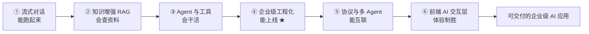

# AI Agent 全栈开发 · 前端转型指南

> **定位**：面向有 React / TypeScript 基础的前端开发者，用**六个关卡**从零到一交付生产级 AI Agent 应用。
>
> **前置要求**：熟悉 TypeScript + React Hooks，了解 HTTP / API 基本概念。**不需要机器学习背景**。
>
> **怎么用这份教程**：先看「三条路径」选一条 → 进关卡 → 每章按 `原理 → 企业实现 → 代码 → 验证 → 面试追问` 五段式推进 → 出关卡前用「自检清单」验收。

---

## 版本基线（唯一真源）

> 全库所有版本声明以此表为准。各章节**只引用、不自创**版本号；如与下表冲突，以本表为准并回帖修正。

**基线核对日期**：2026-10-10

| 维度 | 基线值 | 核验来源 |
|------|--------|---------|
| **AI SDK** | `ai@^7.0.36`（本仓库实际依赖；`engines: node >= 22`，peerDeps `zod ^3.25.76 \|\| ^4.1.8`） | 本仓库 `node_modules/ai/package.json` = `7.0.36` |
| **React 适配器** | `@ai-sdk/react@^4.0.39` | 本仓库 `apps/ai-demo/package.json` |
| **React** | `19.x` | 本仓库 `apps/ai-demo/package.json` |
| **MCP 规范** | `2026-07-28`（上一稳定版 `2025-11-25`） | modelcontextprotocol.io/specification/2026-07-28 |
| **A2A 规范** | `v1.0`（2026-03 发布，首个生产就绪版） | a2aproject / Linux Foundation Agentic AI Foundation |
| **前沿模型** | 旗舰：OpenAI GPT-5 系、Claude Opus/Sonnet 4.5–5.5、Gemini 3.5；性价比：DeepSeek V4、Qwen3、GLM-4.5 | 2026-10 Vercel AI Gateway `/v1/models` 实列 |
| **端侧小模型** | Qwen2.5 / Qwen3 0.5B–1.5B（Transformers.js / onnx-community） | 浏览器推理生态 |
| **前端 AI UI** | AI Elements、assistant-ui、CopilotKit、AG-UI、`@ant-design/x`、`@a2ui/react` | 公开仓库 / 发布信息 |
| **包管理器** | `bun`（本仓库禁止 npm/yarn/pnpm） | 根 `AGENTS.md` |

> 💡 **型号说明**：模型迭代极快，上表「旗舰/性价比」是**档位划分**而非永久结论。
> 写代码前请核对你所用 Gateway / 厂商当期的**实际模型 ID**（如 `openai/gpt-5`、
> `anthropic/claude-opus-4.5`、`google/gemini-3.5-flash`），不要照抄本文示例里的具体型号。

### 关于模型代际

`GPT-4o` / `Claude 3.5 Sonnet` / `Gemini 1.5 Pro` / `Llama 3.1` / `Qwen 2.5` 属 **2024 代际**，
仅可出现在「技术演进史」语境；**选型与示例一律使用上表的 2026 基线**。

### 关于「OpenAI 营销代号 / 未实列型号」

历史版本曾把 OpenAI 的下一代旗舰写作「GPT-5/Sol/Luna」，该命名**未成为官方实列的模型 ID**。
以 Vercel AI Gateway `/v1/models` 实列的 `openai/gpt-5`、`openai/gpt-5-mini`、`openai/gpt-5-codex` 为准；
写代码前请核对当期实际型号，不要把未经验证的营销代号写进示例。

---

## 教程的两条主线

本仓库里 AI 能力**已经真实落地**，教程按「技术栈主线 / 参考实现主线」双轨组织：

| | 主线（你要手写的代码） | 副线（企业级后端参考实现） |
|---|---|---|
| **技术栈** | AI SDK 7 + TypeScript 全栈（React + BFF） | Go + Gin（`backend/internal/*`） |
| **为什么** | 前端转型的最短路径，`useChat` / 流式 / 结构化输出与 React 心智模型一致 | 网关熔断、工具沙箱、护栏、HITL、评测这些**服务端重活**，看生产级怎么写 |
| **入口** | [第一关](./01-第一关-流式对话/index.md) → `apps/ai-course/` | [07-Go后端参考实现](./07-Go后端参考实现/index.md) |
| **通读要求** | 必读 | 按需查阅，不必通读 |

> 每关的 `index.md` 里都有「与本仓库代码的映射」表，可直接对着真实代码读。

---

## 六个关卡



| 关卡 | 主题 | 产出物 | 参考周期 |
|:---:|------|--------|:------:|
| [①](./01-第一关-流式对话/index.md) | 流式对话 | 生产级流式聊天（可中断 / 可重连 / 有成本显示） | 1-2 周 |
| [②](./02-第二关-知识增强RAG/index.md) | 知识增强 RAG | 支持 PDF/Word 的企业知识问答 + 评测闭环 | 2-3 周 |
| [③](./03-第三关-Agent与工具/index.md) | Agent 与工具 | 带审批、能停下来的自主 Agent | 3-4 周 |
| [④](./04-第四关-企业级工程化/index.md) | **企业级工程化** | 有网关容灾、护栏、观测、评测、配额的生产系统 | 持续 |
| [⑤](./05-第五关-协议与多Agent/index.md) | 协议与多 Agent | 可对外提供 MCP 工具 + A2A 协作 | 持续 |
| [⑥](./06-第六关-前端AI交互层/index.md) | 前端 AI 交互层 | 生成式 UI / 端侧推理 / AI 原生体验 | 2 周 |

> **④ 是本教程的分水岭**。前三关解决「能不能跑」，第四关解决「敢不敢上线」——
> 面试里 80% 的追问也集中在这里。

---

## 三条学习路径

| 路径 | 适合谁 | 怎么走 |
|------|--------|--------|
| **⚡ 快速上手（2 周）** | 想尽快跑通一个 AI 应用 | [01-30分钟从0到1](./01-第一关-流式对话/01-30分钟从0到1.md) → 第一关 → 第三关 01/04 → 第四关 01/02/06 |
| **🧗 系统进阶（8 周）** | 想主导 AI 产品架构 | ① → ⑥ 顺序通关，每关做完「自检清单」再进下一关 |
| **🎯 面试突击（1 周）** | 已在做 AI 项目、要准备面试 | [09-面试篇](./09-面试篇/00-面试技巧与回答模板.md) 六篇 → 反查薄弱章节 → 用第四关补齐「生产感」 |

---

## 目录结构

```
S5-AI/
├── index.md                          ← 你在这里（版本基线真源）
├── 00-导学/                          「我该学什么 / 怎么选」
│   ├── 01-前端转型AI能力地图.md       能力地图、术语速查、AI SDK 迁移要点
│   ├── 02-AI应用市场与生态.md         平台 / 工具 / 编码助手全景
│   └── 03-技术选型速查.md             核心决策点的精简对比
├── 01-第一关-流式对话/                LLM 调用 · 流式协议 · AI SDK 7
├── 02-第二关-知识增强RAG/             分块 · 检索 · 重排 · 评测
├── 03-第三关-Agent与工具/             设计模式 · 工具契约 · 停止条件 · HITL
├── 04-第四关-企业级工程化/ ★           网关 · 护栏 · 上下文工程 · 观测 · 评测 · 成本 · 部署
├── 05-第五关-协议与多Agent/            MCP 2026-07-28 · A2A v1.0
├── 06-第六关-前端AI交互层/             生成式 UI · Ant Design X · 端侧推理
├── 07-Go后端参考实现/                 副线：Go + Gin 走一遍 LLM 后端
├── 08-资料库/                         大部头原文归档，按需查阅（不要求通读）
├── 09-面试篇/                         六专题 + 技巧 + 项目表述模板
└── 99-写作约定.md                      章节模板与作者须知
```

> 每个关卡目录下 `NN-*` 是**教程正文**，`附-*` 是**保留原文的实现手册**（内容全量保留，用于深度查阅）。

---

## 文档 ↔ 代码映射

教程不是纸上谈兵，每一关都能在本仓库找到真实实现：

| 关卡 | 本仓库实现位置 | 关键接口 / 组件 |
|------|----------------|-----------------|
| ① 流式对话 | `apps/ai-demo/src/services/aiStream.ts`、`backend/internal/chat/` | SSE 分帧解析、`POST /api/ai/chat/stream` |
| ② 知识增强 RAG | `backend/internal/knowledge/` | 文档加载 / 分块 / 嵌入 / 向量检索 |
| ③ Agent 与工具 | `backend/internal/agent/`、`internal/tool/`、`internal/memory/` | ReAct、Function Calling、工具沙箱与权限分级 L0/L1/L2 |
| ④ 企业级工程化 | `internal/llm/`、`internal/guard/`、`internal/obs/`、`internal/airouter/` | `/api/ai/obs/*`、`/api/ai/eval/*`、`/api/ai/prompts/*`、`/api/ai/approvals/*` |
| ⑤ 协议与多 Agent | `internal/mcp/`、`internal/a2a/` | `POST /api/ai/mcp`（无状态单端点）、`/api/ai/a2a/*` |
| ⑥ 前端 AI 交互层 | `apps/ai-demo/src/components/` | `AIChat`（Ant Design X）、`A2UI`（`@a2ui/react`）、`Observability` |

启动方式见根 `AGENTS.md`：`bun run dev` 起前端三应用，`go run ./cmd/server/` 起后端 `:8080`。

---

## 面试速查

> 用「原理 + 取舍」替代背口号，下面每条都可以被追问到实现层。

| 场景 | 表述要点 |
|------|---------|
| 解释 Agent | `Agent = LLM + Tools + Memory + Planning`，并说清停止条件、审批点与可观测性怎么落地 |
| 解释 MCP | 「LLM 世界的 USB-C」只是类比；要说清 2026-07-28 后的**无状态请求 + `server/discover` + 扩展体系** |
| 解释 RAG | 「开卷考试」之外，要能讲分块策略、混合检索、Rerank 与评测闭环 |
| 解释 KV Cache | 用空间换时间；缓存消除的是**历史 token 的重复计算**，attention 计算量仍是二次增长 |
| 解释上下文工程 | 决定「什么信息在什么时刻进入模型视野」，它是工程产物而不是随手拼的字符串 |

→ 详见 [09-面试篇](./09-面试篇/00-面试技巧与回答模板.md)

---

## 一句话理解

| 前端传统开发 | AI Agent 开发 |
|---|---|
| 用户点击 → 代码执行 → UI 更新 | 用户输入 → LLM 推理 + 工具调用 → 结构化输出 |
| 路由定义页面跳转 | Prompt + Context 定义"智能行为" |
| API 调用后端 | Agent 编排 LLM + 工具 + 记忆 |
| CSS 控制视觉 | Architecture 控制智能边界 |

**核心公式**：`Agent = LLM（大脑）+ Tools（手脚）+ Memory（记忆）+ Planning（规划）`

**2026 补充**：还需一层 `Context Engineering（上下文工程）` 决定「什么信息在什么时刻进入模型视野」——
详见 [04-第四关-企业级工程化/03-上下文工程与Skills](./04-第四关-企业级工程化/03-上下文工程与Skills.md)。

---

## 版本记录

| 日期 | 变更 |
|---|---|
| 2025-09 | 重构为新目录结构，精简面试篇，新增应用市场与面试技巧 |
| 2026-07 | 对齐 AI SDK 7 + MCP 2026-07-28 |
| 2026-09 | 建立唯一版本基线表；修正 MCP「有状态」误述与 A2A v0.3→v1.0；AI SDK v4→v7 示例迁移；重做 2026 模型矩阵；新增上下文工程/Agent Skills 与生成式 UI 两章 |
| 2026-10 | 新增「快速入门 · 30 分钟从 0 到 1」；版本基线对齐仓库实际依赖；模型矩阵改以 Gateway 实列型号为准 |
| 2026-10 | **体系重建**：由「按资料来源归档」改为「按能力阶梯」的六关卡结构；存量 37 篇正文全量保留，迁移至新目录并修复内部链接；主线明确为 AI SDK 7 + TS 全栈，Go 后端降级为参考实现副线；新增 `bun run docs:check` 死链校验脚本 |
