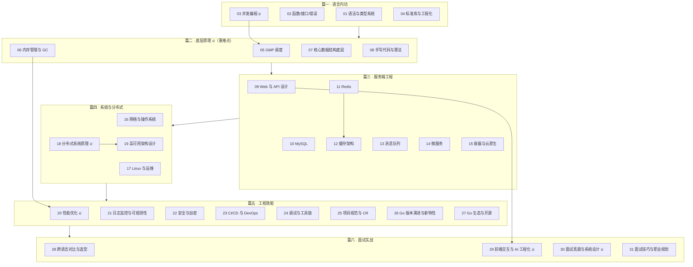

# 📘 Go 语言面试体系总纲（S6-Go）

> **版本**：v3.3（2026-10-16 融合 24 本 Go 书籍深度比对成果）｜ **题量**：**488 道**，31 个专题，共六篇
> **适用对象**：① 有前端经验、准备转 Go 后端（本仓库主要读者）；② Go 后端求职者做系统复习
> **维护原则**：**版本事实联网核验**（见第 9 节）、**重难点显式标注**、**每题都有前端类比与一句话总结**

---

## 0. 三种用法，按需进入

| 你的处境 | 建议路径 |
|----------|----------|
| **零基础/刚转 Go**（系统学） | 篇一 → 篇二 → 篇三，边学边做「产出物」（见第 2 节）；篇四~篇六在项目/面试前再补 |
| **1~2 周突击面试** | 直接读第 5 节「必考 Top 30」→ 逐题只看 **💡 记忆关键词** 与 **📝 一句话总结** → 用每篇末尾「✅ 自测清单」查漏 |
| **已会 Go，只补短板** | 看第 3 节知识地图定位，再跳到对应专题；重点补 **篇二（底层原理）** 与 **篇四（分布式）** |
| **前端面试被问「为什么转 Go」** | 第 2 节「前端优势迁移表」+ [6-31 面试技巧](./6-31-面试技巧与职业规划.md) |
| **不知道读什么书 / 做什么项目** | 直接跳到 [第 10 节 学习资源地图](#10-学习资源地图书单--开源项目--练手项目)：8 本书单 + 避雷清单 + 分阶段开源项目 + 6 个「不烂大街」的练手项目 |

---

## 1. 阅读标记

| 标记 | 含义 |
|------|------|
| ⭐ ~ ⭐⭐⭐⭐⭐ | 难度：⭐⭐ 以下必会，⭐⭐⭐ 进阶，⭐⭐⭐⭐+ 专家级 |
| 🔥 | 面试高频（80%+ 概率被问） |
| 📌 | 常考（50%~80%） |
| 📖 | 了解即可（<50%，有时间再看） |
| 🔁 前端类比 | 用 JS/TS/浏览器知识解释 Go 概念 —— **本系列特色，前端读者的主要抓手** |
| 💡 记忆关键词 | 面试前 30 秒快速回忆 |
| ⚠️ 常见误区 | 最容易答错/被追问的点 |
| 📝 一句话总结 | 面试时组织语言的模板 |

---

## 2. 学习路径：前端 → Go 后端（3 个月）

### 2.1 三阶段安排（与六篇一一对应）

| 阶段 | 时间 | 对应篇 | 目标 | 必须产出 |
|------|------|--------|------|----------|
| **一、语法与标准库** | 第 1 月 | 篇一 | 能独立写小工具与 HTTP 服务 | ① CLI 工具；② 分层 REST API；③ 篇一自测清单全过 |
| **二、并发与底层** | 第 2 月 | 篇二 | 能安全写并发代码，讲清 GMP/GC | ① 并发任务池（`-race` 通过 + 优雅退出）；② pprof 优化前后对比数据；③ 手写 LRU/限流器/协程池 |
| **三、工程与实战** | 第 3 月 | 篇三~篇六 | 可上生产 + 能讲项目 | ① 完整服务（MySQL + Redis + Docker + CI）；② 项目复盘（架构图 + 压测数据 + 一次故障处理）；③ 3 道系统设计口述（含估算） |

**每日节奏（比计划本身更重要）**：1 小时阅读 + 1 小时写代码 > 周末突击 8 小时。每周用「自测清单」做一次周检。

### 2.2 前端已具备、可直接迁移的能力

| 前端已有 | Go 对应 | 迁移红利 |
|----------|---------|----------|
| HTTP/JSON、RESTful 设计 | `net/http`、Gin、gRPC-Gateway | 协议层认知完全可复用，能立刻看懂接口设计 |
| `Promise.all` / `async-await` | `goroutine` + `channel` + `select` | 并发思维已建立，只需学「共享内存要加锁」 |
| `AbortController` | `context` 取消传播 | 取消/超时语义一致，几乎零成本 |
| CI 打包与发布（npm → CDN） | 镜像构建 + 滚动/灰度发布 | 交付链路同构 |
| 埋点 / Web Vitals / Sentry | 日志 / 指标 / 链路追踪 | 可观测性三大支柱的思维一致 |
| 性能分析（Performance 面板、Lighthouse） | pprof / trace / bench | **瓶颈定位方法论完全相同**，这是最容易迁移的硬技能 |
| 缓存（强缓存/协商缓存） | Redis / 多级缓存 / 一致性 | 「缓存一致性与失效」是同一类问题 |

### 2.3 必须刻意转换的思维（高频踩坑）

| 前端习惯 | Go 后端思维 |
|----------|-------------|
| `try/catch` 兜住一切 | **错误是值**：`if err != nil` 显式处理，`%w` 包装后向上传播 |
| 一切皆引用（对象/数组） | 区分**值类型/指针**；slice 是描述符但共享底层数组 |
| 单线程事件循环，无数据竞争 | **真并行**：共享变量必须加锁/原子/channel，`-race` 是必备检查 |
| 依赖 npm 生态 | 标准库强大，**优先标准库**，第三方依赖要评估维护成本 |
| 热更新 + Dev Server | 编译型：`go run`/`go build`，**单二进制部署**，交叉编译极快 |
| 前端不关心内存 | 关心**逃逸分析、分配率、GC 停顿、goroutine 泄漏**（篇二整篇） |
| `npm install` 随手加依赖 | `go mod` 有 **MVS（最小版本选择）**；新增依赖要评估体积/维护度/许可证 |
| 前端「报错就 console.log」 | 结构化日志 + 错误码 + 链路 ID；**错误在边界记一次，不要层层打日志** |
| 前端只面对浏览器一个客户端 | 后端要面对**重试、乱序、恶意输入、依赖超时**；默认假设「上游都会坑我」 |

### 2.4 每日 / 每周节奏模板（可直接抄）

| 时段 | 内容 | 产出（可验证） |
|------|------|----------------|
| 30 min | 读书或官方文档章节 | 笔记 + 代码片段（贴到自己的 repo） |
| 60 min | 动手实现 / 改本仓库代码 | 可运行的 `.go` 文件，且 `go test -race ./...` 通过 |
| 30 min | 刷题 + 复习八股 | 1 道 LeetCode（链表/哈希/二叉树/DP 轮换）+ 1 张概念卡片 |
| 周末 | 项目迭代 + 复盘 | 至少 1 个 Commit + 复盘文档（架构图 / 压测数据 / 故障记录） |

**每周复盘四问**（答不上来就说明这周白学了）：

1. 这周写的并发代码，`-race` 跑过吗？goroutine 有没有退出路径？
2. 这周学的底层原理，能**画出来**吗（GMP、GC、map 扩容）？
3. 这周做的功能，**如果流量涨 10 倍**，第一个崩的是哪里？
4. 这周的知识点，能用**一句话**讲给不懂 Go 的前端同事听吗？

---

## 3. 知识地图（六篇总览）



---

## 4. 文件索引（31 个专题）

### 篇一 · 语言内功（前端最容易上手，共 59 题）

| # | 专题 | 题量 | 权重 | 前置 |
|---|------|------|------|------|
| [1-01](./1-01-Go基础语法与类型系统.md) | Go 基础语法与类型系统 | 14 | 🔥🔥🔥🔥🔥 | — |
| [1-02](./1-02-函数接口与错误处理.md) | 函数、接口与错误处理 | 13 | 🔥🔥🔥🔥🔥 | 1-01 |
| [1-03](./1-03-并发编程.md) | **并发编程**（goroutine/channel/sync/context） | 19 | 🔥🔥🔥🔥🔥 | 1-01 |
| [1-04](./1-04-标准库与工程化基础.md) | 标准库与工程化基础 | 13 | 🔥🔥🔥🔥 | 1-01 |

### 篇二 · 底层原理（**面试区分度最高**，共 71 题）

| # | 专题 | 题量 | 权重 | 前置 |
|---|------|------|------|------|
| [2-05](./2-05-GMP调度模型.md) | **GMP 调度模型** | 9 | 🔥🔥🔥🔥🔥 | 1-03 |
| [2-06](./2-06-内存管理与GC.md) | **内存管理与垃圾回收** | 11 | 🔥🔥🔥🔥🔥 | 2-05 |
| [2-07](./2-07-核心数据结构底层.md) | 核心数据结构底层（含 map/slice/channel/sync 原语/unsafe/Timer） | 38 | 🔥🔥🔥🔥 | 1-01、2-06 |
| [2-08](./2-08-手写代码与算法实战.md) | 手写代码与算法实战 | 13 | 🔥🔥🔥🔥 | 1-03 |

### 篇三 · 服务端工程（共 175 题）

| # | 专题 | 题量 | 权重 | 前置 |
|---|------|------|------|------|
| [3-09](./3-09-Web框架与API设计.md) | Web 框架与 API 设计（含 Swagger/HTTPS/压测） | 13 | 🔥🔥🔥🔥 | 1-04 |
| [3-10](./3-10-MySQL与数据访问.md) | MySQL 与数据访问 | 34 | 🔥🔥🔥🔥🔥 | 3-09 |
| [3-11](./3-11-Redis.md) | Redis 缓存与数据结构 | 40 | 🔥🔥🔥🔥🔥 | 3-10 |
| [3-12](./3-12-缓存架构设计.md) | 缓存架构设计（含进程内缓存/RocksDB/singleflight） | 15 | 🔥🔥🔥🔥 | 3-11 |
| [3-13](./3-13-消息队列.md) | 消息队列（Kafka / RabbitMQ） | 19 | 🔥🔥🔥🔥 | 3-09 |
| [3-14](./3-14-微服务架构.md) | 微服务架构（含 go-kit/go-zero 选型） | 18 | 🔥🔥🔥🔥 | 3-09 |
| [3-15](./3-15-容器与云原生.md) | 容器技术与云原生 | 36 | 🔥🔥🔥 | 3-14 |

### 篇四 · 系统与分布式（共 83 题）

| # | 专题 | 题量 | 权重 | 前置 |
|---|------|------|------|------|
| [4-16](./4-16-网络与操作系统.md) | 网络与操作系统原理（含 net/http 高并发、零拷贝、粘包/epoll） | 33 | 🔥🔥🔥🔥 | 2-05 |
| [4-17](./4-17-Linux与运维.md) | Linux 与运维（含诊断命令矩阵/内核参数） | 21 | 🔥🔥🔥 | 4-16 |
| [4-18](./4-18-分布式系统原理.md) | **分布式系统原理** | 19 | 🔥🔥🔥🔥🔥 | 3-11、3-13 |
| [4-19](./4-19-高可用架构设计.md) | 高可用架构设计（含 SLA/SLO/混沌工程） | 10 | 🔥🔥🔥🔥 | 4-18 |

### 篇五 · 工程效能（共 65 题）

| # | 专题 | 题量 | 权重 | 前置 |
|---|------|------|------|------|
| [5-20](./5-20-性能优化实战.md) | **性能优化实战**（pprof / trace / bench） | 10 | 🔥🔥🔥🔥 | 2-06 |
| [5-21](./5-21-日志监控与可观测性.md) | 日志、监控与可观测性 | 7 | 🔥🔥🔥 | 5-20 |
| [5-22](./5-22-安全与加密.md) | 安全与加密（含 HMAC/加密日志） | 9 | 🔥🔥🔥 | 3-09 |
| [5-23](./5-23-CICD与DevOps.md) | CI/CD 与 DevOps（含 CGO 与交叉编译） | 7 | 🔥🔥 | 3-15 |
| [5-24](./5-24-调试与工具链.md) | 高级调试与工具链（含 httptest/benchstat/GODEBUG） | 11 | 🔥🔥🔥 | 5-20 |
| [5-25](./5-25-项目规范与代码审查.md) | 项目规范与代码审查 | 7 | 🔥🔥🔥 | 1-04 |
| [5-26](./5-26-Go版本演进与新特性.md) | Go 版本演进与新特性 | 11 | 🔥🔥🔥🔥 | 1-01 |
| [5-27](./5-27-Go生态与开源.md) | Go 生态与开源 | 3 | 🔥🔥 | 1-04 |

### 篇六 · 面试实战（共 35 题）

| # | 专题 | 题量 | 权重 | 前置 |
|---|------|------|------|------|
| [6-28](./6-28-跨语言对比与技术选型.md) | 跨语言对比与技术选型 | 7 | 🔥🔥🔥 | 全篇 |
| [6-29](./6-29-Go与前端交互及AI工程化.md) | **Go 与前端交互及 AI 工程化** | 10 | 🔥🔥🔥🔥 | 3-09 |
| [6-30](./6-30-面试真题与系统设计.md) | **面试真题与系统设计**（含排行榜/抢红包） | 12 | 🔥🔥🔥🔥🔥 | 全篇 |
| [6-31](./6-31-面试技巧与职业规划.md) | 面试技巧与职业规划 | 6 | 🔥🔥 | 全篇 |

> **题量口径**：以 `### Qn:` 三级标题计数，共 **488 道**。同一主题可能在多篇出现（如「分布式锁」在 2-08 手写、3-11 Redis、4-18 分布式），此时**答法深浅不同**，属于刻意设计。

---

## 5. 重难点清单：必考 Top 30

> 用法：面试前一晚只看这一节。每条右侧是「一句话钩子」，答不出就点回对应专题。

### 语言与并发（篇一）

| # | 题目 | 一句话钩子 | 出处 |
|---|------|-----------|------|
| 1 | slice 与 array 的区别、扩容规则 | ptr/len/cap 描述符共享底层数组；1.18 起阈值 256、因子 2.0→1.25、最后按 size class 对齐 | 1-01 |
| 2 | map 是否并发安全 | 不安全；写并发会 fatal；用 RWMutex / sync.Map / 分片锁 | 1-01 |
| 3 | defer 顺序与陷阱 | LIFO；循环里 defer 会拖到函数返回，需匿名函数包裹 | 1-01 |
| 4 | 接口的鸭子类型与 iface/eface | 隐式实现；空接口非 nil 需要「类型+值都为 nil」 | 1-02 |
| 5 | **接口 nil 陷阱** | 返回具体类型的 nil 指针 → `err != nil` 为 true | 1-02 |
| 6 | 错误处理规范 | `%w` 包装 + `errors.Is/As` 判定；只在边界记一次日志 | 1-02 |
| 7 | 值/指针接收者与方法集 | `T` 只有值方法，`*T` 含全部；有指针方法则必须 `*T` 实现接口 | 1-02 |
| 8 | **goroutine vs 线程** | 2KB 起栈 + 用户态调度 + M:N，故「廉价」 | 1-03 |
| 9 | **channel 五大陷阱** | nil 永久阻塞、关后发送 panic、重复关闭 panic、关后收零值、发送方关闭 | 1-03 |
| 10 | **context 用法** | 取消/超时/值传递；父取消级联子；ctx 作第一个参数 + `defer cancel()` | 1-03 |
| 11 | goroutine 泄漏排查 | 卡在发送/接收/等锁；看 goroutine 数 + pprof + 1.27 的 `goroutineleak` | 1-03 |

### 底层原理（篇二，**最容易拉开差距**）

| # | 题目 | 一句话钩子 | 出处 |
|---|------|-----------|------|
| 12 | **GMP 模型** | G 任务、M 线程、P 工位 + 本地队列；P 数量 = GOMAXPROCS = 并行度 | 2-05 |
| 13 | **工作窃取与 1/61** | 本地 → 全局（每 61 次）→ 随机偷一半 → netpoll | 2-05 |
| 14 | **系统调用与 Handoff** | 系统调用阻塞则 M/P 解绑换 M；网络 IO 交给 netpoller 完全不占 M | 2-05 |
| 15 | 抢占式调度 | 函数调用点协作式 → Go 1.14 起信号异步抢占（防死循环占死 P） | 2-05 |
| 16 | 容器感知 GOMAXPROCS | Go 1.25+ 读 cgroup CPU limit 并动态更新，避免容器内线程/GC 暴涨 | 2-05 |
| 17 | **逃逸分析** | `-gcflags=-m`；指针返回/接口装箱/闭包捕获会逃逸；能栈不堆 | 2-06 |
| 18 | **三色标记 + 混合写屏障** | 白灰黑 + 写屏障维护三色不变式，STW 通常 <1ms；非分代、不整理 | 2-06 |
| 19 | GC 触发与调优 | GOGC（默认 100）+ 2 分钟定时 + `GOMEMLIMIT`；`gctrace` 观察 | 2-06 |
| 20 | **Green Tea GC（1.26 默认）** | 同一算法的**实现优化**，GC 开销降 10~40%；1.25 实验、1.26 默认 | 2-06 / 5-26 |
| 21 | map 底层（hmap/bmap/扩容） | 桶 + 溢出桶、负载因子 6.5、渐进式扩容（1.24 起 Swiss Table） | 2-07 |
| 22 | channel 底层 hchan | 环形缓冲 + sendq/recvq + 锁；无缓冲是同步交接 | 2-07 / 1-03 |

### 存储与分布式（篇三、篇四）

| # | 题目 | 一句话钩子 | 出处 |
|---|------|-----------|------|
| 23 | **MySQL 索引与最左前缀** | B+ 树、聚簇/二级索引、回表与覆盖索引、索引失效场景 | 3-10 |
| 24 | **事务隔离级别与 MVCC** | 四种隔离级别；RR 靠 MVCC + 间隙锁防幻读 | 3-10 |
| 25 | **Redis 缓存三大问题** | 穿透（布隆/空值）、击穿（互斥重建）、雪崩（随机 TTL + 多级缓存） | 3-12 |
| 26 | **Redis 分布式锁** | SET NX PX + 唯一 value + Lua 释放 + 续期；配幂等兜底 | 3-11 / 2-08 |
| 27 | **消息不丢与幂等消费** | 生产确认 + 副本同步 + 手动提交；消费端 `msgID` 去重 | 3-13 |
| 28 | **CAP/BASE 与分布式事务** | 取舍而非兼得；2PC/TCC/Saga/消息最终一致 | 4-18 |
| 29 | **限流熔断降级 + 幂等** | 令牌桶/漏桶、熔断三态、幂等靠唯一键/状态机 | 4-19 |
| 30 | **系统设计四步法 + 容量估算** | 澄清 → 估算（峰值系数 3~5、单机 QPS 量级）→ 架构 → 深挖 + 权衡 | 6-30 |

### 附加：最能体现版本敏感度的 5 个点（加分项）

1. Go 1.22 **循环变量每次迭代新建**（由 `go.mod` 的 `go` 版本控制）；
2. Go 1.24 **Swiss Table map** 与泛型类型别名、`omitzero`；
3. Go 1.25 **容器感知 GOMAXPROCS**、`testing/synctest` 转正、`jsonv2` 实验；
4. Go 1.26 **Green Tea GC 默认开启**、`new(expr)`、`go fix` modernizers；
5. Go 1.27 **泛型方法**、`encoding/json/v2` 正式版（v1 底层换芯）、`goroutineleak` profile 转正。

详见 [5-26 Go 版本演进](./5-26-Go版本演进与新特性.md)。

---

## 6. 前端转 Go 最易答错的 10 个点

| # | 常见错误回答 | 正确表述 | 出处 |
|---|--------------|----------|------|
| 1 | 「slice 是引用类型」 | slice 是**值类型**（ptr/len/cap 描述符），但拷贝时**共享底层数组** | 1-01 |
| 2 | 「扩容小于 1024 翻倍、否则 1.25 倍」 | 那是 **Go 1.18 之前**；1.18 起阈值 **256**，因子 2.0 平滑逼近 1.25 | 1-01 |
| 3 | 「for 循环变量共享」 | **Go 1.22 起每次迭代新建变量**，行为由 `go.mod` 的 `go` 版本决定 | 1-01 / 5-26 |
| 4 | 「Go 的 GC 是分代的」 | 非分代、不整理、并发三色标记 + 混合写屏障 | 2-06 |
| 5 | 「Go 1.26 换了新的 GC 算法」 | 是**同一算法下的实现优化**（Green Tea 提升局部性与并行度） | 2-06 / 5-26 |
| 6 | 「channel 谁都可以关」 | 约定**由发送方（唯一生产者）关闭**；重复关闭 panic | 1-03 |
| 7 | 「goroutine 死了会自动回收」 | 阻塞在发送/接收/锁上的 goroutine **永久泄漏**，必须设计退出路径 | 1-03 |
| 8 | 「异步编程用 async/await 那套」 | Go 用**同步写法 + goroutine**；取消靠 `context`，不要自己造 done channel 满天飞 | 1-03 |
| 9 | 「Redis 客户端用 Jedis/Redisson」 | **Go 项目用 `go-redis/v9`**（context + 连接池 + Cluster/Sentinel 全支持） | 3-11 |
| 10 | 「接口为 nil 就是没实现/没错误」 | 接口 nil 要求「类型 + 值」都为 nil，返回具体类型 nil 指针会「假非 nil」 | 1-02 |

---

## 7. 面试追问链示例（面试官如何深挖）

> 提前想清「第二问、第三问」，是拉开差距的关键。

1. `slice` → 「扩容策略」→「为什么按 size class 对齐」→「截取共享内存的线上 bug 怎么产生的」（1-01）
2. `channel` → 「底层结构」→「无缓冲如何唤醒接收者」→「select 多个就绪为什么随机」（1-03 / 2-07）
3. GMP → 「工作窃取」→「全局队列饥饿怎么解决（1/61）」→「协程死循环会怎样（异步抢占）」（2-05）
4. GC → 「三色标记」→「并发标记为什么会漏标（写屏障）」→「容器里 GC 太频繁怎么调（GOMAXPROCS/GOMEMLIMIT）」（2-06）
5. Redis 分布式锁 → 「为什么用 Lua 释放」→「锁超时业务没执行完怎么办（续期）」→「主从切换丢锁怎么办（fencing token）」（3-11 / 4-18）
6. 缓存一致性 → 「先删缓存还是先更新 DB」→「延迟双删为什么需要」→「订阅 binlog 的方案与代价」（3-12）
7. 限流 → 「令牌桶 vs 漏桶」→「单机怎么实现」→「分布式怎么做（Redis + Lua）」（4-19）
8. 系统设计 → 「短链怎么生成」→「如何防冲突」→「如何抗住 10 倍流量」（6-30）

---

## 8. 面试冲刺复习计划（4 周）

| 周次 | 重点 | 每日任务（2~3h） | 周末产出 |
|------|------|------------------|----------|
| 第 1 周 | 篇一 + 篇二（**语言与底层**） | 10 道题 + 手写 1 个并发/数据结构实现 | 手写 LRU + 限流器，能画 GMP 与 GC 流程图 |
| 第 2 周 | 篇三（**存储与工程**） | MySQL/Redis 各 5 题 + 1 个缓存场景题 | 讲清一条完整读写链路（缓存 → DB → 一致性） |
| 第 3 周 | 篇四 + 篇五（**架构与效能**） | 分布式/高可用/性能各 3 题 | 用 pprof 做一次真实优化并写出数据 |
| 第 4 周 | 篇六 + 全篇回顾 | 3 道系统设计 + 录音复述项目 | 模拟面试 2 次；只看「记忆关键词 + 一句话总结」 |

---

## 9. 版本事实基线（更新于 2026-10-10，**面试前务必复核**）

| 项 | 结论 | 来源 |
|----|------|------|
| **当前 stable** | **Go 1.27.2**（`go1.27.0` 2026-08-19；`go1.27.1` 2026-09-01；`go1.27.2` 2026-10-08） | [go.dev/doc/devel/release](https://go.dev/doc/devel/release) |
| 上一版本 | Go 1.26（2026-02，Green Tea GC 默认开启；仍在维护线，最新 `go1.26.9` 2026-10-08） | Go 1.26 Release Notes |
| 本仓库基线 | `apps/backend/go.mod` 声明 **`go 1.27.2`**（2026-10 从 `go 1.26.2` 升级，Dockerfile/CI 同步为 1.27） | 仓库内文件 |
| 近期关键变化 | 1.24 Swiss map / 1.25 容器感知 GOMAXPROCS + `synctest` / 1.26 Green Tea GC / 1.27 泛型方法 + `json/v2` | 各版本 Release Notes |
| 仍在实验 | `simd`（1.27 便携包）、`simd/archsimd`、`runtime/secret`、`crypto/hpke` 之外的部分能力 | Release Notes |
| 表述纪律 | **stable 特性正常讲；实验特性必须标注 `GOEXPERIMENT` 与成熟度**，不得把它当作已发布能力 | 本文档维护原则 |

> ⚠️ 面试资料最容易出错的就是版本号。若时间紧张，**宁可说「我记得是 1.2x 引入的，具体版本我会查 Release Notes」**，也不要把实验特性说成已发布。

---

## 10. 学习资源地图（书单 · 开源项目 · 练手项目）

> 三类资源分工：**书**解决「系统输入」，**开源项目**解决「别人怎么写」，**练手项目**解决「我能写出来」。
> 第 12 节本仓库 `apps/backend/` 是第四类 —— **能改能跑的靶子**，优先级最高（如果时间只够一件事，做这个）。

### 10.1 书单：8 本，按阶段读（不要并行开多本）

| 阶段 | 书 | 读法与重点 | ⚠️ 版本提示（必看） |
|------|-----|-----------|---------------------|
| 入门 | 《Go 语言实战》William Kennedy | 案例驱动，2 周刷完；重点切片/map、并发章 | 基于 Go **1.5~1.7**：无泛型、`go mod`、`errors.Is/As`，需配合 [5-26](./5-26-Go版本演进与新特性.md) 补齐 |
| 入门 | 《Go 程序设计语言》Donovan & Kernighan | 系统主教材；1~9 章精读，13 章（unsafe/反射）选读 | 同样早于泛型，**习题必须自己敲一遍** |
| 入门 | 《Learning Go》Jon Bodner（中译《Go 语言学习指南》） | 覆盖泛型 + `go mod`，**最贴近现代 Go 的入门书**；零基础可直接从这本开始 | 优先选第 2 版及以后 |
| 进阶 | 《Go 语言精进之路 1》郝林 | 编程思维与惯用法：类型、函数、方法、接口、并发的「为什么这样写」 | 1.22 后循环变量语义变化，需按 §5-26 校验 |
| 进阶 | 《Go 语言精进之路 2》郝林 | 工程实践：错误处理、测试、性能、标准库、架构模式 | 同上 |
| 底层 | 《Go 语言设计与实现》draven（有在线版 *go-under-the-hood*） | **中文最佳底层参考**：GMP / GC / 内存 / 接口，配合 [2-05](./2-05-GMP调度模型.md)~[2-07](./2-07-核心数据结构底层.md) 逐章对照 | 源码基于 Go **1.16~1.19**：调度与 GC 细节可能已被改写，结论一律以 §9 基线为准 |
| 底层 | 《Go 语言高级编程》柴树杉 | CGO、汇编、RPC、插件、Protobuf 等高级主题 | 部分章节基于 Go 1.10~1.13，取思想不取代码 |
| 实战 | 《Go 语言编程之旅》煎鱼 | 项目驱动（CLI / gRPC / 博客后台 / 工具链），贴近工业界套路 | 与第 12 节本仓库练习互补，二选一深挖即可 |

**并发专项**：上面之外，想系统学并发模型可读 Cox-Buday《Concurrency in Go》（偏 CSP 理论，补 [1-03](./1-03-并发编程.md) 与 [2-05](./2-05-GMP调度模型.md) 的理论底座）。

### 10.1b 本仓库书库深度比对结果（2026-10-16，24 本 PDF + 6 门课程）

> 对本地书库做了「提取大纲 → 去重 → 与本文档逐专题比对 → 校验 → 升级」全流程，结论如下。
> **读法**：优先读「主参考」列；「内容重叠」列的书只作速查，不必通读；「已融入」列说明该书的独有知识点已落到哪个专题的第几题。

| 书 | 定位 | 独有知识点 → 已融入文档 |
|----|------|------------------------|
| 《Go 语言圣经》（gopl） | **主参考**（入门系统教材） | 方法值/方法表达式 → 1-02 Q12；接口/反射体系校验 1-02、2-07 |
| 《Effective Go》中英双语 | **主参考**（官方风格唯一标准） | gofmt/命名/文档注释 → 1-01 Q14；控制结构与初始化校验 1-01/1-02 |
| 《Go 语言实战》（In Action） | 主参考（案例驱动入门） | 数组切片 map/并发模式校验 1-01、1-03 |
| 《Go 语言精进之路 1/2》（郝林） | **主参考**（66 条惯用法） | init → 1-01 Q12；错误处理 4 策略 → 1-02 Q13；并发设计/channel 惯用法校验 1-03；单飞与标准库 → 1-03/1-04 |
| 《GO 专家编程》 | 主参考（底层+标准库工具） | 数据结构实现原理校验 2-07；定时器 → 2-07 Q36；go test/httptest → 5-24 Q6 |
| 《深入理解 Go 语言》（Aceld） | 主参考（GPM/GC/网络 IO 模型图文） | 校验 2-05/2-06；网络 IO 复用模型 → 4-16 Q33 |
| 《Go 语言底层原理剖析》 | 内容重叠（编译器/类型系统细节可查） | 字符串本质/哈希表/函数栈校验 2-07；Go 1.24 Swiss map → 2-07 Q37 |
| 《Go 程序员面试笔试宝典》（第 2 版） | 主参考（面试向底层） | 逃逸分析校验 2-06；Timer 四叉堆 → 2-07 Q36；context 底层 → 1-03 Q18；unsafe → 2-07 Q34；defer 拆解 → 2-07 Q35 |
| 《100 个 Go 语言典型错误》 | **主参考**（典型错误=面试误区库） | channel vs mutex → 1-03 Q19；range/getter 等误区校验 1-01~1-04、2-07 |
| 《Go 语言高级编程》（柴树杉） | 主参考（CGO/汇编/RPC） | CGO/汇编/Protobuf 已在 5-23 Q6、3-14 覆盖；内存模型校验 1-03 Q17 |
| 《分布式缓存：原理、架构及 Go 语言实现》 | **独有专题书** | 进程内缓存库对比 → 3-12 Q11；RocksDB → 3-12 Q12；singleflight 惊群 → 3-12 Q13；一致性哈希再平衡 → 3-12 Q14；Pipelining/批量写/异步读 → 3-12 Q15 |
| 《基于 Go 语言构建企业级 RESTful API 服务》 | 主参考（API 工程落地） | Swagger → 3-09 Q11；HTTPS/Nginx → 3-09 Q12；压测+Makefile+启动脚本 → 3-09 Q13；内核参数 → 4-17 Q21 |
| 《改善 Go 语言编程质量的 50 个有效实践》 | 内容重叠（《精进之路 1》子集，二选一） | 设计哲学/命名/零值可用校验 1-01、5-25 |
| 《Go Web 编程》（Shaw） | 内容重叠（net/http 细节可查） | 接收/处理请求/存储数据校验 3-09；并发优势校验 4-16 |
| 《Go 并发编程实战（第 2 版）》 | 内容重叠（并发机制可查） | 校验 1-03；网络爬虫框架校验 2-08 |
| 《Go 语言核心编程》（李文塔） | 内容重叠（类型系统可查，基于 Go 1.10 **已过时**） | 类型系统/接口校验 1-01、1-02；5 个并发范式校验 1-03 |
| 《Go 语言核心 36 讲》《Tony Bai · Go 语言第一课》 | 内容重叠（极客课，v3.2 已融合） | — |
| 《Go 语言项目开发实战》《手把手带你写一个 Web 框架》《287 Go 微服务实战 38 讲》《Go 并发编程实战课》 | 内容重叠（极客/慕课课，v3.2 已融合） | Makefile/Jenkins 补充 → 5-23 Q7 |
| 《Go 语言编程之旅》（煎鱼） | 主参考（项目实战） | WebSocket 帧 → 4-16 Q32；pprof/gops → 5-24 Q8 |
| 《LeetCode Cookbook》（halfrost） | **主参考**（算法模板） | 八大算法模板 → 2-08 Q13；高频题表校验 2-08 附录 |
| 《22 讲通关 Go 语言》《零基础 Go 语言从入门到精通》《Go 语言编程入门与实战技巧》《Go 语言从入门到项目实战》《Go 语言学习笔记》（雨痕） | 内容重叠（入门平铺/源码笔记，作校验用） | 校验 1-01~1-04、2-05~2-06；new vs make → 2-07 Q38 |

**比对方法论（可复用到下一批书）**：① 脚本提取 PDF 书签大纲 + 目录页文本（修复字体编码乱码）→ ② 按「专题」聚合去重（同一主题多本只保留信息量最大的主参考）→ ③ 与 31 个专题的索引表逐条比对找缺口 → ④ 缺口按「面试频率 × 独有性」排序补题 → ⑤ 新增内容统一过版本基线（§9）校验老书过时结论（如 Go 1.22 循环变量、1.23 Timer GC、1.24 Swiss map、1.25 容器感知 GOMAXPROCS）。

**老书阅读纪律（重要）**：书库中相当多书基于 Go 1.10~1.18 写作，以下结论已过时，以本文档为准——① 循环变量共享（1.22 修复）；② Timer 不 Stop 就泄漏（1.23 起可 GC）；③ map 是 hmap 桶结构（1.24 起 Swiss Table）；④ slice 扩容阈值 1024（1.18 起 256）；⑤ 「Go 没有泛型」（1.18 起有）。

### 10.2 避雷清单（不建议投入整块时间）

| 类型 | 代表 | 原因 |
|------|------|------|
| 早期老书 | 《Go 语言编程》许式伟（2012） | 基于 Go 1.x 早期，语法与工具链已严重过时 |
| 内容重叠 | 《Go 语言核心 36 讲》郝林 | 与《精进之路》系列高度重叠，**二选一** |
| 小众「原理剖析」 | 各类《Go 语言底层原理剖析》 | 深度与准确性不如「官方源码 + 《设计与实现》」，且版本滞后 |
| 语法手册 | Go 101 等「规范型」读物 | 定位是参考手册，**适合查不适合通读**，官网有免费最新版 |
| 大杂烩 | 《Go 语言从入门到进阶实战》一类 | 泛而不精，案例缺乏工业参考价值 |
| 二手博客 | 未标注 Go 版本的「原理」文 | **最容易传播错误结论**；优先级永远低于 Release Notes 与源码 |

### 10.3 开源项目阅读地图（按阶段，**不列 Star 数** —— 数字会变，学习点不会）

**入门 —— 读得懂，用来建立手感**

| 项目 | 重点读什么 | 对应专题 |
|------|-----------|----------|
| [gin](https://github.com/gin-gonic/gin) | 中间件链 `c.Next()`、radix 路由树、`Context` 池化复用、绑定与校验 | [3-09](./3-09-Web框架与API设计.md) |
| [chi](https://github.com/go-chi/chi) | 如何**完全兼容 `net/http`** 做轻量路由与中间件组合 | 3-09 |
| [cobra](https://github.com/spf13/cobra) + [viper](https://github.com/spf13/viper) | 子命令/Flag 解析、多源配置、与标准库 `flag` 的取舍 | 1-04 |
| [zap](https://github.com/uber-go/zap) / [zerolog](https://github.com/rs/zerolog) | 结构化日志、零分配技巧、分级与采样 | 5-21 |
| [testify](https://github.com/stretchr/testify) + [uber-go/mock](https://github.com/uber-go/mock) | 表驱动测试、断言、接口 mock 生成 | 1-04、5-25 |
| [ants](https://github.com/panjf2000/ants) | goroutine 池、任务调度、并发控制与对象复用 | 1-03、2-08 |

**进阶 —— 架构设计精良，值得精读一个**

| 项目 | 重点读什么 | 对应专题 |
|------|-----------|----------|
| [grpc-go](https://github.com/grpc/grpc-go) | 拦截器链、流式 RPC、HTTP/2 多路复用、连接管理 | 3-14 |
| [go-redis](https://github.com/redis/go-redis) | 连接池、Pipeline/事务、Cluster/Sentinel、**context 贯穿** | 3-11 |
| [gorm](https://github.com/go-gorm/gorm) | 回调链、关联查询、迁移、SQL 构造器 | 3-10 |
| [go-zero](https://github.com/zeromicro/go-zero) | `goctl` 代码生成、内置限流/熔断/自适应降载 | 3-14、4-19 |
| [kratos](https://github.com/go-kratos/kratos) | Wire 依赖注入、Protobuf 统一错误码、分层边界 | 3-14、5-25 |
| [prometheus/client_golang](https://github.com/prometheus/client_golang) | Counter/Gauge/Histogram 语义、拉模型采集 | 5-21 |
| [nsq](https://github.com/nsqio/nsq) | 生产者/消费者、去中心化、磁盘队列与投递语义 | 3-13 |
| [caddy](https://github.com/caddyserver/caddy) | 模块化架构、自动 HTTPS（ACME）、配置 API | 4-16、5-22 |

**高级 —— 大规模工程，择一深入即可（不必通读）**

| 项目 | 重点读什么 | 对应专题 |
|------|-----------|----------|
| [etcd](https://github.com/etcd-io/etcd) | Raft 共识、Watch 机制、MVCC 存储、线性一致性 | 4-18 |
| [tidb](https://github.com/pingcap/tidb) | SQL 层、分布式事务、Raft、存储引擎分层 | 3-10、4-18 |
| [kubernetes](https://github.com/kubernetes/kubernetes) | 声明式 API、控制器模式、Informer 机制、调度器 | 3-15 |
| [minio](https://github.com/minio/minio) | S3 兼容 API、纠删码、分布式部署 | 4-18 |
| [docker / moby](https://github.com/moby/moby) | Namespace/Cgroup、镜像分层、容器网络 | 3-15 |

**阅读方法论**（详见 [5-27](./5-27-Go生态与开源.md)，这里给精简版）：

1. **先跑起来**：`docker compose up` 或 `go run`，先理解功能再读源码；
2. **抓入口**：`main.go` → 依赖注入 → 路由注册 → 中间件链 → Handler，不要漫无目的翻文件；
3. **接口先行**：先看 `interface` 定义理解模块契约，再看实现（Go 的接口就是架构图）；
4. **由浅入深**：先读 `errors` / `config` / `utils` 等外围，再攻调度与存储核心；
5. **带着问题读**：「它的错误码怎么定义」「它的超时怎么传递」「它哪里做了复用」——问题驱动的阅读才留得下。

### 10.4 练手项目（拒绝烂大街的「博客 / TODO / 电商 CRUD」）

> 挑选标准：**有真实的并发/分布式难题**，能在面试里讲出「难点 → 方案 → 数据」三段式。

| 项目 | 核心技术点 | 面试能讲出的「难点」 | 对应专题 |
|------|-----------|---------------------|----------|
| **高并发 IM 即时通讯** | WebSocket 长连接、连接管理、消息路由、离线存储、分布式 Session、读扩散/写扩散 | 单机连接数天花板在哪；心跳与断线重连；消息**时序与幂等**；群聊扩散写放大 | 4-16、6-29、6-30 |
| **轻量级 API 网关** | 反向代理、JWT 鉴权、令牌桶限流、动态路由、日志聚合、健康检查 | 代理的坑（Hop-by-hop 头、连接复用、body 流式）；限流粒度；**超时如何逐跳传递** | 4-19、5-22、4-16 |
| **短链 / 计数服务** | 发号器（Snowflake / 号段）、布隆过滤器、缓存与 DB 一致性、301 vs 302、热点 key | 高并发热点 key 打爆单分片；跳转链路 P99；防刷与风控 | 6-30、3-12、3-11 |
| **秒杀系统** | Redis 预扣库存 + 异步落库、MQ 削峰、限流、幂等、防超卖 | **超卖是怎么发生的**；最终一致如何保证；压测前后的 QPS 对比 | 4-19、3-13、3-12 |
| **分布式任务调度** | 选主/分片、分布式锁、重试与幂等、超时与漏桶、故障转移 | 任务**不丢不重**如何证明；机器时钟漂移；执行器失联怎么办 | 4-18、3-11 |
| **RAG / AI Agent 服务** | 流式 SSE、工具调用编排、向量检索、限流与成本治理 | 流式响应**被取消时如何停止推理**；上下文超时逐层传播；Token 成本核算 | 6-29、1-03 |

> 💡 最后一个不用从零写 —— 本仓库 `apps/backend/` 已有 `chat` / `knowledge` / `llm` / `tool` / `airouter` 等包（见第 12 节），**改造它比新建一个更有说服力**。

**项目交付标准（面试能加分的最低要求）**：

- [ ] `Dockerfile` + `docker-compose.yml` 一键启动，README 有架构图；
- [ ] 核心逻辑有单测，且 `go test -race ./...` 通过；
- [ ] 有一份**压测数据**（wrk / vegeta / k6，给出 QPS、P99、CPU/内存）；
- [ ] 有一次**真实的故障复盘**（OOM？goroutine 泄漏？慢 SQL？）与修复过程；
- [ ] 有可观测性三件套：结构化日志 + 指标 `/metrics` + 链路追踪。

### 10.5 技术栈选型速查（面试被问「你们技术栈怎么选」）

```
国内常见：  go-zero / kratos + gRPC + GORM + MySQL + Redis + Kafka/RocketMQ
海外常见：  chi / gin + gRPC + ent / sqlx + PostgreSQL + Redis + NATS/Kafka
云原生：    Kubernetes + Istio(或 Linkerd) + Prometheus + OpenTelemetry + Loki/Fluent Bit
可观测：    OpenTelemetry 已是「指标 / 链路 / 日志」统一的事实标准（别再只说 Jaeger）
ORM 取舍：  GORM（生态全、上手快）vs ent（代码生成、图建模、类型安全）vs sqlx（可控、性能透明）
```

**选型回答模板**：先说**业务约束**（团队规模/一致性要求/延迟目标）→ 再说**为什么选它** → 最后说**什么情况下我会换**（体现权衡，而不是背清单）。

---

## 11. 版本迭代记录

| 版本 | 日期 | 变更 | 维护者 |
|------|------|------|--------|
| v1.0 | 2026-05-17 | 初始版本（按 32 个阶段划分） | System |
| v2.0 | 2026-05-17 | 扩展至 348 道题、32 阶段 | System |
| v2.1 | 2026-06-10 | Review 完善：扩展新特性、工程化、实战场景 | WeijieChen |
| **v3.0** | **2026-09-30** | **体系化重构**：① 32 阶段重组为 **六篇 31 个专题**，文件按「篇-序号」重排；② **题目编号连续化**（共 416 道）并为每篇生成题目索引表（含难度/频率）；③ 每篇新增「定位 / 面试权重 / 前置 / 🔁 前端类比 / 核心考点 / 自测清单」；④ **核验版本事实**：Go 版本演进更新到 **1.27**（1.25/1.26/1.27 全部按官方 Release Notes 核验，区分 stable 与 `GOEXPERIMENT` 实验特性）；⑤ 纠错：slice 扩容规则（Go 1.18 阈值 256）、Redis 客户端由 Java 生态改为 **go-redis**；⑥ 补全薄弱专题：GMP（1→9 题）、并发（6→14 题）、手写代码（3→10 题）、性能优化（3→8 题）、高可用（3→8 题）、安全（3→8 题）、系统设计（4→10 题）、可观测性（3→7 题）、CI/CD（2→5 题）、规范（3→7 题）、选型（3→7 题）、前端交互与 AI（6→10 题）等 | WeijieChen |
| **v3.1** | **2026-10-11** | **补学习资源与落地材料**：① 新增 **§10 学习资源地图** —— 8 本书单（逐本标注**版本滞后风险**）、避雷清单 6 类、分三档开源项目阅读地图（**刻意不列 Star 数**，改列「读什么 + 对应专题」）、6 个「不烂大街」练手项目（每个标注**面试可讲的难点**）、技术栈选型速查与选型回答模板；② 新增 **§2.4 每日/每周节奏模板 + 每周复盘四问**；③ 思维转换表补 3 条（`go mod` MVS、日志与错误码、后端要假设「上游都会坑我」）；④ **纠错**：`apps/backend/` 内部包数量 **19 → 26**（补齐 AI 侧 `llm`/`tool`/`guard`/`airouter`/`mcp`/`a2a`/`obs` 等 7 个包的练习映射），并把「建议练法」细化为画调用链 → 补单测 → pprof 优化 → 写复盘四步；⑤ 章节重排：学习资源 §10、配套练习 §12，版本迭代记录归位 §11 | WeijieChen |
| **v3.2** | **2026-10-15** | **融合极客 Go 课程深化篇一、篇二**：① 建立源材料提取流程（5 门极客 HTML 课 211 讲 + 1 门云原生 PDF 课 16 讲 → 纯文本，脚本 `_extract.mjs`/`_pdf/extract-pdf.mjs`）；② **篇一**（37 → **49 题**）：1-01（7→11：变量遮蔽 / 常量与 iota / 字符串底层 / 结构体嵌入）、1-02（9→11：函数一等公民与闭包 / 错误判断惯用法）、1-03（14→17：singleflight / 信号量 / 内存模型 happens-before）、1-04（7→10：io.Reader/Writer 接口体系 / 三类测试 / encoding/json）；③ **篇二**（59 → **62 题**）：2-07（29→31，**新增 sync.Map 底层、interface 底层 iface/eface/itab**，并**纠正 2 处错误**——map 哈希「低 B 位定位桶/高 8 位 tophash 比对」、sync.Once panic 后 done 仍置 1）、2-08（10→11，新增 CyclicBarrier 循环栅栏 + H2O 水分子工厂题）；2-05 GMP、2-06 GC 已完整未动；④ **篇三**（156 → **165 题**）：3-09（7→10，**新增 net/http 请求主流程、中间件链实现（装饰器/Next()/Recovery）、RESTful 设计规范**，源自手把手 Web 框架课 + 项目实战 API 设计）、3-14（16→17，新增服务注册与发现）、3-15（31→36，**新增 K8s 架构与控制面组件、Pod、Deployment 滚动升级、Service 服务发现、声明式 API + 控制器模式**，源自云原生训练营 PDF）；3-10~3-13 无直接源课程未动；⑤ **篇四**（75 → **76 题**）：4-18（18→19，**新增 etcd 分布式锁与 Leader 选举**——Session/Lease 自动释放、Campaign/Observe，源自并发实战课分布式并发原语）；4-16/4-17/4-19 已完整或无直接源课程未动；⑥ **篇五**（55 → **56 题**）：5-24（4→5，**新增 go vet 常用分析器与 go fix modernizers**）；5-20/5-21/5-22/5-23/5-25/5-26/5-27 已在 v3.0 重构时融入源课程内容、本轮核验已完整未动；⑦ **篇六**（33 题）：6-28 跨语言选型 / 6-29 前端交互与 AI / 6-30 系统设计 / 6-31 面试技巧均已完整，无直接源课程未动；⑧ **本轮总计**：六篇 31 专题 **415 → 441 题**（+26），其中篇一 +12、篇二 +3、篇三 +9、篇四 +1、篇五 +1、篇六 0；版本事实按 §9 基线核验（老课程基于 Go 1.13~1.18，新增内容已标注 Go 1.22/1.24/1.27 差异） | System |
| **v3.3** | **2026-10-16** | **融合 24 本 Go 书籍深度比对成果**：① 建立 PDF 提取流程（Python + pypdf 提取 24 本书的书签大纲/目录页，修复 UTF-8/GBK 双编码乱码，2 本扫描书用文本恢复目录）；② **去重与比对**：24 本书按专题聚合，识别 5 组高度重叠（精进之路⊃50 实践、22 讲⊃零基础⊂项目实战、底层原理剖析≈深入理解Go语言、面试宝典≈GO专家编程、圣经≈In Action），确定每主题「主参考」；③ **篇一**（49 → **59 题**）：1-01（11→14：init / for range 语法糖与 1.22 loopvar / Effective Go 规范）、1-02（11→13：方法值与方法表达式 / 错误处理 4 策略，**剔除与 Q10/Q5 重复的 2 题**）、1-03（17→19：context 底层结构 / channel vs mutex 选择）、1-04（10→13：标准库全景 / vet-staticcheck-golangci-lint / time 包）；④ **篇二**（62 → **71 题**）：2-07（31→38：**string 底层 / struct 对齐与空结构体 / unsafe 三件套 / defer 开放编码 / Timer 四叉堆+1.23 / Swiss map 1.24 / new vs make**，并**修正 Q3 扩容规则**与 Q1 矛盾的过时描述）、2-08（11→13：无缓冲 channel 生产者消费者 / 八大算法模板）；⑤ **篇三**（165 → **175 题**）：3-12（10→15：**进程内缓存四库 / RocksDB / singleflight 惊群 / 一致性哈希再平衡 / Pipelining 批量写异步读**，源自《分布式缓存》一书）、3-09（10→13：Swagger / HTTPS 与 Nginx 卸载 / 压测与工程化落地）、3-13（18→19：投递语义与 NSQ/Pulsar）、3-14（17→18：四大微服务框架选型）；⑥ **篇四**（76 → **83 题**）：4-16（30→33：TCP 粘包与 Nagle / WebSocket 握手帧 / epoll LT-ET 与 netpoller）、4-17（19→21：诊断命令矩阵 / 内核参数与 ulimit）、4-19（8→10：SLA/SLO 与可用性 9 / 混沌工程与应急预案）；⑦ **篇五**（56 → **65 题**）：5-24（5→11：**httptest 表驱动 / benchstat / expvar+gops / panic 栈与 core dump / GODEBUG / Timer 与定时任务**）、5-20（9→10：goroutine profile 排查 + 优化 checklist）、5-22（8→9：HMAC 与加密日志）、5-23（6→7：GitLab CI/Jenkins/Makefile）；⑧ **篇六**（33 → **35 题**）：6-30（10→12：排行榜 / 抢红包系统设计）；⑨ **资源地图**：§10.1b 新增 24 本书比对结果表（主参考/内容重叠/已融入题号）+ 比对方法论 + 老书过时结论纪律；⑩ **本轮总计**：**441 → 488 题**（+47），新增题全部按 v3.0 模板成文并过 §9 版本基线校验 | WeijieChen |

---

## 12. 配套练习：本仓库就是最好的项目素材

本目录所属仓库自带一个 **Go 后端（`apps/backend/`）**，包含 **26 个内部包**（其中 AI 侧 7 个），可直接作为「读懂真实项目」的靶子（读法见 [5-27 Go 生态与开源](./5-27-Go生态与开源.md)，方法论见 §10.3）：

| 选择练习目标 | 对应专题 |
|--------------|----------|
| `auth`（JWT 双 Token + 刷新 + 重放检测 + Session Nonce） | [5-22](./5-22-安全与加密.md) 安全与加密 |
| `upload`（大文件分片 + SHA-256 校验 + 断点续传会话） | [6-30](./6-30-面试真题与系统设计.md) 系统设计 |
| `payment`（7 状态 × 6 驱动状态机 + 幂等 + 指数退避重试） | [4-19](./4-19-高可用架构设计.md) 高可用、[3-13](./3-13-消息队列.md) 消息队列 |
| `gis`（50 万随机点位）、`lrucache`、`vitals` | [5-20](./5-20-性能优化实战.md) 性能优化 |
| `requestload`（可控延迟/失败注入）、`middleware`（CORS） | 3-09 Web 框架、4-19 高可用（故障演练） |
| `rbac`（位运算权限）、`schema`（动态表单递归校验） | 5-22 安全、1-04 标准库 |
| `alert`（WebSocket/SSE/轮询三通道统一分发）、`sse` | [6-29](./6-29-Go与前端交互及AI工程化.md) 前端交互（SSE vs WebSocket） |
| `encryptedlog`（RSA 交换 + AES-256-GCM 加密日志） | 5-22 安全与加密 |
| `memory`（对话记忆）、`knowledge`（RAG 分块/嵌入/检索） | [6-29](./6-29-Go与前端交互及AI工程化.md) AI 工程化 |
| `llm`（Provider 注册表 + 熔断 + 离线降级 + 定价估算） | [4-19](./4-19-高可用架构设计.md) 熔断降级、6-29 AI 工程化 |
| `tool`（工具注册中心：沙箱 + 权限分级 + 幂等 + 超时 + 审计） | 5-22 安全、[4-19](./4-19-高可用架构设计.md) 高可用 |
| `guard`（Prompt 注入检测 + PII 脱敏 + 分隔符隔离） | 5-22 安全与加密 |
| `airouter`（RAG → 工具 → 重试 → HITL 的 Agentic 循环 + SSE 事件） | [1-03](./1-03-并发编程.md) 并发、6-29 AI 工程化 |
| `mcp`（MCP 无状态单端点 + MRTR + 幂等 + 双版本兼容） | [3-09](./3-09-Web框架与API设计.md) API 设计、4-18 分布式 |
| `a2a`（Agent 卡片 + 任务状态机 + 取消 + well-known） | [3-14](./3-14-微服务架构.md) 微服务、6-29 AI |
| `obs`（链路追踪 + 运行计数 + 工具审计 + 离线评测 + Prompt 版本） | [5-21](./5-21-日志监控与可观测性.md) 可观测性 |
| `agent`（ReAct / Function Calling / Multi-Agent） | 6-29 AI 工程化、[1-03](./1-03-并发编程.md) 并发 |

**建议练法**（四步，每一步都能变成面试素材）：

1. **画调用链**：挑一个包，从 `main.go` → 路由 → handler → service，画出调用链与数据结构；
2. **补单测**：给它写一遍单测（`go test -race ./...` 要过），这是最快理解边界条件的方式；
3. **找优化点**：用 pprof / bench 找出 1 个真实瓶颈，给出优化前后的数据对比；
4. **写复盘**：把「问题 → 定位 → 方案 → 数据 → 教训」写成 300 字复盘，面试直接讲。

---

> 💡 **最后**：面试考的不是背诵量，而是**能不能把知识连成网、说清权衡**。遇到不会的题，用本系列的通用套路回答：
> ① 我理解这个问题想问什么；
> ② 我确定的结论是什么；
> ③ 相关但我还不确定的部分是什么；
> ④ 如果让我解决，我会怎么验证。
