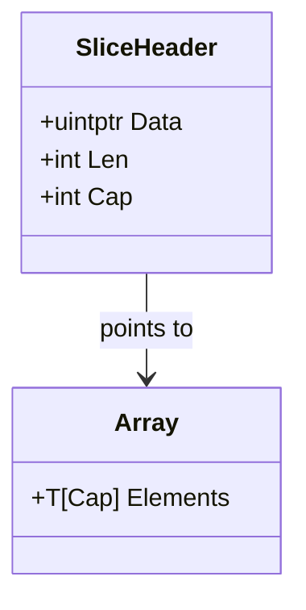
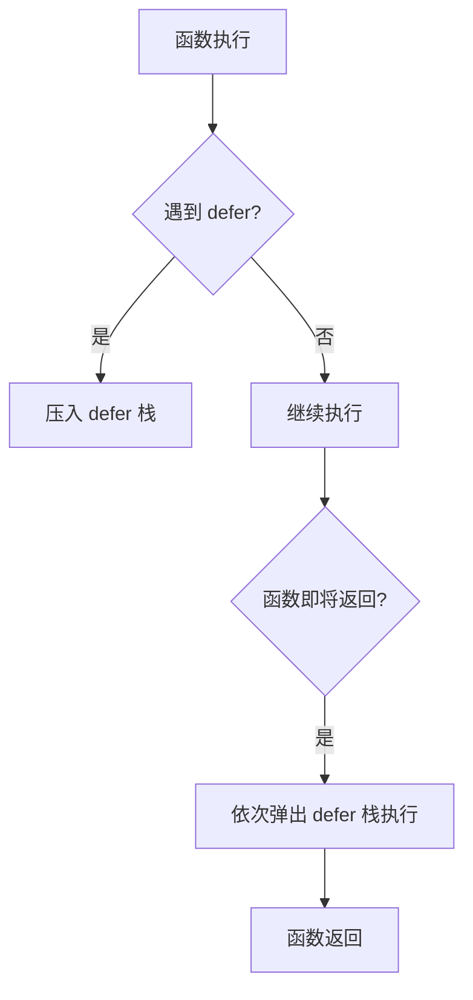
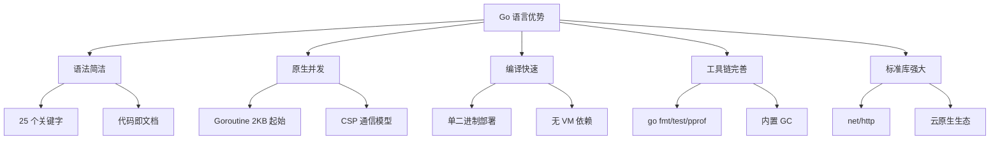
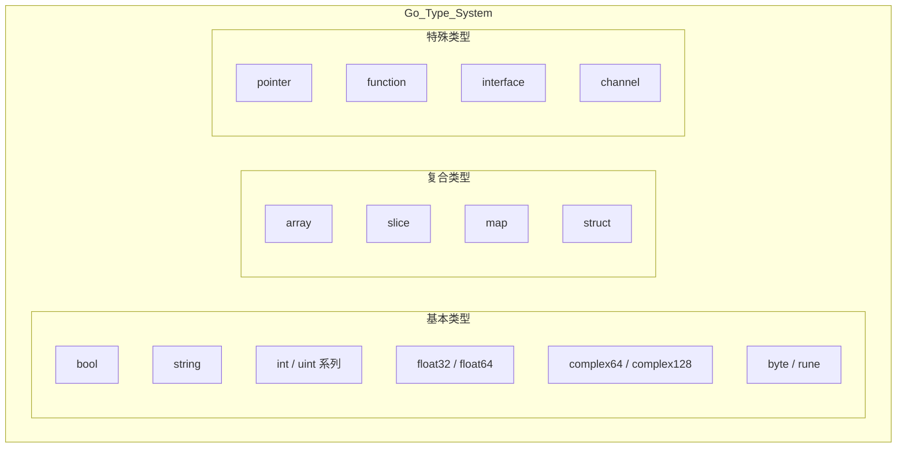

# 篇一 · 语言内功 · 01 Go 基础语法与类型系统

> **定位**：Go 语法与类型系统打底：值/引用语义、slice、map、零值、类型转换、defer
> **面试权重**：🔥🔥🔥🔥🔥 必考 ｜ **前置**：无（本系列起点）
> **🔁 前端类比**：JS 的 `let/const` + 数组/对象 → Go 的值语义与指针；TS 类型只在编译期，Go 类型参与内存布局

## 🧭 核心考点

- 值类型 vs 引用类型：struct 拷贝 vs slice/map 共享底层数组
- slice 三要素（ptr/len/cap）与扩容、截取共享内存的坑
- map 非并发安全、键类型约束与哈希映射过程
- defer 的 LIFO、参数求值时机与循环中的资源泄漏
- 变量声明、作用域与变量遮蔽（`:=` 短声明 + 隐式代码块）
- 常量与 `iota`：无类型常量、隐式转型、枚举
- 字符串底层（`StringHeader`）、字节 vs rune、UTF-8
- 结构体嵌入（组合 vs 继承、方法提升与屏蔽）
- 零值可用与显式类型转换（Go 无隐式转换）

## 📑 本篇题目索引（共 11 题）

| # | 题目 | 难度 | 频率 |
|---|------|------|------|
| Q1 | `slice` 和 `array` 的区别是什么？`slice` 的底层结构是怎样的？ | ⭐⭐ | 🔥 高频 |
| Q2 | `map` 是并发安全的吗？键类型有什么约束？如何安全并发读写？ | ⭐⭐⭐ | 🔥 高频 |
| Q3 | `defer` 的执行顺序是什么？参数何时求值？循环中使用有什么风险？ | ⭐⭐ | 🔥 高频 |
| Q4 | 与其他语言相比，使用 Go 有什么好处？ | ⭐⭐⭐ | 📌 常考 |
| Q5 | Go 使用什么数据类型？ | ⭐⭐⭐ | 📌 常考 |
| Q6 | Go 程序中的包是什么？ | ⭐⭐⭐ | 📌 常考 |
| Q7 | Go 支持什么形式的类型转换？将整数转换为浮点数。 | ⭐⭐⭐ | 📌 常考 |
| Q8 | 变量声明有哪几种形式？什么是变量遮蔽（shadowing）？ | ⭐⭐⭐ | 🔥 高频 |
| Q9 | Go 的常量有什么「创新」？`iota` 是什么？ | ⭐⭐⭐ | 🔥 高频 |
| Q10 | Go 字符串的底层结构是什么？为什么不可变？ | ⭐⭐⭐ | 🔥 高频 |
| Q11 | 结构体嵌入字段是什么？Go 是「组合」还是「继承」？ | ⭐⭐⭐ | 🔥 高频 |

---

### Q1: `slice` 和 `array` 的区别是什么？`slice` 的底层结构是怎样的？

**难度**：⭐⭐ | **频率**：🔥 高频

**考点**：值类型 vs 引用类型、切片扩容机制、内存布局。

**💡 记忆关键词**：值/引用、指针+len+cap、1.18 扩容策略

**答案要点**：
- `array` 是**值类型**，长度是类型的一部分（`[3]int` 与 `[4]int` 是不同类型），赋值/传参**整体拷贝**。
- `slice` 本身也是**值类型**（一个三字段的描述符：`ptr`/`len`/`cap`），但拷贝时只复制描述符、**共享同一底层数组**，所以语义上表现得像引用类型 —— 面试务必说清这个区别。
- **扩容规则**（易考且常被答错）：
  - **Go 1.18 之前**：`cap < 1024` 时翻倍；`cap ≥ 1024` 时每次增加 25%（`newcap += newcap/4`）；
  - **Go 1.18 起**：阈值改为 **256**。`newcap < 256` 时翻倍；`newcap ≥ 256` 时按 `newcap += (newcap + 3*256) / 4` 平滑过渡，增长因子从约 **2.0 逐步逼近 1.25**（越大的切片增长越接近 1.25 倍）；
  - 之后还要按 `size class` 做**内存对齐（roundupsize）**，所以观察到的容量往往比公式算出的更大（如 `append` 到 5 个元素时 `cap` 可能是 6 或 8）。
- **截取共享底层数组的坑**：`s2 := s1[1:3]` 与 `s1` 共享内存，改 `s2` 会影响 `s1`；`append(s2, x)` 可能覆盖 `s1` 的数据（若未触发扩容）。要独立副本用 `slices.Clone(s)` 或 `copy`。

**🔁 前端类比**：JS 数组是「引用 + 可随意变长」；Go 用 `array`（定长值）+ `slice`（可增长的视图）把这两件事拆开了，`len`/`cap` 就等于「已用长度」与「已申请容量」。

**⚠️ 常见误区**：① 说「slice 是引用类型」（更准确的说法是「值类型但共享底层数组」）；② 把扩容讲成「一律 1.25 倍」或「小于 1024 翻倍」（那是 **Go 1.18 之前**的规则）。

**📝 一句话总结**：array 定长值拷贝，slice 是 ptr+len+cap 的描述符且共享底层数组；Go 1.18 起扩容阈值是 256，增长因子从 2.0 平滑逼近 1.25，最后还会按 size class 对齐。



### Q2: `map` 是并发安全的吗？键类型有什么约束？如何安全并发读写？

**难度**：⭐⭐⭐ | **频率**：🔥 高频

**考点**：并发安全、键类型约束、哈希映射过程、nil map、`sync.Map`。

**💡 记忆关键词**：非并发安全、键须可判等、哈希碰撞、nil map 写 panic、RWMutex/sync.Map/分片

**答案要点**：

**① 并发安全**：原生 `map` **不是并发安全的**，多 goroutine 并发写会触发 `fatal error: concurrent map writes`（运行时直接崩溃，不可 recover）。解决方案：
1. `sync.RWMutex` 保护原生 map（适合读多写少）；
2. `sync.Map`（适合「键空间稳定、读多写少、写入集中在少数新键」的场景，内部 read/dirty 双 map 空间换时间）；
3. 分片锁（Sharding，如 `concurrent-map`），按 key 哈希路由到多个锁，降低锁竞争。

**② 键类型约束（高频追问）**：map 的键类型**必须支持 `==` / `!=` 判等** —— 因为哈希表定位到桶后，还要逐键比对才能确认是同一键。因此 **函数、map、slice 三种类型不能作键**；接口类型作键时，若运行时动态类型不可判等（如 `map[interface{}]int{[]int{2}: 2}`）会 **panic**。数组/结构体作键时，其元素/字段也必须可判等（编译器会递归检查，如 `map[[1][]string]int` 会报错）。

**③ 哈希映射过程（底层）**：`哈希函数(键) → 哈希值` → 用**哈希值低几位定位到桶** → 桶内先比对**哈希值**，相等再比对**键值本身** —— 因为不同键的哈希值可能相同（「哈希碰撞」），哈希值相同不代表键相同。

**④ 键类型选择（性能）**：求哈希 + 判等越快越适合做键。优先选**宽度小的数值类型和指针类型**（宽度越小哈希越快）；字符串哈希速度与长度成正比；数组/结构体/接口哈希慢且内部值可变，不建议作键。

**⑤ nil map 陷阱**：`var m map[K]V` 声明而不初始化得到 `nil` map。**读** nil map 返回零值（不报错），**写** nil map 会 **panic**。用 `make(map[K]V)` 或字面量初始化。

**🔁 前端类比**：JS 的 `Map` 键可以是任意类型（对象也行），Go 却要求键可判等 —— 就像 `Set` 依赖 `===` 去重一样，Go 的 map 依赖 `==` 定位与消碰撞。

**⚠️ 常见误区**：① 以为「只读并发」就安全 —— 读并发与写并发冲突同样触发 `fatal error: concurrent map read and map write`；② 用 `map[interface{}]...` 躲过编译检查，运行时仍会 panic；③ 在 nil map 上直接写。

**📝 一句话总结**：map 非并发安全，键必须可判等（函数/map/slice 不行），靠哈希值定位桶 + 键值比对消碰撞；nil map 读可写崩；并发场景用 RWMutex / sync.Map / 分片锁。

### Q3: `defer` 的执行顺序是什么？参数何时求值？循环中使用有什么风险？

**难度**：⭐⭐ | **频率**：🔥 高频

**考点**：栈结构、延迟执行、参数求值时机、返回值命名变量、资源泄漏。

**💡 记忆关键词**：LIFO、参数立即求值、返回值命名可改、循环陷阱、匿名函数包裹

**答案要点**：
- **执行顺序**：`defer` 遵循 **LIFO**（后进先出）原则，后注册的先执行，像函数返回前弹出一个栈。
- **执行时机**：在函数 `return` 之后、结果真正返回给调用者**之前**执行。因此 defer 可以影响函数的返回值（见下）。
- **参数求值时机（高频陷阱）**：`defer` 语句的**参数在 defer 语句执行时就求值**，而非 defer 函数体执行时才求值：
  ```go
  func f() {
      x := 1
      defer fmt.Println(x) // 此刻 x=1 已被捕获，最终打印 1
      x = 2
  }
  ```
  想用「执行时」的最新值，用闭包（不传参）：`defer func() { fmt.Println(x) }()` 打印 2。
- **返回值命名变量**：若函数返回值有名字，defer 可以修改它（defer 在 return 之后运行）：
  ```go
  func f() (n int) { defer func() { n++ }(); return 1 } // 返回 2
  ```
- **循环陷阱**：在循环里写 `defer f.Close()` 会把所有 Close 压到函数返回才执行，导致**文件描述符/连接被延迟释放**甚至耗尽。**最佳实践**：循环内用匿名函数包裹 `defer`（每次迭代立即释放），或手动 `Close()`。

**🔁 前端类比**：`defer` 类似 `try/finally` 的清理逻辑，但能叠加多个且逆序执行；「参数立即求值」则像 JS 里 `setTimeout(fn(x))` 参数在调用时就确定。

**📝 一句话总结**：defer LIFO、参数在注册时立即求值、可在命名返回值上做收尾；循环里要用匿名函数包裹，否则资源延迟释放。



---

### 1.1 接口与错误处理

### Q4: 与其他语言相比，使用 Go 有什么好处？

**难度**：⭐⭐⭐ | **频率**：📌 常考
**考点**：语言特性对比、并发模型、编译速度、工程化。
**答案要点**：
- 语法简洁，学习曲线低，代码可读性强（关键字仅 25 个）。
- 原生并发支持（goroutine + channel），基于 CSP 模型，轻量级且高效。
- 编译速度快，直接编译为机器码，无虚拟机依赖，部署简单（单二进制文件）。
- 内置垃圾回收（GC），工具链完善（`go fmt`, `go test`, `go pprof`, `go vet`）。
- 标准库强大，`net/http`、`encoding/json`、`crypto` 等开箱即用，适合网络编程和微服务。
- **技术发展**：Go 自 2009 年发布以来，在云原生领域（Docker, K8s, Prometheus, Etcd）占据主导地位，2026 年已成为后端开发的主流语言之一。



### Q5: Go 使用什么数据类型？

**难度**：⭐⭐⭐ | **频率**：📌 常考
**考点**：基本类型、复合类型、特殊类型、零值机制。
**答案要点**：
- **基本类型**：`bool`, `string`, `int`/`int8`/`int16`/`int32`/`int64`, `uint`/`uint8`/`uint16`/`uint32`/`uint64`, `float32`/`float64`, `complex64`/`complex128`, `byte`（`uint8` 别名）, `rune`（`int32` 别名，表示 Unicode 码点）。
- **复合类型**：`array`（固定长度）, `slice`（动态数组）, `map`（哈希表）, `struct`（结构体）。
- **特殊类型**：`pointer`（指针）, `function`（函数）, `interface`（接口）, `channel`（通道）。
- **零值机制**：声明未赋值时自动初始化为零值（数值为 `0`，字符串为 `""`，布尔为 `false`，引用类型为 `nil`）。



### Q6: Go 程序中的包是什么？

**难度**：⭐⭐⭐ | **频率**：📌 常考
**考点**：包管理、可见性规则、模块化、go mod。
**答案要点**：
- 包是代码组织的基本单元，每个 `.go` 文件必须声明所属的包（`package xxx`）。
- `main` 包是可执行程序的入口，必须包含 `main()` 函数。
- **可见性规则**：大写字母开头的标识符（变量、函数、类型）对外包可见（导出），小写字母开头仅包内可见。
- `go mod` 管理依赖，支持语义化版本（SemVer），`go.mod` 记录直接依赖，`go.sum` 记录哈希校验。

### Q7: Go 支持什么形式的类型转换？将整数转换为浮点数。

**难度**：⭐⭐⭐ | **频率**：📌 常考
**考点**：显式转换、类型断言、类型选择、转换规则。
**答案要点**：
- Go **不支持隐式类型转换**，所有类型转换必须显式声明。
- **数值类型转换**：`T(value)` 语法，如 `float64(intValue)`。
- **类型断言**：`value, ok := interfaceVar.(ConcreteType)`，用于从接口提取具体值。
- **类型选择**：`switch v := interfaceVar.(type) { case int: ... case string: ... }`。

```go
var i int = 42
var f float64 = float64(i)
var u uint = uint(i)
var b byte = byte(i)

var x interface{} = "hello"
if s, ok := x.(string); ok {
    fmt.Println(s)
}

func describe(v interface{}) {
    switch t := v.(type) {
    case int:
        fmt.Printf("整数: %d\n", t)
    case string:
        fmt.Printf("字符串: %s\n", t)
    default:
        fmt.Printf("未知类型: %T\n", t)
    }
}
```

### Q8: 变量声明有哪几种形式？什么是变量遮蔽（shadowing）？

**难度**：⭐⭐⭐ | **频率**：🔥 高频

**考点**：声明形式、短变量声明、作用域、隐式代码块、变量遮蔽。

**💡 记忆关键词**：`var` / `:=`、隐式代码块、内层遮蔽外层、go vet shadow

**答案要点**：
- **四种声明形式**：① `var a int = 1`（完整）；② `var a = 1`（类型推断）；③ `a := 1`（短变量声明，**只能在函数内**，声明并初始化）；④ 多变量 `var a, b int` / `var a, b = 1, 2`。
- **短变量声明 `:=` 的坑**：`:=` 要求左侧**至少有一个新变量**；在**不同作用域**使用时，容易「重新声明」出同名新变量，导致**变量遮蔽**。
- **变量遮蔽（Variable Shadowing）**：内层代码块声明了与外层同名的变量，内层变量「遮蔽」外层变量，外层变量不参与内层计算。它是 Go 开发最常见的低级 bug 之一，尤其 `:=` + `if/switch/for` 结合时极易发生。
- **代码块（Block）**：显式代码块（大括号包裹）之外，Go 还有 5 种**隐式代码块**（按范围从大到小）：宇宙代码块（预定义标识符 `new`/`make`/`true`…所在）→ 包代码块 → 文件代码块 → `if/for/switch` 控制语句的隐式代码块 → `switch/select` 每个 `case` 子句隐式代码块。
- **作用域规则**：声明于外层代码块的标识符，其作用域包括所有内层代码块；反之不可。**同一代码块内不能重名，跨代码块可以**（这正是遮蔽的土壤）。
- **导出标识符**：声明在包代码块中（或字段/方法名），且**首字母大写**，才能被其他包访问。
- **检测工具**：`go vet -vettool=$(which shadow)`（`golang.org/x/tools/go/analysis/passes/shadow`），Go 1.14 后需单独安装，且不能穷尽所有遮蔽。

```go
var a = 11
func foo(n int) {
    a := 1     // 遮蔽包级变量 a，包级 a 不受影响
    a += n
}
```

**🔁 前端类比**：JS 的 `let` 块级作用域 + 同名变量「内层覆盖外层」是同一类问题；但 JS 有 `const` 且 `var` 有函数作用域提升，Go 的遮蔽发生在「隐式代码块」层级，比 JS 更容易踩。

**⚠️ 常见误区**：把「遮蔽」当成「赋值」—— `a := 1` 在 switch 内是**声明新变量**而非修改外层变量；想改外层应写成 `a, err = getYear()`（用 `=` 而非 `:=`）。

**📝 一句话总结**：`:=` 跨作用域使用会声明新变量并遮蔽外层同名变量；理解 5 种隐式代码块 + 作用域规则，用 `go vet` shadow 插件辅助排查。

### Q9: Go 的常量有什么「创新」？`iota` 是什么？

**难度**：⭐⭐⭐ | **频率**：🔥 高频

**考点**：无类型常量、隐式转型、iota 枚举、编译期求值。

**💡 记忆关键词**：无类型常量、隐式转型、iota 行偏移、`_ = iota` 跳过

**答案要点**：
- **常量性质**：`const` 声明的常量是**编译期创建**、生命周期内不变；类型只限**数值、字符串、布尔**三种基本类型；编译期求值还能提前发现「整数除零、字符串索引越界」等错误。
- **三大创新（相对 C 的宏/const）**：
  1. **无类型常量（Untyped Constant）**：`const n = 13` 不带类型，有「默认类型」但不受其约束，可灵活参与运算。
  2. **隐式转型**：无类型常量会根据上下文自动转换为目标类型（编译器保证安全）；若无法转换（如 `const m = 1333333333; var k int8; j := k + m`）会报 **overflow 溢出错误**。
  3. **用常量实现枚举**：Go 无原生枚举，用 `const` 块 + `iota` 实现。
- **iota**：预定义标识符，表示 **const 块中每行的偏移值（从 0 开始）**，且**同一行的多个 iota 值相同**。配合「隐式重复上一行的初始化表达式」自动递增：
  ```go
  const (
      mutexLocked = 1 << iota // 0 → 1
      mutexWoken              // 1 → 2（重复 1<<iota）
      mutexStarving           // 2 → 4
      mutexWaiterShift = iota // 3
  )
  ```
- **跳过/占位**：用空白标识符 `_ = iota` 让枚举值从 1 开始，或用 `_` 跳过某个值（如跳过 `Pin4`）。
- **注意**：每个 `const` 块拥有独立的 iota（值从 0 重新计）；iota 是行偏移，**不是**「前一个值 +1」（虽然常见用法下效果相同）。
- **用显式字面值更合适的场景**：值需要固定不可变（如端口号、状态码、系统调用号、协议常量），避免后续插入导致已有值漂移。

**🔁 前端类比**：iota 类似「自动递增的下标」；无类型常量 + 隐式转型则类似 JS 的隐式转换，但 Go 把它限制在编译期常量上，保证安全。

**📝 一句话总结**：Go 常量靠「无类型常量 + 隐式转型」获得 C 宏没有的类型安全与灵活性，靠 `iota` 行偏移实现枚举；编译期求值、溢出/除零提前报错。

### Q10: Go 字符串的底层结构是什么？为什么不可变？

**难度**：⭐⭐⭐ | **频率**：🔥 高频

**考点**：StringHeader、不可变性、字节 vs rune、UTF-8。

**💡 记忆关键词**：Data+Len 描述符、不可变、字节长度 vs 字符数、rune=int32

**答案要点**：
- **底层结构**：`string` 本质是一个**描述符**（二元组），不直接存数据：
  ```go
  // $GOROOT/src/reflect/value.go
  type StringHeader struct { Data uintptr; Len int }
  ```
  `Data` 指向底层字节数组，`Len` 是字节数。因此 `len(s)` 是 **O(1)**（直接读 Len），传参也只传描述符，开销恒定。
- **不可变性**：字符串值在生命周期内**不可变** —— `s[0] = 'k'` 编译报错，但 `s = "gopher"`（变量重新赋值）合法。不可变带来：① **并发安全**（多 goroutine 共享无需加锁）；② 存储复用（同一字符串值只需分配一块内存）。
- **字节视角 vs 字符视角**：`len("中国人") == 9`（3 个汉字 × 3 字节），`utf8.RuneCountInString("中国人") == 3`。**下标 `s[i]` 取到的是字节**，不是字符；`for i := ...` 遍历字节，`for i, v := range s` 遍历 **rune（码点）**。
- **rune 与 UTF-8**：`rune` 是 `int32` 的别名，表示一个 **Unicode 码点**；Go 用 **UTF-8 变长编码**（1~4 字节：ASCII 1 字节、汉字 3 字节）存储，编码单元是单字节、无需考虑字节序，且兼容 ASCII。
- **常见操作注意**：`+`/`+=` 拼接最直观但**性能最差**（每次产生新字符串）；循环拼接优先 `strings.Builder`（可 `Grow` 预分配）或 `strings.Join`；`string ↔ []byte/[]rune` 转换会**分配新内存**（因字符串不可变）。

**🔁 前端类比**：Go 字符串不可变 ≈ JS 字符串不可变（`str[0]='x'` 无效、`replace` 返回新串）；但 Go 把「字节长度」和「字符数」分开，`len` 是字节数（`"中".length===1` 而 Go `len("中")===3`）。

**📝 一句话总结**：string 是 `Data+Len` 描述符、不可变，因此并发安全、取长度 O(1)；`len` 是字节数、`range` 才是按 rune 遍历，底层 UTF-8 编码。

### Q11: 结构体嵌入字段是什么？Go 是「组合」还是「继承」？

**难度**：⭐⭐⭐ | **频率**：🔥 高频

**考点**：嵌入字段、方法提升、屏蔽、组合 vs 继承。

**💡 记忆关键词**：匿名字段、方法提升、浅层屏蔽深层、组合非继承

**答案要点**：
- **嵌入字段（Embedded Field，匿名字段）**：结构体字段声明中**只有类型名、没有字段名**，如 `type Animal struct { AnimalCategory }`。嵌入字段「类型即名称」，其**字段和方法会被「提升」到外层结构体**，可直接 `animal.String()` 调用。
- **屏蔽（Shadowing）**：外层若定义同名字段/方法，会**屏蔽**嵌入字段的同名成员（浅层屏蔽深层）；多层嵌入时层级越深越容易被屏蔽。仍可通过完整链式选择表达式访问，如 `cat.Animal.AnimalCategory`。
- **值方法 vs 指针方法**：
  - 值方法接收者是副本，修改不反映原值（除非是引用类型的别名）；指针方法接收者是指针，修改反映原值。
  - 方法集合：`T` 只有值方法；`*T` 含全部（值 + 指针）。这是「实现接口」的关键差异。
  - 自动转译：`cat.SetName("x")` 会被编译为 `(&cat).SetName("x")`（值可调用指针方法，前提可寻址）。
- **组合 ≠ 继承**：Go **没有继承**，嵌入字段是实现**类型组合**的方式 —— 非侵入式、不破坏封装、可嵌入多个类型（无多重继承的复杂度）。被嵌入类型实现的接口，外层类型也自动实现。
- **两个易忽略点**：① 可嵌入**指针类型**（默认 `nil`，使用前必须初始化）；② 空结构体 `struct{}` 不占内存、可作 channel 信号值。

**🔁 前端类比**：类似 JS 的「组合优于继承」（把功能对象 mixin 进来），而不是 `class extends`；Go 直接把它内建成了语言级的「嵌入」。

**⚠️ 常见误区**：面试官最爱纠的点 —— 说「Go 用嵌入实现继承」。正确表述是「组合」，可补充官网 FAQ「Why is there no type inheritance?」。

**📝 一句话总结**：嵌入字段实现类型组合，方法/字段自动提升、浅层屏蔽深层；Go 无继承，组合非侵入、可多嵌入；方法集合（T 只有值方法，*T 含全部）决定接口实现。

---

## ✅ 自测清单（答不出就回去看对应题）

- [ ] 能脱离资料讲清本篇「核心考点」中的每一条
- [ ] 能手写/口述至少 2 道 🔥 高频题的最小实现
- [ ] 能结合自己的项目讲出 1 个坑或 1 次调优

