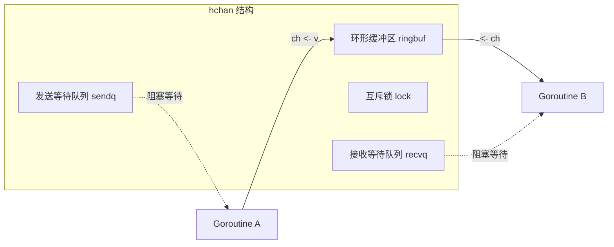
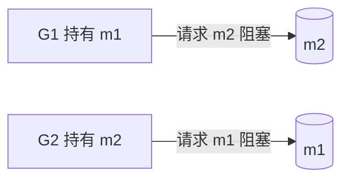

# 篇一 · 语言内功 · 03 并发编程（goroutine / channel / sync / context）

> **定位**：Go 面试区分度最高的一篇：从进程/线程模型到高并发架构的**四阶段完整阶梯**，覆盖并发原语、并发模式、死锁/竞态、泄漏排查与性能调优
> **面试权重**：🔥🔥🔥🔥🔥 必考 ｜ **前置**：1-01、1-02
> **🔁 前端类比**：`Promise.all` / `async-await` → `goroutine + channel + select`；`AbortController` → `context` 取消传播；Web Worker → goroutine，但 goroutine 便宜几个数量级。

## 🧭 核心考点

- 进程/线程/协程三级模型与三种线程映射（1:1 / N:1 / M:N）
- goroutine 与 OS 线程的成本差异（2KB 栈、用户态调度、M:N）
- channel 的阻塞语义、缓冲、关闭规则与**五大陷阱**
- `select` 多路复用、超时与非阻塞收发
- `sync` 全家桶：`Mutex` / `RWMutex` / `WaitGroup` / `Once` / `Pool` / `Map` / `atomic`
- `context`：取消、超时、值传递与传播规范（**面试必问**）
- 并发模式与 goroutine 泄漏排查
- 扩展并发原语：`singleflight` 请求合并、`semaphore` 信号量
- Go 内存模型与 happens-before（可见性与顺序保证，含 Go 1.19 atomic 修订）
- **数据竞争 vs 竞态条件**、**死锁四条件与预防**、**无锁编程与 CAS**
- 线程池 vs goroutine 池、**工作窃取**（深挖去向 2-05）
- 协程 vs 异步编程；Go / Python / Rust 并发模型横向对比（深挖去向 6-28）
- 分布式系统中的并发（深挖去向 4-18）与性能调优/容量规划（深挖去向 5-20）
- 高并发架构设计（深挖去向 4-19 / 6-30）与并发框架设计（深挖去向 2-08）

## 🗺️ 四阶段学习路径（本篇地图）

| 阶段 | 目标 | 覆盖题目 | 深挖去向 |
|------|------|----------|----------|
| **一 · 基础理解** | 搞懂进程/线程/协程，会用同步原语，写出**正确退出**的并发程序 | Q1~Q10 | [2-05 GMP](./2-05-GMP调度模型.md) |
| **二 · 深入原理** | 内存模型与可见性、原子/无锁、死锁与竞态、线程池与工作窃取 | Q11~Q20 | [2-05](./2-05-GMP调度模型.md)、[2-06](./2-06-内存管理与GC.md) |
| **三 · 高级应用** | 并发模式深化、协程/异步与跨语言模型、分布式并发、性能调优 | Q21~Q27 | [4-18](./4-18-分布式系统原理.md)、[5-20](./5-20-性能优化实战.md)、[6-28](./6-28-跨语言对比与技术选型.md) |
| **四 · 专家水平** | 设计高并发架构、排查复杂并发 Bug、开发并发框架、团队传播 | Q28~Q31 | [4-19](./4-19-高可用架构设计.md)、[6-30](./6-30-面试真题与系统设计.md)、[2-08](./2-08-手写代码与算法实战.md) |

## 📑 本篇题目索引（共 31 题）

| # | 题目 | 难度 | 频率 | 阶段 |
|---|------|------|------|------|
| Q1 | 进程、线程、协程的关系？Go 为什么选 M:N？ | ⭐⭐ | 📌 常考 | 一 |
| Q2 | `goroutine` 和操作系统线程的区别？为什么 Go 并发更高效？ | ⭐⭐ | 🔥 高频 | 一 |
| Q3 | 如何停止一个 goroutine？ | ⭐⭐ | 🔥 高频 | 一 |
| Q4 | `channel` 的底层实现？无缓冲和有缓冲的区别？ | ⭐⭐⭐ | 🔥 高频 | 一 |
| Q5 | 使用 channel 有哪些陷阱？ | ⭐⭐⭐ | 🔥 高频 | 一 |
| Q6 | channel 缓冲有什么特点？如何用 channel 做限流？ | ⭐⭐ | 📌 常考 | 一 |
| Q7 | `sync.Mutex` / `RWMutex` 有什么特点？ | ⭐⭐⭐ | 🔥 高频 | 一 |
| Q8 | `sync` 包里 `WaitGroup` / `Once` / `Cond` / `Pool` / `Map` 分别用在哪？ | ⭐⭐⭐ | 🔥 高频 | 一 |
| Q9 | 信号量（Semaphore）是什么？Go 里如何实现？ | ⭐⭐⭐ | 📌 常考 | 一 |
| Q10 | 手撕并发任务池：并发度控制 + 错误收敛 + 优雅退出 | ⭐⭐⭐ | 🔥 高频 | 一 |
| Q11 | `select` 的底层机制与典型用法？ | ⭐⭐⭐ | 🔥 高频 | 二 |
| Q12 | `context` 是什么？取消信号如何传播？ | ⭐⭐⭐ | 🔥 高频 | 二 |
| Q13 | `context` 的底层结构是怎样的？取消是如何沿上下文树传播的？ | ⭐⭐⭐ | 🔥 高频 | 二 |
| Q14 | Go 的内存模型是什么？happens-before 有哪些保证？ | ⭐⭐⭐⭐ | 📌 常考 | 二 |
| Q15 | 数据竞争（Data Race）与竞态条件（Race Condition）有什么区别？ | ⭐⭐⭐ | 📌 常考 | 二 |
| Q16 | 原子操作 vs 锁怎么选？什么是无锁编程？ | ⭐⭐⭐⭐ | 📌 常考 | 二 |
| Q17 | 死锁：四个必要条件、Go 中的典型场景与预防？ | ⭐⭐⭐ | 🔥 高频 | 二 |
| Q18 | 线程池 vs goroutine 池？什么是工作窃取？ | ⭐⭐⭐ | 🔥 高频 | 二 |
| Q19 | 常见并发模式有哪些（fan-out/fan-in、worker pool、pipeline）？ | ⭐⭐⭐ | 🔥 高频 | 二 |
| Q20 | goroutine 泄漏的常见原因与排查手段？ | ⭐⭐⭐⭐ | 🔥 高频 | 二 |
| Q21 | 如何实现并发安全的单例？ | ⭐⭐ | 🔥 高频 | 三 |
| Q22 | `singleflight` 是什么？如何用它解决缓存击穿？ | ⭐⭐⭐ | 🔥 高频 | 三 |
| Q23 | channel 和互斥锁如何选择？（《100 个 Go 语言典型错误》#57） | ⭐⭐⭐ | 🔥 高频 | 三 |
| Q24 | goroutine 是协程吗？与 Python / JS 异步模型的区别？ | ⭐⭐⭐ | 📌 常考 | 三 |
| Q25 | Go / Python / Rust 并发模型对比与选型？ | ⭐⭐⭐ | 🔥 高频 | 三 |
| Q26 | 分布式系统中的并发问题有哪些？ | ⭐⭐⭐⭐ | 📌 常考 | 三 |
| Q27 | 并发程序怎么做性能调优与容量规划？ | ⭐⭐⭐ | 📌 常考 | 三 |
| Q28 | 高并发系统架构设计（并发视角）？ | ⭐⭐⭐⭐ | 🔥 高频 | 四 |
| Q29 | 复杂并发 Bug 排查实战（案例复盘）？ | ⭐⭐⭐⭐ | 📌 常考 | 四 |
| Q30 | 如何设计一个并发编程框架？ | ⭐⭐⭐⭐ | 📖 了解即可 | 四 |
| Q31 | 并发能力矩阵与团队落地（分享与传播）？ | ⭐⭐ | 📖 了解即可 | 四 |

---

## 阶段一 · 基础理解：进程/线程/协程 → 同步原语 → 并发程序

### Q1: 进程、线程、协程的关系？Go 为什么选 M:N？

**难度**：⭐⭐ | **频率**：📌 常考

**考点**：三级执行单元、内核态/用户态、三种线程映射模型。

**💡 记忆关键词**：进程=资源单位、线程=调度单位、协程=用户态任务、1:1/N:1/M:N

**答案要点**：

| 维度 | 进程 | 线程 | 协程 |
|------|------|------|------|
| 定位 | 资源分配的基本单位（独立地址空间） | CPU 调度的基本单位（共享进程内存） | 用户态的轻量执行单元（runtime 调度） |
| 切换者 | 内核 | 内核 | **语言 runtime / 用户态** |
| 切换成本 | 最高（换页表、刷 TLB） | 中（保存寄存器、陷入内核） | **最低**（只保存少量寄存器） |
| 通信方式 | IPC（管道/共享内存/信号） | 共享内存 + 同步原语 | channel / 消息传递 |

- **线程的三种映射模型**：
  1. **1:1**（一个用户线程绑一个内核线程）：Linux pthread、Java Thread —— 简单，但线程数受内核限制；
  2. **N:1**（多个用户线程复用一个内核线程）：切换快，但**一个线程阻塞系统调用，全部一起阻塞**；
  3. **M:N**（M 个内核线程跑 N 个协程）：**Go 的选择** —— 兼顾并行度与成本，阻塞的协程让出工位（P），不拖累其他协程。
- Go 1.1 之前是 N:1 调度器，1.1 起重写为 M:N（GMP 模型，详见 [2-05](./2-05-GMP调度模型.md)）。

**🔁 前端类比**：浏览器「多进程 → 多线程 → 任务」三级模型同构：浏览器进程（崩溃隔离）→ 渲染进程内的 GUI / JS / 网络线程 → Event Loop 里的 task。Web Worker ≈ 线程，`async` 任务 ≈ 协程——但 JS 的「协程」由事件循环调度，Go 的 goroutine 由 runtime 调度且可多核并行。

**📝 一句话总结**：进程管资源、线程管调度、协程管轻量任务；Go 用 M:N 把几十万协程复用到少量内核线程上，是「成本」与「并行」的折中。

---

### Q2: `goroutine` 和操作系统线程的区别？为什么 Go 并发更高效？

**难度**：⭐⭐ | **频率**：🔥 高频

**考点**：用户态调度、栈成本、切换成本、GMP 初探。

**💡 记忆关键词**：2KB vs 1~8MB、用户态切换、几十万并发、M:N 映射

**答案要点**：

| 维度 | OS 线程 | goroutine |
|------|---------|-----------|
| 管理者 | 内核 | Go runtime（用户态） |
| 初始栈 | 通常 1~8MB（固定） | **约 2KB**，按需扩缩（64 位上限 1GB） |
| 切换成本 | 陷入内核、保存大量寄存器 | 仅保存少量寄存器，用户态完成 |
| 映射关系 | 1:1 | **M:N**（多个 G 复用多个 M，由 P 调度） |
| 创建成本 | 昂贵（系统调用） | 廉价（一次函数调用） |

- 单机可轻松运行**数十万** goroutine；阻塞的网络 IO 由 netpoller 接管，不占线程（详见 [2-05](./2-05-GMP调度模型.md)）。

**🔁 前端类比**：Web Worker 是 OS 线程级别的「重」并发，通常只开几个；goroutine 类似「任务」粒度，可以随手创建。JS 的单线程 Event Loop 则完全无法利用多核。

**⚠️ 常见误区**：「goroutine 廉价」不等于「可以随便起不管」——泄漏的 goroutine 一样会吃内存、吃调度、拖垮 GC（见 Q20）。

**📝 一句话总结**：goroutine 是 runtime 管理的用户态协程，2KB 起栈 + M:N 调度，所以「便宜到可以随手开」。

---

### Q3: 如何停止一个 goroutine？

**难度**：⭐⭐ | **频率**：🔥 高频

**考点**：协作式退出、context、channel 信号、无外部强杀。

**💡 记忆关键词**：不能外部强杀、函数返回 / channel / context、协作式退出

**答案要点**：
- **Go 没有「从外部杀死 goroutine」的 API**，设计哲学是**协作式退出**：让 goroutine 自己检查退出信号并返回。
- 三种常用方式：
  1. **函数自然返回**：最简单，任务跑完即退出。
  2. **channel 信号**：`done := make(chan struct{})`，`close(done)` 广播退出（**关闭 channel 会唤醒所有接收者**，这是广播的惯用法）。
  3. **`context` 取消**（推荐）：`context.WithCancel` / `WithTimeout`，可层层传播，适合 goroutine 树与请求链路。
- **注意**：退出时要释放资源（`defer close` / `defer cancel()`），避免泄漏。

```go
// 1) channel 广播退出
done := make(chan struct{})
go func() {
    defer wg.Done()
    ticker := time.NewTicker(time.Second)
    defer ticker.Stop()
    for {
        select {
        case <-done:
            return
        case <-ticker.C:
            doWork()
        }
    }
}()
close(done) // 一次关闭，所有监听者退出

// 2) context 取消（推荐：可超时、可级联）
ctx, cancel := context.WithTimeout(context.Background(), 3*time.Second)
defer cancel() // 务必调用，否则定时器资源泄漏到超时为止
go func() {
    for {
        select {
        case <-ctx.Done():
            return // ctx.Err() 可知是 Canceled 还是 DeadlineExceeded
        default:
            doWork()
        }
    }
}()
```

**🔁 前端类比**：就是 `AbortController.abort()` → `fetch` 的 `signal` → 请求中断，Go 里把这个模式标准化成了 `context` 并贯穿标准库。

**📝 一句话总结**：goroutine 只能「劝退」不能「强杀」——用 `context` 或关闭 channel 通知它自己返回。

---

### Q4: `channel` 的底层实现？无缓冲和有缓冲的区别？

**难度**：⭐⭐⭐ | **频率**：🔥 高频

**考点**：`hchan` 结构、环形缓冲、sendq/recvq、阻塞唤醒。

**💡 记忆关键词**：hchan、环形缓冲区、sendq/recvq、同步 vs 异步

**答案要点**：
- 底层是 `runtime.hchan`，核心字段：`buf`（环形缓冲区）、`sendx/recvx`（读写下标）、`lock`、`sendq`/`recvq`（阻塞在该 channel 上的 goroutine 等待队列，元素是 `sudog`）。
- **无缓冲**（`make(chan T)`）：**同步通信**，发送方与接收方必须同时就绪才完成交接（直接把数据从发送 G 拷贝给接收 G），否则阻塞。
- **有缓冲**（`make(chan T, n)`）：**异步通信**，缓冲区未满即可发送、未空即可接收；满则发送阻塞，空则接收阻塞。
- **关闭语义**：`close(ch)` 后不能再发送（panic），接收会立即得到零值 + `ok == false`；关闭会唤醒所有等待的 goroutine。



**📝 一句话总结**：`hchan` = 环形缓冲 + 两等待队列 + 一把锁；无缓冲是「一手交钱一手交货」，有缓冲是「放货架上」。

---

### Q5: 使用 channel 有哪些陷阱？

**难度**：⭐⭐⭐ | **频率**：🔥 高频

**考点**：nil/已关闭 channel、重复关闭、零值接收、循环 defer。

**💡 记忆关键词**：nil 永久阻塞、关后发送 panic、重复关闭 panic、关后收零值、谁发送谁关闭

**答案要点**（**面试常要求一口气说出**）：
1. 向 **nil channel** 发送或接收会**永久阻塞**（`var ch chan int; ch <- 1` 死锁）——但 `select` 中把 channel 置 nil 可「禁用」某个 case，这是有用的技巧。
2. 向**已关闭**的 channel 发送会 **panic**。
3. 从**已关闭**的 channel 接收会立即返回**零值**，必须用 `v, ok := <-ch` 判断。
4. **重复关闭** channel 会 **panic**；关闭 nil channel 也 panic。
5. 在**循环里** `defer close(ch)` 会延迟到函数返回才执行，易造成资源长时间不释放。
6. **责任约定**：**由发送方关闭** channel（或唯一的生产者关闭），不要在多个 goroutine 中随意关闭。

```go
// 安全读取：判断通道是否关闭
if v, ok := <-ch; ok {
    fmt.Println("收到:", v)
} else {
    fmt.Println("通道已关闭")
}

// 非阻塞收发（select + default）
select {
case ch <- 42:
    fmt.Println("发送成功")
default:
    fmt.Println("缓冲已满，丢弃或降级")
}
```

**⚠️ 加分点**：`for v := range ch` 会在 channel 关闭且缓冲排空后自动退出，是最安全的消费写法。

**📝 一句话总结**：nil 阻塞、关闭后发送 panic、重复关闭 panic、关闭后收零值——记住「发送方负责关闭」。

---

### Q6: channel 缓冲有什么特点？如何用 channel 做限流？

**难度**：⭐⭐ | **频率**：📌 常考

**考点**：背压、并发度控制、信号量模式。

**💡 记忆关键词**：背压、缓冲即并发额度、semaphore、worker pool

**答案要点**：
- **无缓冲**用于同步协调（等待某事件、交接所有权）；**有缓冲**用于解耦生产/消费速度、做任务队列。
- **背压（Backpressure）**：缓冲满时发送方阻塞，天然限制上游速度，防止把内存打爆。
- **限流/并发度控制**：用「带缓冲 channel 当信号量」——获取额度发送、释放额度接收（更完整的信号量见 Q9）。

```go
// 用缓冲 channel 控制最大并发数（信号量模式）
sem := make(chan struct{}, 10) // 最多 10 个并发
for _, task := range tasks {
    sem <- struct{}{} // 占一个坑，满了就阻塞（背压）
    go func(t Task) {
        defer func() { <-sem }() // 释放
        process(t)
    }(task)
}
// 等待全部完成：再填满信号量说明所有 goroutine 都已释放
for i := 0; i < cap(sem); i++ {
    sem <- struct{}{}
}
```

**📝 一句话总结**：缓冲 channel 既是队列也是并发额度，用「发送占坑、接收放坑」就是最简单的并发限流。

---

### Q7: `sync.Mutex` / `RWMutex` 有什么特点？

**难度**：⭐⭐⭐ | **频率**：🔥 高频

**考点**：互斥/读写锁、不可重入、饥饿模式、TryLock、锁粒度。

**💡 记忆关键词**：不可重入、正常模式+饥饿模式、RLock 可并发读、defer 解锁、锁粒度

**答案要点**：
- `sync.Mutex`：同一时刻只允许一个 goroutine 进入临界区。**不可重入**（同一 goroutine 重复 Lock 会死锁，见 Q17）。
- 内部有**正常模式**（自旋 + FIFO 排队，吞吐优先）与**饥饿模式**（等待超过 1ms 直接移交锁，防止尾部延迟），解锁时在这两种模式间切换。
- `sync.RWMutex`：允许多个读并发，**写独占且阻塞所有读**；适合**读多写少**。
- Go 1.18+ 提供 `TryLock()`（拿不到立即返回 false，**不要用它做自旋**）。
- **实践**：
  - 用 `defer mu.Unlock()` 保证释放；
  - **缩小临界区**（不要在锁内做 IO / 调用外部函数）；
  - 锁不要拷贝（复制含锁的结构体会导致锁失效，`go vet` 的 `copylock` 会报警）。

```go
var mu sync.Mutex
var counter int

func Inc() {
    mu.Lock()
    defer mu.Unlock()
    counter++
}

var rw sync.RWMutex
var cache = map[string]string{}

func Get(k string) string {
    rw.RLock()
    defer rw.RUnlock()
    return cache[k]
}

func Set(k, v string) {
    rw.Lock()
    defer rw.Unlock()
    cache[k] = v
}
```

**📝 一句话总结**：Mutex 互斥且不可重入，RWMutex 适合读多写少；锁要小粒度、别拷贝、别在锁里做 IO。

---

### Q8: `sync` 包里 `WaitGroup` / `Once` / `Cond` / `Pool` / `Map` 分别用在哪？

**难度**：⭐⭐⭐ | **频率**：🔥 高频

**考点**：并发原语选型、各自适用与不适用场景。

**💡 记忆关键词**：WaitGroup 等一组、Once 只一次、Cond 等条件、Pool 复用对象、Map 读多写少/键稳定

**答案要点**：

| 原语 | 用途 | 要点与坑 |
|------|------|----------|
| `WaitGroup` | 等待一组 goroutine 结束 | `Add` 要在启动 goroutine **之前**调用；`Wait` 与 `Add` 并发调用是数据竞争；Go 1.25 有 `wg.Go(f)` 简化写法 |
| `Once` | 只执行一次（单例、惰性初始化） | `Do` 内的 panic 也会标记为已执行 |
| `Cond` | 等待某个条件成立（比 `for + sleep` 高效） | 必须配合锁使用，且用 `for` 循环检查条件（防止虚假唤醒） |
| `Pool` | 复用临时对象，降低 GC 压力 | 取出的对象**必须重置**；Pool 中的对象**随时可能被 GC 回收**，不能当缓存用 |
| `Map` | 并发安全 map | 适合**读多写少**或**键集合稳定**（如每个 goroutine 写自己的键）；频繁写新键时不如 `RWMutex + map` |

```go
// WaitGroup：并发抓取并聚合
var wg sync.WaitGroup
results := make([]Result, len(urls))
for i, u := range urls {
    wg.Add(1)
    go func(i int, u string) {
        defer wg.Done()
        results[i] = fetch(u) // 各写各的下标，无竞争
    }(i, u)
}
wg.Wait()

// sync.Pool：复用 buffer
var bufPool = sync.Pool{New: func() any { return new(bytes.Buffer) }}
buf := bufPool.Get().(*bytes.Buffer)
buf.Reset()          // 必须重置
defer bufPool.Put(buf)
```

**📝 一句话总结**：等一组用 WaitGroup，只一次用 Once，等条件用 Cond，省 GC 用 Pool，并发 map 优先看读写比再决定 sync.Map 还是 RWMutex+map。

---

### Q9: 信号量（Semaphore）是什么？Go 里如何实现？

**难度**：⭐⭐⭐ | **频率**：📌 常考

**考点**：P/V 操作、计数信号量、`semaphore.Weighted`、channel 实现、资源控制。

**💡 记忆关键词**：P 获取 V 释放、控制 N 个资源、Weighted、buffered chan、请求多少释放多少

**答案要点**：
- **概念**：信号量是控制「多个 goroutine 同时访问**一组资源**」的并发原语（Dijkstra 1963 提出）。**P 操作**（acquire/wait）请求资源、计数减 1；**V 操作**（release/signal）释放资源、计数加 1。计数为 0 时 P 阻塞。
- **计数 vs 二进制信号量**：计数可为任意整数（如连接池大小 10）；二进位信号量（0/1）就等价于互斥锁。
- **Go 实现方式一：官方扩展库 `golang.org/x/sync/semaphore`**：
  - 类型 `Weighted`，字段 `{size, cur, mu, waiters(list.List)}`；
  - `Acquire(ctx, n)`（一次可请求**多个**资源，带 context 可取消/超时）、`Release(n)`、`TryAcquire(n)`（不阻塞）；
  - `notifyWaiters` 按 **FIFO** 唤醒，避免饥饿。
- **实现方式二：带缓冲 channel**（`make(chan struct{}, n)`）：发送占坑、接收释放 —— 最简单，但**一次只能请求一个资源**（`Weighted` 的优势是 `Acquire(ctx, n)` 一次拿多个）。
- **常见错误**：① 请求了忘记释放；② 释放从未请求的资源（`Release` 超量会 panic）；③ 长期持有不需要的资源；④ 请求数超过 `size` 永远阻塞。
- **典型场景**：Worker Pool 并发度控制、连接池、限流（配合 Q6、Q18）。

```go
sema := semaphore.NewWeighted(10)            // 最多 10 个并发
if err := sema.Acquire(ctx, 1); err != nil { return }
go func() {
    defer sema.Release(1)
    doWork()
}()
```

**🔁 前端类比**：类似「并发限制的 p-limit」——用一个计数器限制同时进行的异步任务数量，满了就排队。

**📝 一句话总结**：信号量控制「N 个资源」的并发访问，P/V 对应 acquire/release；Go 用 `semaphore.Weighted`（可一次拿多个、带 ctx）或 buffered channel（简单但只能拿一个）实现。

---

### Q10: 手撕并发任务池：并发度控制 + 错误收敛 + 优雅退出

**难度**：⭐⭐⭐ | **频率**：🔥 高频

**考点**：errgroup、信号量、context、优雅停机、面试手撕题的标准答案。

**💡 记忆关键词**：errgroup.WithContext、SetLimit、ctx 贯穿、defer cancel、停机两阶段、-race 验证

**答案要点**（「编写简单的多线程程序」的 Go 标准形态——面试手撕题直接套）：

```go
// ① 并发执行 + 并发度限制 + 首个错误取消整组
func RunTasks(ctx context.Context, tasks []func(context.Context) error, limit int) error {
    g, ctx := errgroup.WithContext(ctx) // 任一任务返回 error，ctx 自动取消
    g.SetLimit(limit)                   // Go 1.19+（x/sync v0.1.0+）限制同时在跑的任务数
    for _, t := range tasks {
        g.Go(func() error {
            return t(ctx) // 任务内部所有阻塞操作都应接收 ctx
        })
    }
    return g.Wait() // 等全部结束；返回第一个非 nil error
}

// ② 优雅停机：停止接收新任务 → 等待存量 drain（可带超时）
type Pool struct {
    wg      sync.WaitGroup
    sem     chan struct{}
    stopCh  chan struct{}
    stopOne sync.Once
}

func (p *Pool) Submit(t func()) error {
    select {
    case <-p.stopCh:
        return errors.New("pool: shutting down") // 已停机，拒绝新任务
    default:
    }
    p.sem <- struct{}{} // 占坑（背压，见 Q6/Q9）
    p.wg.Add(1)
    go func() {
        defer func() { <-p.sem; p.wg.Done() }()
        t()
    }()
    return nil
}

func (p *Pool) Shutdown(timeout time.Duration) error {
    p.stopOnce.Do(func() { close(p.stopCh) }) // 广播停机（只执行一次）
    done := make(chan struct{})
    go func() { p.wg.Wait(); close(done) }()
    select {
    case <-done:
        return nil // 全部存量任务跑完
    case <-time.After(timeout):
        return context.DeadlineExceeded // 超时强退（生产中记录泄漏任务）
    }
}
```

- **写完对着自查的 checklist**：`Add` 在启动前 ｜ 每个 goroutine 有退出路径 ｜ 错误能收敛不泄漏 ｜ 停机分两阶段 ｜ 单测里 `go test -race` + 前后断言 `runtime.NumGoroutine()` 不增长。
- **为什么不是 `go f()` 一把梭**：无界 goroutine 在流量洪峰下会把内存和下游一起打爆（见 Q18、Q27）。

**🔁 前端类比**：等价于 `Promise.allSettled` + 并发上限（p-limit）+ 「页面隐藏时取消在途请求」的组合——Go 用 errgroup + context 把这三件事标准化了。

**⚠️ 常见误区**：`wg.Add(1)` 写在 goroutine 里面（可能 Wait 先跑完）；忘了 `defer cancel()`（Q13）；停机时直接 `os.Exit`（存量任务被腰斩）。

**📝 一句话总结**：并发任务池 = errgroup 收敛错误与取消 + 信号量限并发 + 两阶段优雅停机；写完用 `-race` 和 goroutine 数断言验证。

---

## 阶段二 · 深入原理：内存模型 → 原子/无锁 → 死锁/竞态 → 工作窃取

### Q11: `select` 的底层机制与典型用法？

**难度**：⭐⭐⭐ | **频率**：🔥 高频

**考点**：多路复用、随机选择、超时与心跳、nil channel 禁用 case。

**💡 记忆关键词**：同时就绪随机选、default 非阻塞、time.After 超时、nil 禁用分支

**答案要点**：
- `select` 同时监听多个 channel 操作；**若多个 case 同时就绪，会随机选一个**（避免饿死）。
- 无 `default` 且都未就绪 → 阻塞；有 `default` → 立即返回，实现非阻塞收发。
- 典型用法：
  1. **超时控制**：`case <-time.After(d)`（注意：在循环里用 `time.After` 会每次新建定时器，长时间循环应改用 `time.NewTimer` + `Reset`）；
  2. **退出信号**：`case <-ctx.Done()`；
  3. **心跳/定时**：`case <-ticker.C`；
  4. **禁用分支**：把某个 channel 置为 `nil`，对应 case 永远不就绪（常用在「消费完就不再消费」的场景）。

```go
func doWithTimeout(ctx context.Context, d time.Duration) error {
    timer := time.NewTimer(d)
    defer timer.Stop()
    select {
    case r := <-resultCh:
        return handle(r)
    case <-ctx.Done():
        return ctx.Err() // 上游取消
    case <-timer.C:
        return errors.New("timeout")
    }
}
```

**📝 一句话总结**：select 是 Go 的「事件循环」——多 case 就绪时随机选，`default` 变非阻塞，`nil` 通道可禁用分支。

---

### Q12: `context` 是什么？取消信号如何传播？

**难度**：⭐⭐⭐ | **频率**：🔥 高频

**考点**：四种 context、取消树、超时、值传递规范。

**💡 记忆关键词**：Background/WithCancel/WithTimeout/WithValue、父死子亡、ctx 作第一个参数、defer cancel

**答案要点**：
- **作用**：在 goroutine 树中传递**取消信号、截止时间、请求级数据**，是解决「请求取消/超时传播」的标准方案。
- **四种构造**：
  - `context.Background()`：根 context（`TODO()` 用于暂时不确定时）；
  - `WithCancel`：手动取消；
  - `WithTimeout` / `WithDeadline`：超时/到期自动取消；
  - `WithValue`：传值（**只用于请求级元数据**，如 traceID；不要用它传业务参数或可选参数）。
- **传播机制**：子 context 持有父的引用，**父 context 取消会级联取消所有子孙**；子 context 取消不影响父。
- **规范**：
  - `ctx` 作为**函数的第一个参数**，命名为 `ctx`；
  - **不要**把 context 存在结构体里（应在调用链显式传递）；
  - 派生 context 后**必须 `defer cancel()`**，否则定时器/父引用会泄漏到超时为止；
  - 下游函数应在阻塞处检查 `ctx.Done()`。

```go
func handler(ctx context.Context, userID string) error {
    ctx, cancel := context.WithTimeout(ctx, 2*time.Second)
    defer cancel()
    return queryDB(ctx, userID) // 取消信号随调用链传播到 DB 驱动
}
```

**🔁 前端类比**：`AbortController` 的 signal 可以在多层 `fetch` 间传递，Go 把它做成了贯穿标准库的 `context`。

**⚠️ 常见误区**：用 `WithValue` 传业务参数（会变成隐式耦合）；忘记 `defer cancel()`（典型泄漏源，见 Q20）。

**📝 一句话总结**：context 是「取消信号 + 截止时间 + 请求元数据」的载体，父取消级联子，ctx 放第一个参数并记得 `defer cancel()`。

---

### Q13: `context` 的底层结构是怎样的？取消是如何沿上下文树传播的？

**难度**：⭐⭐⭐ | **频率**：🔥 高频

**考点**：Context 接口四方法、四种实现、取消树、值链、防泄漏姿势。

**💡 记忆关键词**：Deadline/Done/Err/Value、emptyCtx、cancelCtx、timerCtx、valueCtx、取消树父死子亡、defer cancel、自定义 key 类型

**答案要点**：
- **Context 接口 4 个方法**：`Deadline()`（截止时间）、`Done()`（取消信号 channel）、`Err()`（取消原因）、`Value(key)`（请求级值）。
- **4 种实现**：
  - **`emptyCtx`**：`Background()`/`TODO()`，不可取消、空值；
  - **`cancelCtx`**：`Done channel + err + children map`；取消时**关闭 Done、置 err、逐个子取消**；
  - **`timerCtx`**：`cancelCtx + deadline`，**超时自动取消**；
  - **`valueCtx`**：链式 key-value，`Value` 查找**沿 parent 链向上**。
- **取消传播**：`WithCancel(parent)` 建起一棵**取消树** —— **父取消 → 所有子孙取消**；子取消不影响父。
- **防 goroutine 泄漏的标准姿势**：`ctx, cancel := context.WithCancel(...); defer cancel()`（忘记 cancel 是经典泄漏源，见 Q20）。
- **值传递规范**：`WithValue` 只传**请求级数据**（traceID、用户身份），**别传业务参数**；key 用**自定义类型**防碰撞。

**🔁 前端类比**：取消树就是 `AbortController` 的「一个 signal 控制整棵请求树」；`valueCtx` 的链式查找像原型链逐层向上，但 Go 明确反对用它传业务参数。

**⚠️ 常见误区**：只 `WithCancel` 不 `defer cancel()`（定时器与父引用泄漏到超时）；用 `WithValue` 传业务参数（隐式耦合）；用字符串作 key（可能碰撞，应用自定义类型）。

**📝 一句话总结**：context 四种实现（empty/cancel/timer/value）组成取消树与值链，父取消级联所有子孙；`defer cancel()` 防泄漏，WithValue 只传请求级数据。

---

### Q14: Go 的内存模型是什么？happens-before 有哪些保证？

**难度**：⭐⭐⭐⭐ | **频率**：📌 常考

**考点**：可见性、指令重排、happens-before、各并发原语的顺序保证。

**💡 记忆关键词**：可见性、重排、happens-before、channel 4 条、锁 3 条、init/go 语句、atomic 顺序一致（1.19）、Don't be clever

**答案要点**：
- **内存模型是什么**：不是「内存分配/GC」，而是描述**并发环境下多 goroutine 读写同一变量时的可见性条件**——什么条件下一个 goroutine 能读到另一个 goroutine 的写。因 CPU 指令重排 + 多级 Cache，代码不保证按书写顺序对其它 goroutine 可见。
- **happens-before**：若事件 e1 happens-before e2，则 e2「观察到」e1 的效果。**单 goroutine 内部** happens-before 顺序 = 代码书写顺序（重排不影响单 goroutine 的可观察行为）。
- **Go 明确保证的 happens-before 关系**：
  1. **init**：包 q 被包 p 导入，q 的 init 一定先于 p 的初始化；`main` 一定在所有导入包 init 之后。
  2. **goroutine**：`go` 语句的**启动** happens-before 该 goroutine 内代码执行（但 goroutine **退出无任何保证**，须靠同步原语）。
  3. **Channel（4 条）**：① 第 n 个 send → 第 n 个 receive 完成之前；② `close` → 从关闭的 channel 读到零值；③ 无缓冲：receive → send 完成之前；④ 容量 m 的缓冲：第 n 个 receive → 第 n+m 个 send 完成之前。
  4. **Mutex/RWMutex（3 条）**：第 n 次 `Unlock` → 第 n+1 次 `Lock` 返回；写锁释放 → 之后的读锁；读锁全部释放 → 之后的写锁。
  5. **WaitGroup**：`Done()` 计数值归零 → `Wait()` 返回。
  6. **Once**：`Do(f)` 中 f 的单次执行 → 任何 `Do` 返回之前。
  7. **atomic**：**Go 1.19 修订了内存模型**，明确 `sync/atomic` 的全部操作是**顺序一致（sequentially consistent）**的——即「原子操作的效果可被其它原子操作按统一全序观察到」（此前 go#5045 长期悬而未决；按仓库基线 Go 1.27，直接按新定义回答）。
- **经典反例**：`for !done {}` 忙等检查 `done` 标志 —— 即使看到 `done==true`，也可能读不到 `done` 之前的其它写（`setup()` 里先 `a="hello"` 再 `done=true`）；甚至可能一直看不到 `done` 被写而 hang。

**⚠️ 常见误区**：用原子变量或 `bool` 标志做「无锁同步」却指望它顺带保证其它变量的可见性（能保证原子变量自身，但**不等同于**让其它普通变量可见——把要一起看的变量都做成原子或用锁）；官方文档告诫 **"Don't be clever"** —— 有现成同步原语就别自己用 channel/atomic 造轮子。

**📝 一句话总结**：内存模型用 happens-before 定义跨 goroutine 的可见性；Go 保证 init/go/channel/锁/WaitGroup/Once 的顺序，atomic 自 1.19 起定义为顺序一致；goroutine 退出无保证，跨 goroutine 共享必须用同步原语。

---

### Q15: 数据竞争（Data Race）与竞态条件（Race Condition）有什么区别？

**难度**：⭐⭐⭐ | **频率**：📌 常考

**考点**：两个易混概念的界定、-race 的能力边界、正确性层面的并发缺陷。

**💡 记忆关键词**：数据竞争=无同步的并发访问；竞态条件=结果依赖时序；-race 只能抓前者；check-then-act / TOCTOU / lost update

**答案要点**：
- **数据竞争（Data Race）**：两个以上 goroutine 并发访问同一内存，**至少一个是写**，且**没有同步顺序**——按 Go 内存模型这是**未定义行为**，`-race` 能检出。
- **竞态条件（Race Condition）**：程序的**正确性依赖事件的相对时序/调度顺序**。它**不一定是**数据竞争——即使每个变量都有锁保护，逻辑仍可能出错。典型形态：
  1. **check-then-act**：`if _, ok := m[k]; !ok { m[k] = compute() }` —— 两个 goroutine 可能同时漏检、重复计算（甚至写坏中间态）；
  2. **TOCTOU**：检查权限/库存与实际使用之间状态被改；
  3. **lost update**：读-改-写三步没包在同一临界区里，后写覆盖先写。
- **关键区别**：数据竞争是「**怎么访问**」的问题（无同步），竞态条件是「**逻辑对不对**」的问题（不变式被时序破坏）。`go test -race` **只能检出数据竞争，检不出竞态条件**。
- **消除手段的差异**：
  - 数据竞争：不共享 / 加锁 / 原子 / channel（手段见 Q5~Q16）；
  - 竞态条件：把**整个不变式**（检查 + 行动）纳入同一临界区、CAS 循环、singleflight 合并重复执行（Q22）、幂等设计（唯一键/状态机）。

```go
// 反例：map 有锁，但「检查-计算-写入」不是原子的 → 重复计算（竞态条件）
if _, ok := cache[k]; !ok {
    cache[k] = expensiveCompute() // 漏检后并发执行
}

// 正例 A：临界区覆盖整个不变式
mu.Lock()
if v, ok := cache[k]; !ok {
    v = expensiveCompute()
    cache[k] = v
}
mu.Unlock()

// 正例 B：读请求合并（singleflight，见 Q22）
v, err, _ := g.Do(k, func() (any, error) { return expensiveCompute(), nil })
```

**🔁 前端类比**：JS 单线程没有数据竞争，但竞态条件天天见——两个请求并发，「后发的先回」导致旧数据覆盖新数据（请求竞态），解法也是同一思路：给每个请求编号/用最新 key 丢弃过期响应，等价于「版本向量 / 单调序号」。

**📝 一句话总结**：数据竞争是「无同步的并发访问」（-race 可检）；竞态条件是「正确性依赖时序」（-race 检不出，要靠不变式、CAS、单飞与幂等）。

---

### Q16: 原子操作 vs 锁怎么选？什么是无锁编程？

**难度**：⭐⭐⭐⭐ | **频率**：📌 常考

**考点**：CAS、无锁/等待无关、ABA、性能与可读性权衡。

**💡 记忆关键词**：简单变量用原子、复合操作用锁、CAS 循环、ABA 用版本号、lock-free ≠ wait-free、先写对再优化

**答案要点**：
- **原子操作**（`sync/atomic`）：适用于**单个变量**的读写、自增、CAS（如计数器、状态标志）。Go 1.19 起推荐**类型化 API**（`atomic.Int64` / `atomic.Bool` / `atomic.Pointer[T]`），零值可用、避免类型错误。
- **锁**：适用于**多个变量的复合不变式**或临界区包含一段逻辑。原子操作无法保证多步操作的整体原子性。
- **无锁编程（Lock-free）**：不靠互斥锁，而靠 **CAS 自旋**保证正确性：
  - **lock-free**：系统整体一定有进展（不保证单个线程不停步）；
  - **wait-free**：每个线程都能在有限步内完成（更强，如计数器自增）。

```go
// CAS 循环模板：无锁累加
for {
    old := counter.Load()
    if counter.CompareAndSwap(old, old+1) {
        break
    }
    // CAS 失败说明被别人改了，重试
}
```

- **ABA 问题**：CAS 只比对「值」，值可能从 A 改成 B 又改回 A，导致 CAS 误判「没变过」。Go 无内建 tagged pointer，常用**版本号/单调递增 tag 打包进指针**（`atomic.Pointer[T]` + 结构体内版本字段）来规避。
- **Go 1.19 内存模型修订**：`sync/atomic` 全部操作定义为**顺序一致**，可以放心用原子操作在 goroutine 间传递「某个值」，但**不要**用它顺带保证其它普通变量的可见性（见 Q14）。
- **建议**：先用锁保证正确，压测证明锁是瓶颈后再换原子或无锁结构，并保留 benchmark 证据（Q27）。

**⚠️ 常见误区**：① 把「多字段一起更新」硬用两个原子操作拼（中间态可被观察到）；② 无锁 = 一定更快（高竞争下 CAS 自旋反而烧 CPU，可能不如锁）；③ ABA 不处理直接上生产。

**📝 一句话总结**：单个变量用原子，一段逻辑用锁；无锁靠 CAS 循环 + 版本号防 ABA；先用锁写对，再用数据证明可以优化。

---

### Q17: 死锁：四个必要条件、Go 中的典型场景与预防？

**难度**：⭐⭐⭐ | **频率**：🔥 高频

**考点**：Coffman 条件、Go 死锁场景、runtime 检测边界、预防手段。

**💡 记忆关键词**：互斥/占有且等待/不可剥夺/循环等待、AB-BA、不可重入、全死锁才 fatal、固定锁序

**答案要点**：
- **死锁的四个必要条件（Coffman，1971）**：① 互斥（资源独占）② 占有且等待（拿着旧锁等新锁）③ 不可剥夺（不能强行抢走）④ **循环等待**。破掉任意一个即不会死锁，工程上最好破的是 ④。
- **Go 中的典型死锁场景**：
  1. **channel 互等**：两个 goroutine 互相向对方的无缓冲 channel 发送；
  2. **AB-BA 锁序**：G1 持 m1 等 m2，G2 持 m2 等 m1；
  3. **不可重入**：同一 goroutine 对 `sync.Mutex` 重复 `Lock`（Go 锁不可重入，见 Q7）；
  4. **RWMutex 递归读**：持读锁时又 `RLock`，若此时有写者在排队，死锁；
  5. **WaitGroup 计数错误**：`Add` 位置不对/漏 `Done`，`Wait` 永远等不到归零；
  6. **select 无 default** 且所有 channel 永不就绪。



- **runtime 能检测到什么**：只有**所有 goroutine 都 asleep**时才报 `fatal error: all goroutines are asleep - deadlock!`；**部分 goroutine 死锁（还有别的在跑）runtime 检测不到**，表现为进程 hang、监控超时——生产中更常见也更危险。
- **预防手段**：
  1. **固定加锁顺序**（全局约定，如按结构体字段/资源 ID 排序），破坏循环等待；
  2. 尽量**单锁**，避免嵌套锁；必须嵌套时用 `TryLock` + 超时回退（Go 1.18+）；
  3. 用 **channel + `select` + ctx 超时**替代「持锁等待」；
  4. 锁内**不调外部函数**（外部可能反向回调拿同一把锁）；
  5. 测试可用 `github.com/sasha-s/go-deadlock` 做死锁检测（仅测试构建）。
- **排查**：`SIGQUIT`（或 pprof goroutine profile）dump 所有 goroutine 栈，找「互相等待」的环；`go tool trace` 看阻塞事件。

**🔁 前端类比**：JS 单线程不会死锁，但「await 一个永远不被 resolve 的 Promise」就是等价事故（页面假死）；数据库 AB-BA 死锁与这里的锁序问题是同一族。

**📝 一句话总结**：死锁四条件里最好破「循环等待」——固定加锁顺序 + 单锁优先 + TryLock 超时；runtime 只报全死锁，部分死锁要靠 dump 栈找环。

---

### Q18: 线程池 vs goroutine 池？什么是工作窃取？

**难度**：⭐⭐⭐ | **频率**：🔥 高频

**考点**：池化的目的变迁、ants、work stealing 与 GMP 的关系。

**💡 记忆关键词**：省创建成本（Java）→ 限并发+隔离（Go）、ants、本地队列→全局→偷一半、1/61

**答案要点**：
- **线程池为什么存在（Java 视角）**：线程创建昂贵（1MB 栈 + 系统调用），池化复用。核心参数：corePoolSize / maximumPoolSize / keepAlive / 工作队列 / 拒绝策略（Abort、CallerRuns、Discard、DiscardOldest）。
- **Go 里 goroutine 廉价（Q2），「池」的目的变了**：
  1. **限制并发度**：流量洪峰下无界 `go` 会打爆内存与下游（信号量 / `errgroup.SetLimit`，见 Q6/Q9/Q10）；
  2. **资源隔离**：不同任务类别用独立池，避免相互挤占（舱壁思想，见 Q28）；
  3. **复用昂贵上下文**：每 worker 持有连接/大 buffer，池化避免反复建立；
  4. **可观测与可控**：排队深度、执行耗时、优雅停机（Q10）。
- **ants**（`github.com/panjf2000/ants`）：成熟的 goroutine 池——容量控制、过期 worker 周期清理、panic 恢复、批量提交；适合「海量短任务」场景。**但**：短生命周期、低并发的服务直接 `go` 更简单，别为了池而池。
- **工作窃取（Work Stealing）**：Go 的 GMP 调度器就是工作窃取的实现——
  - 每个 **P 有本地 runqueue**，goroutine 优先在本地执行（缓存友好、无锁）；
  - P 空了：先看**全局队列**（每调度 61 次才检查一次，防全局队列饥饿）；
  - 再看 **netpoll**（就绪的网络 IO）；
  - 最后**随机偷其他 P 的一半**任务；
  - 全部落空则自旋/休眠让出 M。
  - 详解见 [2-05 GMP 调度模型](./2-05-GMP调度模型.md)。

**🔁 前端类比**：JS 没有线程池，但有「并发请求控制」（p-limit 等价于信号量池）；worker_threads 的池化思路与线程池一致。

**📝 一句话总结**：线程池为「省创建成本」，goroutine 池为「限并发 + 隔离 + 复用上下文」；Go 调度器本身是工作窃取：本地队列 → 全局（1/61）→ 偷一半。

---

### Q19: 常见并发模式有哪些（fan-out/fan-in、worker pool、pipeline）？

**难度**：⭐⭐⭐ | **频率**：🔥 高频

**考点**：channel 编排、关闭责任、结果聚合、错误处理。

**💡 记忆关键词**：扇出并行、扇入合并、流水线分段、谁生产谁关闭、errgroup 收敛错误

**答案要点**：
- **Fan-out（扇出）**：多个 goroutine 从同一个输入 channel 取任务并行处理。
- **Fan-in（扇入）**：把多个输出 channel 合并到一个 channel（用 `WaitGroup` 在所有生产者结束后**关闭**结果 channel）。
- **Pipeline（流水线）**：每个 stage 是 `func(in <-chan T) <-chan U`，stage 内部起 goroutine 消费输入、产出输出，**由 stage 自己关闭输出 channel**。
- **Worker Pool**：固定数量 worker 消费任务队列（见 Q6/Q9/Q10/Q18），控制并发度并复用 goroutine。
- **错误收敛**：使用 `golang.org/x/sync/errgroup`（`WithContext` 可在首个错误时取消整组任务）。

```go
// Fan-out + Fan-in：并发处理并合并结果
func merge(cs ...<-chan int) <-chan int {
    var wg sync.WaitGroup
    out := make(chan int)
    for _, c := range cs {
        wg.Add(1)
        go func(c <-chan int) {
            defer wg.Done()
            for v := range c {
                out <- v
            }
        }(c)
    }
    go func() {   // 所有生产者结束后关闭 out
        wg.Wait()
        close(out)
    }()
    return out
}
```

**📝 一句话总结**：扇出提并行、扇入做聚合、流水线分段；记住「谁生产谁关闭」，`errgroup` 收敛错误与取消。

---

### Q20: goroutine 泄漏的常见原因与排查手段？

**难度**：⭐⭐⭐⭐ | **频率**：🔥 高频

**考点**：泄漏场景、pprof、goroutine dump、Go 1.27 新 profile。

**💡 记忆关键词**：无人接收的发送、阻塞在 nil/未关闭 channel、忘 cancel、死锁、pprof/goroutineleak

**答案要点**（**面试高频追问**）：
- **常见原因**：
  1. 向**没有接收者**的 channel 发送（或缓冲满后无人消费）→ goroutine 永久阻塞在发送；
  2. 从**永不关闭且永不发送**的 channel 接收 → 永久阻塞在接收；
  3. **提前 return 导致剩余 goroutine 卡在发送**（经典：收集结果时遇错直接返回，其余 goroutine 全泄漏）；
  4. 忘记调用 `cancel()`，导致子 context 树与定时器不释放（Q13）；
  5. 死锁（互相等待、锁顺序不一致，见 Q17）。
- **排查手段**：
  1. `pprof` 的 **goroutine profile**（`/debug/pprof/goroutine?debug=2`）看阻塞栈与数量增长；
  2. 监控 goroutine 数（`runtime.NumGoroutine()` 或 `runtime/metrics`），持续上涨即泄漏信号；
  3. `go tool trace` 看 goroutine 状态分布；
  4. **Go 1.26 实验 / Go 1.27 转正的 `goroutineleak` profile**（`/debug/pprof/goroutineleak`）可直接报告「不可能再被唤醒」的 goroutine。
- **预防**：给每个 goroutine 明确的退出路径；用 `context` 统一取消；用带缓冲 channel 或 `select + default` 兜底；单测里断言 goroutine 数不增长（完整排查案例见 Q29）。

```go
// 典型泄漏：出错提前 return，其余 goroutine 卡在 ch <- 上
for range len(ws) {
    r := <-ch
    if r.err != nil {
        return nil, r.err // 泄漏！ch 是无缓冲的
    }
}
// 修正：用 errgroup + context，或让发送方 select ctx.Done()
```

**📝 一句话总结**：泄漏 = goroutine 永远卡在「发送/接收/等锁」；用 goroutine 数监控 + pprof 定位，用 context 与明确的退出路径预防。

---

## 阶段三 · 高级应用：模式深化 → 协程/异步 → 跨语言 → 分布式 → 调优

### Q21: 如何实现并发安全的单例？

**难度**：⭐⭐ | **频率**：🔥 高频

**考点**：`sync.Once`、双重检查锁、原子标志。

**💡 记忆关键词**：sync.Once、优于双重检查、Do 内 panic 也算执行过

**答案要点**：
- **最佳实践**：`sync.Once`，内部用原子标志 + Mutex，保证函数只执行一次，且并发调用会阻塞等待初始化完成（无竞态窗口，见 Q15/Q16）。
- **不要用双重检查锁**：在 Go 中既没有必要，也容易因缺少同步语义而出错。

```go
var (
    instance *Client
    once     sync.Once
)

func GetClient() *Client {
    once.Do(func() {
        instance = newClient() // 只执行一次
    })
    return instance
}
```

**📝 一句话总结**：单例用 `sync.Once`，别手写双重检查锁。

---

### Q22: `singleflight` 是什么？如何用它解决缓存击穿？

**难度**：⭐⭐⭐ | **频率**：🔥 高频

**考点**：请求合并、缓存击穿、与 sync.Once 的区别、实现原理。

**💡 记忆关键词**：同 key 只一个执行、共享结果、缓存击穿、Mutex+Map、Do/DoChan/Forget

**答案要点**：
- **作用**：把「同一时刻对同一 key 的并发请求合并成一个」，只有一个 goroutine 真正执行函数，其余共享同一个结果，把下游压力从 n 降到 1。
- **与 `sync.Once` 的区别（高频追问）**：`Once` 保证函数**永远只执行一次**（单次初始化，见 Q21）；`singleflight` 是**每次调用都会执行**，只是并发时同一 key 只让一个执行 —— 后者面向「合并并发请求」，前者面向「一次性初始化」。
- **API**（`golang.org/x/sync/singleflight`）：`Do(key, fn)`（返回 `v, err, shared`，`shared` 表示结果是否被共享）、`DoChan`（返回 channel，异步拿结果）、`Forget`（忘掉 key，下次重新执行）。
- **实现原理**：`Group{Mutex + map[string]*call}`；`call` 内含 `sync.WaitGroup` + 结果/错误 + `dups`（重复请求计数）。第一个请求建 `call` 并 `Add(1)`，后续同 key 请求 `Wait()` 复用其结果；执行完 `Done()` 并 `delete(key)`。
- **典型应用**：
  1. **解决缓存击穿**：大量请求同时打一个「刚失效的 key」时，用 singleflight 只放一个请求回源 DB/重建缓存，其余共享结果（`groupcache`、CockroachDB、CoreDNS 都这么用）；
  2. **DNS 查询合并**：标准库 `net/lookup.go` 的 `lookupGroup` 合并同一 host 的 `LookupIPAddr`。
- **注意**：它只适合**读请求**合并；写请求合并需谨慎（要保证幂等，见 Q26）。

**🔁 前端类比**：类似「防抖/节流」里「同一请求在飞行中就复用同一个 Promise」的去重逻辑（如 axios 的请求去重、SWR 的 deduping）。

**📝 一句话总结**：singleflight 用 `Mutex + map[string]*call` 合并同 key 并发请求，只让一个执行、其余共享结果，是解决缓存击穿的利器（区别于 sync.Once 的「永远一次」）。

---

### Q23: channel 和互斥锁如何选择？（《100 个 Go 语言典型错误》#57）

**难度**：⭐⭐⭐ | **频率**：🔥 高频

**考点**：CSP vs 共享内存、所有权传递 vs 状态保护、性能与语义权衡。

**💡 记忆关键词**：通信共享内存 vs 锁保护状态、所有权传递用 channel、短临界区用 mutex、channel 有缓冲可解耦、mutex 零分配更轻

**答案要点**：
- **两种范式**：Go 同时提供「**通过通信共享内存**」（channel，CSP）与「共享内存 + 锁」（mutex）。官方名言是倡导 channel，但**不是教条** —— 选错工具是《100 个 Go 语言典型错误》收录的高频错误。
- **选 channel 的场景**：
  1. **传递数据所有权**：把一块数据交给下游处理，之后自己不再碰（避免共享）；
  2. **生产者/消费者解耦**：channel 自带队列缓冲，天然背压（见 Q6、[2-08](./2-08-手写代码与算法实战.md)）；
  3. **可取消的等待**：`select` + `ctx.Done()` 多路超时退出（Q11），mutex 做不到；
  4. **流水线/扇出扇入**：fan-out/fan-in（见 Q19）。
- **选 mutex 的场景**：
  1. **保护既有共享状态**：一段短临界区读写 map/计数器，加锁最直接；
  2. **高频短临界区**：channel 的发送/接收有调度成本，mutex 无分配、纳秒级；
  3. **需要条件变量/读写分离**：`sync.RWMutex`/`sync.Cond` 的表达力（见 Q7/Q8）。
- **混合用法（工程常态）**：外层 `mutex` 保护 map，内层 `channel` 派发任务；或 `channel` 传指针 + 接收方独占所有权。
- **经验法则**：先问自己「我要**传所有权**还是**护状态**」—— 前者 channel，后者 mutex；数据是「流」用 channel，是「状态」用 mutex。

**🔁 前端类比**：channel ≈ MessageChannel/postMessage 的消息传递（传拷贝、解耦）；mutex ≈ 给共享对象加锁的临界区（JS 单线程没有，WebWorker + SharedArrayBuffer + Atomics 才需要）。前端转后端最要补的直觉就是「共享状态要显式加锁」。

**⚠️ 常见误区**：① 用 channel 包一切（缓冲配错就死锁，性能也差）；② 用 mutex 做跨 goroutine 的长时消息传递（持锁阻塞其他 goroutine）；③ 把「Go 推荐 channel」理解成「不许用锁」。

**📝 一句话总结**：传所有权、解耦、可取消等待选 channel；护状态、短临界区、零分配选 mutex；判断口诀「数据是流用 channel，是状态用 mutex」。

---

### Q24: goroutine 是协程吗？与 Python / JS 异步模型的区别？

**难度**：⭐⭐⭐ | **频率**：📌 常考

**考点**：有栈/无栈协程、抢占式让出、并行 vs 并发、取消机制差异。

**💡 记忆关键词**：有栈协程 vs 无栈协程（状态机）、runtime 抢占 vs await 让出、真并行 vs 单线程并发、context vs AbortController

**答案要点**：
- **goroutine 是协程**，且是**有栈协程（stackful coroutine）**：每个 goroutine 有独立栈（2KB 起，可扩缩），运行时可在**任意函数边界**保存/恢复现场。
- 对比三种主流「轻量并发」：

| 维度 | Go goroutine | Python asyncio / JS async | Rust async（tokio） |
|------|--------------|---------------------------|---------------------|
| 协程类型 | **有栈** | **无栈**（编译为 Promise/状态机） | **无栈**（编译为 Future 状态机） |
| 让出方式 | runtime **抢占**（1.14 起信号异步抢占）+ channel/锁阻塞 | 必须 **`await`/`yield` 显式让出** | 必须 `.await` 让出 |
| 并行能力 | **真并行**（M:N，多核） | 单线程**并发**（非并行） | 多线程 work-stealing runtime |
| CPU 密集任务 | 不影响其他 goroutine | **卡死事件循环** | 需 `spawn_blocking` 或专用线程 |
| 取消机制 | `context` 语言级贯穿 | `AbortController` 手动逐层传 | 无内建，靠 drop future / `CancellationToken` |
| 栈大小 | 动态增长（2KB~1GB） | 无独立栈（宿主栈帧） | 无独立栈 |

- **迁移注意（前端最容易踩）**：`go f()` 之后**处处都是让出点**（协作调度点密），而 `await` **只在 await 处让出**。Go 代码写「共享变量要加锁」的直觉，在 JS 里根本不存在（单线程）。
- **Python 的特殊性**：CPython 的 **GIL** 让多线程无法 CPU 并行，并发主要靠 `asyncio`（IO）或 `multiprocessing`（进程）；**Python 3.13 起实验性 free-threaded 构建（PEP 703），3.14（2025-10）起转为官方支持（PEP 779 第二阶段）**，默认解释器仍带 GIL、单线程回退约 5~10%，选型时注意。

**🔁 前端类比**：`async` 函数 ≈ 「只能在 await 处挂起的协程」，事件循环 ≈ 单 P 调度器；Go 把这个模型升级为「多核 + 抢占 + 显式取消（context）」。

**📝 一句话总结**：goroutine 是有栈协程，runtime 抢占、可真并行；async/await 是无栈协程，只能在 await 处让出且单线程并发——「处处可让出」是 Go 并发思维的分水岭。

---

### Q25: Go / Python / Rust 并发模型对比与选型？

**难度**：⭐⭐⭐ | **频率**：🔥 高频

**考点**：三种并发哲学、横向对比表、面试中的选型表达（与 [6-28](./6-28-跨语言对比与技术选型.md) 互补：那里讲语言选型，这里专攻并发模型）。

**💡 记忆关键词**：Go=CSP+抢占调度、Python=GIL/asyncio/multiprocessing、Rust=所有权+async 状态机、编译期 Send/Sync

**答案要点**：

| 维度 | Go | Python | Rust |
|------|-----|--------|------|
| 并发抽象 | goroutine + channel（CSP） | 线程 + GIL / asyncio / 多进程 | async/await + `Send`/`Sync` 编译期检查 |
| 调度 | runtime 抢占式 M:N | 解释器级 GIL / 事件循环 | 无内建调度器（tokio 等用户态） |
| 数据竞争防护 | 约定 + `-race`（运行期发现） | GIL 变相「保护」（单线程执行字节码） | **编译器拒绝**非法共享（编译期） |
| 并行能力 | 真并行 | 默认不可 CPU 并行；3.14 起 free-threaded 官方支持 | 真并行 |
| 内存管理 | GC | 引用计数 + GC | 所有权/借用，**无 GC** |
| 学习曲线 | 低（并发模型极简） | 低 | **陡**（生命周期 + 异步染色） |

- **选型结论**：
  - **Go**：高并发网络服务、API 网关、云原生组件——「并发正确性靠纪律和工具（-race/pprof），工程效率优先」；
  - **Rust**：系统编程、数据库引擎、代理——「把并发安全交给编译器，`Send`/`Sync` 编译不过就别想上线」，代价是抽象成本；
  - **Python**：AI/数据/脚本——GIL 下别指望多线程并行；重并发后端通常 Go/Java 包一层，Python 做模型服务（本仓库 AI Demo 正是 `Python 训练 → Go 网关` 形态）。
- **面试表达模板**：先讲**并发模型差异**（调度者是谁、共享怎么保护、取消怎么传播）→ 再讲**因此各自适合什么**→ 最后讲**自己项目里为什么这么选 + 踩过什么坑**。

**📝 一句话总结**：Go 用「极简并发 + 运行期纪律」换工程效率，Rust 用「所有权 + 编译期检查」换极致安全，Python 靠 GIL/asyncio/多进程各管一摊——没有最好的并发模型，只有最匹配场景的。

---

### Q26: 分布式系统中的并发问题有哪些？

**难度**：⭐⭐⭐⭐ | **频率**：📌 常考

**考点**：从单机同步原语到分布式协议的跃迁、共识、时钟、幂等。

**💡 记忆关键词**：无共享内存→只有消息、分布式锁、共识/Raft、逻辑时钟、幂等=恰好一次、背压传播

**答案要点**：
- **本质变化**：单机并发靠**同步原语**（锁/原子/channel）；分布式并发**没有共享内存、没有全局锁**，并发控制升级为**协议设计**问题。所有节点看到的事件顺序不一致，是全部难题的根源。
- **核心议题地图**（深挖去向已标注）：
  1. **互斥**：分布式锁 —— Redis `SET NX PX` + 唯一 value + Lua 释放 + 续期（→ [3-11](./3-11-Redis.md)）；etcd Lease + Session 自动释放、Leader 选举（→ [4-18](./4-18-分布式系统原理.md)）；
  2. **顺序与共识**：多节点对「事件顺序」达成一致 —— Raft/Paxos、全序广播（→ [4-18](./4-18-分布式系统原理.md)）；
  3. **时钟**：物理时钟会漂（NTP 毫秒级），用**逻辑时钟**（Lamport / 向量时钟）或 TrueTime 界定因果关系（→ [4-18](./4-18-分布式系统原理.md)）；
  4. **并发写冲突**：last-write-wins、版本向量、CRDT（→ [4-18](./4-18-分布式系统原理.md)）；
  5. **恰好一次**：at-least-once + **幂等**（唯一键/状态机/去重表）≈ effectively once（→ [3-13](./3-13-消息队列.md)、[4-19](./4-19-高可用架构设计.md)）；
  6. **背压传播**：流式链路里 slow consumer 要把压力反向传回生产者，否则整条链路堆积雪崩（→ [3-13](./3-13-消息队列.md)）。
- **面试钩子**：「单机并发问**同步原语选型**，分布式并发问**协议与取舍**（CAP/BASE）」——能主动把两个层次拉开，就是加分回答。

**🔁 前端类比**：多标签页操作同一账号 = 跨「上下文」并发——没有共享锁，只能靠广播（WebSocket/localStorage 事件）+ 服务端幂等兜底；这和分布式节点间的并发是同构问题。

**📝 一句话总结**：分布式并发的核心是「没有共享内存」——互斥靠锁、顺序靠共识、时间靠逻辑时钟、可靠性靠幂等，本质全是协议设计。

---

### Q27: 并发程序怎么做性能调优与容量规划？

**难度**：⭐⭐⭐ | **频率**：📌 常考

**考点**：profile 工具链、并发瓶颈模式、优化顺序、容量估算（深挖去向 [5-20](./5-20-性能优化实战.md)）。

**💡 记忆关键词**：先测量再优化、mutex/block/goroutine profile、无界并发治理、GOMAXPROCS 容器感知、峰值系数 3~5

**答案要点**：
- **并发程序的诊断工具链**：
  - `go test -bench` + `-cpuprofile` / `-memprofile` 做基准；
  - **mutex profile** 看锁竞争（contented 计数）、**block profile** 看 channel/锁阻塞耗时、**goroutine profile** 看堆积、**trace** 看调度延迟与 GC 干扰；
  - `-race` 只用于测试环境（5~10 倍开销，别上生产）。
- **常见并发瓶颈与对策**：
  1. **锁竞争**：缩小临界区、`RWMutex`、分片锁、换原子（Q16）；
  2. **goroutine 风暴**：无界并发 → 限流（信号量 / `errgroup.SetLimit`，Q10）；
  3. **channel 热路径**：批量处理、合并小消息、评估换 mutex（Q23）；
  4. **分配热点**：`sync.Pool` 复用 buffer/对象（Q8）；
  5. **调度与容器**：GOMAXPROCS 容器感知（Go 1.25+ 读 cgroup limit，→ [2-05](./2-05-GMP调度模型.md)）；
  6. **伪共享（false sharing）**：多核频繁写同一缓存行的不同字段——结构体字段按访问频次分组排布（低频）。
- **优化纪律**：先建基线（bench/压测数据）→ 一次只改一个变量 → 保留前后对比（benchstat）→ 警惕「优化引入竞态」（改完必跑 `-race`）。
- **容量规划要点**：
  - 单机 goroutine 量级 **10⁵~10⁶**（每 goroutine 2KB 起栈 + 调度开销，实际以压测为准）；
  - 长连接服务看 **fd 上限 + 每连接内存**（C10K/C1M 解法见 Q28）；
  - QPS 估算：轻量接口单机（4C8G）约 **1~5 万 QPS** 量级，含 DB/Redis 时取决于下游——面试给「量级 + 假设」即可；
  - 扩容策略：无状态水平扩展 + LB；有状态部分外置（Redis/DB 分片）。

**🔁 前端类比**：和前端性能优化方法论完全一致——先 Profile（Performance 面板）再动手、区分「脚本/渲染/网络」哪段是瓶颈、每次只改一处并验证。

**📝 一句话总结**：并发调优 = profile 定位（mutex/block/goroutine）→ 治理无界并发 → 缩小临界区 → 复用对象；容量规划给「量级 + 假设」，用压测数据说话。

---

## 阶段四 · 专家水平：高并发架构 → 疑难排查 → 框架设计 → 传播

### Q28: 高并发系统架构设计（并发视角）？

**难度**：⭐⭐⭐⭐ | **频率**：🔥 高频

**考点**：隔离/异步/背压/限流四大手段、连接模型演进、架构题表达套路（深挖去向 [4-19](./4-19-高可用架构设计.md)、[6-30](./6-30-面试真题与系统设计.md)）。

**💡 记忆关键词**：舱壁隔离、异步削峰、背压、限流熔断降级、goroutine-per-connection + netpoller、无状态水平扩展

**答案要点**：
- **并发架构四板斧**：
  1. **隔离（舱壁 Bulkhead）**：按业务/优先级分池（goroutine 池、连接池、线程池相互独立），一个模块打满不拖垮全局——把「无界共享资源」拆成「有界独立资源」；
  2. **异步化**：MQ 削峰填谷，把同步峰值转成异步匀速消费（→ [3-13](./3-13-消息队列.md)）；
  3. **背压与限流**：上游压不住就限流（令牌桶/漏桶）、熔断（三态机）、降级（保核心功能），见 [4-19](./4-19-高可用架构设计.md)；
  4. **缓存与读写分离**：多级缓存扛读流量，写走主库（→ [3-12](./3-12-缓存架构设计.md)）。
- **连接模型的演进（为什么 Go 适合高并发）**：
  - 一个连接一个线程（C10K 崩溃：线程内存 + 切换成本）；
  - epoll 事件驱动（单/少线程管理海量连接，但回调割裂业务逻辑）；
  - **goroutine-per-connection + netpoller**（Go）：每个连接一个 goroutine，同步写法不割裂；阻塞由 netpoller 接管不占线程，单机可扛 **10 万级长连接**（→ [4-16](./4-16-网络与操作系统.md)）。
- **扩展性设计**：无状态服务水平扩展 + LB；会话/状态外置（Redis）；热点治理（分片、本地缓存 + 短 TTL、读写分离）。
- **架构题表达套路**（与 [6-30](./6-30-面试真题与系统设计.md) 四步法一致）：澄清需求（QPS/延迟/一致性）→ **容量估算**（峰值系数 3~5、单机量级）→ 架构图（上述四板斧落地）→ 深挖瓶颈与权衡（「流量再涨 10 倍先崩哪里」）。

**🔁 前端类比**：浏览器同域 6 个连接限制是「内置背压」；CDN/边缘节点是「隔离 + 缓存」的分布式版本；Service Worker 缓存优先策略 ≈ 服务端降级策略。

**📝 一句话总结**：高并发架构 = 隔离（舱壁）+ 异步（削峰）+ 背压（限流熔断）+ 缓存；Go 的 goroutine-per-connection + netpoller 让单机扛 10 万级长连接，无状态化再横向扩展。

---

### Q29: 复杂并发 Bug 排查实战（案例复盘）？

**难度**：⭐⭐⭐⭐ | **频率**：📌 常考

**考点**：把 Q17/Q20/Q27 的工具串成一次真实排查，面试讲「故障复盘」的素材模板。

**💡 记忆关键词**：监控指标先行、goroutine dump 找栈聚集、根因=提前 return、修复=errgroup+关闭责任、防复发三件套

**答案要点**（**完整案例，面试可直接讲成 5 分钟故事**）：
- **现象**：消息推送服务上线 3 天，goroutine 数从 ~200 涨到 12 万，CPU 周期性打满，接口 P99 劣化。
- **定位链路**：
  1. **看监控确认特征**：goroutine 数**单调上涨不回落**（泄漏特征，区别于正常流量波峰）；
  2. **dump 找聚集**：`/debug/pprof/goroutine?debug=2` 按栈聚合，80% 阻塞在 `chan send`，栈指向同一个 fan-in 收集器；
  3. **读代码定位根因**：任务循环里**遇错提前 `return`**，收集器的 `wg.Wait()` 永远完不成；上游的 `done` channel 也没有关闭路径 → 所有在途 goroutine 永久卡在发送（Q20 场景 3 + Q5 关闭责任）；
  4. **交叉验证**：`go tool trace` 看到这些 goroutine 从服务启动后一直 blocked，确认不是近期变更引入的新阻塞。
- **修复**：
  ```go
  // 修复前：遇错提前返回，发送方永久阻塞
  for range workers {
      r := <-ch
      if r.err != nil {
          return nil, r.err
      }
  }

  // 修复后：errgroup 收敛错误并取消整组；发送方监听 ctx；生产者负责关闭
  g, ctx := errgroup.WithContext(context.Background())
  out := make(chan result, len(workers))
  for i := 0; i < len(workers); i++ {
      g.Go(func() error {
          defer close(...) // 按真实职责放置 close（见 Q5）
          for {
              select {
              case <-ctx.Done():
                  return ctx.Err()
              case r := <-ch:
                  if r.err != nil {
                      return r.err // errgroup 保证 Wait 仍会返回
                  }
              }
          }
      })
  }
  return g.Wait()
  ```
- **防复发三件套**：① 单测前后断言 `runtime.NumGoroutine()` 不增长；② CI 常开 `go test -race`；③ 生产监控 goroutine 数**斜率**告警 + 保留 Go 1.27 转正的 `goroutineleak` profile（`/debug/pprof/goroutineleak`，见 Q20）。
- **复盘模板**：现象 → 指标（什么数据不对）→ 假设与验证（dump/profile/trace）→ 根因（一句话讲清不变式怎么被破坏的）→ 修复 → 防复发机制。

**🔁 前端类比**：和 Chrome DevTools 排查内存泄漏同一套方法论——快照对比（Heap snapshot diff ≈ goroutine dump 对比）、保留树找引用链（≈ 阻塞栈）、修复后加监控防复发。

**📝 一句话总结**：并发 Bug 排查 = 指标定性（泄漏 vs 波动）→ dump 定位聚集栈 → 读代码验证根因 → 修复 + 防复发三件套（单测断言 / -race CI / 监控告警）。

---

### Q30: 如何设计一个并发编程框架？

**难度**：⭐⭐⭐⭐ | **频率**：📖 了解即可（高阶追问）

**考点**：需求拆解、API 语义权衡、取消/错误/panic/背压/停机/观测六大设计点（参考实现：errgroup / ants / conc，手写深挖去向 [2-08](./2-08-手写代码与算法实战.md)）。

**💡 记忆关键词**：任务模型、并发控制、错误策略、context 贯穿、panic 转 error、两阶段停机、指标先行

**答案要点**：
- **先列需求清单**（框架化就是把 Q10 的任务池泛化）：

| 设计维度 | 可选方案 | 建议 |
|----------|----------|------|
| 任务提交 API | 阻塞式 / channel 式 / 回调式 | 默认阻塞式（`errgroup` 风格，心智最低），高级场景给 channel 式 |
| 并发控制 | 全局信号量 / 分组配额 | 全局 `SetLimit` + 分组配额（多租户隔离，见 Q28 舱壁） |
| 错误策略 | 首个错误取消全组 / 收集全部错误 | 默认前者（快速失败），提供 `TryGo`/收集模式 |
| 取消传播 | 自造 done channel / `context` | **必须 context**（Q12），每个任务入口检查 `ctx.Err()` |
| panic | 扩散崩溃 / recover 转 error | recover 转 error 并带栈（框架不能因单任务挂掉整个进程） |
| 背压 | 队列满阻塞 / 拒绝 / 降级 | 默认非阻塞拒绝（快速失败），可配置降级钩子 |
| 优雅停机 | 立即返回 / 两阶段 drain | **两阶段**：停止接收 → 等待存量（可配超时，Q10） |
| 可观测 | 无 / 指标 / 链路 | 提交/执行/排队/失败四类指标 + trace 透传 |

- **实现要点**：
  - 提交路径尽量**无锁**（channel + `select default` 快速拒绝）；
  - worker 复用与**过期清理**（ants 的做法），避免空闲池无限膨胀；
  - `WaitGroup`/计数器的生命周期与 `Add` 时机（Q8 的坑在框架里会被放大）；
  - 取消传播要**闭环**：任务提交时 ctx 已取消 → 直接不入队。
- **测试策略**：`-race` 全量跑；goroutine 泄漏断言（前后数量比对，Q20）；取消时序用 `testing/synctest`（Go 1.25 转正，虚拟时间）；panic 注入测试。
- **参考实现**：`errgroup`（错误+取消）、`semaphore`（并发控制）、`ants`（池化+清理）、`conc`（sourcegraph/conc，panic 安全的 pool + iter）。

**🔁 前端类比**：相当于设计一个「带并发控制、取消、重试、埋点的请求调度 SDK」——和后端框架的设计维度一一对应。

**📝 一句话总结**：并发框架 = 任务模型 + 并发控制 + 错误/取消/panic 策略 + 背压 + 两阶段停机 + 指标；先用 errgroup 组合验证需求，再决定要不要自研。

---

### Q31: 并发能力矩阵与团队落地（分享与传播）？

**难度**：⭐⭐ | **频率**：📖 了解即可

**考点**：把并发知识组织成「可教、可查、可复盘」的体系；面试深度表达的来源。

**💡 记忆关键词**：四阶段能力矩阵、code review 并发清单、新人 4 周路径、复盘会、分享五段式

**答案要点**：
- **四阶段能力矩阵**（自评用，也是面试「你的并发到什么水平」的回答框架）：

| 阶段 | 能做什么 | 标志 |
|------|----------|------|
| 一 · 基础理解 | 写出正确退出、带并发控制的并发程序 | 手撕任务池一次过（Q10） |
| 二 · 深入原理 | 讲清内存模型/happens-before、定位死锁与竞态 | 能画 GMP + 解释一次真实 -race 报告（Q14/Q17） |
| 三 · 高级应用 | 选对并发模式、做跨语言/分布式并发决策、压测调优 | 有压测数据支撑的优化案例（Q27/Q28） |
| 四 · 专家水平 | 设计并发框架、定团队规范、排疑难杂症、教会别人 | 框架/规范/复盘三选一有产出（Q29/Q30） |

- **团队落地清单**：
  - **code review 并发检查单**（可直接抄）：谁负责关闭 channel（Q5）｜ ctx 是第一个参数且 `defer cancel()`（Q12）｜每个 goroutine 有退出路径（Q20）｜`Add` 在启动前（Q8）｜锁粒度与锁序（Q7/Q17）｜`-race` 必须过；
  - **新人 4 周路径**：第 1 周 Q1~Q10 + 手撕任务池 → 第 2 周 Q11~Q20 + GMP/内存模型 → 第 3 周 Q21~Q27 + 做一个带压测数据的优化 → 第 4 周 Q28~Q31 + 一次故障复盘分享；
  - **沉淀机制**：并发故障复盘会（用 Q29 模板）、内部 wiki 维护「并发原语选型表」（本篇索引即雏形）。
- **分享的标准结构**（五段式，可直接套）：**原理**（是什么/为什么）→ **企业实现**（真实代码在哪）→ **代码**（最小可运行例子）→ **验证**（测试/-race/压测）→ **面试追问**（最深的三问）。
- **面试表达**：讲并发项目用「**难点 → 方案 → 数据 → 教训**」四段；不会的问题按「我确定什么 / 不确定什么 / 怎么验证」三段答（见 [6-31](./6-31-面试技巧与职业规划.md)）。

**📝 一句话总结**：专家水平 = 能设计（框架）、能兜底（排查）、能传承（规范 + 分享）；用四阶段矩阵自评，用 review 清单和复盘会把知识变成团队能力。

---

## ✅ 自测清单（答不出就回去看对应题）

**阶段一 · 基础理解**
- [ ] 能画出进程/线程/协程关系图，并说出 1:1 / N:1 / M:N 各自的死穴
- [ ] 能一口气说出 channel 的五大陷阱（Q5）
- [ ] 能徒手写一个带并发度限制、错误收敛、优雅停机的任务池（Q10）

**阶段二 · 深入原理**
- [ ] 能解释 happens-before，并说清 Go 对 channel/锁/Once/atomic 的顺序保证（Q14）
- [ ] 能区分数据竞争与竞态条件，并各给出一个修复方案（Q15）
- [ ] 能说出死锁四条件，以及 Go 里 3 种典型死锁写法与预防手段（Q17）
- [ ] 能讲清工作窃取的流程：本地队列 → 全局（1/61）→ 偷一半（Q18）

**阶段三 · 高级应用**
- [ ] 能对比 goroutine 与 async/await 的让出模型差异（Q24）
- [ ] 能做 Go / Python / Rust 并发模型选型并讲出权衡（Q25）
- [ ] 能列出分布式并发的 6 个核心议题及其对应协议（Q26）
- [ ] 能用 profile 工具定位一次锁竞争/goroutine 堆积（Q27）

**阶段四 · 专家水平**
- [ ] 能画出高并发架构图并讲清四板斧的落地方式（Q28）
- [ ] 能完整复述一次并发故障排查：现象 → 定位 → 根因 → 修复 → 防复发（Q29）
- [ ] 能说出设计并发框架的 8 个维度及自己的取舍（Q30）
