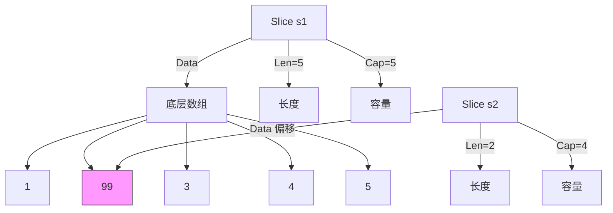
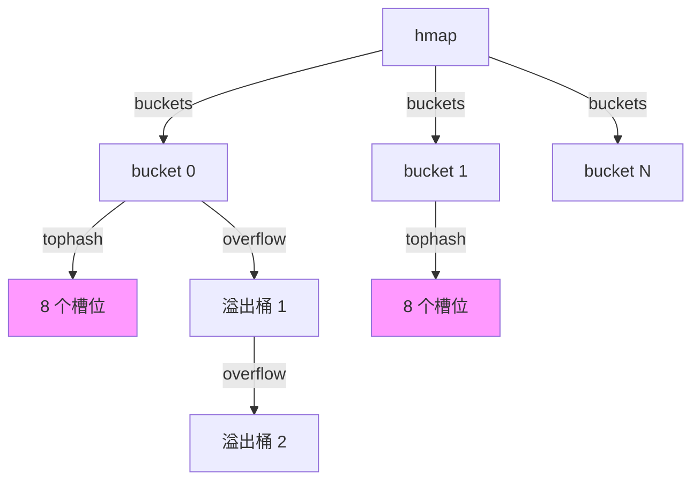
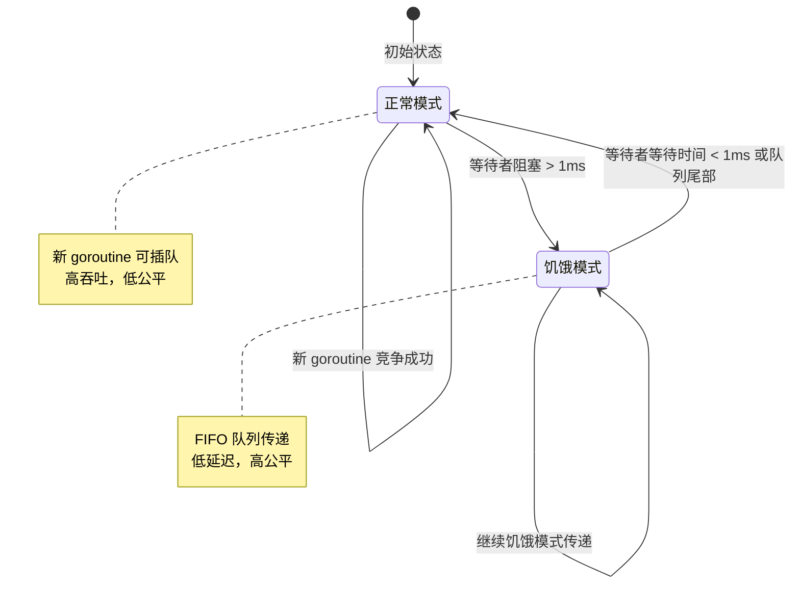
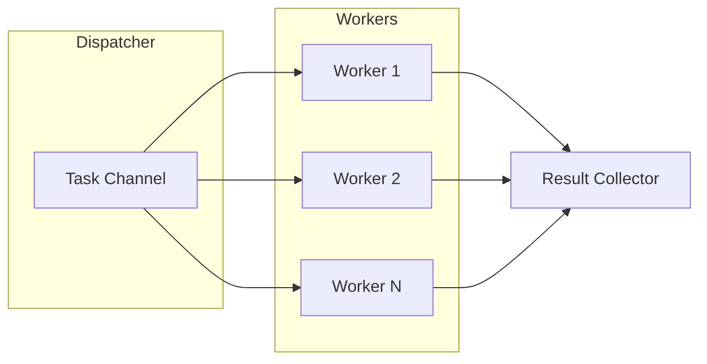

# 篇二 · 底层原理 · 07 核心数据结构底层

> **定位**：map / slice / channel / string / interface / sync.Pool 的运行时实现
> **面试权重**：🔥🔥🔥🔥 高频 ｜ **前置**：1-01、2-06
> **🔁 前端类比**：V8 的隐藏类与数组形态优化 → Go 的 struct 内存对齐、切片与哈希表实现

## 🧭 核心考点

- map：hmap/bmap、桶与溢出、负载因子与渐进式扩容
- slice：扩容策略与共享底层数组的副作用
- channel：hchan 环形缓冲 + sendq/recvq 阻塞唤醒
- string 与 []byte 转换的拷贝成本与 unsafe 优化
- sync.Pool、sync.Map 的适用场景与实现要点

## 📑 本篇题目索引（共 38 题）

| # | 题目 | 难度 | 频率 |
|---|------|------|------|
| Q1 | `map` 的底层结构是怎样的？扩容是如何进行的？ | ⭐⭐⭐⭐ | 🔥 高频 |
| Q2 | Golang Slice 的底层实现 | ⭐⭐ | 🔥 高频 |
| Q3 | Golang Slice 的扩容机制，有什么注意点？ | ⭐⭐⭐ | 🔥 高频 |
| Q4 | 扩容前后的 Slice 是否相同？ | ⭐⭐ | 📌 常考 |
| Q5 | Golang 的参数传递、引用类型 | ⭐⭐⭐ | 🔥 高频 |
| Q6 | Golang Map 底层实现 | ⭐⭐⭐⭐ | 🔥 高频 |
| Q7 | Golang Map 如何扩容 | ⭐⭐⭐⭐ | 🔥 高频 |
| Q8 | Golang Map 查找流程 | ⭐⭐⭐ | 📌 常考 |
| Q9 | 介绍一下 Channel | ⭐⭐⭐ | 🔥 高频 |
| Q10 | Go 语言的 Channel 特性 | ⭐⭐⭐ | 📌 常考 |
| Q11 | Channel 的 ring buffer 实现 | ⭐⭐⭐ | 📖 了解 |
| Q12 | Mutex 几种状态 | ⭐⭐⭐⭐ | 📌 常考 |
| Q13 | Mutex 正常模式和饥饿模式 | ⭐⭐⭐⭐ | 📌 常考 |
| Q14 | Mutex 允许自旋的条件 | ⭐⭐⭐ | 📖 了解 |
| Q15 | RWMutex 实现 | ⭐⭐⭐ | 📌 常考 |
| Q16 | RWMutex 注意事项 | ⭐⭐⭐ | 📌 常考 |
| Q17 | Cond 是什么 | ⭐⭐ | 📖 了解 |
| Q18 | Broadcast 和 Signal 区别 | ⭐⭐ | 📖 了解 |
| Q19 | Cond 中 Wait 使用 | ⭐⭐ | 📖 了解 |
| Q20 | WaitGroup 用法 | ⭐⭐ | 🔥 高频 |
| Q21 | WaitGroup 实现原理 | ⭐⭐⭐ | 📌 常考 |
| Q22 | 什么是 sync.Once | ⭐⭐ | 🔥 高频 |
| Q23 | 什么操作叫做原子操作 | ⭐⭐ | 📌 常考 |
| Q24 | 原子操作和锁的区别 | ⭐⭐ | 📌 常考 |
| Q25 | 什么是 CAS | ⭐⭐⭐ | 📌 常考 |
| Q26 | 如何实现一个并发安全的 Worker Pool？ | ⭐⭐⭐ | 🔥 高频 |
| Q27 | Go 的内存分配器（TCMalloc 思想）是如何工作的？ | ⭐⭐⭐⭐ | 📌 常考 |
| Q28 | 设计一个高并发计数器，支持百万级 QPS 读写。 | ⭐⭐⭐⭐ | 📌 常考 |
| Q29 | `sync.Pool` 的作用是什么？使用场景和注意事项？ | ⭐⭐⭐ | 📌 常考 |
| Q30 | `sync.Map` 的底层实现是什么？为什么某些场景比 `map+RWMutex` 快？ | ⭐⭐⭐⭐ | 🔥 高频 |
| Q31 | 接口（interface）的底层结构是什么？iface 与 eface 有何区别？ | ⭐⭐⭐⭐ | 🔥 高频 |
| Q32 | `string` 的底层结构是什么？为什么不可变？`string` 与 `[]byte` 转换的成本？ | ⭐⭐⭐ | 🔥 高频 |
| Q33 | struct 内存对齐与空结构体 `struct{}` 有什么工程意义？ | ⭐⭐⭐ | 📌 常考 |
| Q34 | `unsafe.Sizeof/Alignof/Offsetof` 与 `unsafe.Pointer` 的转换规则是什么？ | ⭐⭐⭐⭐ | 📌 常考 |
| Q35 | `defer` 的底层实现是怎样的？开放编码与堆分配如何选择？ | ⭐⭐⭐⭐ | 🔥 高频 |
| Q36 | `time.Timer` 底层为什么用四叉堆而非二叉堆？Go 1.23 定时器有哪些变化？ | ⭐⭐⭐⭐ | 📖 了解 |
| Q37 | Go 1.24 的 Swiss Table 给 `map` 带来了哪些变化？ | ⭐⭐⭐ | 📌 常考 |
| Q38 | `new` 和 `make` 的区别？什么情况下用谁？ | ⭐⭐ | 🔥 高频 |

---

### Q1: `map` 的底层结构是怎样的？扩容是如何进行的？

**难度**：⭐⭐⭐⭐ | **频率**：🔥 高频

**考点**：`hmap`、`bmap`、哈希冲突、渐进式扩容。

**💡 记忆关键词**：hmap桶数组、bmap八键值、负载因子6.5、渐进式迁移

**答案要点**：
- `hmap` 包含桶数组 `buckets`，每个桶 `bmap` 存 8 个键值对。
- 哈希**低 B 位**用于定位桶（`hash & bucketMask(B)`），**高 8 位（tophash）**用于桶内快速比对（先比对 tophash，命中再比对完整 key，避免逐个比较完整 key）。
- **扩容条件**：负载因子 > 6.5 或溢出桶过多。
- **渐进式**：扩容时创建新桶，旧桶数据在访问或后台 goroutine 逐步迁移，期间读写需同时检查新旧桶。

---

### Q2: Golang Slice 的底层实现

**难度**：⭐⭐ | **频率**：🔥 高频

**考点**：slice header、连续内存、动态数组。

**💡 记忆关键词**：SliceHeader、Data指针、LenCap、共享数组

**答案要点**：
- 底层是 `reflect.SliceHeader`：包含 `Data`（指针）、`Len`、`Cap` 三个字段。
- `Data` 指向底层数组的起始位置。
- 切片是数组的视图，多个切片可能共享同一底层数组。
- 修改切片元素会影响共享数组的其他切片。

```go
type SliceHeader struct {
    Data uintptr
    Len  int
    Cap  int
}

s1 := []int{1, 2, 3, 4, 5}
s2 := s1[1:3]
s2[0] = 99
```



---

### Q3: Golang Slice 的扩容机制，有什么注意点？

**难度**：⭐⭐⭐ | **频率**：🔥 高频

**考点**：扩容策略、Go 1.18 变更、内存对齐。

**💡 记忆关键词**：1.18平滑扩容、256阈值、预分配容量、共享断开、阈值表

**答案要点**：
- **Go 1.18 之前**：`cap < 1024` 时双倍扩容，`>= 1024` 时 1.25 倍。
- **Go 1.18+（现行规则）**：阈值从 1024 降为 **256** —— `newcap < 256` 时**翻倍**；`newcap ≥ 256` 时按 `newcap += (newcap + 3*256) / 4` 平滑增长，增长因子从约 2.0 **逐步逼近 1.25**（切片越大增长越保守，减少内存浪费）。之后还要按 `size class` 做**内存对齐（roundupsize）**，所以实际拿到的 cap 往往比公式值略大。
- **注意点**：
  1. 扩容会分配新数组，复制旧数据。
  2. 预分配容量可避免频繁扩容（`make([]T, 0, cap)`）。
  3. 切片共享数组时扩容会断开共享。

```go
s := make([]int, 0, 1000)
for i := 0; i < 1000; i++ {
    s = append(s, i)
}

s1 := make([]int, 0, 4)
s1 = append(s1, 1, 2, 3)
s2 := s1
s1 = append(s1, 4, 5)
s1[0] = 99
```

```mermaid
graph LR
    A[append 触发扩容] --> B{newcap < 256?}
    B -->|是| C[新 cap ≈ 2 * 旧 cap]
    B -->|否| D[新 cap 平滑增长: += (newcap+768)/4]
    C --> E[分配新数组]
    D --> E
    E --> F[复制旧数据]
    F --> G[返回新 slice]
```

---

### Q4: 扩容前后的 Slice 是否相同？

**难度**：⭐⭐ | **频率**：📌 常考

**考点**：内存地址变化、数据迁移、引用关系。

**💡 记忆关键词**：地址改变、新数组、GC回收、%p验证

**答案要点**：
- 扩容后底层数组地址改变，是新的数组。
- 旧数组若无其他引用，会被 GC 回收。
- 扩容前的切片仍指向旧数组，不会自动更新。
- 验证：`fmt.Printf("%p\n", slice)` 前后地址不同。

### Q5: Golang 的参数传递、引用类型

**难度**：⭐⭐⭐ | **频率**：🔥 高频

**考点**：值传递本质、引用类型误解、指针传递。

**💡 记忆关键词**：只有值传递、SliceHeader副本、指针的指针、共享底层

**答案要点**：
- **Go 只有值传递，没有引用传递**。
- slice、map、channel 是"引用类型"但传递的是结构体副本。
- slice 传递的是 `SliceHeader` 副本，指向同一底层数组。
- 要修改指针本身需传递指针的指针。

### Q6: Golang Map 底层实现

**难度**：⭐⭐⭐⭐ | **频率**：🔥 高频

**考点**：hmap、bmap、哈希算法、溢出桶。

**💡 记忆关键词**：hmap结构、bmap八槽、tophash加速、遍历无序

**答案要点**：
- `hmap`：包含 count、B（桶数量 2^B）、buckets 指针、oldbuckets 等。
- `bmap`（bucket）：存储 8 个键值对，包含 tophash 数组加速查找。
- 哈希冲突：链地址法，通过溢出桶（overflow bucket）解决。
- 遍历无序：每次遍历顺序随机，防止依赖顺序的代码。

```go
type hmap struct {
    count     int
    B         uint8
    buckets   unsafe.Pointer
    oldbuckets unsafe.Pointer
    nevacuate uintptr
}

type bmap struct {
    tophash [8]uint8
    keys    [8]key
    values  [8]value
    overflow *bmap
}
```



---

### Q7: Golang Map 如何扩容

**难度**：⭐⭐⭐⭐ | **频率**：🔥 高频

**考点**：渐进式扩容、等量扩容、翻倍扩容。

**💡 记忆关键词**：负载因子6.5、翻倍等量、渐进迁移、oldbuckets

**答案要点**：
- **触发条件**：负载因子 > 6.5 或溢出桶过多。
- **翻倍扩容**：B++，桶数量翻倍。
- **等量扩容**：溢出桶过多时，重新组织数据。
- **渐进式**：写入时迁移 1-2 个桶，读取时检查新旧桶。
- 扩容期间 hmap 同时持有 oldbuckets 和 buckets。

```go
m := make(map[int]int)
for i := 0; i < 1000; i++ {
    m[i] = i
}
```

---

### Q8: Golang Map 查找流程

**难度**：⭐⭐⭐ | **频率**：📌 常考

**考点**：哈希计算、桶定位、tophash 匹配、溢出链。

**💡 记忆关键词**：哈希计算、低B定位、tophash匹配、溢出链查

**答案要点**：
1. 计算 key 的哈希值。
2. 低 B 位定位桶。
3. 高 8 位（tophash）快速匹配。
4. 遍历桶内 8 个槽位比对 key。
5. 未找到则检查溢出桶。
6. 若正在扩容，同时检查旧桶。

```go
func mapaccess1(t *maptype, h *hmap, key unsafe.Pointer) unsafe.Pointer {
    hash := alg.hash(key, uintptr(t.hasher))
    m := bucketMask(h.B)
    b := (*bmap)(add(h.buckets, (hash&m)*uintptr(t.bucketsize)))

    for {
        for i := 0; i < 8; i++ {
            if b.tophash[i] == top {
                if alg.equal(key, k) {
                    return val
                }
            }
        }
        if b.overflow == nil {
            break
        }
        b = b.overflow
    }
    return nil
}
```

---

### Q9: 介绍一下 Channel

**难度**：⭐⭐⭐ | **频率**：🔥 高频

**考点**：hchan 结构、类型安全、goroutine 通信。

**💡 记忆关键词**：hchan结构、环形缓冲、sendq/recvq、类型安全

**答案要点**：
- Channel 是 goroutine 之间的通信管道。
- 底层 `hchan` 结构：包含环形缓冲区、sendq、recvq、锁。
- 类型安全：编译期检查元素类型。
- 第一公民：可作为参数、返回值、结构体字段。

```go
type hchan struct {
    qcount   uint
    dataqsiz uint
    buf      unsafe.Pointer
    elemsize uint16
    closed   uint32
    elemtype *_type
    sendx    uint
    recvx    uint
    recvq    waitq
    sendq    waitq
    lock     mutex
}
```

---

### Q10: Go 语言的 Channel 特性

**难度**：⭐⭐⭐ | **频率**：📌 常考

**考点**：阻塞语义、close 行为、select 多路复用。

**💡 记忆关键词**：阻塞语义、close通知、select多路、nil阻塞

**答案要点**：
- 发送/接收可能阻塞（取决于缓冲和等待者）。
- `close(ch)` 通知接收方不再有数据。
- `select` 支持多 channel 非阻塞操作。
- `for range` 可遍历 channel 直到关闭。
- nil channel 操作永久阻塞。

```go
ch := make(chan int, 2)
ch <- 1
close(ch)

v, ok := <-ch
v, ok = <-ch

var nilCh chan int
<-nilCh

select {
case v := <-ch1:
    fmt.Println("ch1:", v)
case ch2 <- x:
    fmt.Println("sent to ch2")
default:
    fmt.Println("no channel ready")
}
```

---

### Q11: Channel 的 ring buffer 实现

**难度**：⭐⭐⭐ | **频率**：📖 了解

**考点**：环形队列、sendx/recvx 索引、内存连续。

**💡 记忆关键词**：环形数组、sendx/recvx、取模运算、CPU缓存友好

**答案要点**：
- 使用环形数组作为缓冲区。
- `sendx` 指向下一个发送位置，`recvx` 指向下一个接收位置。
- 通过取模运算实现环形：`index % dataqsiz`。
- 内存连续，CPU 缓存友好。

---

### Q12: Mutex 几种状态

**难度**：⭐⭐⭐⭐ | **频率**：📌 常考

**考点**：正常模式、饥饿模式、自旋状态、等待状态。

**💡 记忆关键词**：locked/woken/starved、正常饥饿、自旋等待、状态位

**答案要点**：
- 状态位：`locked`、`woken`、`starved`。
- 正常模式：新 goroutine 可与等待者竞争。
- 饥饿模式：直接传递给队列头部等待者。
- 自旋：短暂忙等待，避免立即挂起。

```go
const (
    mutexLocked      = 1 << iota
    mutexWoken
    mutexStarving
    mutexWaiterShift = iota
)
```

---

### Q13: Mutex 正常模式和饥饿模式

**难度**：⭐⭐⭐⭐ | **频率**：📌 常考

**考点**：模式切换、阈值、公平性。

**💡 记忆关键词**：正常插队、饥饿FIFO、1ms阈值、Go1.9引入

**答案要点**：
- **正常模式**：等待者排队，新 goroutine 可插队（不公平但吞吐高）。
- **饥饿模式**：等待超过 1ms 触发，新 goroutine 不竞争，直接排队。
- **切换**：饥饿模式下等待者获得锁后，若等待时间 < 1ms 或队列尾部，切回正常模式。
- Go 1.9 引入饥饿模式解决尾部延迟问题。



---

### Q14: Mutex 允许自旋的条件

**难度**：⭐⭐⭐ | **频率**：📖 了解

**考点**：自旋策略、多核、运行时判断。

**💡 记忆关键词**：多核GOMAXPROCS、队列非空、4次限制、忙等待

**答案要点**：
- 多核处理器（GOMAXPROCS > 1）。
- 全局运行队列非空或有空闲 P。
- 当前 P 的本地队列非空。
- 自旋次数有限（通常 4 次），避免 CPU 浪费。

```go
func runtime_canSpin(i int) bool {
    if i >= active_spin {
        return false
    }
    if ncpu <= 1 {
        return false
    }
    if gomaxprocs <= 1 || gp.schedlink != 0 {
        return false
    }
    return true
}
```

---

### Q15: RWMutex 实现

**难度**：⭐⭐⭐ | **频率**：📌 常考

**考点**：读写分离、计数器、写优先。

**💡 记忆关键词**：readerCount、写优先、阻塞新读者、Go1.14+

**答案要点**：
- 内部维护 `readerCount`（读计数）和 writer 锁。
- 读锁：`readerCount++`，若无写者则直接获取。
- 写锁：阻塞新读者，等待现有读者完成。
- Go 1.14+：写者优先，防止写饥饿。

```go
type RWMutex struct {
    w           Mutex
    writerSem   uint32
    readerSem   uint32
    readerCount int32
    readerWait  int32
}

func (rw *RWMutex) RLock() {
    if atomic.AddInt32(&rw.readerCount, 1) < 0 {
        runtime_SemacquireMutex(&rw.readerSem, false, 0)
    }
}

func (rw *RWMutex) Lock() {
    rw.w.Lock()
    r := atomic.AddInt32(&rw.readerCount, -rwmutexMaxReaders)
    if r != 0 {
        rw.readerWait = r
        runtime_SemacquireMutex(&rw.writerSem, false, 0)
    }
}
```

---

### Q16: RWMutex 注意事项

**难度**：⭐⭐⭐ | **频率**：📌 常考

**考点**：不可重入、升级死锁、降级问题。

**💡 记忆关键词**：不可重入、读升写死锁、写降读安全、读多写少

**答案要点**：
- 不可重入：同一 goroutine 不能重复获取同一把锁。
- 读锁不能升级为写锁（会导致死锁）。
- 写锁可降级为读锁（先 `Unlock()` 再 `RLock()`）。
- 不适合读多写少且读操作耗时的场景。

```go
var rw sync.RWMutex
func deadlock() {
    rw.RLock()
    rw.Lock()
    rw.Unlock()
    rw.RUnlock()
}

func correct() {
    rw.RLock()
    data := readData()
    rw.RUnlock()

    if needUpdate(data) {
        rw.Lock()
        writeData(data)
        rw.Unlock()
    }
}
```

---

### Q17: Cond 是什么

**难度**：⭐⭐ | **频率**：📖 了解

**考点**：条件变量、等待/通知、sync.Cond。

**💡 记忆关键词**：条件变量、Wait释放锁、Signal唤醒一、Broadcast唤醒全

**答案要点**：
- 条件变量：让 goroutine 等待某个条件成立。
- `sync.Cond` 基于 Locker（Mutex 或 RWMutex）。
- `Wait()`：释放锁并阻塞，被唤醒后重新获取锁。
- `Signal()`：唤醒一个等待者。
- `Broadcast()`：唤醒所有等待者。

```go
type Cond struct {
    noCopy noCopy
    L      Locker
    notify notifyList
    checker copyChecker
}

var mu sync.Mutex
cond := sync.NewCond(&mu)
var ready bool

go func() {
    cond.L.Lock()
    for !ready {
        cond.Wait()
    }
    fmt.Println("条件满足！")
    cond.L.Unlock()
}()

mu.Lock()
ready = true
cond.Signal()
mu.Unlock()
```

---

### Q18: Broadcast 和 Signal 区别

**难度**：⭐⭐ | **频率**：📖 了解

**考点**：单播 vs 广播、惊群效应、性能。

**💡 记忆关键词**：Signal单播、Broadcast广播、惊群效应、配置变更

**答案要点**：
- `Signal()`：唤醒一个等待者（FIFO 队列头部）。
- `Broadcast()`：唤醒所有等待者。
- Broadcast 可能导致惊群效应，需谨慎使用。
- 适用场景：Signal 用于一对一通知，Broadcast 用于配置变更等全局事件。

```go
cond.Signal()
cond.Broadcast()
```

---

### Q19: Cond 中 Wait 使用

**难度**：⭐⭐ | **频率**：📖 了解

**考点**：循环检查、虚假唤醒、锁保护。

**💡 记忆关键词**：for循环检查、虚假唤醒、Wait释放重获、if错误

**答案要点**：
- Wait 必须在循环中使用（检查条件）。
- 可能被虚假唤醒（spurious wakeup）。
- Wait 自动释放锁，唤醒后重新获取。

```go
cond.L.Lock()
for !condition() {
    cond.Wait()
}
cond.L.Unlock()
```

---

### Q20: WaitGroup 用法

**难度**：⭐⭐ | **频率**：🔥 高频

**考点**：Add/Done/Wait、goroutine 同步、计数器。

**💡 记忆关键词**：Add前Done后、Wait阻塞、计数器归零、传指针

**答案要点**：
- `Add(n)`：增加计数器。
- `Done()`：计数器减一（等价于 Add(-1)）。
- `Wait()`：阻塞直到计数器为零。
- 注意：Add 必须在 goroutine 启动前调用。

```go
var wg sync.WaitGroup
for i := 0; i < 10; i++ {
    wg.Add(1)
    go func(id int) {
        defer wg.Done()
        fmt.Println("task", id, "done")
    }(i)
}
wg.Wait()
fmt.Println("all tasks completed")
```

---

### Q21: WaitGroup 实现原理

**难度**：⭐⭐⭐ | **频率**：📌 常考

**考点**：原子操作、信号量、状态位。

**💡 记忆关键词**：64位状态、高32计数器、低32等待者、信号量阻塞

**答案要点**：
- 内部使用 64 位状态：高 32 位计数器，低 32 位等待者数。
- 使用原子操作（atomic）更新计数器。
- Wait 时若计数器非零，使用信号量阻塞。
- Done 时若计数器归零，释放所有等待者。
- 不可复制使用（需传指针）。

```go
func (wg *WaitGroup) Add(delta int) {
    state := atomic.AddUint64(&wg.state, uint64(delta)<<32)
    v := int32(state >> 32)
    w := uint32(state)

    if v < 0 {
        panic("negative counter")
    }
    if v == 0 && w > 0 {
        runtime_Semrelease(&wg.sema, false, 0)
    }
}
```

---

### Q22: 什么是 sync.Once

**难度**：⭐⭐ | **频率**：🔥 高频

**考点**：单次执行、线程安全、懒加载。

**💡 记忆关键词**：只执行一次、Mutex+atomic、懒加载单例、panic可重试

**答案要点**：
- 保证函数只执行一次，即使多次调用。
- 内部使用 Mutex + atomic 实现（`done uint32` 标志 + `doSlow`）。
- 适合懒加载单例、初始化配置。
- **panic 语义（易混淆）**：`doSlow` 里 `defer atomic.StoreUint32(&o.done, 1)` 先于 `f()` 注册，所以 **f panic 后 `done` 仍会被置 1，后续 `Do` 不会再执行**（不会「重试」）。若需要「失败可重试」，要用自己的错误记录 + `sync.Mutex` 或 `singleflight` 包装。

```go
type Once struct {
    done uint32
    m    Mutex
}

var once sync.Once
var config *Config

func GetConfig() *Config {
    once.Do(func() {
        config = loadConfig()
    })
    return config
}
```

---

### Q23: 什么操作叫做原子操作

**难度**：⭐⭐ | **频率**：📌 常考

**考点**：不可分割、CAS、硬件指令。

**💡 记忆关键词**：不可中断、sync/atomic、CPU指令、Add/Load/Store/CAS

**答案要点**：
- 原子操作是不可中断的操作，要么全部完成，要么完全不执行。
- Go 中通过 `sync/atomic` 包提供。
- 底层依赖 CPU 的原子指令（如 x86 的 LOCK 前缀、CMPXCHG）。
- 常见操作：Add、Load、Store、Swap、CompareAndSwap。

```go
import "sync/atomic"

var counter int64
atomic.AddInt64(&counter, 1)
val := atomic.LoadInt64(&counter)
atomic.StoreInt64(&counter, 100)
old := atomic.SwapInt64(&counter, 200)

var ptr atomic.Pointer[Config]
ptr.Store(&Config{})
cfg := ptr.Load()
```

---

### Q24: 原子操作和锁的区别

**难度**：⭐⭐ | **频率**：📌 常考

**考点**：性能、适用场景、粒度。

**💡 记忆关键词**：硬件级vs软件级、单变量vs多变量、无锁vs有锁、性能对比

**答案要点**：
- 原子操作：硬件级支持，无锁，性能极高，适合简单变量。
- 锁：软件级实现，可保护复杂临界区，开销较大。
- 原子操作无法保护多变量一致性。
- 选择原则：单变量用原子操作，多变量/复杂逻辑用锁。

```go
var hits atomic.Int64
hits.Add(1)

var mu sync.Mutex
var cache map[string]string
func updateCache(k, v string) {
    mu.Lock()
    cache[k] = v
    mu.Unlock()
}
```

---

### Q25: 什么是 CAS

**难度**：⭐⭐⭐ | **频率**：📌 常考

**考点**：Compare And Swap、无锁编程、ABA 问题。

**💡 记忆关键词**：比较并交换、无锁基础、ABA问题、版本号解决

**答案要点**：
- CAS：比较并交换，原子地检查值是否为预期，若是则更新。
- `atomic.CompareAndSwapInt64(&val, old, new)`。
- 无锁编程的基础。
- ABA 问题：值从 A→B→A，CAS 无法察觉，可用版本号解决。
- Go 1.19+ 引入 atomic 泛型类型。

```go
var value int64 = 10

if atomic.CompareAndSwapInt64(&value, 10, 20) {
    fmt.Println("更新成功")
} else {
    fmt.Println("值已被其他 goroutine 修改")
}

type Node struct {
    Value int
    Next  *Node
}

var head atomic.Pointer[Node]

func Push(v int) {
    newHead := &Node{Value: v}
    for {
        oldHead := head.Load()
        newHead.Next = oldHead
        if head.CompareAndSwap(oldHead, newHead) {
            break
        }
    }
}
```

---

### Q26: 如何实现一个并发安全的 Worker Pool？

**难度**：⭐⭐⭐ | **频率**：🔥 高频

**考点**：`errgroup`、`channel` 控制并发度、任务分发。

**💡 记忆关键词**：缓冲 Channel、固定 Goroutine、WaitGroup、errgroup

**答案要点**：
- 使用带缓冲的 `channel` 作为任务队列。
- 启动固定数量的 `goroutine` 从队列中消费任务。
- 使用 `sync.WaitGroup` 等待所有任务完成，或使用 `errgroup.Group` 处理错误传播和上下文取消。



---

---

---

### Q27: Go 的内存分配器（TCMalloc 思想）是如何工作的？

**难度**：⭐⭐⭐⭐ | **频率**：📌 常考

**考点**：`mcache`、`mcentral`、`mheap`、对象大小分类。

**💡 记忆关键词**：三级缓存、mcache 无锁、mcentral 补 Span、mheap 管全局

**答案要点**：
- Go 借鉴 TCMalloc，将内存分配分为三级缓存：
  1. **mcache**：线程（P）本地缓存，无锁分配，适合小对象（< 32KB）。
  2. **mcentral**：全局中心缓存，为 `mcache` 补充 Span，需加锁。
  3. **mheap**：向操作系统申请大块内存，管理所有 Span。
- **Tiny 对象**：多个微小对象合并分配，减少碎片。
- **大对象**：直接从 `mheap` 分配。

---

### Q28: 设计一个高并发计数器，支持百万级 QPS 读写。

**难度**：⭐⭐⭐⭐ | **频率**：📌 常考

**考点**：原子操作、分片、缓存一致性。

**💡 记忆关键词**：atomic 原子、Cache Line 伪共享、分片汇总、Redis INCR

**答案要点**：
- **方案一（单机）**：使用 `sync/atomic.AddInt64`，性能极高，但多核下 Cache Line 伪共享（False Sharing）可能导致瓶颈。可通过填充结构体对齐 Cache Line 解决。
- **方案二（分布式）**：使用 Redis `INCR` 命令，配合 Pipeline 或 Lua 脚本批量提交，减少网络 RTT。
- **方案三（分段锁）**：将计数器拆分为多个分片（Sharding），每个分片独立加锁或原子操作，最后汇总。

---

### Q29: `sync.Pool` 的作用是什么？使用场景和注意事项？

**难度**：⭐⭐⭐ | **频率**：📌 常考

**考点**：对象复用、GC 压力、生命周期。

**💡 记忆关键词**：临时对象、GC 清空、Buffer 复用、无状态数据

**答案要点**：
- `sync.Pool` 用于存储临时对象，减少频繁分配和 GC 压力。
- **注意**：池中的对象在 GC 时会被清空（Go 1.13 前是每次 GC 清空，之后改为保留部分），因此不能用于存储有状态或需要持久化的数据。
- **场景**：`fmt` 包内部的 buffer 复用、数据库连接句柄（通常用连接池而非 Pool）、序列化 buffer。

### Q30: `sync.Map` 的底层实现是什么？为什么某些场景比 `map+RWMutex` 快？

**难度**：⭐⭐⭐⭐ | **频率**：🔥 高频

**考点**：read/dirty 双 map、miss 提升、expunged 延迟删除、适用场景。

**💡 记忆关键词**：read 无锁 + dirty 加锁、空间换时间、miss 提升、double-check、延迟删除

**答案要点**：
- **数据结构**：`Map{ mu Mutex; read atomic.Value; dirty map[any]*entry; misses int }`。核心是**冗余的两张表**：
  - `read`（`readOnly{m map[any]*entry; amended bool}`）：只读快照，**无锁访问**（原子读）；
  - `dirty`：可写表，**加锁访问**，存新加的键；
  - `amended`：`dirty` 中有 `read` 没有的数据时为 true。
- **五大优化点**：
  1. **空间换时间**：`read` + `dirty` 两份冗余，让绝大多数读**免锁**；
  2. **优先读 `read`**：`Load`/`Store`/`Delete` 都先从 `read` 走，命中即无锁；
  3. **miss 提升**：从 `read` 未命中且 `amended` 时，`misses++`；当 `misses >= len(dirty)` 就把 `dirty` 整体提升为 `read`、`dirty` 置 nil、`misses` 清零；
  4. **double-checking**：加锁后**再查一次 `read`**（防止加锁期间被其他 goroutine 更新）；
  5. **延迟删除**：删除只把 `entry.p` 标记为 `nil` 或 `expunged`（已彻底删除、仅存在于 read），真正清理发生在「重建 dirty」或「dirty 提升为 read」时。
- **适用场景（官方文档明确的两个）**：
  1. **只增长的缓存**：key 只写入一次、之后大量读（如配置/元数据缓存）；
  2. **多个 goroutine 读写不相交的键集**。
  这两类场景下 `sync.Map` 的免锁读占绝大多数，性能优于 `map+RWMutex`；**其余场景（频繁写新键、删除多）反而不如加锁 map**，官方建议先压测再选。
- **两个易忽略点**：`sync.Map` **没有 `Len()`**（要数量只能 `Range` 遍历计数）；`Range` 不会因并发写而 panic，但遍历中可能读到中间态。

**🔁 前端类比**：类似「读多写少」场景下用 `Map` 的不可变快照 + 写时复制（Copy-on-Write）思想，读走快照免锁、写走新表加锁。

**📝 一句话总结**：`sync.Map` 靠 `read`(无锁只读快照) + `dirty`(加锁可写) 冗余换并发读性能，miss 次数达标就把 dirty 提升为 read；只适合「key 写一次读多次 / 不相交键集」。

### Q31: 接口（interface）的底层结构是什么？iface 与 eface 有何区别？

**难度**：⭐⭐⭐⭐ | **频率**：🔥 高频

**考点**：iface/eface、itab、静态/动态类型、接口赋值与 nil 陷阱。

**💡 记忆关键词**：iface=itab+data、eface=_type+data、动态类型/值、两指针、有类型 nil 非 nil

**答案要点**：
- **两种底层结构**（运行时都是**两个机器字**）：
  - **eface**（空接口 `any`）：`{ _type *_type; data unsafe.Pointer }` —— 类型指针 + 数据指针；
  - **iface**（带方法的接口）：`{ tab *itab; data unsafe.Pointer }` —— `itab` 指针 + 数据指针。
  ```go
  type eface struct { _type *_type; data unsafe.Pointer }
  type iface struct { tab  *itab;  data unsafe.Pointer }
  type itab struct {
      inter *interfacetype // 接口类型
      _type *_type         // 具体动态类型
      hash  uint32         // 类型哈希，用于类型断言快速比对
      _     [4]byte
      fun   [1]uintptr     // 方法表：具体类型方法指针（按接口方法排序）
  }
  ```
- **itab 的作用**：缓存「接口类型 × 具体类型」的映射与方法表，接口方法调用即 `iface.tab.fun[i](iface.data)`，实现**动态派发**；itab 全局缓存，同类型对重复赋值复用同一 itab。
- **静态类型 vs 动态类型**：接口变量的**静态类型**永远是其声明的接口类型；**动态类型**随赋入的具体类型变化；赋 nil 前动态类型不存在。
- **接口赋值是副本**：`var pet Pet = dog`（值接收者实现）会把 dog **复制**进接口，之后 `dog` 的修改不影响 `pet`；`var pet Pet = &dog`（指针接收者）存的是指针副本，共享底层。
- **nil 陷阱**：接口为 nil 需「类型 + 值」**都为 nil**。把 `*Dog` 类型的 nil 赋给接口，得到的是 `(*Dog, nil)`——**动态类型非 nil，所以接口非 nil**（这正是 `err != nil` 误判的根因，见 1-02 Q6）。

**🔁 前端类比**：`iface/eface` 类似 V8 对象的「隐藏类（Map）」——类型信息与数据分离，方法调用查表派发；「有类型 nil 非 nil」则像 JS `typeof null === 'object'` 的坑，都是「空值携带了类型」。

**📝 一句话总结**：接口底层是两个机器字——`eface=_type+data`、`iface=itab+data`，`itab` 缓存类型对与方法表实现动态派发；接口赋值是副本，且「类型非 nil」就使接口非 nil。

---

### Q32: `string` 的底层结构是什么？为什么不可变？`string` 与 `[]byte` 转换的成本？

**难度**：⭐⭐⭐ | **频率**：🔥 高频

**考点**：`StringHeader`、不可变性、转换拷贝、`unsafe` 零拷贝。

**💡 记忆关键词**：ptr+len 两字段、只读底层数组、转换必拷贝、 unsafe 零拷贝有风险

**答案要点**：
- **底层结构**：`string` 也是**值类型**，底层是 `StringHeader{ Data uintptr; Len int }` —— 指向一段**只读**字节数组的指针 + 长度（不含 cap）。字符串字面量存储在只读数据段。
- **为什么不可变**：① 只读段内存不可写，写会段错误；② 不可变使**字符串可安全共享**（子串 `s[1:3]` 不与原串拷贝，共享底层），也让 `map[string]V` 的键可缓存哈希；③ 运行时依赖字符串不可变做优化（如 `m[string(b)]` 免拷贝查 map）。
- **`string` ↔ `[]byte` 转换的成本（高频追问）**：标准转换**必然拷贝**（`[]byte(s)` 拷贝只读数组到可写数组；`string(b)` 拷贝回去），各 O(n)。在**热路径**上反复转换是常见性能坑（优化手段见 5-20）。
- **零拷贝转换（unsafe 黑魔法，知其然也要知其所以然）**：
  ```go
  func stringToBytes(s string) []byte {
      return unsafe.Slice(unsafe.StringData(s), len(s)) // Go 1.20+
  }
  func bytesToString(b []byte) string {
      return unsafe.String(unsafe.SliceData(b), len(b)) // Go 1.20+
  }
  ```
  返回的 `[]byte` **只读语义**：底层仍是原字符串的只读数组，**写入会 panic/未定义行为**，且原 `b` 被修改时字符串内容跟着变（破坏不可变性）—— 只适合「转完立即读、绝不修改、不逃逸」的场景，标准库自己谨慎使用。

**🔁 前端类比**：JS 字符串同样不可变（`str[0] = 'x'` 静默失败），且 JS 引擎也会缓存字符串哈希；`[]byte(s)` 的拷贝就像 `str.split('')` 产生新数组，而 `unsafe` 版则像直接拿到底层 buffer 的 `ArrayBuffer` 视图。

**⚠️ 常见误区**：① 说「字符串是引用类型」（它是值类型，只是共享只读底层）；② 认为 `[]byte(s)` 只是换个类型不拷贝；③ 在 unsafe 零拷贝结果上写入。

**📝 一句话总结**：string 是 ptr+len 的值类型、只读不可变（因此可安全共享子串）；与 `[]byte` 互转默认 O(n) 拷贝，unsafe 可零拷贝但结果只读、不可写。

---

### Q33: struct 内存对齐与空结构体 `struct{}` 有什么工程意义？

**难度**：⭐⭐⭐ | **频率**：📌 常考

**考点**：对齐系数、字段重排、空结构体零尺寸、map/set 语义。

**💡 记忆关键词**：字段按偏移对齐、重排省内存、struct{} 占 0 字节、set 语义、channel 信号语义

**答案要点**：
- **对齐规则**：结构体字段按各自**对齐系数**（通常等于类型宽度）排列，字段之间可能插入**填充字节**，且**整个结构体大小是最大字段对齐值的倍数**。例：`struct{ a bool; b int64; c bool }` 实际占 24 字节而非 10 —— 如果把两个 `bool` 放一起（`a, c bool; b int64`）只需 16 字节。**手工重排字段顺序**是省内存的经典手段（但可读性优先，别过度优化）。
- **空结构体 `struct{}`**：**大小为 0**，两个 `struct{}` 变量地址甚至相同（`runtime.zerobase`）。工程用法：
  1. **set 语义**：`map[string]struct{}` 比 `map[string]bool` 省一个字节/条目且语义更清晰；
  2. **信号 channel**：`chan struct{}` 只传「事件」不传数据（比 `chan bool` 意图明确）；
  3. **方法挂载点**：给 `struct{}` 定义方法，实现「命名空间」式的工具类分组。
- **False Sharing 引申**：高并发计数场景要把计数器按 **Cache Line（64 字节）**填充隔离（见 Q28），这与「对齐省内存」是同一原理的正反两面。

**🔁 前端类比**：像 C 结构体/WebAssembly 的内存布局一样，Go struct 是「紧凑排布在连续内存里的定长记录」；字段重排省内存类似 TS interface 重排不影响逻辑，但 Go 里直接影响内存。

**⚠️ 常见误区**：① 以为字段按声明顺序紧密排列（中间有填充）；② 以为 `struct{}` 占 1 字节；③ 把「对齐」和「字节序」混为一谈。

**📝 一句话总结**：struct 按对齐系数排布、有填充、总大小为最大对齐值倍数，重排字段可省内存；`struct{}` 占 0 字节，是 set 语义与信号 channel 的标准写法。

---

### Q34: `unsafe.Sizeof/Alignof/Offsetof` 与 `unsafe.Pointer` 的转换规则是什么？有哪些安全用例？

**难度**：⭐⭐⭐⭐ | **频率**：📌 常考

**考点**：unsafe 三件套、`Pointer` 四大转换规则、典型安全用例。

**💡 记忆关键词**：Sizeof/Alignof/Offsetof、*T1→Pointer→*T2、uintptr 模式、string/byte 零拷贝、slice header 操作

**答案要点**：
- **三个编译期函数**（返回 `uintptr`，不是指针、不参与 GC 追踪）：
  - `unsafe.Sizeof(x)`：x 占用的字节数（**不含**它指向的数据）；
  - `unsafe.Alignof(x)`：对齐系数；
  - `unsafe.Offsetof(s.f)`：字段 f 在结构体中的偏移。
  典型用途：验证结构体布局、手写序列化时按偏移取字段。
- **`unsafe.Pointer` 四大合法转换模式**（面试常考「规则」）：
  1. `*T1 → unsafe.Pointer → *T2`：任意指针类型互转（实现「类型双关」，如把 `*MyInt` 当 `*int64` 用）；
  2. `unsafe.Pointer ↔ uintptr`：必须**成对出现、中间不插入其他语句**（防止 GC 移动对象后 uintptr 失效）；
  3. `unsafe.Pointer → uintptr` 后**只能**用于：加减偏移得到新 `Pointer`、传给 `syscall`、反射内部；
  4. `uintptr → unsafe.Pointer` 的常见合法形态：`(*T)(unsafe.Pointer(uintptr(p) + offset))`，offset 必须是编译期常量或来自同一对象。
- **经典安全用例**：
  - **string ↔ []byte 零拷贝**（见 Q32，Go 1.20+ 推荐用 `unsafe.String`/`unsafe.Slice` 替代裸转换）；
  - **`SliceHeader` 操作**：`s := unsafe.Slice(ptr, n)` 从指针+长度构造切片，比手写 `reflect.SliceHeader` 安全；
  - **原子地读写结构体字段**、`atomic.Pointer[T]` 的底层就是模式 1。

**🔁 前端类比**：类似 TS 的 `as unknown as T` 强转 —— 编译器信任你，运行时不检查；区别是 Go 的强转错误直接踩内存（panic 或更糟），TS 只是逻辑错误。

**⚠️ 常见误区**：① 把 `uintptr` 当普通整数存起来再转回 `Pointer`（GC 不追踪 `uintptr`，对象可能被移动/回收）；② `Sizeof` 一个指针期望得到「指向对象大小」；③ 认为 unsafe 转换后的类型双挑没有对齐要求（`*T2` 的对齐仍由 CPU 强制）。

**📝 一句话总结**：unsafe 三件套在编译期查询布局；`Pointer` 与 `uintptr` 互转必须成对、及时；经典安全用例是 string/byte 零拷贝与 Slice 构造，核心纪律是「别让 GC 追踪断链」。

---

### Q35: `defer` 的底层实现是怎样的？开放编码与堆分配如何选择？

**难度**：⭐⭐⭐⭐ | **频率**：🔥 高频

**考点**：编译期拆解、`_defer` 记录、开放编码（open defer）、堆分配 defer。

**💡 记忆关键词**：注册+延迟调用两段式、return 前倒序执行、开放编码内联、堆分配链表、1.14 起开放编码

**答案要点**：
- **编译期拆解**：每条 `defer` 被拆成两段 —— ① `deferproc` 注册一条 `_defer` 记录（函数指针 + 参数拷贝 + 链表指针）；② 函数 `return` 前由 `deferreturn` **倒序**遍历执行并出栈。这就是「参数注册时求值、LIFO 执行」的根源（1-02 Q3）。
- **两种实现（性能分野）**：
  1. **堆分配 defer（传统）**：`_defer` 记录从堆上分配，串成链表；成本 ≈ 一次小对象分配 + 链表操作。`newdefer`/`freedefer` 有 P 本地缓存优化，但仍慢；
  2. **开放编码（open defer，Go 1.14 起）**：编译器发现「defer 在函数内、不在循环里、数量确定」时，把 `_defer` 记录**内联进函数栈帧**一个数组，执行时直接读数组，**零堆分配**，成本接近普通函数调用。不满足条件（如 defer 在循环里）自动回退堆分配。
- **判断与观测**：`go build -gcflags='-m'` 看不出，用 `GODEBUG=deferdebug=1`（或压测对比）可观测；写热路径时「循环内 defer 会退化为堆分配」正是要避免的模式（1-02 Q3 的循环陷阱多了底层解释）。
- **Go 1.22/1.23 微调**：`defer` 与 `panic` 交互、open-coded defer 与 `recover` 的边界情况有过若干 runtime 修复，面试点到「1.14 开放编码」即可。

**🔁 前端类比**：像 JS 的 `try/finally` 编译成「异常表 + 清理回调」；开放编码则类似引擎把「确定的清理动作」直接内联到函数序言/尾声，省掉闭包分配。

**⚠️ 常见误区**：① 以为 defer 是「运行时动态注册」零成本（不满足条件时有堆分配）；② 说「defer 一定在函数最后执行」（是 return 之后、控制权交还调用者之前）；③ 以为 `recover` 只能在 defer 里生效却说不出原因（panic 沿栈 unwind，只有 defer 能拦）。

**📝 一句话总结**：defer 编译期拆成「注册 `_defer` 记录 + return 前倒序执行」；Go 1.14 起满足条件走零分配的开放编码，循环内 defer 退化为堆分配——热路径要避免。

---

### Q36: `time.Timer` 底层为什么用四叉堆而非二叉堆？Go 1.23 定时器有哪些变化？

**难度**：⭐⭐⭐⭐ | **频率**：📖 了解

**考点**：定时器堆结构、四叉堆优势、Go 1.23 Timer/Ticker 变化。

**💡 记忆关键词**：四叉堆=4 个子节点、树更浅缓存友好、Add/Delete O(log n)、1.23 无缓冲 channel、可被 GC 回收

**答案要点**：
- **定时器堆**：runtime 用**最小堆**按到期时间组织所有 Timer（早期在 P 上，Go 1.14 起每 P 独立堆）。堆操作 `addtimer`/`deltimer` 都是 O(log n)。
- **为什么是四叉堆**（《Go 程序员面试笔试宝典》专题）：同样 n 个元素，四叉堆高度 `log₄n` 约为二叉堆 `log₂n` 的一半 —— **上浮/下沉的比较层数更少、缓存行命中率更高**；代价是每层比较 4 个孩子稍贵，但定时器场景「层数」比「每层宽度」更影响性能，实测更优。
- **Timer 使用注意**：
  - `time.After(d)` 在 `d` 到期前 Timer 不会被 GC（旧版本泄漏根源）；不需要的 Timer 要 `Stop()`；
  - `Reset` 已过期/未停止的 Timer 必须先 `Stop` 并排空 channel，否则可能读到旧值。
- **Go 1.23 起的变化（升级必知）**：Timer/Ticker 关联的 channel 改为**无缓冲**（容量 0），且**不再被引用的 Timer/Ticker 可立即被 GC 回收**（即使没调 `Stop`）—— 「忘记 Stop 导致泄漏」的经典八股被部分修复，但「`time.After` 在大循环里滥用造成堆压力」仍需靠代码规范解决。

**🔁 前端类比**：像浏览器里的 `setTimeout` 管理 —— 大量定时器需要高效排序触发；四叉堆的选择类似 V8 对「小对象多层级结构」的缓存友好优化。

**⚠️ 常见误区**：① 把「四叉堆」和 timer channel 的缓冲混为一谈；② 还在讲「Timer 必须 Stop 否则泄漏」却不提 1.23 已改为可 GC；③ 认为 `Reset` 可以直接调用（未 Stop 的 Timer 直接 Reset 有竞态）。

**📝 一句话总结**：Timer 底层是每 P 一个最小堆，用四叉堆（更浅、缓存友好）而非二叉堆；Go 1.23 起 timer channel 无缓冲且可被 GC 回收，忘 Stop 的泄漏风险大幅下降。

---

### Q37: Go 1.24 的 Swiss Table 给 `map` 带来了哪些变化？

**难度**：⭐⭐⭐ | **频率**：📌 常考

**考点**：Swiss Table 结构、组式查找、`GOEXPERIMENT=swissmap`、与旧 hmap 的差异。

**💡 记忆关键词**：组（group of 8）+ 控制字、SIMD 并行匹配、增量扩容变全量、GOEXPERIMENT 演进

**答案要点**：
- **背景**：Go 1.24 起默认启用基于 **Swiss Table** 的新 map 实现（经历 `GOEXPERIMENT=swissmap` 实验期，1.24 转正），替换沿用多年的 `hmap` + `bmap` 桶结构（Q1/Q6 讲的是旧实现，面试可按版本分层回答）。
- **结构变化**：数据按**组（group，8 个 slot）**存储，每组有一个 8 字节**控制字**（每个 slot 1 字节：存哈希高 7 位 + 1 个空/删除标记）。查找时先用控制字做**并行位匹配**（可被编译成 SIMD 指令），只对命中的 slot 再比键 —— 删掉了旧实现「桶内逐个比 tophash」的线性扫描。
- **性能与行为差异**：
  - 查找/插入在**中大 map 上显著更快**、内存利用率更高（旧实现一个桶固定 8 键值 + 8 tophash + 溢出指针，小 map 浪费明显）；
  - **扩容策略变化**：旧实现的「增量扩容（翻倍 / 等量扩容）」被新的**全量 rehash** 取代，扩容期间不再有「渐进式搬迁」的中间态 —— 依赖旧实现细节的八股（如「扩容期间查不到新桶」）已过时；
  - 迭代顺序依旧**随机**（语言规范保证，与实现无关）。
- **面试口径**：小 map（≤8 元素）新实现优势不明显；`GOEXPERIMENT=swissmap` 在 1.24 前的版本可开启做 A/B 验证；想看汇编级细节推荐阅读 runtime 源码 `internal/runtime/maps`。

**🔁 前端类比**：类似 V8 的「字典模式对象」优化 —— 用「控制字 + 组」做批量比对，就像 CPU 缓存行一次拉 8 个 slot 一起筛，减少逐键比较的指针追逐。

**⚠️ 常见误区**：① 还在用「bmap 八键值 + tophash」描述现行 map；② 说新 map 消除了迭代随机性（没有）；③ 把 Swiss Table 说成「Go 1.25 特性」（是 1.24）。

**📝 一句话总结**：Go 1.24 默认启用 Swiss Table map：组式存储 + 控制字并行匹配，中大 map 更快更省内存；扩容改为全量 rehash，迭代顺序仍随机。

---

### Q38: `new` 和 `make` 的区别？什么情况下用谁？

**难度**：⭐⭐ | **频率**：🔥 高频

**考点**：初始化语义、返回值、适用类型。

**💡 记忆关键词**：new 返回指针、make 返回引用类型本身、make 只服务三种内建类型、new 可被变量声明+&替代

**答案要点**：
- **`make`**：只用于**初始化**内建的**三种引用类型** —— `slice`、`map`、`channel`，返回的是**初始化后的值本身**（不是指针），因为它们头部已含指针，值拷贝即可共享底层：
  ```go
  s := make([]int, 0, 10)   // slice：需指定 len（可 0）与可选 cap
  m := make(map[string]int) // map：可指定容量提示 make(map[K]V, n)
  c := make(chan int, 1)    // channel：可指定缓冲大小
  ```
- **`new(T)`**：分配一块 T 的零值内存，返回 **`*T`** 指针。适用于任何类型：
  ```go
  p := new(int)      // *int，指向 0
  u := new(User)     // *User，指向 User 零值
  ```
- **现代替代写法**：`new(User)` 基本可被 `u := &User{}` 替代（后者还能同时给非零字段）；`new` 的存在意义更多是「显式表达我要一个零值指针」。
- **对照记忆**：`make` 管「引用类型的初始化」（内部还要建哈希表/环形缓冲），`new` 管「任意类型的零值分配」；`make` 不了的类型（如 struct、int）用 `new` 或 `&T{}`。

**🔁 前端类比**：`make` 像 `new Map()`/`new Set()`/`new Array(n)` —— 调用构造函数才能用的内建容器；`new(T)` 像 `Object.create(T.prototype)` 之后拿到一个全零字段的对象引用。

**⚠️ 常见误区**：① `make(struct{})` / `make(int)`（编译报错）；② 说 `make(map)` 返回指针（返回的是 map 值）；③ 以为 `new([]int)` 得到可用切片（得到的是 nil slice 的指针，还要再 make）。

**📝 一句话总结**：`make` 只初始化 slice/map/channel 三种引用类型并返回值本身；`new(T)` 分配任意类型零值并返回 `*T`（基本可用 `&T{}` 替代）。

---

## ✅ 自测清单（答不出就回去看对应题）

- [ ] 能脱离资料讲清本篇「核心考点」中的每一条
- [ ] 能手写/口述至少 2 道 🔥 高频题的最小实现
- [ ] 能结合自己的项目讲出 1 个坑或 1 次调优

