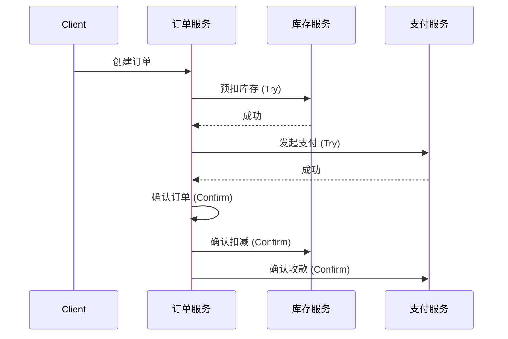
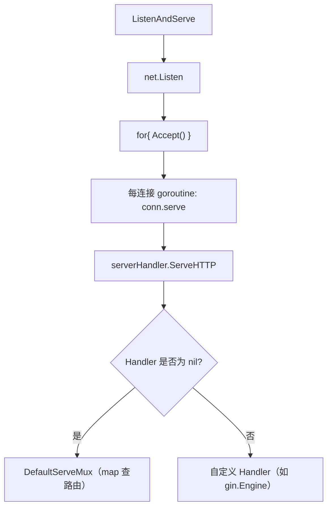

# 篇三 · 服务端工程 · 09 Web 框架与 API 设计

> **定位**：net/http 与 Gin：路由、中间件、绑定校验、响应规范、项目分层
> **面试权重**：🔥🔥🔥🔥 高频 ｜ **前置**：1-04
> **🔁 前端类比**：Express/Koa 的中间件洋葱模型 ≈ Gin 的 `c.Next()`；前端写接口层，现在要写接口本身

## 🧭 核心考点

- net/http 请求主流程：`ListenAndServe` → `Accept` → goroutine → `serverHandler` → `ServeMux`
- 中间件链实现原理：装饰器模式、`Context.Next()`、Recovery
- Gin 中间件链、Context 与请求生命周期
- 参数绑定与校验、统一响应与错误码
- 优雅关机、超时控制与并发安全
- RESTful 设计规范：URI、HTTP 方法映射、幂等/安全、版本管理

## 📑 本篇题目索引（共 10 题）

| # | 题目 | 难度 | 频率 |
|---|------|------|------|
| Q1 | gRPC 和 RESTful API 的区别？Protobuf 的优势？ | ⭐⭐ | 🔥 高频 |
| Q2 | 微服务中如何实现分布式事务？ | ⭐⭐⭐⭐ | 🔥 高频 |
| Q3 | 如何排查 Goroutine 泄漏？ | ⭐⭐⭐ | 🔥 高频 |
| Q4 | 接口限流有哪些常见算法？Go 中如何实现？ | ⭐⭐⭐ | 🔥 高频 |
| Q5 | 如何实现数据库读写分离？ | ⭐⭐ | 📌 常考 |
| Q6 | 什么是优雅关停（Graceful Shutdown）？Go 中如何实现？ | ⭐⭐ | 🔥 高频 |
| Q7 | Go 服务如何实现配置热更新？ | ⭐⭐⭐ | 📌 常考 |
| Q8 | `net/http` 处理一个请求的主流程是什么？ | ⭐⭐⭐ | 🔥 高频 |
| Q9 | Web 框架的中间件链是如何实现的？ | ⭐⭐⭐ | 🔥 高频 |
| Q10 | RESTful API 的设计规范有哪些？ | ⭐⭐⭐ | 🔥 高频 |

---

### 9.1 微服务与 RPC

### Q1: gRPC 和 RESTful API 的区别？Protobuf 的优势？

**难度**：⭐⭐ | **频率**：🔥 高频

**考点**：协议对比、序列化效率、IDL。

**💡 记忆关键词**：HTTP/2 vs HTTP/1.1、Protobuf vs JSON、IDL契约、内部vs外部

**答案要点**：
- **传输**：gRPC 基于 HTTP/2（多路复用、头部压缩、双向流），REST 通常基于 HTTP/1.1。
- **序列化**：gRPC 使用 Protobuf（二进制、紧凑、快），REST 常用 JSON（文本、冗余、慢）。
- **开发**：gRPC 通过 `.proto` 文件生成代码，强类型契约优先。
- **场景**：内部微服务通信用 gRPC，对外暴露 API 用 REST/GraphQL。

### Q2: 微服务中如何实现分布式事务？

**难度**：⭐⭐⭐⭐ | **频率**：🔥 高频

**考点**：CAP/BASE 理论、Saga、TCC、最终一致性。

**💡 记忆关键词**：最终一致性、Saga补偿、TCC三段、本地消息表

**答案要点**：
- 强一致性难实现，通常追求最终一致性。
- **Saga**：长事务拆分为本地事务，失败时执行补偿操作（编排式/协同式）。
- **TCC**：Try-Confirm-Cancel，性能高但侵入性强。
- **本地消息表**：利用本地 DB 事务保证消息与业务原子性，异步投递。
- **可靠消息最终一致性**：如 RocketMQ 事务消息。



---

### 9.2 高并发与性能调优

### Q3: 如何排查 Goroutine 泄漏？

**难度**：⭐⭐⭐ | **频率**：🔥 高频

**考点**：`pprof`、阻塞原因、最佳实践。

**💡 记忆关键词**：pprof分析、NumGoroutine、Channel阻塞、context超时

**答案要点**：
- **现象**：内存持续增长，`runtime.NumGoroutine()` 居高不下。
- **工具**：`net/http/pprof` 抓取 `goroutine` profile，使用 `go tool pprof` 或 Web UI 分析。
- **常见原因**：
  1. Channel 无接收者导致发送阻塞。
  2. Channel 无发送者导致接收阻塞。
  3. `sync.WaitGroup` 未正确 `Done()`。
  4. 定时器 `time.Ticker` 未停止。
- **预防**：使用 `context` 设置超时，确保 Channel 操作有退出路径。

### Q4: 接口限流有哪些常见算法？Go 中如何实现？

**难度**：⭐⭐⭐ | **频率**：🔥 高频

**考点**：令牌桶、漏桶、滑动窗口、`golang.org/x/time/rate`。

**💡 记忆关键词**：令牌桶、漏桶、滑动窗口、x/time/rate、Redis+Lua

**答案要点**：
- **令牌桶**：允许一定突发流量，按固定速率生成令牌。
- **漏桶**：固定速率处理请求，平滑流量。
- **滑动窗口**：统计最近 N 秒请求数。
- **Go 实现**：官方库 `golang.org/x/time/rate` 提供令牌桶实现；生产环境常用 Redis + Lua 脚本做分布式限流。

### Q5: 如何实现数据库读写分离？

**难度**：⭐⭐ | **频率**：📌 常考

**考点**：主从复制、读写分离中间件、数据源路由。

**💡 记忆关键词**：主从复制、读写分离、GORM 插件、`Proxy` 中间件

**答案要点**：
- **ORM 层实现**：GORM 支持通过 `Use()` 或插件实现读写分离，将写操作路由到主库，读操作路由到从库。
- **代理层实现**：通过 Proxy 中间件（如 `ProxySQL`、`MaxScale`）对应用透明。
- **注意事项**：主从延迟可能导致读不到刚写入的数据，写后读场景需强制走主库。

```go
import "gorm.io/plugin/dbresolver"

db.Use(dbresolver.Register(dbresolver.Config{
    Sources:  []gorm.Dialector{postgres.Open(dsnMaster)},
    Replicas: []gorm.Dialector{postgres.Open(dsnSlave1), postgres.Open(dsnSlave2)},
    Policy:   dbresolver.RandomPolicy{},
}))

// 写操作自动走主库
db.Create(&user)

// 读操作自动走从库
db.Where("name = ?", "Alice").Find(&users)

// 写后读强制走主库
tx := db.Session(&gorm.Session{Context: db.Set("read_write", "write")})
tx.Model(&user).Update("age", 30)
tx.First(&user)
```

### Q6: 什么是优雅关停（Graceful Shutdown）？Go 中如何实现？

**难度**：⭐⭐ | **频率**：🔥 高频

**考点**：`os.Signal`、`server.Shutdown`、上下文超时、请求排空。

**💡 记忆关键词**：信号监听、Shutdown、context 超时、Drain 请求

**答案要点**：
- **优雅关停**：服务收到退出信号时，停止接受新请求，等待活跃请求处理完毕后再退出。
- **实现**：监听 `SIGINT`/`SIGTERM` 信号，调用 `http.Server.Shutdown(ctx)`。
- **超时控制**：设置最大等待时间（如 30s），超时仍未完成则强制退出。

```go
srv := &http.Server{Addr: ":8080"}

go func() {
    if err := srv.ListenAndServe(); err != nil && err != http.ErrServerClosed {
        log.Fatalf("listen: %s\n", err)
    }
}()

quit := make(chan os.Signal, 1)
signal.Notify(quit, syscall.SIGINT, syscall.SIGTERM)
<-quit

ctx, cancel := context.WithTimeout(context.Background(), 30*time.Second)
defer cancel()
if err := srv.Shutdown(ctx); err != nil {
    log.Fatal("Server forced to shutdown:", err)
}
```

### Q7: Go 服务如何实现配置热更新？

**难度**：⭐⭐⭐ | **频率**：📌 常考

**考点**：文件监听、原子替换、`fsnotify`、配置版本化。

**💡 记忆关键词**：fsnotify、atomic.Value、热加载、版本号回滚

**答案要点**：
- **文件监听**：使用 `fsnotify` 库监听配置文件变化。
- **原子替换**：配置文件变化时重新解析，用 `atomic.Value` 或 `sync.RWMutex` 安全替换配置指针。
- **配置中心**：生产环境推荐 Apollo、Nacos、etcd 等配置中心，通过 Watch 机制实时推送变更。
- **版本回滚**：保留多版本配置快照，变更异常时自动回滚到上一版本。

```go
type Config struct {
    Addr string `json:"addr"`
    DB   string `json:"db"`
}

var cfg atomic.Value

func WatchConfig(path string) {
    watcher, _ := fsnotify.NewWatcher()
    defer watcher.Close()

    watcher.Add(path)
    for event := range watcher.Events {
        if event.Op&fsnotify.Write == fsnotify.Write {
            // 配置变更，重新加载
            newCfg := loadConfig(path)
            cfg.Store(newCfg)
        }
    }
}

func GetConfig() *Config {
    return cfg.Load().(*Config)
}
```

### Q8: `net/http` 处理一个请求的主流程是什么？

**难度**：⭐⭐⭐ | **频率**：🔥 高频

**考点**：ListenAndServe 链路、每连接一 goroutine、serverHandler、ServeMux。

**💡 记忆关键词**：ListenAndServe→Listen→Accept 循环→每连接一个 goroutine→serverHandler→ServeMux、单进程多协程

**答案要点**：
- **主流程（七层链路，面试要求能背下来）**：
  1. `http.ListenAndServe(addr, handler)` 本质是创建 `http.Server` 结构并调用其 `ListenAndServe`（快捷封装）；
  2. `server.ListenAndServe` 先 `net.Listen` 建监听；
  3. `Serve` 里 `for { l.Accept() }` 循环接收连接，每 accept 到一个连接就 `srv.NewConn` 建 `http.conn`，**为该连接单独开一个 goroutine 调 `c.serve`**；
  4. `c.serve` 读取并解析请求；
  5. 调用 `serverHandler{c.server}.ServeHTTP(w, req)` 进入自定义处理逻辑；
  6. `serverHandler.ServeHTTP` 里：若 `Server.Handler == nil` 则用 `DefaultServeMux`，否则用自定义 Handler；
  7. `DefaultServeMux` 内部是 `map[pattern]handler`，`mux.match(path)` 查路由分发。
- **关键结论**：net/http 是**单进程、多协程**模型 —— 每个连接一个 goroutine；因此**每个 goroutine 必须自己兜住 panic**（否则整个进程崩溃），这是 Recovery 中间件必备的原因。
- **扩展点**：`Handler` 接口只有 `ServeHTTP(w, r)` 一个方法，框架（gin 等）都是通过实现它、替换 `Server.Handler` 来接管整个请求生命周期。



**🔁 前端类比**：类似 Node 的 `http.createServer` 每连接触发回调，但 Go 是「每连接一个 goroutine」的真并行，不是事件循环单线程。

**📝 一句话总结**：`ListenAndServe → Accept 循环 → 每连接一个 goroutine → serverHandler → ServeMux`；net/http 单进程多协程，所以每个 goroutine 要自己 recover。

### Q9: Web 框架的中间件链是如何实现的？

**难度**：⭐⭐⭐ | **频率**：🔥 高频

**考点**：装饰器/洋葱模型、Context.Next()、pipeline、Recovery。

**💡 记忆关键词**：装饰器模式、handlers 数组 + index、Next()、Recovery 兜底、横切面注入

**答案要点**：
- **本质**：中间件是**装饰器模式**（洋葱模型）—— 在核心业务逻辑外层一层层包裹，请求正序进入、反序退出，用于统一注入**横切面逻辑**（日志、鉴权、打点、限流、超时）。
- **两种实现方式**：
  1. **函数嵌套**：`Timeout(Log(Recovery(handler)))` —— 简单但嵌套长、无法批量设置；
  2. **Pipeline（主流，gin 即此思路）**：把所有中间件 + 最终 handler 压成**一个 `[]Handler` 数组**，用 `Context` 里的 `index` 游标驱动：
  ```go
  func (c *Context) Next() {
      c.index++
      if c.index < len(c.handlers) {
          c.handlers[c.index](c) // 调用下一个中间件/handler
      }
  }
  ```
  - `index` 初始为 `-1`，入口处与每个中间件里都调 `Next()`，形成「前进一层 → 返回时再收尾」的洋葱结构。
- **Recovery 中间件（必备）**：`defer recover()` 包住 `c.Next()`，捕获业务代码 panic 返回 500 —— 因为 net/http 每连接一个 goroutine，**单个请求 panic 会拖垮整个进程**，必须在框架层统一兜底。
- **注册方式**：`Use(middlewares...)` 批量 + `Get/Post(path, handlers...)` 单个路由，最终聚合到路由节点的 handler 链上。
- **执行顺序**：先注册的先执行（如 `Use(A, B)` 则 A → B → handler → 返回时 B → A）。

**🔁 前端类比**：就是 Koa/Express 的洋葱模型（`await next()`）—— Go 用 `index` 游标 + 函数数组实现，`Next()` 对应 `next()`。

**📝 一句话总结**：中间件 = 装饰器/洋葱模型；用 `[]Handler + index + Next()` 实现 pipeline，Recovery 用 `defer recover` 兜住 panic，实现横切面逻辑统一注入。

### Q10: RESTful API 的设计规范有哪些？

**难度**：⭐⭐⭐ | **频率**：🔥 高频

**考点**：URI 设计、HTTP 方法映射、安全/幂等、版本管理、分页过滤排序。

**💡 记忆关键词**：一切皆资源、名词复数、幂等/安全、/v1/ 版本、offset/limit 分页

**答案要点**：
- **核心思想**：REST = 表现层状态转移，**一切皆资源**，用 URI 标识资源、用 HTTP 动词操作资源。`REST` 是规范，`RESTful API` 是满足规范的 API。
- **URI 设计**：
  - 资源名用**名词复数**（Collection `/users` vs Member `/users/admin`）；
  - 全小写、用 `-` 不用 `_`、结尾不带 `/`；
  - **层级 ≤ 2**，更深的资源转成查询参数（`/students?school=qinghua` 而非 `/schools/tsinghua/classes/rooma/students/zhang`）。
- **HTTP 方法映射与语义（高频）**：
  | 方法 | 操作 | 安全性 | 幂等性 |
  |------|------|--------|--------|
  | GET | 查询 | 安全 | 幂等 |
  | POST | 创建/批量删除 | 不安全 | 不幂等 |
  | PUT | 全量更新 | 不安全 | 幂等 |
  | DELETE | 删除 | 不安全 | 幂等 |
  - 「安全性」= 不改变资源状态（只读）；「幂等性」= 执行 1 次和 N 次效果等价。
- **统一返回格式**：成功/失败都要统一结构（如 `{code, message, data}`），降低客户端适配成本。
- **API 版本管理**：不可向下兼容时新增版本，老版本保留；版本号放 **URL**（`/v1/users`，最直观，K8s/GitHub/etcd 都这么用）、Header 或 Query 参数。
- **通用查询能力**：分页 `?offset=0&limit=20`、字段过滤 `?fields=email,username`、排序 `?sort=age,desc`、搜索 `?q=xxx`。
- **动词型操作**：无法映射为资源时，抽象成属性（`/users/zhangsan?active=false`）或子资源（`PUT /gists/:id/star`）；实在不行才打破规范（如 `/login`）。

**🔁 前端类比**：REST 的「资源 + 动词」≈ 前端把后端接口抽象成 `resource` 对象调 CRUD；`/v1/` 版本 ≈ npm 包的 semver 大版本，破坏性变更换版本号。

**📝 一句话总结**：REST 一切皆资源，名词复数 URI + HTTP 动词 CRUD，注意「安全/幂等」语义、统一返回格式、`/v1/` 版本管理与分页过滤排序。

---

## ✅ 自测清单（答不出就回去看对应题）

- [ ] 能脱离资料讲清本篇「核心考点」中的每一条
- [ ] 能手写/口述至少 2 道 🔥 高频题的最小实现
- [ ] 能结合自己的项目讲出 1 个坑或 1 次调优

