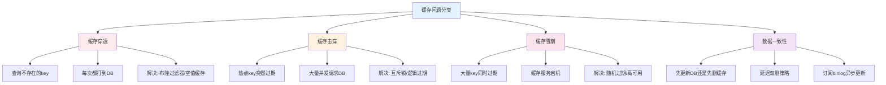

# 篇三 · 服务端工程 · 12 缓存架构设计

> **定位**：缓存三大问题、一致性、淘汰策略、多级缓存与预热
> **面试权重**：🔥🔥🔥🔥 高频 ｜ **前置**：3-11
> **🔁 前端类比**：浏览器强缓存/协商缓存解决的是「客户端与源站」的一致性问题，服务端缓存解决「DB 与应用」的同一类问题

## 🧭 核心考点

- 穿透 / 击穿 / 雪崩的成因与对策（布隆过滤、空值、随机 TTL）
- 缓存与 DB 一致性：更新顺序、延迟双删、订阅 binlog
- 淘汰策略 LRU/LFU/随机与 Redis 实现
- 多级缓存：本地缓存 + Redis + 预热
- 热点 key 与大 key 治理

## 📑 本篇题目索引（共 15 题）

| # | 题目 | 难度 | 频率 |
|---|------|------|------|
| Q1 | 缓存如何实现高性能？ | ⭐⭐ | 📌 常考 |
| Q2 | 缓存如何实现高并发？ | ⭐⭐ | 📌 常考 |
| Q3 | Redis 和 Memcached 的区别 | ⭐⭐⭐ | 🔥 高频 |
| Q4 | 用缓存可能出现的问题 | ⭐⭐⭐ | 🔥 高频 |
| Q5 | 当查询缓存报错，怎么提高可用性？ | ⭐⭐⭐ | 📌 常考 |
| Q6 | 如何避免缓存"穿透"的问题？ | ⭐⭐⭐ | 🔥 高频 |
| Q7 | 如何避免缓存"雪崩"的问题？ | ⭐⭐⭐ | 🔥 高频 |
| Q8 | 如何避免缓存"击穿"的问题？ | ⭐⭐⭐ | 🔥 高频 |
| Q9 | 什么是缓存预热？如何实现缓存预热？ | ⭐⭐ | 📌 常考 |
| Q10 | 缓存数据的淘汰策略有哪些？ | ⭐⭐ | 📌 常考 |
| Q11 | 进程内缓存是什么？BigCache / freecache / ristretto / groupcache 怎么选？ | ⭐⭐⭐ | 🔥 高频 |
| Q12 | 如何用 RocksDB 给缓存做持久化？它和 Redis 的定位差异是什么？ | ⭐⭐⭐ | 📌 常考 |
| Q13 | 什么是 singleflight？它如何解决缓存回源时的「惊群」问题？ | ⭐⭐⭐ | 🔥 高频 |
| Q14 | 分布式缓存如何定位 key？一致性哈希与节点再平衡怎么做？ | ⭐⭐⭐ | 📌 常考 |
| Q15 | 缓存有哪些性能优化手段？（Pipelining / 批量写入 / 异步读取） | ⭐⭐⭐ | 🔥 高频 |

---

### Q1: 缓存如何实现高性能？

**难度**：⭐⭐ | **频率**：📌 常考

**考点**：内存存储、零拷贝、连接池

**💡 记忆关键词**：内存存储、零拷贝、Pipeline批量

**答案要点**：
- 数据存储在内存中，访问延迟纳秒级
- 避免磁盘 IO 和序列化开销
- 使用连接池复用连接，减少握手开销
- 批量操作（Pipeline）减少网络 RTT

**📝 一句话总结**：缓存内存纳秒级，零拷贝来省开销；连接池复 Pipeline 批，高性能由此而来。

---

### Q2: 缓存如何实现高并发？

**难度**：⭐⭐ | **频率**：📌 常考

**考点**：单线程模型、分片、读写分离

**💡 记忆关键词**：单线程无锁、集群分片、读写分离

**答案要点**：
- Redis 单线程无锁竞争，避免上下文切换
- 集群分片：数据分散到多个节点并行处理
- 读写分离：Master 写，Slave 读
- 客户端连接池并发访问

**📝 一句话总结**：单线程无锁竞争，集群分片并行处；读写分离 Master Slave，连接池来并发访。

---

### Q3: Redis 和 Memcached 的区别

**难度**：⭐⭐⭐ | **频率**：🔥 高频

**考点**：功能对比、数据类型、持久化、线程模型

**💡 记忆关键词**：数据类型、持久化、单线程vs多线程

**答案要点**：
| 维度 | Redis | Memcached |
|------|-------|-----------|
| 数据类型 | String/Hash/List/Set/ZSet | 仅 String |
| 持久化 | RDB + AOF | 不支持 |
| 线程模型 | 单线程+多线程IO | 多线程 |
| 集群 | 原生支持 | 客户端分片 |
| 事务 | 支持 | 不支持 |
| 适用场景 | 缓存/DB/消息队列 | 纯缓存 |

**📝 一句话总结**：Redis 类型多持久强，Memcached 纯缓存简单；单线程对多线程，场景选择看需求。

---

### Q4: 用缓存可能出现的问题

**难度**：⭐⭐⭐ | **频率**：🔥 高频

**考点**：穿透、击穿、雪崩、一致性

**💡 记忆关键词**：穿透击穿、雪崩一致、四大问题

**答案要点**：
- **缓存穿透**：查询不存在的数据，每次都穿透到 DB
- **缓存击穿**：热点 key 过期瞬间，大量请求打到 DB
- **缓存雪崩**：大量 key 同时过期或缓存宕机
- **数据一致性**：缓存与 DB 数据不一致



**📝 一句话总结**：穿透查询不存在，击穿热点 key 过期；雪崩大量同时过，一致性要双更新。

---

### Q5: 当查询缓存报错，怎么提高可用性？

**难度**：⭐⭐⭐ | **频率**：📌 常考

**考点**：降级、重试、熔断、多级缓存

**💡 记忆关键词**：降级重试、熔断保护、多级缓存

**答案要点**：
- 降级策略：缓存不可用时直接查 DB
- 重试机制：短暂重试几次
- 熔断器：缓存连续失败时熔断，避免雪崩
- 多级缓存：本地缓存（Caffeine）+ 分布式缓存（Redis）

**📝 一句话总结**：缓存报错降级查，重试熔断防雪崩；多级缓存本地加，可用性高有保障。

---

### Q6: 如何避免缓存"穿透"的问题？

**难度**：⭐⭐⭐ | **频率**：🔥 高频

**考点**：布隆过滤器、空值缓存、参数校验

**💡 记忆关键词**：布隆过滤、空值缓存、参数校验

**答案要点**：
- **布隆过滤器**：快速判断 key 是否存在，不存在直接返回
- **空值缓存**：查询结果为空也缓存（短 TTL）
- **参数校验**：拦截非法请求
- **限流**：防止恶意查询

---

### Q7: 如何避免缓存"雪崩"的问题？

**难度**：⭐⭐⭐ | **频率**：🔥 高频

**考点**：随机过期、高可用、限流降级

**💡 记忆关键词**：随机过期、集群高可用、限流降级

**答案要点**：
- 过期时间加随机值（±10%），避免集中过期
- 缓存高可用：集群、哨兵模式
- 限流降级：缓存宕机时限制 DB 查询量
- 预热：提前加载热点数据

---

### Q8: 如何避免缓存"击穿"的问题？

**难度**：⭐⭐⭐ | **频率**：🔥 高频

**考点**：互斥锁、逻辑过期、永不过期

**💡 记忆关键词**：互斥锁SETNX、逻辑过期、后台异步

**答案要点**：
- **互斥锁**：第一个请求重建缓存，其他等待（`SETNX`）
- **逻辑过期**：不设置物理过期，值中包含过期时间，后台异步更新
- **永不过期**：热点 key 不设置过期时间，通过后台更新

```go
// 互斥锁防击穿
func GetWithLock(key string) (string, error) {
    val, err := redis.Get(key)
    if err == redis.Nil {
        // 获取分布式锁
        locked, _ := redis.SetNX(key+":lock", "1", 10*time.Second)
        if locked {
            val = loadFromDB(key)
            redis.Set(key, val, 5*time.Minute)
            redis.Del(key + ":lock")
        } else {
            time.Sleep(50 * time.Millisecond)
            return GetWithLock(key) // 重试
        }
    }
    return val, err
}
```

---

### Q9: 什么是缓存预热？如何实现缓存预热？

**难度**：⭐⭐ | **频率**：📌 常考

**考点**：系统启动、热点数据、定时任务

**💡 记忆关键词**：启动预载、热点数据、定时刷新

**答案要点**：
- 缓存预热：系统启动前将热点数据加载到缓存
- 实现方式：
  1. 启动脚本批量加载
  2. 定时任务定期刷新
  3. 消息队列异步预热
  4. 用户访问触发懒加载

---

### Q10: 缓存数据的淘汰策略有哪些？

**难度**：⭐⭐ | **频率**：📌 常考

**考点**：LRU、LFU、FIFO、TTL

**💡 记忆关键词**：LRU最近少用、LFU频率最低、TTL过期

**答案要点**：
- **LRU**（Least Recently Used）：淘汰最近最少使用
- **LFU**（Least Frequently Used）：淘汰使用频率最低
- **FIFO**（First In First Out）：先进先出
- **TTL**：过期自动淘汰
- **Random**：随机淘汰
- Redis 支持：allkeys-lru、volatile-lru、allkeys-lfu 等

**📝 一句话总结**：LRU 最近最少用，LFU 频率最低踢；FIFO 先进先出队，TTL 过期自动清。

---

### Q11: 进程内缓存（本地缓存）是什么？BigCache / freecache / ristretto / groupcache 怎么选？

**难度**：⭐⭐⭐ | **频率**：🔥 高频

**考点**：本地缓存 vs 分布式缓存、四大 Go 缓存库特性对比、多级缓存架构。

**💡 记忆关键词**：无网络往返、重启丢失、堆内容量上限、BigCache 分片零 GC、freecache TTL、ristretto 成本准入、groupcache singleflight 回填、L1+L2 多级

**答案要点**：
- **进程内缓存的特点**：与应用同进程，读写**无网络往返**（纳秒~微秒级）；代价是**重启即丢**、容量受堆限制（不能太大）、**多实例间数据不一致**（各节点各一份）。适合「读多写少、允许短暂不一致、热点集中」的数据（配置、字典、热点对象）。
- **四大 Go 库对比**（选型常考）：
  | 库 | 核心特点 | 适用场景 |
  |---|---|---|
  | **BigCache** | 分片 map + 键值都是 string、**零 GC 压力**（对象不移动） | 大键值、超高并发、追求低延迟 |
  | **freecache** | 减少 GC 扫描、**每 slot 独立 TTL**、支持过期 | 需要 TTL 的中等规模缓存 |
  | **ristretto** | 自适应淘汰 + **成本准入**（按收益/成本决定是否缓存）、官方推荐 | 通用场景，默认首选 |
  | **groupcache** | LRU + **singleflight 回填** + 可多点协同 | 需要「未命中自动回源」的缓存层 |
- **架构套路 = 多级缓存**：**L1 进程内（ristretto）+ L2 集中式（Redis）**：L1 扛热点流量，L2 保一致性与全量；L1 设置短 TTL（秒级）兜底不一致。本仓库的 LRU 演示包就是进程内缓存的缩小版。

**🔁 前端类比**：像 Service Worker 的 CacheStorage（本地缓存）+ CDN（分布式缓存）的多级结构；本地缓存命中最快，但更新后各节点「各自为政」，要设短 TTL 兜底。

**⚠️ 常见误区**：① 把进程内缓存当持久化存储（重启全丢）；② 缓存容量不设上限（把堆撑爆，触发频繁 GC）；③ 多节点部署时期望本地缓存「一处更新处处生效」（做不到，要广播失效或短 TTL）。

**📝 一句话总结**：进程内缓存无网络往返但重启丢失、容量受限；BigCache 零 GC、freecache 带 TTL、ristretto 成本准入、groupcache 会回填；工程上做 L1 本地 + L2 Redis 多级。

---

### Q12: 如何用 RocksDB 给缓存做持久化？它和 Redis 的定位差异是什么？

**难度**：⭐⭐⭐ | **频率**：📌 常考

**考点**：LSM-Tree 结构、嵌入式 KV、冷数据落盘、与 Redis 的全内存对比。

**💡 记忆关键词**：LSM-Tree、memtable+WAL、SST 文件、Compaction、嵌入式无服务、冷数据/大容量/廉价、写放大

**答案要点**：
- **为什么缓存要持久化**：进程内缓存重启丢失；Redis 全内存、大容量成本高；把**冷数据/全量数据落盘**到嵌入式 KV，用内存做热数据的前置，兼顾容量与恢复速度（《分布式缓存：原理、架构及 Go 语言实现》的典型架构）。
- **RocksDB = LSM-Tree 结构的嵌入式 KV 引擎**（C++ 库，Go 用 `grocksdb`/`tecbot/gorocksdb` 绑定）：
  - 写：先追加 **WAL**（写前日志，保持久性）+ 写 **memtable**（内存有序表）；memtable 满后刷成不可变的 **SST 文件**落盘；
  - 读：先查 memtable → 再查各层 SST（布隆过滤器跳过不含 key 的文件）；
  - 后台 **Compaction** 合并 SST、清理过期版本，控制读放大。
- **缓存场景用法**：内存 LRU 作 L1、RocksDB 作 L2（「内存 + 磁盘」分级）；或定时把热点 dump 落盘、启动时预热加载。
- **与 Redis 的定位差异**：
  | 维度 | Redis（独立服务） | RocksDB（嵌入式） |
  |---|---|---|
  | 部署 | 独立进程/集群，走网络 | 与业务进程同生命周期，零网络 |
  | 容量 | 受内存限制，成本高 | 磁盘存储，容量大且廉价 |
  | 一致性 | 多客户端共享一份 | 每个进程一份，不共享 |
  | 适用 | 共享缓存、分布式锁、队列 | 本地大容量冷数据、持久化 KV |
- **注意点**：写放大（WAL + Compaction 的 IO 放大）、SSD 写入寿命、Compaction 的 CPU/IO 资源争抢（要限流配置）。

**🔁 前端类比**：像 IndexedDB 之于内存状态——「热数据在内存、全量在本地数据库」的分层；LSM-Tree 的「顺序写 + 后台合并」也类似日志结构存储（append-only）的思路。

**⚠️ 常见误区**：① 把 RocksDB 当 Redis 用（它没有网络协议、不能多进程共享）；② 忽略写放大，把写密集缓存直接怼 RocksDB；③ 以为 LSM 读很快（多层 SST 查找有读放大，需靠布隆过滤 + 分层缓解）。

**📝 一句话总结**：RocksDB 是 LSM-Tree 嵌入式 KV（WAL + memtable + SST + Compaction），适合做本地大容量/可持久化的缓存层；与 Redis 的差异是「嵌入式不共享 vs 独立服务可共享」。

---

### Q13: 什么是 singleflight？它如何解决缓存回源时的「惊群」问题？

**难度**：⭐⭐⭐ | **频率**：🔥 高频

**考点**：singleflight 合并并发请求、缓存击穿防护、异步回源与 stale-while-revalidate。

**💡 记忆关键词**：同一 key 只放一个回源、其余等待共享结果、`Group.Do`、防惊群、stale-while-revalidate、后台更新

**答案要点**：
- **问题（缓存击穿的并发放大版）**：热点 key 过期瞬间，N 个并发请求同时未命中，全部涌向 DB —— 「惊群」效应，DB 瞬间过载（Q8 讲了互斥锁方案，这里讲**请求合并**方案）。
- **singleflight（`golang.org/x/sync/singleflight`）**：对同一个 key 的并发调用**只放一个真实回源**，其余调用阻塞等待并**共享同一份结果**：
  ```go
  var g singleflight.Group
  v, err, _ := g.Do(key, func() (any, error) {
      return db.Query(key) // 并发同 key 只执行一次
  })
  ```
  groupcache 的回填、各类框架的「防击穿」底层都是它；注意 `Do` 的结果不带「是否来自共享」，要统计去重要另做。
- **异步回源（stale-while-revalidate）**：更高并发的玩法——未命中时**先返回旧值/默认值**，同时后台异步刷新；用户永远不等 DB，DB 压力被削平。适合允许秒级旧数据的场景（榜单、配置）。
- **组合拳**：singleflight（合并）+ 互斥锁（防单点重复）+ 逻辑过期（永不物理过期，后台续）= 缓存击穿防护的三件套，按并发量与一致性要求选。

**🔁 前端类比**：像前端的「请求去重」——多个组件同时请求同一接口，只发一次 HTTP，其余复用同一个 Promise；singleflight 就是后端的请求去重器。

**⚠️ 常见误区**：① 把 singleflight 当「限流」用（它只合同一 key，不同 key 照样并发）；② 忘了处理 `Do` 里的 panic 恢复与超时（回源慢会拖垮所有等待者，要配超时）；③ 与互斥锁方案叠加使用导致死锁风险。

**📝 一句话总结**：singleflight 把同一 key 的并发回源合并为一次、其余共享结果，专治缓存击穿时的惊群；配合异步回源（先返回旧值后台刷新）可进一步削峰。

---

### Q14: 分布式缓存如何定位 key？一致性哈希与节点再平衡怎么做？

**难度**：⭐⭐⭐ | **频率**：📌 常考

**考点**：哈希取模 vs 一致性哈希、虚拟节点、节点增删的迁移量、渐进式再平衡。

**💡 记忆关键词**：哈希环 2^32、虚拟节点防倾斜、增删只动相邻区间、迁移量 ~1/N、渐进迁移双读、Redis Cluster 16384 slot

**答案要点**：
- **定位问题**：分布式缓存集群有 N 个节点，`key` 放哪？读哪？
- **普通哈希取模**：`hash(key) % N` —— N 变化时**几乎所有 key 都要重新映射**（缓存全量穿透，等于雪崩），只适合节点固定的场景。
- **一致性哈希（4-18 Q17 的原理在缓存工程的落地）**：
  1. 把哈希空间组织成 **2^32 的环**，节点按 `hash(节点IP)` 落环；
  2. key 按 `hash(key)` 顺时针找到**第一个节点**即为归属节点；
  3. **虚拟节点**：每个物理节点派生多个虚拟节点均匀撒环，解决节点少时数据倾斜；
  4. **增删节点只影响相邻区间**：新增节点只承接它逆时针方向到前一个节点之间的一段 key，**迁移量约 1/N**（N 个节点时），不会全量失效。
- **Go 实现要点**：把虚拟节点哈希排序成数组，key 定位用**二分查找**第一个 `>= hash(key)` 的虚拟节点，O(log N)。
- **再平衡（rebalance）工程细节**：
  1. **渐进式迁移**：新节点上线后，旧属主逐步把数据推送/拉取过去，不一次性全量拷；
  2. **双读兜底**：迁移期间读请求先读新归属，未命中再读旧归属（防迁移中途丢数据）；
  3. **预分片 slot**：Redis Cluster 用 **16384 个 slot** 而不是裸一致性哈希——迁移单位是 slot，粒度更细、元数据更简单（`CRC16(key) % 16384`）。
- **客户端缓存路由表**：smart client 本地缓存「slot → 节点」映射，MOVED 重定向时刷新。

**🔁 前端类比**：像 CDN 的边缘节点调度——按内容哈希路由到最近的节点，新增节点只接管周边范围的内容；虚拟节点类似「一台物理机拆多个逻辑身份」让流量撒得更匀。

**⚠️ 常见误区**：① 说「一致性哈希增删节点零迁移」（是只迁移 1/N，不是零）；② 忘掉虚拟节点导致数据倾斜（节点在环上挤一堆）；③ 把 Redis Cluster 的 slot 方案说成「它用了一致性哈希」（slot 是预分片，思路同源但实现不同）。

**📝 一句话总结**：一致性哈希环 + 虚拟节点让 key 定位 O(log N) 且增删节点只迁移约 1/N 数据；工程上配渐进迁移 + 双读兜底，Redis Cluster 则用 16384 slot 预分片。

---

### Q15: 缓存有哪些性能优化手段？（Pipelining / 批量写入 / 异步读取）

**难度**：⭐⭐⭐ | **频率**：🔥 高频

**考点**：Pipelining 省 RTT、批量写入摊薄 IO、异步读取削峰、多级缓存、命中率监控。

**💡 记忆关键词**：Pipeline 一次发多条、批量写合并 WAL/Compaction、异步读不阻塞、连接池、多级缓存、序列化选型、命中率/延迟监控

**答案要点**：
- **Pipelining（流水线）**：把多条命令/请求**一次批量发出**，等服务端批量返回，把「N 次 RTT」压缩成「1 次 RTT + 批量传输」。Redis 有原生 `Pipeline`；自研 RPC 缓存同样适用。**注意**：Pipeline 不保证原子性（要原子用 Lua/事务）；大批量要控制单批大小（防单次响应过大）。
- **批量写入**：写缓存时合并多条为一个批次，落盘侧共享一次 WAL/Compaction，摊薄 IO 成本；但**牺牲实时性**（要配 flush 间隔或批量条数上限）。
- **异步读取**：读请求不阻塞等待回源——命中最快路径、未命中走「singleflight 合并 + 后台刷新」（见 Q13）；对延迟敏感的业务（feed、榜单）用「先旧值后刷新」。
- **其他常规手段**：连接池（复用 TCP，避免频繁握手）、多级缓存（L1 本地 + L2 分布式，见 Q11）、序列化选型（protobuf 比 JSON 小且快，缓存 value 用二进制）、热点 key 本地缓存/L1 前置、大 value 拆分或压缩。
- **监控闭环**：命中率（`keyspace_hits/(hits+misses)`，低于 90% 要排查 key 设计与 TTL）、P99 延迟、内存/磁盘水位、回源 QPS——**优化前先埋点，优化后看数据**（5-20 的方法论）。

**🔁 前端类比**：Pipelining ≈ HTTP/2 多路复用 + 请求合并（一次连接发多个请求）；批量写入 ≈ 前端日志攒批再 `sendBeacon`；异步读取 ≈ SWR（stale-while-revalidate）模式。

**⚠️ 常见误区**：① 把 Pipeline 当事务用（无原子性）；② 批量写入不设上限（延迟无限放大）；③ 只优化延迟不看命中率（命中率低说明缓存设计有问题，优化管道是治标）。

**📝 一句话总结**：Pipelining 压缩 RTT、批量写入摊薄 IO、异步读取 + singleflight 削峰，配合连接池、多级缓存与序列化优化；一切以命中率与 P99 数据闭环验证。

---

## ✅ 自测清单（答不出就回去看对应题）

- [ ] 能脱离资料讲清本篇「核心考点」中的每一条
- [ ] 能手写/口述至少 2 道 🔥 高频题的最小实现
- [ ] 能结合自己的项目讲出 1 个坑或 1 次调优

