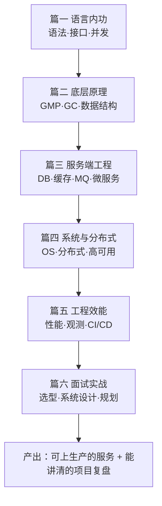

# 🐹 Go 语言面试体系（S6 · 阶段总纲）

> **版本**：v3.4（2026-11-20 版本口径更新）｜ **题量**：**500 道** / 31 个专题 / 六篇递进
> **适用对象**：① 有前端经验、准备转 Go 后端（本仓库主要读者）；② Go 后端求职者做系统复习
> **维护原则**：**版本事实联网核验**（见第 6 节）｜**重难点显式标注**｜**每题都有 难度 / 频率 / 💡 记忆关键词 / 🔁 前端类比 / 📝 一句话总结**

---

## 0. 三种用法，按需进入

| 你的处境 | 建议路径 |
|----------|----------|
| **系统学（3 个月）** | 篇一（语法与标准库）→ 篇二（并发与底层）→ 篇三（服务端工程）→ 篇四/五/六（项目与面试前补）。产出物见第 5 节 |
| **1~2 周突击面试** | 直接读第 4 节「必考 Top 30」→ 逐题只看 💡 记忆关键词与 📝 一句话总结 → 用第 7 节自测清单查漏 |
| **只补短板** | 看第 2 节定位表 → 跳到对应专题；重点补 **篇二（GMP/GC）** 与 **篇四（分布式）** |
| **手撕专项** | [2-08 手写代码与算法实战](./2-08-手写代码与算法实战.md) + [1-03 并发编程](./1-03-并发编程.md) + [3-10 MySQL](./3-10-MySQL与数据访问.md) |
| **被问「为什么转 Go」** | [总纲 §2.2 前端优势迁移表](./00-总纲-学习路径与知识地图.md) + [6-31 面试技巧与职业规划](./6-31-面试技巧与职业规划.md) |

---

## 1. 阅读标记

| 标记 | 含义 |
|------|------|
| ⭐ ~ ⭐⭐⭐⭐⭐ | 难度：⭐⭐ 以下必会，⭐⭐⭐ 进阶，⭐⭐⭐⭐+ 专家级 |
| 🔥 | 面试高频（80%+ 概率被问） |
| 📌 | 常考（50%~80%） |
| 📖 | 了解即可（<50%，有时间再看） |
| 🔁 前端类比 | 用 JS/TS/浏览器知识解释 Go 概念 —— **本系列特色，前端读者的主要抓手** |
| 💡 记忆关键词 | 面试前 30 秒快速回忆 |
| ⚠️ 常见误区 | 最容易答错/被追问的点 |
| 📝 一句话总结 | 面试时组织语言的模板 |

> 完整约定（含每章固定结构）见 [00-总纲](./00-总纲-学习路径与知识地图.md)。

---

## 2. 内容定位与知识地图

| 篇 | 入口 | 定位 | 面试权重 | 建议用时 | 题量 |
|----|------|------|----------|----------|------|
| 篇一 · 语言内功 | [1-01 ~ 1-04](./1-01-Go基础语法与类型系统.md) | 语法/类型、函数接口与错误处理、**并发编程**、标准库与工程化 | ★★★★★ | 4 周 | 71 |
| 篇二 · 底层原理 | [2-05 ~ 2-08](./2-05-GMP调度模型.md) | **GMP 调度**、**内存管理与 GC**、核心数据结构底层、手写算法 | ★★★★★ | 4 周 | 71 |
| 篇三 · 服务端工程 | [3-09 ~ 3-15](./3-09-Web框架与API设计.md) | Web/API、MySQL、Redis、缓存架构、消息队列、微服务、容器云原生 | ★★★★☆ | 5 周 | 175 |
| 篇四 · 系统与分布式 | [4-16 ~ 4-19](./4-16-网络与操作系统.md) | 网络与 OS、Linux 运维、分布式原理、高可用架构 | ★★★★☆ | 3 周 | 83 |
| 篇五 · 工程效能 | [5-20 ~ 5-27](./5-20-性能优化实战.md) | 性能优化、可观测性、安全、CI/CD、调试工具链、代码审查、版本演进、生态 | ★★★☆☆ | 3 周 | 65 |
| 篇六 · 面试实战 | [6-28 ~ 6-31](./6-28-跨语言对比与技术选型.md) | 跨语言选型、**Go 与前端交互及 AI 工程化**、系统设计、面试技巧与职业规划 | ★★★★☆ | 2 周 | 35 |

---

## 3. 各篇核心考点速览

| 篇 | 三个必须答出的点 |
|----|------------------|
| 篇一 | ① slice 是描述符、共享底层数组与扩容规则；② 接口 nil 陷阱与 `%w` 错误包装；③ goroutine/channel/context 与 goroutine 泄漏 |
| 篇二 | ① GMP 与工作窃取、Handoff、netpoller；② 三色标记 + 混合写屏障、逃逸分析；③ map/channel 底层与手写 LRU/限流/协程池 |
| 篇三 | ① MySQL B+ 树、最左前缀、MVCC；② Redis 穿透/击穿/雪崩 + SET NX PX 分布式锁；③ 消息不丢与幂等消费 |
| 篇四 | ① TCP/HTTP/操作系统基础；② CAP/BASE 与分布式事务取舍；③ 限流熔断降级 + 幂等 |
| 篇五 | ① pprof/bench 定位瓶颈的方法论；② 结构化日志/指标/链路追踪；③ CI/CD + 滚动/灰度发布 |
| 篇六 | ① Go vs Java/Node/Rust 的取舍；② 与前端交互及 AI 工程化；③ 系统设计四步法与容量估算 |

---

## 4. 必考 Top 30（跨篇）

> 完整版（含答案要点）见 [总纲 §5](./00-总纲-学习路径与知识地图.md)；下表为快查索引。

| # | 题目 | 出处 | # | 题目 | 出处 |
|---|------|------|---|------|------|
| 1 | slice 与 array、扩容规则 | 1-01 | 16 | 容器感知 GOMAXPROCS | 2-05 |
| 2 | map 是否并发安全 | 1-01 | 17 | 逃逸分析 | 2-06 |
| 3 | defer 顺序与陷阱 | 1-01 | 18 | 三色标记 + 混合写屏障 | 2-06 |
| 4 | 鸭子类型与 iface/eface | 1-02 | 19 | GC 触发与调优（GOGC/GOMEMLIMIT） | 2-06 |
| 5 | **接口 nil 陷阱** | 1-02 | 20 | Green Tea GC（1.26 默认） | 2-06 / 5-26 |
| 6 | `%w` 包装与 `errors.Is/As` | 1-02 | 21 | map 底层与 Swiss Table | 2-07 |
| 7 | 值/指针接收者与方法集 | 1-02 | 22 | channel 底层 hchan | 2-07 / 1-03 |
| 8 | goroutine vs 线程 | 1-03 | 23 | MySQL 索引与最左前缀 | 3-10 |
| 9 | **channel 五大陷阱** | 1-03 | 24 | 事务隔离与 MVCC | 3-10 |
| 10 | **context 用法** | 1-03 | 25 | Redis 缓存三大问题 | 3-12 |
| 11 | goroutine 泄漏与死锁排查 | 1-03 | 26 | Redis 分布式锁 | 3-11 / 2-08 |
| 12 | **GMP 模型** | 2-05 | 27 | 消息不丢与幂等消费 | 3-13 |
| 13 | 工作窃取与 1/61 | 2-05 | 28 | CAP/BASE 与分布式事务 | 4-18 |
| 14 | 系统调用与 Handoff | 2-05 | 29 | 限流熔断降级 + 幂等 | 4-19 |
| 15 | 抢占式调度 | 2-05 | 30 | 系统设计四步法 + 容量估算 | 6-30 |

---

## 5. 学习路径

### 5.1 三个月系统路线

| 月 | 内容 | 必须产出 |
|----|------|----------|
| 第 1 月 | 篇一：语法 → 接口/错误 → 并发 → 标准库 | ① CLI 工具；② 分层 REST API；③ 篇一自测清单全过 |
| 第 2 月 | 篇二：GMP → GC → 数据结构 → 手写 | ① 并发任务池（`-race` 通过 + 优雅退出）；② pprof 优化前后对比；③ 手写 LRU/限流器/协程池 |
| 第 3 月 | 篇三~篇六 + 项目复盘 | ① 完整服务（MySQL + Redis + Docker + CI）；② 架构图 + 压测数据 + 一次故障复盘；③ 3 道系统设计口述 |

**每日节奏**：1 小时阅读 + 1 小时写代码 > 周末突击 8 小时。每周用「自测清单」做一次周检。

### 5.2 两周突击路线

| 天 | 内容 |
|----|------|
| 第 1~2 天 | Top 30 第 1~11 题（语言内功 + 并发） |
| 第 3~4 天 | Top 30 第 12~22 题（GMP / GC / 底层） |
| 第 5~7 天 | Top 30 第 23~30 题（DB / 缓存 / MQ / 分布式 / 系统设计） |
| 第 8~10 天 | [6-30 面试真题](./6-30-面试真题与系统设计.md) + [6-31 技巧](./6-31-面试技巧与职业规划.md)，口述演练 |
| 第 11~14 天 | 各篇自测清单查漏 + 手写题默写 |

---

## 6. 版本口径（2026-11-20 联网核验）

| 技术 / 标准 | 真实状态 | 备注 |
|-------------|----------|------|
| Go | **1.27.4**（2026-11-10，安全修复 cgo/go command/compiler/linker/net/http） | `go1.27.3` 发布于 2026-10-19；1.26 最新补丁为 `go1.26.11` |
| 本仓库 | `apps/backend/go.mod` = **`go 1.27.2`** | 示例 Dockerfile/CI 统一用 `golang:1.27` / `go-version: '1.27'` |
| 包管理 | Go modules + **MVS（最小版本选择）** | 新增依赖需评估体积 / 维护度 / 许可证 |
| GC | 三色标记 + 混合写屏障；Green Tea 1.25 实验、1.26 默认 | 非分代、不整理；表述时区分「算法」与「实现优化」 |
| 容器调度 | Go 1.25+ 容器感知 GOMAXPROCS（读 cgroup CPU limit） | 避免容器内线程 / GC 暴涨 |

> **写作口径**：stable 特性正常讲；`GOEXPERIMENT` 实验特性必须标注成熟度。性能数字必须给出测量口径，否则用「数量级」表述并标注为估算。

---

## 7. 阶段自测清单（答不出就回对应篇补）

- [ ] 能讲清 slice 描述符、共享底层数组与 1.18+ 扩容规则
- [ ] 能解释接口 nil 陷阱与 `%w` + `errors.Is/As` 的错误链
- [ ] 能写出正确退出的 goroutine + channel + `context` 组合，并列举泄漏场景
- [ ] 能画出 GMP 模型并讲清工作窃取、Handoff、netpoller、抢占
- [ ] 能讲清逃逸分析、三色标记 + 混合写屏障、GOGC/GOMEMLIMIT 调优
- [ ] 能手写并发安全 LRU / 限流器 / 协程池，并用 `-race` 验证
- [ ] 能讲清 MySQL B+ 树、最左前缀、MVCC 与间隙锁
- [ ] 能讲清 Redis 三大缓存问题与 SET NX PX + Lua 分布式锁
- [ ] 能讲清 CAP/BASE、分布式事务四种方案与限流熔断降级
- [ ] 能用 pprof/bench 讲出一次真实的瓶颈定位与优化前后对比
- [ ] 能口述系统设计四步法（澄清 → 估算 → 架构 → 深挖）并做容量估算
- [ ] 能用前端类比解释至少 3 个 Go 概念（Promise.all ↔ goroutine、AbortController ↔ context 等）

---

## 8. 与其他阶段的衔接

- **前置**：[S1 基础夯实](../S1-基础夯实/)（JS 异步/事件循环 → Go 并发的心智对照）、[S3 进阶提升](../S3-进阶提升/)（计算机网络/性能优化的方法论可直接迁移）
- **横向**：[S5-AI](../S5-AI/)（AI 工程化、`apps/backend/internal/*` 的 LLM/工具/MCP/A2A 实现是本阶段知识的真实靶场）
- **实战**：[S4 面试冲刺](../S4-面试冲刺/)（把本阶段技术点组织成 STAR 弹药与项目表述）
- **代码靶子**：`apps/backend/`（26 个内部包：auth / payment / upload / gis / vitals / agent / llm / tool / mcp / a2a / obs…），见 [总纲 §12](./00-总纲-学习路径与知识地图.md)
